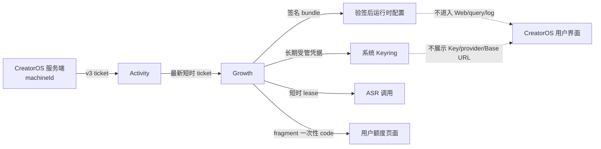

# CreatorOS V1.0 候选集成报告

> 任务：T-728
> 日期：2026-08-08（America/Los_Angeles）
> 状态：候选验证中；不代表已正式发布

### Integrated components

- Activity 票据入口已统一为 `config-access-ticket-v3`：CreatorOS 仅在服务端把当前
  `machineId` 交给 Activity，并使用同一最新票据向 Growth 获取签名 bundle 与
  `/api/client-config/managed-credentials/current`。
- 受管模型长期凭据只经 Tauri 命令进入系统 Keyring；ASR 经
  `growth-managed-model-credential-lease-v1` 获取短时 lease，前端设置页不展示 provider、Base URL、
  serviceId 或 Key。
- Growth 用户额度入口已收敛为本地 POST 路由：首次连接返回 `/credits/connect#code`，已绑定返回
  `/credits/launch#code`。code 只在 URL fragment 中传递，query、跨域地址与重放异常均失败关闭。
- 桌面版本在 `frontend/package.json`、`frontend/src-tauri/tauri.conf.json`、
  `frontend/src-tauri/Cargo.toml` 与 `Cargo.lock` 统一为 `1.0.0`；候选说明位于
  `docs/RELEASE_NOTES_V1.0.0.md`。
- macOS 正式 workflow 已串接 Developer ID、Apple 公证、staple、Gatekeeper、DMG 内层 App 严格
  验签与安装后真实启动门；Windows 仍未接 Authenticode，保持 unsigned 风险边界。

### Environment

- 候选工作树：`/Users/zyongzhu/.codex/worktrees/101d/Thirdspace-creator`。
- 候选分支：`codex/v1.0-candidate`；本报告编写时 HEAD 为 `8d6f5257`，最终 SHA 在合并后回填。
- Node/TypeScript 验证使用仓库锁定的 pnpm 依赖；Rust 验证使用本机 Cargo 工具链。
- Growth 生产 SHA `5ec1f3cf149aac9963bb2b6b732102ca66cc3ab1`、schema
  `0056_t142_ai_credit_grant`、证据提交 `32cf6c3e3a461f896e22b31e61bc02c3e3f387d3`，以及 Activity
  部署 `d426c6106f4b787c9344613d321cae0b38d73177` 均为用户提供的跨仓事实；本仓未伪造跨仓回执。

### Contract checks

- `contract`：typecheck 通过；27 个测试文件、147/147 测试通过。
- `ai-worker`：typecheck 通过；45 个测试文件、333/333 测试通过。
- `backend`：typecheck 通过；默认并发全量 221 个文件通过、2 个跳过，2765/2765 测试通过、4 个跳过。
  一次与前端全量测试并跑时出现 10 个 5 秒超时；失败的 3 个文件在单 worker 下复验 75/75 通过，
  后端独占资源再跑默认全量全部通过，因此归类为同机资源争用，不记为业务回归。
- `frontend`：typecheck 通过；317/317 测试文件通过，2896 个测试通过、1 个 todo；Next.js 生产构建
  成功并生成 26 个静态页面。
- 桌面脚本：29 个测试文件、242/242 测试通过；Rust：155 个测试通过、1 个 Growth/AM live 测试
  ignored。该 ignored 测试没有被补写成联调 PASS。

### Data flow checks

- `frontend/src/server/activation/client-config.server.ts` 固定 `TICKET_CONTRACT` 为
  `config-access-ticket-v3`，并在服务端验证 Growth 签名、过期时间、服务身份和响应结构。
- `frontend/src/app/api/v1/local/client-config/route.test.ts` 断言 Web 响应不包含
  `channelRef/projectKey/machineId/licenseCode/ticket/signature/secret`。
- `frontend/src/server/activation/ai-credit-link.server.ts` 只接受同源 `/credits/connect` 或
  `/credits/launch`，`frontend/src/lib/open-ai-credit-center.ts` 只把后端返回的受控 URL 交给桌面打开。
- `shared_test_machine` 在 Growth provider/DB 动作前失败关闭属于跨仓口径；本仓只消费签名结果，
  不决定套餐、金额或赠送规则。

### Known issues

- 全仓 `frontend pnpm lint` 目前为 62 errors / 164 warnings，跨越既有 React hooks、纯度、未转义文本
  与脚本规则。候选新增课程脚本的 `module` 命名错误已修复并聚焦 lint 通过；历史债登记 T-729。
- `node --test orchestrator/process/*.test.mjs` 为 92 通过、28 失败，失败集中于缺失的
  `orchestrator/tools/init-*.sh`、模板与旧 test-integrity 断言；候选相关聚焦 process 测试 63/63、
  frontend-validation 18/18、reviewctl 19/19 通过。历史流程基线登记 T-730。
- 当前未生成本轮 Developer ID 签名/公证/staple 的 V1.0 DMG，也未执行安装版真机 E2E；workflow
  只证明发布链会失败关闭，不能冒充真实安装包回执。
- Windows setup 仍 unsigned；未经独立风险处置不能宣称 Windows 正式版就绪。
- J-142 真实经济联调未执行：没有消费一次性渠道码，没有创建真实 5 CNY 额度或 OmniHi Key。

### Fixes applied

- 将历史脏快照按 AI/额度、项目创作、制作与素材、桌面发布、雷达、内容、品牌、工具和流程控制面
  拆为逻辑提交；仓库外恢复包与 SHA 证据保存在
  `/Users/zyongzhu/.codex/creatoros-v1-recovery.WdNj0F`。
- 修复 T-722 因共享文件漂移造成的当前回执失效：保留历史 receipt 原文，新增长期可审计的
  `taskctl revalidate`，生成当前 receipt `PASS:98600ee0109a`，没有改写旧证据。
- 根治 review receipt 漂移后的真实复审路径并完成 T-726、T-703、T-694 独立复审；6 个不属于 V1
  冻结范围的旧开放任务用 `taskctl block` 明确延期，没有假完成。
- 修正后端 artifact 测试的 TypeScript 窄化写法，并修正课程产品化脚本的 ESLint 变量名冲突。

### Regression evidence

- 本报告所列 typecheck、单测、生产构建均为本轮新鲜实跑输出。
- boundary、semantic boundary、orphan、review、reconcile 与独立 prelaunch audit 的最终结果将在
  `RELEASE_REVIEW.md` 汇总；未完成前不将 `5-ship` 写成 PASS。
- 真实 J-142、Developer ID 成品签名/公证和安装版 E2E 均明确记为未验证。

### Remaining risks

- 生产发布仍需最终用户确认；本任务不得创建 `v1.0.0` tag、GitHub Release、上传/分发安装包，
  也不得修改生产 Activity `latestVersion`/`downloadUrl` 或渠道公告。
- 若要做 J-142，必须先取得用户再次确认和专用全新一次性测试码；共享码不得用于产生经济事实。
- T-729、T-730 与独立 prelaunch audit 的 Blocker/High 必须有清晰归属；Blocker 未清零前不得进入
  正式发布确认。
