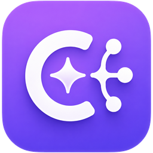
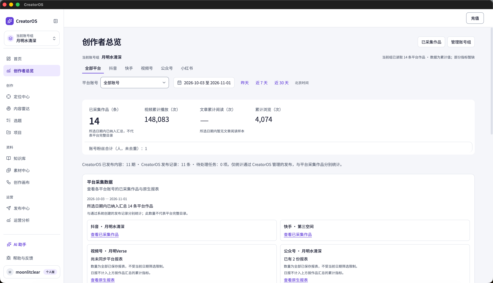
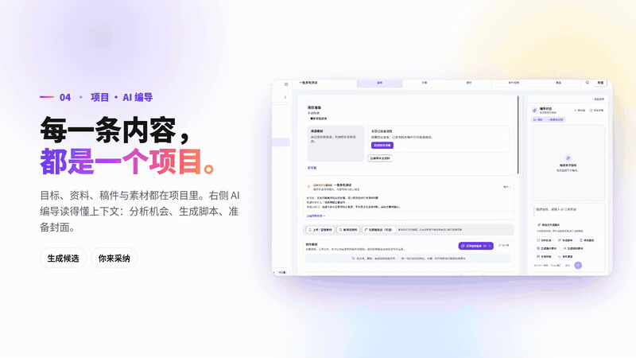
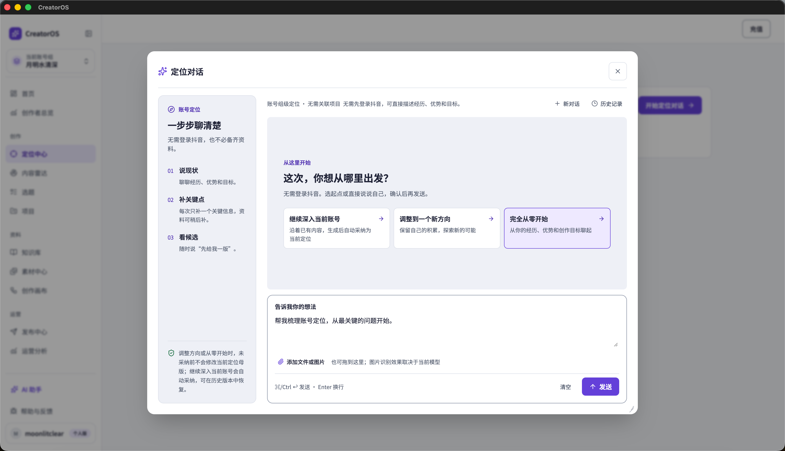
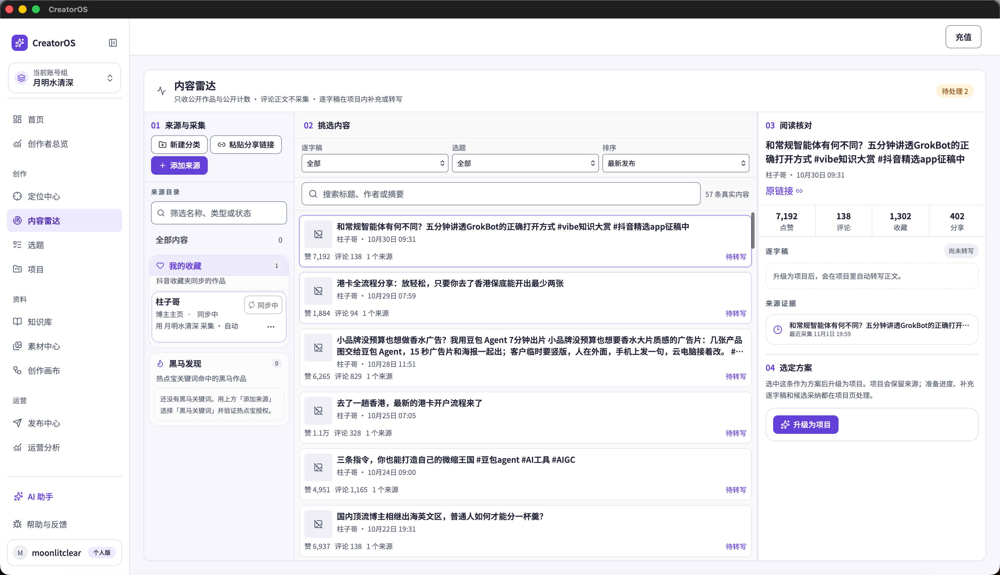
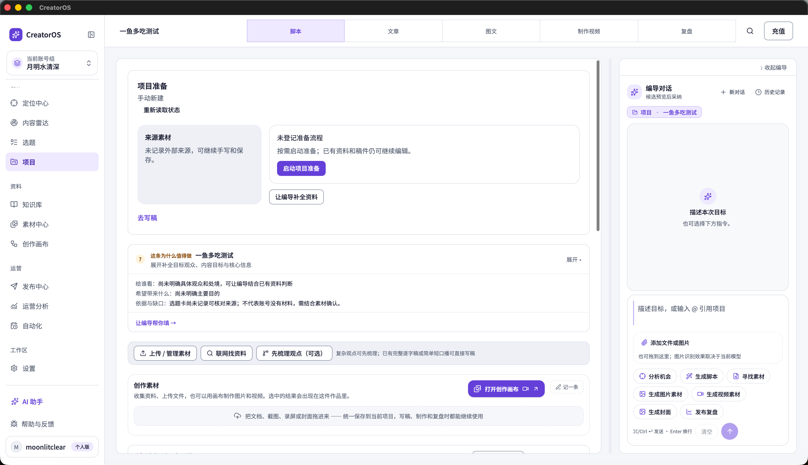
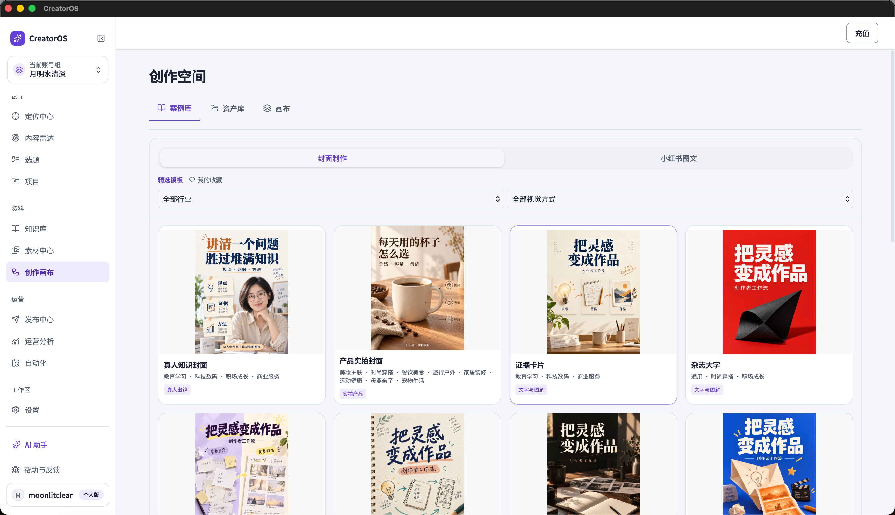
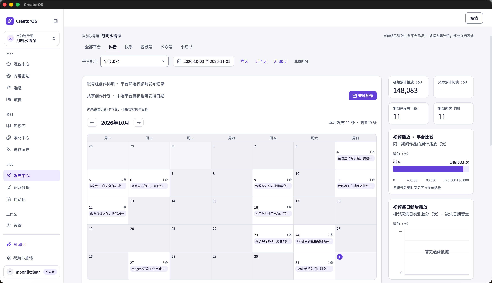
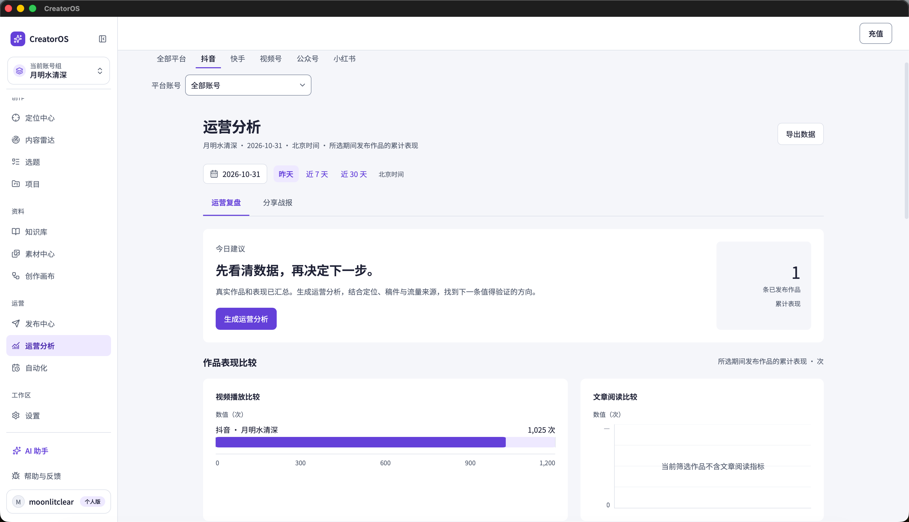

# CreatorOS

### 把灵感做成作品，把经验留给下一次创作。

**面向中文创作者的 AI 内容工作台 · 从账号定位，到创作、发布管理与数据复盘**

[产品官网](https://creatoros.aitongban.cloud/) · [观看产品演示](https://creatoros.aitongban.cloud/#demo) · [购买与下载](https://buy.aitongban.cloud/creatoros/) · [使用指南](https://my.feishu.cn/wiki/QY1owmFUjit7VgkpmQ1chGPCnTR)

 

真实软件界面与账号数据 · macOS / Windows 桌面端

---

## 先看一段演示

选题、文稿、图片和发布记录，终于能在同一个项目里接着往下做。

**[▶ 观看 87 秒完整有声演示](https://creatoros.aitongban.cloud/#demo)** · [直接打开 MP4](https://creatoros.aitongban.cloud/media/creatoros-product-demo-20261105.mp4)

上方为原产品视频的 9 秒无声片段；点击即可进入完整播放器。

## 创作不用每次从零开始

一个想法写在聊天里，一份资料留在文档里，封面在另一个工具里，发布后又换一张表格看数据。下一次创作，还得重新解释自己是谁、要写什么。

CreatorOS 把这些过程收进同一个本机工作台，让定位、资料、稿件、素材与真实作品表现可以持续积累。

| 你想完成的事 | CreatorOS 怎么帮你 |
| --- | --- |
| **知道自己该做什么** | 梳理账号定位，结合受众问题、知识资料与热点补充选题。 |
| **把想法写成内容** | 与 AI 编导讨论目标、依据和结构，在同一项目中继续脚本、文章、图文和视频创作。 |
| **把资料真正用起来** | 管理知识库与图片、视频等素材，复用项目已有资料，减少重复搬运。 |
| **让下一条有据可依** | 管理发布安排与记录，查看已采集作品表现，把复盘带回下一轮创作。 |

> **定位 → 内容雷达 → 选题 → 项目创作 → 发布管理 → 运营复盘 → 下一轮创作**
>
> AI 提供候选与建议，关键产物由你确认采纳。项目与素材数据本地优先；使用云端模型或连接内容平台时，仍需相应的网络服务。

## 看看真实工作台

<table>
<tr>
<td width="50%" valign="top">
<h3>01 · 定位与选题</h3>

从你的经验、优势和目标出发，整理账号定位。不用先登录抖音，也能开始讨论创作方向。

</td>
<td width="50%" valign="top">
<h3>02 · 内容雷达</h3>

管理内容来源，查看真实作品与互动数据，把值得继续研究的内容升级为项目。

</td>
</tr>
<tr>
<td width="50%" valign="top">
<h3>03 · AI 编导与项目创作</h3>

围绕同一项目的目标、资料和素材，继续脚本、文章、图文、视频制作与复盘。

</td>
<td width="50%" valign="top">
<h3>04 · 封面与图文画布</h3>

从真实案例和模板出发，准备封面与小红书图文，把表达和视觉放到一起推敲。

</td>
</tr>
<tr>
<td width="50%" valign="top">
<h3>05 · 多平台发布管理</h3>

用日历组织创作安排、发布记录和平台表现，减少多账号运营时的遗漏。

</td>
<td width="50%" valign="top">
<h3>06 · 运营分析与复盘</h3>

按账号与周期查看作品表现，结合定位与稿件生成分析，找下一条值得验证的方向。

</td>
</tr>
</table>

[查看全部 14 张真实界面 →](https://creatoros.aitongban.cloud/#screenshots)

## 多种内容，同一条创作链

- **短视频与口播**：选题、脚本、素材和视频制作在项目内衔接。
- **小红书图文**：组织正文、逐页配图与封面，在画布中继续制作。
- **公众号文章**：处理长文、配图与排版，复用项目资料。
- **多账号运营**：面向抖音、小红书、视频号、快手、B站、YouTube 与公众号组织内容和发布管理。
- **模型按需选择**：按用途配置官方模型、自配模型或本地 Codex；具体可用能力以当前设置为准。

各平台的发布、采集能力以客户端中的账号连接状态为准；项目数据和平台采集数据按各自口径展示。

## 开始使用

| | 入口与说明 |
| --- | --- |
| **了解产品** | [官网与产品演示](https://creatoros.aitongban.cloud/) |
| **购买、下载与激活** | [官方购买页](https://buy.aitongban.cloud/creatoros/) · 选择套餐，付款后按页面指引兑换正式激活码 |
| **安装与日常使用** | [使用指南](https://my.feishu.cn/wiki/QY1owmFUjit7VgkpmQ1chGPCnTR) · 系统要求和当前安装包以购买页及指南为准 |
| **查看版本变化** | [更新日志](https://creatoros.aitongban.cloud/#changelog) |
| **咨询与反馈** | [联系客服](https://buy.aitongban.cloud/creatoros/#support) |

### 第一次打开，可以这样开始

1. **确定方向**：在定位中心描述你的经验、优势和创作目标，确认适合自己的定位。
2. **推进一条内容**：挑选选题，建立项目，加入资料，与 AI 编导一起完成创作。
3. **留下真实结果**：管理发布记录，查看作品表现，再把经验用于下一条。

## 授权与共创

CreatorOS 使用[专有软件许可](LICENSE)。**源码可查看，不等于开放任意复制、分发或商业使用授权。**

**以下两项附加权益仅限购买 599 元永久版，月卡不包含：**

| 权益 | 范围与结算 |
| --- | --- |
| **分销合作** | 可销售 CreatorOS，双方五五分成。以 599 元产品为例，双方各分 **299.50 元**。 |
| **核心客户端源码共创** | 共享 GitHub 核心客户端代码仓库，可基于源码二次开发，并自行定价销售二开产品；**不包含授权与签名部分**。当前每售出一份，向原作者按 **599 元 × 50% = 299.50 元**结算，不按二开售价另取 50%。后续基准价调整另行说明。 |

[了解购买权益与交付方式 →](https://buy.aitongban.cloud/creatoros/#rights)

第三方开源组件保留各自许可证赋予的权利，见 [LICENSE](LICENSE) 与[第三方组件说明](docs/licenses/README.md)。

## 开发与技术

产品采用 **Tauri · Next.js · TypeScript · PGlite**，以本地桌面应用承载创作工作流。

| 想了解什么 | 从这里开始 |
| --- | --- |
| 本地开发、目录结构与常用命令 | [开发指引](docs/development/README.md) |
| 项目协作规则 | [AGENTS.md](AGENTS.md) |
| 当前任务与进度 | [任务看板](BACKLOG.md) |
| 工程实践与问题记录 | [工程坑册](docs/engineering-notes/pitfalls.md) |

<strong>开发活动</strong> · 查看仓库提交统计

 
<picture>
  <source media="(prefers-color-scheme: dark)" srcset="docs/assets/commit-activity-dark.svg">
  
</picture>

---

**CreatorOS · 让每一次创作，都成为下一次的起点。**

[观看演示](https://creatoros.aitongban.cloud/#demo) · [查看套餐与购买](https://buy.aitongban.cloud/creatoros/) · [回到顶部](#readme-top)

由月明水清深持续开发 · 图中为真实软件界面，演示素材来自官方产品视频。

