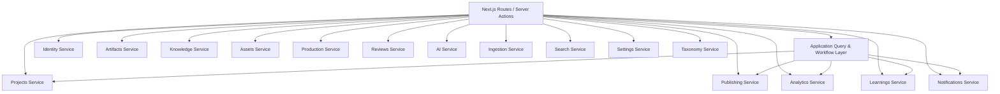
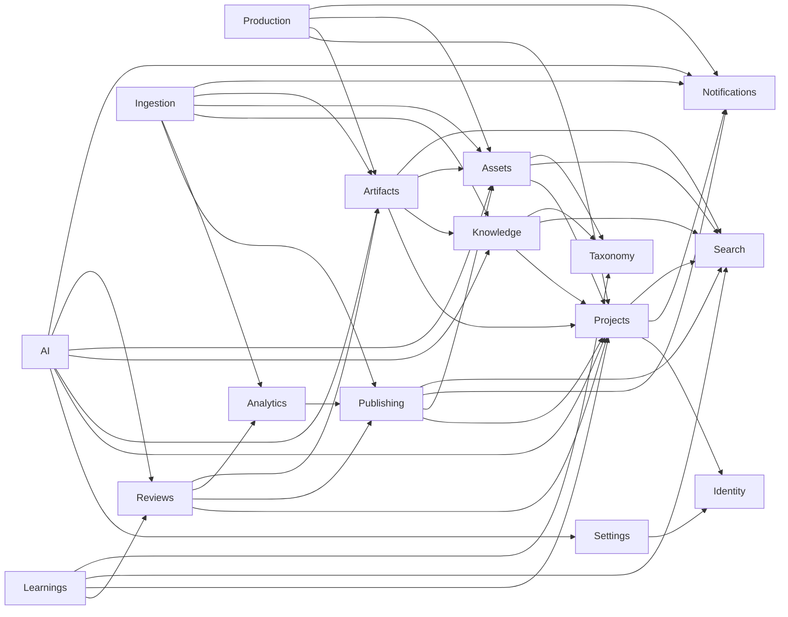

# CreatorOS Module Architecture

## 1. 架构概览

CreatorOS 采用一个 Next.js 模块化单体。



所有箭头表示 service 调用，不表示 repository 访问。

## 2. 统一模块模板

```text
src/server/modules/{module}/
├── {module}.service.ts
├── {module}.repository.ts
├── {module}.schema.ts
├── {module}.db-schema.ts
├── {module}.types.ts
├── {module}.errors.ts
├── {module}.service.test.ts
├── {module}.repository.integration.test.ts
├── {module}.contract.test.ts
└── index.ts
```

规则：

- `index.ts` 是模块唯一公开入口。
- `repository.ts` 不从 `index.ts` 导出。
- 其他模块只能 import `index.ts` 暴露的 service interface、command 和 DTO。
- route 可以 import schema 和 public service，但不得 import repository。
- 测试可在同模块内部访问 repository。

## 3. 建议代码结构

```text
src/
├── app/
│   └── api/
│       └── v1/
├── server/
│   ├── application/
│   │   ├── dashboard/
│   │   ├── project-overview/
│   │   └── publishing-center/
│   ├── modules/
│   │   ├── identity/
│   │   ├── projects/
│   │   ├── artifacts/
│   │   ├── knowledge/
│   │   ├── assets/
│   │   ├── production/
│   │   ├── publishing/
│   │   ├── analytics/
│   │   ├── reviews/
│   │   ├── learnings/
│   │   ├── ai/
│   │   ├── ingestion/
│   │   ├── search/
│   │   ├── settings/
│   │   ├── notifications/
│   │   └── taxonomy/
│   ├── infrastructure/
│   │   ├── database/
│   │   ├── object-storage/
│   │   ├── auth/
│   │   ├── logging/
│   │   ├── clock/
│   │   └── ids/
│   ├── shared/
│   │   ├── errors/
│   │   ├── pagination/
│   │   ├── result/
│   │   └── context/
│   └── composition-root.ts
└── test/
    ├── architecture/
    ├── fixtures/
    └── helpers/
```

`shared` 只允许放技术性、无业务语义的内容。ProjectStage、PublicationStatus 等领域类型必须属于对应模块。

## 4. 模块清单

### 4.1 Identity

**职责**

- User 身份。
- 当前用户解析。
- User 所有权 guard。
- 账户导出与删除协调入口。

**拥有实体**

- User

**公开 Service**

- getCurrentUser
- requireUser
- getUser
- assertUserOwnsContext
- requestAccountExport
- requestAccountDeletion

**依赖**

- 无业务模块依赖。

### 4.2 Projects

**职责**

- Project 生命周期。
- 固定六阶段。
- ContentOutput。
- OutputStage。
- ProjectRelation。
- ProjectTargetPlatform。
- Task、Milestone、ProjectActivity。

**拥有实体**

- Project
- ProjectRelation
- ProjectStage
- ProjectTargetPlatform
- ContentOutput
- OutputStage
- Task
- Milestone
- ProjectActivity

**公开 Service**

- createProject
- updateProject
- archiveProject
- restoreProject
- getProject
- listProjects
- getProjectOverviewBase
- transitionProjectStage
- createContentOutput
- updateContentOutput
- transitionOutputStage
- setPrimaryOutputAsset
- createTask
- completeTask
- listProjectActivity
- recordActivity
- assertProjectOwned
- assertOutputOwned

**依赖**

- Identity
- Notifications
- Search

### 4.3 Artifacts

**职责**

- 阶段产物。
- 不可变版本。
- 产物派生和引用。
- 论点、脚本、证据和方案时间线结构。

**拥有实体**

- Artifact
- ArtifactVersion
- ArtifactRelation
- ThesisNode
- ScriptSection
- EvidenceLink
- TimelineSegment

**公开 Service**

- createArtifact
- createVersion
- getArtifact
- listProjectArtifacts
- listOutputArtifacts
- restoreVersion
- createRelation
- replaceStructuredContent
- getScriptSections
- assertArtifactOwned

**依赖**

- Projects
- Knowledge
- Assets
- Search

**依赖说明**

Artifacts 通过 KnowledgeService 和 AssetsService 校验证据目标。Knowledge 和 Assets 不得依赖 Artifacts 的写 service；资源关联写入由 Artifacts 拥有或通过无反向调用的关联命令完成，以避免循环依赖。

### 4.4 Knowledge

**职责**

- 用户级知识。
- 知识版本。
- 知识关系。
- ProjectKnowledge。
- ArtifactKnowledge 的资源侧查询。

**拥有实体**

- KnowledgeItem
- KnowledgeRevision
- KnowledgeRelation
- ProjectKnowledge
- ArtifactKnowledge

**公开 Service**

- createKnowledge
- createRevision
- getKnowledge
- listKnowledge
- relateKnowledge
- attachToProject
- attachToArtifact
- listForProject
- assertKnowledgeOwned

**依赖**

- Projects
- Search
- Taxonomy

Knowledge 不直接读取 Artifact repository。`attachToArtifact` 接收已经由调用方验证的 Artifact reference，或通过只读 Artifact guard service 校验。

### 4.5 Assets

**职责**

- Asset 与 AssetFile。
- 上传和对象存储。
- 回收站。
- ProjectAsset、ArtifactAsset、OutputAsset。
- 文件使用记录和存储空间统计。

**拥有实体**

- Asset
- AssetFile
- ProjectAsset
- ArtifactAsset
- OutputAsset

**公开 Service**

- createUpload
- completeUpload
- registerGeneratedAsset
- createFileVersion
- getAsset
- listAssets
- attachToProject
- attachToArtifact
- attachToOutput
- setOutputAssetRole
- moveToTrash
- restoreAsset
- getUsageHistory
- getStorageUsage
- assertAssetOwned

**依赖**

- Projects
- Search
- Taxonomy
- Object storage adapter

### 4.6 Production

**职责**

- ContentOutput 制作记录。
- 制作片段。
- 片段素材。
- 导出记录。
- 实际制作状态。

**拥有实体**

- Production
- ProductionSegment
- SegmentAsset
- ExportRecord

**公开 Service**

- createProduction
- updateProductionSettings
- replaceSegments
- attachSegmentAsset
- requestExport
- completeExport
- failExport
- getProduction

**依赖**

- Projects
- Artifacts
- Assets
- Notifications

### 4.7 Publishing

**职责**

- Publication。
- PublicationRevision。
- 发布状态。
- 发布中心列表。

**拥有实体**

- Publication
- PublicationRevision

**公开 Service**

- createPublication
- createRevision
- transitionPublication
- resolvePublication
- getPublication
- listOutputPublications
- listPublishingCenter
- getRecentPublications
- assertPublicationOwned

**依赖**

- Projects
- Assets
- Notifications
- Search

Publishing 只记录发布事实，不执行平台自动发布队列。

### 4.8 Analytics

**职责**

- 原始指标快照。
- 标准化指标。
- 留存曲线。
- 受众维度。
- Dashboard、Project、Output、Publication 分析查询。

**拥有实体**

- MetricSnapshot
- MetricValue
- RetentionPoint
- AudienceSnapshot

**公开 Service**

- appendMetricSnapshot
- getPublicationAnalytics
- getOutputAnalytics
- getProjectAnalytics
- getDashboardMetrics
- getComparisonMetrics
- assertMetricDictionary

**依赖**

- Publishing

Analytics 只追加指标，不修改历史快照。

### 4.9 Reviews

**职责**

- Project 或 Output 复盘。
- 复盘覆盖的 Publication。
- ReviewInsight。
- 复盘报告 Artifact 协调。

**拥有实体**

- Review
- ReviewPublication
- ReviewInsight

**公开 Service**

- createReview
- addPublication
- createInsight
- completeReview
- getReview
- listProjectReviews
- assertReviewOwned

**依赖**

- Projects
- Publishing
- Analytics
- Artifacts

### 4.10 Learnings

**职责**

- 全局经验。
- 经验验证状态。
- LearningApplication。
- 经验中心列表与排序。

**拥有实体**

- Learning
- LearningApplication

**公开 Service**

- createLearning
- promoteReviewInsight
- listLearnings
- applyLearning
- evaluateApplication
- updateValidationStatus
- getSuggestions

**依赖**

- Reviews
- Projects
- Search
- Taxonomy

### 4.11 AI

**职责**

- AIConversation、AIMessage。
- AITask。
- AI 上下文引用。
- 候选结果。
- 确认和取消。

**拥有实体**

- AIConversation
- AIMessage
- AITask
- AITaskReference
- AITaskResult

**公开 Service**

- createConversation
- appendMessage
- requestTask
- startTask
- submitCandidateResult
- confirmResult
- failTask
- cancelTask
- getTask
- listRecentTasks

**依赖**

- Settings
- Projects
- Artifacts
- Knowledge
- Assets
- Reviews
- Notifications

AI 模块可以调用目标模块 service 创建正式结果，目标模块不得依赖 AI repository。

### 4.12 Ingestion

**职责**

- 外部数据源。
- IngestionRun。
- 幂等。
- 批次和逐条错误。
- 外部 Skill 写入协调。

**拥有实体**

- ExternalSource
- IngestionRun
- IngestionError
- IngestionRecord

**公开 Service**

- registerSource
- authenticateSource
- startRun
- ingestMetrics
- ingestKnowledge
- ingestAsset
- ingestArtifact
- completeRun
- failRun
- getRun

**依赖**

- Publishing
- Analytics
- Knowledge
- Assets
- Artifacts
- Notifications

### 4.13 Search

**职责**

- SearchDocument。
- 全文、模糊和向量搜索。
- 搜索历史。
- 可重建索引。

**拥有实体**

- SearchDocument
- SearchHistory
- SearchRetry

**公开 Service**

- upsertDocument
- removeDocument
- search
- recordSearch
- rebuildUserIndex
- retryFailedIndexing

**依赖**

- 无业务读取依赖。

Search 只接收拥有模块提交的索引 DTO，不读取其他模块 repository。

### 4.14 Settings

**职责**

- UserPreference。
- ModelConfiguration。
- AgentConfiguration。

**拥有实体**

- UserPreference
- ModelConfiguration
- AgentConfiguration

**公开 Service**

- getSettings
- updatePreferences
- setModelConfiguration
- createAgentConfiguration
- updateAgentConfiguration
- resolveModelForCapability

**依赖**

- Identity

### 4.15 Notifications

**职责**

- 用户通知。
- 未读计数。

**拥有实体**

- Notification

**公开 Service**

- createNotification
- listNotifications
- markRead
- markAllRead
- getUnreadCount

**依赖**

- 无业务模块依赖。

### 4.16 Taxonomy

**职责**

- Tag。
- EntityTag。
- 标签筛选。

**拥有实体**

- Tag
- EntityTag

**公开 Service**

- createTag
- updateTag
- deleteTag
- assignTags
- removeTag
- listTags
- listEntityTags

**依赖**

- Identity

调用方必须先验证目标实体归属，再调用 TaxonomyService。

## 5. Application 组合层

Application 层不拥有核心业务表，只负责页面查询或跨模块用例协调。

### DashboardQueryService

调用：

- ProjectsService
- PublishingService
- AnalyticsService
- LearningsService
- NotificationsService

返回 Dashboard 页面专用 DTO。

### ProjectOverviewQueryService

调用：

- ProjectsService
- ArtifactsService
- KnowledgeService
- AssetsService
- PublishingService

返回 Project Overview 页面专用 DTO。

### PublishingCenterQueryService

调用：

- PublishingService
- AnalyticsService
- ProjectsService

返回发布列表和右侧统计 DTO。

### GlobalSearchQueryService

调用：

- SearchService

返回按 entity type 分组的搜索 DTO，不读取各模块 repository。

## 6. 模块依赖图



依赖必须保持有向无环。出现循环时，优先：

1. 移动关联表所有权。
2. 将验证改为 guard service。
3. 将跨域流程提升到 application workflow。
4. 不允许通过导入 repository 绕过循环。

## 7. 表所有权

| 模块 | 表 |
|---|---|
| identity | users |
| projects | projects, project_relations, project_stages, project_target_platforms, content_outputs, output_stages, tasks, milestones, project_activities |
| artifacts | artifacts, artifact_versions, artifact_relations, thesis_nodes, script_sections, evidence_links, timeline_segments |
| knowledge | knowledge_items, knowledge_revisions, knowledge_relations, project_knowledge, artifact_knowledge |
| assets | assets, asset_files, project_assets, artifact_assets, output_assets |
| production | productions, production_segments, segment_assets, export_records |
| publishing | publications, publication_revisions |
| analytics | metric_snapshots, metric_values, retention_points, audience_snapshots |
| reviews | reviews, review_publications, review_insights |
| learnings | learnings, learning_applications |
| ai | ai_conversations, ai_messages, ai_tasks, ai_task_references, ai_task_results |
| ingestion | external_sources, ingestion_runs, ingestion_records, ingestion_errors |
| search | search_documents, search_histories, search_retries |
| settings | user_preferences, model_configurations, agent_configurations |
| notifications | notifications |
| taxonomy | tags, entity_tags |

只有表拥有模块的 repository 可以读写该表。

## 8. 跨模块关联规则

跨模块关联保留 ID，但不赋予 Repository 访问权限。

示例：

- `PublicationRevision.cover_asset_id` 由 PublishingRepository 保存；PublishingService 先调用 AssetsService 校验。
- `Review.report_artifact_id` 由 ReviewsRepository 保存；ReviewsService 先调用 ArtifactsService。
- `ProductionSegment.script_section_id` 由 ProductionRepository 保存；ProductionService 先调用 ArtifactsService。
- `MetricSnapshot.publication_id` 由 AnalyticsRepository 保存；AnalyticsService 先调用 PublishingService。

## 9. Composition Root

`composition-root.ts` 负责：

1. 创建数据库和基础设施 adapter。
2. 创建各模块 repository。
3. 创建无依赖 service。
4. 按依赖顺序注入其他 service interface。
5. 创建 application query service。
6. 供 API Route 获取 service。

禁止：

- 在 Route 内 new Repository。
- 在模块内部读取全局容器。
- 使用 service locator 隐藏依赖。
- 通过循环 import 解决依赖。

## 10. 架构守卫

必须自动检查：

1. `modules/*/repository` 只能被同模块 service 和测试导入。
2. `app/api` 不得导入 repository、db client 或 db schema。
3. repository 不得导入其他模块。
4. 模块只能从其他模块的 `index.ts` 导入。
5. infrastructure 不得依赖业务模块。
6. shared 不得包含领域枚举。
7. 模块依赖图不得出现循环。
8. 所有 route 必须调用 service。

违反规则时 CI 必须失败。

## 11. 页面到模块映射

| 页面 | 主要模块 | 组合层 |
|---|---|---|
| Dashboard | projects, publishing, analytics, learnings, notifications | DashboardQueryService |
| Projects | projects | 无 |
| New Project | projects | 无 |
| Project Overview | projects, artifacts, knowledge, assets, publishing | ProjectOverviewQueryService |
| Research | artifacts, knowledge, assets, taxonomy | 无 |
| Planning | artifacts, knowledge, assets, projects | 无 |
| Script | artifacts, ai | 无 |
| Production | production, artifacts, assets | 无 |
| Publishing Workspace | publishing, assets | 无 |
| Analytics & Review | analytics, reviews, learnings | 无 |
| Knowledge & Memory | knowledge, taxonomy, search | 无 |
| Assets Center | assets, taxonomy | 无 |
| Publishing Center | publishing, analytics, projects | PublishingCenterQueryService |
| Experience Center | learnings, reviews, analytics | 无 |
| Global Search | search | GlobalSearchQueryService |
| AI Copilot | ai, settings | 无 |
| Settings | identity, settings, assets, notifications | SettingsQueryService |

## 12. 禁止事项

- 禁止把模块拆成独立部署。
- 禁止模块拥有独立数据库连接配置。
- 禁止 Repository 返回其他模块聚合对象。
- 禁止 Route 中编排多个 Repository。
- 禁止在 shared 中创建万能 BaseRepository。
- 禁止用通用 CRUD Service 替代领域 Service。
- 禁止通过数据库视图绕过模块边界读取其他模块表。
- 禁止为规避依赖规则复制业务数据。
- 禁止为未来微服务预先加入消息中间件、Saga 或 RPC 层。
