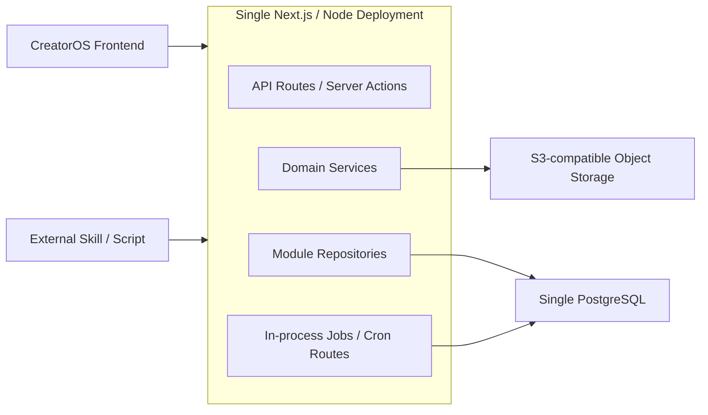

# CreatorOS Backend SPEC

## 1. 目标

本文定义 CreatorOS 后端的运行形态、代码边界、API 规则、事务、安全、存储、错误处理和验收约束。

后端必须支撑：

```text
Research
→ Planning
→ Script
→ Production
→ Publishing
→ Review
→ Learning
```

以及 Dashboard、项目管理、知识库、素材中心、发布中心、经验沉淀、搜索、AI Copilot 和设置页面。

## 2. 强制架构约束

1. 后端采用模块化单体。
2. 所有模块运行在同一个 Next.js / Node.js 后端中。
3. 所有模块作为一个应用部署。
4. 不拆微服务。
5. 不设计独立业务服务部署。
6. 不为每个模块创建独立数据库。
7. 不引入跨服务 RPC、服务发现或分布式事务。
8. 业务代码必须按领域模块组织。
9. 每个领域模块必须包含：
   - service
   - repository
   - schema
   - types
   - tests
10. 模块只能通过对方公开 service 协作。
11. 禁止跨模块导入或调用 repository。
12. API Route、Server Action、React Server Component 禁止直接访问 repository 或数据库客户端。
13. Repository 只能访问本模块拥有的数据表。
14. 业务规则只能存在于 service，不得散落在 route、repository 或 UI。
15. 跨模块写入必须由顶层 service 或 application workflow 协调。
16. Dashboard、搜索和发布中心属于查询组合，不拥有重复的业务真相。

## 3. 推荐技术基线

| 能力 | 技术 |
|---|---|
| Runtime | Node.js LTS |
| Web framework | Next.js App Router |
| Language | TypeScript strict mode |
| Database | PostgreSQL 16 |
| ORM / query builder | Drizzle ORM |
| Input validation | Zod |
| Unit / integration tests | Vitest |
| Database integration tests | Testcontainers PostgreSQL |
| HTTP contract tests | Vitest + Next.js route invocation |
| Object storage | S3-compatible storage |
| Search | PostgreSQL FTS + pg_trgm + pgvector |
| Architecture enforcement | ESLint boundaries + dependency-cruiser + Vitest architecture tests |

技术栈变更必须先更新本 SPEC。禁止同时使用两套 ORM 或两套输入校验体系。

后端应用代码根目录固定为：

```text
/Users/zyongzhu/Workbase/Thirdspace-creator/backend
```

后续 `package.json`、`src/app/api`、`src/server/modules` 和数据库配置均放在该目录。前端交付方式不属于本 Backend SPEC；本约束只要求所有后端业务模块是一个部署单元。

仓库采用根级 pnpm workspace，包含 `frontend` 与 `backend` 两个应用包并共享根 lockfile。两者可以独立部署；“单个 Next.js 应用”和“单个业务部署产物”仅约束后端业务模块不得拆成多个服务。前端只能通过批准的 HTTP 契约访问后端，不得直接导入后端 repository、service、数据库 schema 或基础设施模块。

## 4. 运行与部署形态



部署约束：

- 单个代码仓库。
- 单个 Next.js 应用。
- 单个业务部署产物。
- 单个 PostgreSQL 集群。
- 单个对象存储命名空间。
- 定时任务可以由同一应用的受保护 Cron Route 触发。
- 外置 Skill 通过受保护 Ingestion API 写入。
- 不单独部署搜索服务、发布服务、AI 服务或媒体服务。

## 5. 请求处理链

```text
HTTP Request
→ Authentication
→ Route Schema Validation
→ Module Service
→ Module Repository
→ PostgreSQL / Object Storage
→ Service DTO
→ HTTP Response
```

跨模块请求：

```text
Route
→ Owning Service
→ Other Module Public Service
→ Other Module Repository
```

禁止：

```text
Route → Repository
Module A Service → Module B Repository
Module A Repository → Module B Repository
Repository → HTTP Request
Repository → Business State Transition
```

## 6. Route 层职责

Route 只负责：

- 读取身份。
- 解析 path、query 和 body。
- 使用 Zod 校验输入。
- 构造 `RequestContext`。
- 调用一个公开 service 方法。
- 将 DomainError 映射为 HTTP 响应。
- 设置缓存与响应头。

Route 不负责：

- 计算项目进度。
- 判断阶段是否可跳过。
- 创建 Artifact 版本。
- 校验跨实体业务关系。
- 拼接 SQL。
- 直接调用对象存储。
- 直接发送 AI 请求。
- 直接创建通知或搜索索引。

## 7. Service 层职责

Service 是唯一业务入口，负责：

- 所有权和资源存在性校验。
- 状态机与业务不变量。
- 调用本模块 repository。
- 调用其他模块公开 service。
- 开启和提交事务。
- 记录项目活动、通知和搜索索引等副作用。
- 返回稳定 DTO。

Service 方法分为：

| 类型 | 用途 |
|---|---|
| Command | 创建、修改、状态流转、归档 |
| Query | 读取本模块数据 |
| Guard | 验证实体归属和可用性 |
| Internal integration | 供其他模块 service 调用的受控能力 |

公开 service 必须在模块 `index.ts` 中显式导出。未导出的 service 方法视为模块内部能力。

## 8. Repository 层职责

Repository 负责：

- 本模块表的持久化。
- 本模块范围内的查询和分页。
- 数据库行与领域记录之间的映射。
- 接收事务连接。
- 利用数据库唯一约束保证幂等。

Repository 不负责：

- 认证。
- 跨模块所有权检查。
- 状态流转决策。
- 调用其他模块。
- 发送通知。
- 构建 HTTP DTO。
- 读取其他模块表。

跨模块外键可以存储，但 Repository 不得通过 join 读取另一个模块的业务字段。需要相关数据时由 Service 调用对方 Service。

## 9. Schema 与 Types

每个模块维护两类边界：

### Schema

- Zod command schema。
- Zod query schema。
- API response schema。
- 枚举和状态值。
- Drizzle 模块表定义。

### Types

- Service command。
- Service result DTO。
- Query filters。
- Public service interface。
- Domain record。
- Domain error code。

禁止将 Drizzle 行类型直接作为 API 返回类型。API DTO 必须显式定义，避免数据库结构泄漏到前端。

## 10. RequestContext

所有公开 service 方法必须接收上下文：

```text
RequestContext
├── userId
├── requestId
├── source
├── ingestionRunId?
├── aiTaskId?
└── transaction?
```

规则：

- `userId` 是唯一所有权边界。
- 所有读取必须使用 user scope。
- 外置脚本使用对应 User 的服务身份，不绕过 user scope。
- transaction 只由 Unit of Work 创建，Route 不得创建或修改。

## 11. 事务与跨模块操作

使用共享 `UnitOfWork` 管理 PostgreSQL 事务。

跨模块原子操作示例：

### 创建 Project

```text
ProjectsService.createProject
→ ProjectRepository.create
→ ProjectRepository.createFixedStages
→ ProjectRepository.createTargetPlatforms
→ ProjectRepository.appendActivity
```

### 导出 Production 成品

```text
ProductionService.completeExport
→ ProductionRepository.completeExport
→ AssetsService.registerGeneratedAsset
→ ProjectsService.setPrimaryOutputAsset
→ SearchService.indexAsset
→ ProjectsService.recordActivity
```

### 指标导入

```text
IngestionService.ingestMetrics
→ PublishingService.resolvePublication
→ AnalyticsService.appendSnapshot
→ IngestionRepository.markRecordResult
```

要求：

- 数据库写入在同一个 Unit of Work 中完成。
- 其他模块只能获得 transaction-aware service，不获得 repository。
- 对象存储操作不能依赖数据库事务回滚；采用先暂存、后确认的补偿流程。
- 通知和搜索索引在主事务成功后执行。
- 后置副作用失败不能回滚已经成功的业务事实，应记录可重试状态。

## 12. 领域状态机

### Project

```text
draft → active ↔ paused → completed → archived
```

### Stage

```text
not_started → in_progress → completed
                    ↘ blocked
not_started / in_progress → skipped
```

### ContentOutput

```text
draft → active → ready → published → retired
                  ↘ cancelled
```

### Publication

```text
draft → ready → scheduled → published
                    ↘ failed
published → removed
```

### AI Task

```text
queued → running → awaiting_confirmation → completed
                 ↘ failed
queued / running → cancelled
```

状态机由所属模块 service 实现。Repository 只能执行 service 已批准的更新。

## 13. API 规范

API 基础路径：

```text
/api/v1
```

### 项目与流程

```text
GET    /projects
POST   /projects
GET    /projects/:projectId
PATCH  /projects/:projectId
POST   /projects/:projectId/archive
POST   /projects/:projectId/stages/:stage/transition
GET    /projects/:projectId/overview

POST   /projects/:projectId/outputs
GET    /projects/:projectId/outputs
GET    /outputs/:outputId
PATCH  /outputs/:outputId
POST   /outputs/:outputId/stages/:stage/transition

GET    /projects/:projectId/tasks
POST   /projects/:projectId/tasks
PATCH  /tasks/:taskId
GET    /projects/:projectId/activity
```

### 产物

```text
GET    /projects/:projectId/artifacts
POST   /projects/:projectId/artifacts
GET    /artifacts/:artifactId
POST   /artifacts/:artifactId/versions
GET    /artifacts/:artifactId/versions
POST   /artifacts/:artifactId/restore
POST   /artifacts/:artifactId/relations
```

### 知识与素材

```text
GET    /knowledge
POST   /knowledge
GET    /knowledge/:knowledgeId
POST   /knowledge/:knowledgeId/revisions
POST   /knowledge/:knowledgeId/relations

GET    /assets
POST   /assets/uploads
POST   /assets/uploads/:uploadId/complete
GET    /assets/:assetId
POST   /assets/:assetId/files
POST   /assets/:assetId/trash
POST   /assets/:assetId/restore
```

### 制作与发布

```text
GET    /outputs/:outputId/production
PUT    /outputs/:outputId/production
POST   /productions/:productionId/segments
POST   /productions/:productionId/exports
POST   /exports/:exportId/complete

GET    /outputs/:outputId/publications
POST   /outputs/:outputId/publications
GET    /publications/:publicationId
POST   /publications/:publicationId/revisions
POST   /publications/:publicationId/transition
```

### 分析、复盘和经验

```text
GET    /analytics/publications/:publicationId
GET    /analytics/projects/:projectId
GET    /analytics/dashboard

POST   /projects/:projectId/reviews
GET    /reviews/:reviewId
POST   /reviews/:reviewId/insights
POST   /reviews/:reviewId/complete

GET    /learnings
POST   /learnings
POST   /learnings/:learningId/applications
POST   /learnings/:learningId/evaluate
```

### AI、搜索和系统

```text
GET    /search

GET    /ai/conversations
POST   /ai/conversations
POST   /ai/conversations/:conversationId/messages
POST   /ai/tasks
POST   /ai/tasks/:taskId/confirm
POST   /ai/tasks/:taskId/cancel

GET    /notifications
POST   /notifications/:notificationId/read

GET    /settings
PATCH  /settings/preferences
PUT    /settings/models/:capability
POST   /settings/agents
```

### 外置 Skill 写入

```text
POST /ingestion/runs
POST /ingestion/runs/:runId/metrics
POST /ingestion/runs/:runId/knowledge
POST /ingestion/runs/:runId/assets
POST /ingestion/runs/:runId/artifacts
POST /ingestion/runs/:runId/complete
GET  /ingestion/runs/:runId
```

## 14. API 响应

成功：

```json
{
  "data": {},
  "meta": {
    "requestId": "uuid"
  }
}
```

列表：

```json
{
  "data": [],
  "meta": {
    "requestId": "uuid",
    "page": 1,
    "pageSize": 20,
    "total": 100
  }
}
```

失败：

```json
{
  "error": {
    "code": "PROJECT_NOT_FOUND",
    "message": "Project not found",
    "details": {}
  },
  "meta": {
    "requestId": "uuid"
  }
}
```

错误映射：

| 类型 | HTTP |
|---|---:|
| ValidationError | 400 |
| AuthenticationError | 401 |
| OwnershipError | 404 |
| ConflictError | 409 |
| RateLimitError | 429 |
| ExternalDependencyError | 502 |
| UnexpectedError | 500 |

所有权错误返回 404，避免泄露其他 User 的资源是否存在。

## 15. 对象存储

AssetsService 是唯一允许操作对象存储的领域模块。

上传流程：

```text
Route
→ AssetsService.createUpload
→ 生成临时 storage key 和 signed URL
→ Browser 直传对象存储
→ AssetsService.completeUpload
→ 校验 checksum / size / MIME
→ 创建 AssetFile
```

其他模块需要文件时必须调用 AssetsService：

- Production 注册导出文件。
- Publishing 校验封面。
- AI 注册生成图片或音频。
- Ingestion 注册外部文件。

禁止 Production、Publishing、AI 或 Ingestion 直接调用 S3 SDK。

## 16. 搜索

Search 模块拥有 `SearchDocument`。

其他模块通过 SearchService：

- upsertDocument
- removeDocument
- search
- rebuildUserIndex

SearchService 不反向读取其他模块 repository。索引内容由拥有数据的模块 service 提交。

搜索索引是派生数据：

- 可以删除并重建。
- 不得成为业务事实来源。
- 索引失败不得回滚主业务写入。
- 索引失败必须进入可重试记录。

## 17. 外部写入与幂等

每个外置 Skill：

- 注册一个 ExternalSource。
- 使用独立 secret。
- 创建 IngestionRun。
- 为批次提供 idempotency key。
- 提交逐条 record key。

规则：

1. `(external_source_id, idempotency_key)` 唯一。
2. `(run_id, record_key)` 唯一。
3. 同一批次重复提交返回原结果。
4. 批次允许部分成功。
5. 每条失败保存错误码和原 payload。
6. IngestionService 不直接写目标模块 repository。
7. IngestionService 调用 Publishing、Analytics、Knowledge、Assets 或 Artifacts Service。

## 18. AI

AI 模块负责：

- 对话和消息。
- AITask 生命周期。
- 模型与 Agent 配置读取。
- 上下文引用。
- 候选结果。
- 用户确认。

AI 不允许：

- 直接更新 Artifact current version。
- 直接写 Knowledge、Asset 或 Review repository。
- 绕过用户确认将候选内容变成正式产物。

确认流程：

```text
AITask awaiting_confirmation
→ AiService.confirmResult
→ 调用目标模块 Service
→ 创建正式 ArtifactVersion / KnowledgeItem / Asset / ReviewInsight
→ AITask completed
```

## 19. 查询组合

Dashboard、Project Overview、Publishing Center 和 Settings Storage Usage 需要跨模块数据。

这些查询由 application query service 组合：

```text
DashboardQueryService
├── ProjectsService.getDashboardSummary
├── PublishingService.getRecentPublications
├── AnalyticsService.getDashboardMetrics
├── LearningsService.getSuggestions
└── NotificationsService.getUnreadCount
```

要求：

- 组合层只能调用 service。
- 不允许跨模块 repository join。
- 组合层 DTO 专门面向页面。
- 性能不足时可增加可重建 projection，但 projection 不是真相源。

## 20. 安全

- 所有业务查询强制 user scope。
- 外置 Skill 使用哈希存储的 token 或 secret reference。
- 对象存储使用短时 signed URL。
- 日志不得记录 secret、完整 prompt 附件或 signed URL。
- Zod schema 限制字符串、数组和 JSON payload 大小。
- 上传完成时校验 MIME、扩展名、文件大小和 checksum。
- Ingestion、AI 和上传接口单独限流。
- 数据导出和账户删除需要二次确认。

## 21. 可观测性

每次请求记录：

- requestId
- userId
- route
- module
- service method
- duration
- result
- error code

不得记录：

- 密钥。
- 完整私人内容。
- 原始媒体。
- 完整模型输入。

慢查询、Ingestion 失败、AI 失败和索引失败必须可单独检索。

## 22. 验收

后端架构完成必须满足：

- 所有业务模块在同一 Next.js 应用运行。
- 只有一个部署单元和一个 PostgreSQL。
- 每个模块包含 service、repository、schema、types 和 tests。
- 没有跨模块 repository import。
- Route 不访问 repository 或数据库客户端。
- 17 个前端页面需要的数据均有明确 API 或查询 service。
- Project 六阶段和 ContentOutput 独立后四阶段符合产品逻辑。
- ArtifactVersion 不可变。
- Knowledge、Asset、Learning 可脱离 Project 存在并被复用。
- Publication 与指标导入支持幂等。
- AI 候选内容必须确认后才进入正式业务数据。
