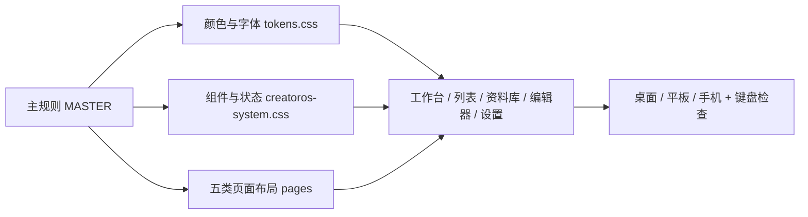

# CreatorOS 设计系统

本系统由 UI/UX Pro Max 的产品、风格、可访问性检索建议结合当前源码整理，适用于个人独立预览。产品是自媒体内容生产工作台：从选题、脚本、素材到制作、发布与复盘。目标是让创作者看清下一步、读写长文、管理真实作品。

## 设计方向

采用扁平工作台，保留 CreatorOS 紫色品牌与已安装的本地中文字体。白色为操作表面，淡灰为工作台背景，紫色只强调主操作、当前导航与焦点。列表、资料库和编辑器按各自任务排布，共用同一套颜色、字体、间距和状态。

## 检索依据与取舍

- `creator productivity dashboard --design-system`，用 `dashboard productivity workspace` 收窄复核，均返回 **Flat Design**，适合 SaaS、dashboard 与工具应用。
- 同次结果的 **Product Demo + Features** 是营销页面模式，和当前应用不匹配，明确弃用。应用布局采用本文按真实页面归纳的规则，属于项目内设计决策，不冒充数据库匹配。
- 检索建议的青绿/橙色、Plus Jakarta Sans 不直接应用：保留品牌紫和本地 Noto Sans SC，减少字体依赖及中文回退差异。
- `focus not obscured`、`keyboard modal focus`、`text contrast minimum`、`target size touch` 的 UX 结果用于焦点、对比与操作尺寸检查。
- 实际栈：Next.js 16.2、React 19.2、Tailwind 4、Radix、Ant Design。Next.js 搜索仅命中图片布局，未用于键盘行为；React 的 `keyboard navigation` 返回语义化 HTML 建议，采用原生链接、按钮及 Radix 弹层。

## 配色

颜色唯一来源：`frontend/src/styles/tokens.css`。组件禁止另起一套语义色。

| 用途 | 亮色 | 暗色 |
|---|---|---|
| 工作台背景 | #F5F6FA | #141723 |
| 内容表面 | #FFFFFF | #1E2232 |
| 次级表面 | #EEF0F6 | #292E41 |
| 品牌 / 主操作 | #6441D9 | #B5A2FF |
| 主操作文字 | #FFFFFF | #1C1534 |
| 品牌悬停 / 强调 | #5030B0 | #CEBEFF |
| 选中背景 | #EEE9FF | #30294D |
| 主文字 | #202337 | #F0F1FA |
| 辅助文字 | #555E70 | #B5BDCF |
| 提示文字 | #626B7C | #AAB3C7 |
| 控件边线 | #838DA0 | #7D89A5 |
| 结构分隔线 | #DCE0E9 | #3B4258 |
| 成功 | #187044 | #83DAB0 |
| 警告 | #8A4B08 | #FFD08B |
| 错误 | #C4313C | #FFACB4 |
| 信息 | #2361BA | #A2C6FF |

状态必须同时有文字、图标或语义属性；不能仅靠颜色区分。浅分隔线只承担结构分组，交互输入框使用较深边线。图表继续保留标签、图例、真实数据及原有可访问文本。

## 字体与间距

- 字体：本地 `Noto Sans SC Variable`，系统 sans-serif 回退；不新增远程字体请求。
- 页面标题：桌面 28/1.35、手机 24/1.35，字重 650；首页当前创作可用 32px。
- 区块标题：16–18px / 1.5、字重 600；项目标题 20px、手机 18px。
- 正文及操作：14–16px / 1.6；输入框手机 16px；辅助信息 12–13px，不承载唯一关键说明。
- 数字：tabular-nums；正文不强行使用等宽字体。
- 间距刻度：4、8、12、16、24、32、48px。区块通常 24–32，卡片内距 24、手机 16–20。
- 圆角：控件 8、卡片 12、弹层 16px。静态卡片不加投影，弹层保留层级阴影。

## 组件状态

| 组件 | 默认 / 选中 | 悬停 / 按下 | 禁用 / 处理中 | 错误 / 键盘 |
|---|---|---|---|---|
| 主按钮 | 紫底、对应对比前景 | 品牌悬停色；轻微明度反馈 | 保留真实 disabled / aria-busy 与文案 | 2px 紫色外焦点、3px 偏移 |
| 次按钮 | 白底、清晰边线 | 次级表面色 | 不可操作时保留语义禁用 | 同上 |
| 导航 / 阶段 | 当前项淡紫底、深紫字及 aria-current | 次级表面 | 原有加载提示保留 | 可 Tab / Enter 到达 |
| 输入 | 可见标签、40px 高 | 焦点边线与外环 | 次级背景、disabled | aria-invalid + 错误文案；保留现有描述关联 |
| 弹窗 | 标题、描述、关闭入口 | 原有 Radix 交互 | 原有异步状态 | 焦点管理、Esc、关闭后回到触发处 |
| 空态 / 状态 | 说明原因、真实 0 或空值 | 原有有效下一步 | 不编造数据 | 状态文字 / role 保留 |

桌面普通按钮 40px、紧凑按钮 32px、极紧凑 28px。手机共享按钮与菜单项优先 44px；这属于本项目舒适目标，不等同于 WCAG 对所有网页控件的统一硬性尺寸。

## 屏幕布局

| 宽度 | 共用框架 | 任务布局 |
|---|---|---|
| ≥1200px | 224px 侧栏，64px 顶栏，32px 页边距，最大内容 1440px | 首页主区+安排栏；资料库允许三栏；列表分组清楚 |
| 768–1199px | 原有自动折叠侧栏，24px 页边距 | 图表和发布区改单列；资料详情转下方 |
| ≤767px | 16px 页边距，24px 标题，44px 优先操作目标 | 主辅区堆叠、工具条换行；局部阶段栏横滑 |
| ≤640px | 52px 菜单栏，展开全屏导航 | 内容保持独立滚动；菜单打开时主区 inert；Tab 留在菜单，Esc 回到开关 |

仅阶段条、数据表、画布和视频时间轴可以有必要的局部横向滚动。不得用裁掉正文来掩盖溢出。编辑成品的排版、画布坐标、视频尺寸与时间轴精度不被全局字号/间距强制覆盖。

## 可访问性验收与来源

- 检查正文及辅助文字对比，普通文字目标 ≥4.5:1，较大文字 ≥3:1：[W3C 1.4.3](https://www.w3.org/WAI/WCAG22/Understanding/contrast-minimum.html)。
- 检查焦点可见且不被固定界面完全遮住：[W3C 2.4.11](https://www.w3.org/WAI/WCAG22/Understanding/focus-not-obscured-minimum.html)。本项目尽量保持整个焦点可见，不将 AAA 建议写成 AA 要求。
- 网页操作目标最低规则包含 24 CSS px 或适用例外：[W3C 2.5.8](https://www.w3.org/WAI/WCAG22/Understanding/target-size-minimum.html)。手机 44px 是项目目标。
- 检查跳过导航、键盘开关菜单、焦点循环、Esc 与弹窗返回；表单具备名称，禁用与错误状态清楚。
- 减少动态效果时关闭装饰动画；强制颜色模式下保留焦点与选中描边。
- 实际验收记录在 `outputs/CreatorOS-uiux-system-report.json`。自动或人工抽查不等于完整 WCAG 认证；不把未运行的检查记为通过。

## 实现与边界

- `tokens.css`：亮暗主题与刻度唯一来源。
- `creatoros-system.css`：共享外壳、控件、状态、焦点与断点；覆盖此前预览的共享样式分歧。
- 页面 CSS modules：仅负责页面构图与局部语义组件。
- 数据、授权、服务契约、调度和创作保存逻辑保持原有实现；只在 `work/preview-data` 运行。
- 页面族的细节见 `pages/`，未列出的页面继承主规则。

## 有内容的独立预览

- `CREATOROS_UI_PREVIEW=1` 仅在开发环境、`work/preview-data` 对应数据库且调度器关闭时启用。模拟平台视图还限定本次示例账号组，生产环境不显示。
- 每页顶部显示“独立预览”，`/preview` 集中列出创作、稿件、资料、运营与配置入口。
- 空列表先补人工编写的模拟资料、选题、初稿和画布；全部使用“【模拟】”名称及模拟出处。平台指标采用独立标明的本地交互示例，真实筛选与操作保留在折叠区；真实内容出现后继续展示真实页面。
- 选题采用来源 / 候选 / 详情三栏，平板先收拢来源，手机单栏。知识库桌面三栏，手机选中原文按内容展开，不以固定行高裁切。素材网格每格至少160px，长名称可显示两行。
- 表单、稿件和自动化仍使用真实保存回调；模拟自动化保持停用。模型、账号和凭据配置保留真实状态，不填写虚构密钥。
- 原生剪辑器的素材添加、视图切换、排序和参数输入使用明确名称，标签由实际属性定义派生；保留原剪辑、提交和保存行为。

## 界面文案

- 标题说明当前任务；不再用一段副标题复述页面功能。保留进度、数量、状态与范围等真实信息。
- 卡片不重复“可读、可编辑”等无决策价值的说明；操作使用清楚的动词和对象。
- 模拟内容保留显著标识；详细声明收进“模拟说明”，可用键盘展开。
- 设置中的授权、隐私、费用、未保存修改和不可逆后果必须明确；不因追求简洁而删减。
- 表单保留可见标签和必要的帮助文字；对话不在标题、空态和输入框中重复同一段示例。
- 精简仅作用于界面文字，用户稿件、模拟样例正文、课程正文和功能回调保持原样。

## Impeccable 独立预览修整（2026-10-20）

沿用现有配色、Noto Sans SC、间距和组件体系；按 Operate 模式修整全部现有页面，详细记录见 [本轮界面检查](pages/impeccable-review.md)。区块标题与操作在窄屏自然换行，保留标题完整显示。课程页也使用语义主题变量，不再以固定深色绿底或固定白底覆盖系统主题。来源、模拟状态、版权说明与真实数据含义保持不变。

描述列表遵循 dl > div > dt/dd；结果类型是可取消的筛选按钮（aria-pressed），设置页是具备方向键与 Home/End 的真正标签页（tablist/tab/tabpanel）。可滚动的成稿及选题详情应支持键盘焦点。时间轴标尺和播放头保留鼠标交互，并支持键盘逐帧定位。减少动态效果时停止空间过渡，保留加载和状态反馈。作品成品内部排版仍由对应编辑器负责。
