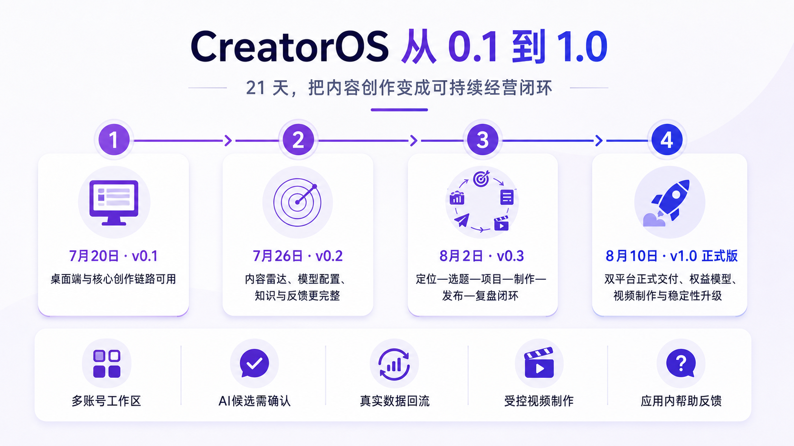

# CreatorOS v1.0 用户更新说明

> 更新范围：2026 年 7 月 20 日—2026 年 8 月 11 日
> 面向对象：CreatorOS 用户
> 说明：只讲用户能看到、能使用的变化，不包含开发过程和技术细节。

## 一句话总结

CreatorOS 已从 7 月 20 日的早期稳定版，升级为 8 月 10 日正式发布的 v1.0。它不再只是“能写稿的 AI 工具”，而是一套围绕真实账号长期经营的桌面工作台：定位、找选题、做项目、写脚本、制作视频、发布登记、回收数据、复盘经验，都在同一条链路里完成。

## 四个版本，分别解决了什么

| 版本 | 日期 | 用户最直接的感受 |
|---|---|---|
| v0.1 | 7 月 20 日 | 桌面端和核心创作链路可用，可以真正开始建立账号工作区和做内容 |
| v0.2 | 7 月 26 日 | 内容雷达、模型配置、知识整理、长任务和反馈入口明显更完整 |
| v0.3 | 8 月 2 日 | 定位—选题—项目—制作—发布—复盘第一次形成完整闭环 |
| v1.0 正式版 | 8 月 10 日 | macOS、Windows 正式交付，模型权益、视频制作、反馈和稳定性进一步收口 |

## 1. 正式版与桌面端

- CreatorOS 已进入 v1.0 正式版；旧内测名额、截止日期和公开共用激活码已经失效。
- macOS 与 Windows 桌面版均已完成完整验收。
- 安装、首次启动、激活、应用重开和日常使用更稳定。
- 用户下载到的是可直接安装的正式桌面包，不需要自己准备额外的运行环境。
- 设置中可以检查软件更新；需要更换激活码时，可使用“重新输入激活码”，不会删除项目、素材、账号和模型配置。

## 2. 一个抖音号，就是一套独立工作区

- 可以绑定和切换多个抖音号。
- 每个抖音号都有各自的定位、选题、项目、知识、素材、自动化、发布和复盘数据。
- 切换账号时，整套经营上下文一起切换，不会把两个账号的数据混在一起。
- 绑定时会明确提示扫码、超时、需要重新登录等状态。
- 已有作品的账号可以先回收历史作品和数据；新账号可以直接从定位和首个项目开始。

## 3. 定位不再只是一段介绍

- 可以通过 AI 访谈建立第一版定位，也可以手动创建。
- 定位会拆成可执行的选题、写稿、项目、表达和禁止规则。
- 修改定位会留下历史版本，不会静默覆盖过去内容。
- AI 编导能够围绕当前账号的定位提出候选，但仍需用户确认后写入。

## 4. 内容雷达成为真实信号入口

- 可以添加博主主页、我的收藏、网页、RSS 和关键词等来源。
- 页面清楚区分来源、作品列表、作品详情、数据和逐字稿。
- 可以先测试来源，再决定是否保存和同步。
- 同步结果会区分有新增、无变化、需要重连、限流保护和失败。
- 抖音分享链接有专门处理方式：只发链接先保存，明确要求转写时才开始转写。
- 真实作品可以继续生成选题候选，确认后进入选题池。

## 5. 选题从“灵感列表”变成“可判断的候选池”

- 选题可以来自内容雷达、受众评论、AI 选题会、手动输入和一句话起草。
- 每张候选卡可以保留来源、证据、适配理由和淘汰原因。
- 可以按真实需要排序、补全、淘汰或立项。
- 立项后直接进入项目，不需要在多个页面重复抄写信息。

## 6. 项目稿面更接近真实创作流程

- 一个项目固定包含“脚本、制作视频、复盘”三个工作面。
- Brief、创作素材、脚本、审核、盲预测和发布物料在同一张稿面里连续完成。
- 项目可以直接从 Brief 和真实素材进入写稿。
- 复杂内容可以先梳理论点；简单口播可以跳过。论点梳理是增强步骤，不再是强制门槛。
- 项目素材和全局素材的来路更清楚，减少错挂、串项目和重复上传。

## 7. AI 写稿更完整，但不会擅自改稿

- AI 起草会更重视完整开头、正文、论据和结尾，不把残缺段落伪装成整稿。
- 不同账号可以保留各自的表达偏好。
- AI 结果先以候选卡出现，点击“写入稿面”后才改变正式脚本。
- 每次保存产生新版本，可查看历史并回滚。
- 右侧项目编导始终绑定当前项目，减少把内容写进错误项目的风险。

## 8. 审核与盲预测更可靠

- 文案审核统一使用当前文本创作模型，不再要求普通用户单独配置审核模型。
- 审核会给出通过、风险或阻断，并逐条展示原因与改写建议。
- 用户可以逐条决定是否应用改写，AI 不会整篇自动覆盖。
- 脚本修改后，旧审核会明确显示过期，需要重新审核。
- 盲预测在发布前锁定；脚本变化后，旧预测也需要重新运行，避免拿过期判断对照新稿。

## 9. 模型配置同时支持“权益提供”和“自行配置”

- 如果当前激活权益已经提供模型，用户不需要填写服务商或密钥。
- 同一能力有多个模型时，可以直接在设置中选择。
- 可以查看 AI 总额度、已消耗和剩余额度，并进入购买或充值入口。
- 当前权益未提供的能力，仍可自行选择服务商、填写模型和密钥。
- 普通用户主要关注文本创作、语音转文字、文生图和文生视频四类能力。
- 未配置云端语音转文字时，仍可使用本地 Whisper，只是处理更慢。

## 10. 视频制作形成两条真实路线

### 用 CreatorOS 制作

- 使用口播稿、粗剪视频和 SRT 字幕发起 AI 分场。
- AI 提出场景、信息卡、B-roll 和字幕候选。
- 用户确认分镜后才开始渲染。
- B-roll 只从当前项目已上传或明确挂载的素材中组织。
- 补传、删除或替换素材后，旧分场会提示重新决策。
- 刷新页面后可以恢复已确认分镜、运行中的渲染和历史成片。

### 直接上传成片

- 已经在剪映、Premiere 或 Final Cut 做好的视频，可以直接上传为项目成片。
- 不需要为了走流程而重新分场或渲染。
- 两条路线最终都回到同一个发布与复盘闭环。

## 11. 发布中心与复盘真正接上真实结果

- CreatorOS 准备标题、标签、封面和成片，但不会自动替用户发布到抖音。
- 用户在抖音发布后，把真实作品链接登记回项目。
- 发布中心集中查看已发布作品、表现汇总和内容日历。
- 自动化可以继续回收作品指标、明细和评论。
- 复盘页把发布前预测、真实表现、评论和人工洞察放在一起。
- 只有用户确认“已验证”的经验，才会进入下一轮选题、脚本和 AI 上下文。

## 12. 知识库与素材中心更像长期资产库

- 知识可以从手动输入、文件导入、网页、评论和复盘经验进入。
- AI 蒸馏只产生候选，用户选择后才进入长期知识。
- 知识支持文件夹、标签、搜索、关系图和历史修订。
- 素材中心统一管理图片、视频、音频、字幕和文档。
- 可以查看素材来源、使用记录、收藏、下载、Finder 定位和回收站。
- 项目产生或挂载的素材会保留清楚的项目归属。

## 13. 自动化和长任务更容易看懂、恢复和重试

- 自动化提供常用任务模板，也可以按周期、间隔或单次运行。
- 运行中会显示真实进度；没有总量时不编造百分比。
- 页面会区分成功、无新数据、需要重连、限流保护和失败。
- 刷新页面或离开后，仍可以继续查看任务和结果。
- 重复点击不会无意义地创建多份同样任务。
- 失败时尽量给出下一步，而不是只显示难懂的错误。

## 14. Copilot 更懂当前页面和项目

- 全局 AI 助手适合跨项目查询和工作区级任务。
- 项目右侧编导适合当前项目的 Brief、备料、脚本、审核、封面和复盘。
- 可以通过 `@` 引用项目，减少上下文猜测。
- 图片、文件和抖音链接都有明确处理方式。
- AI 可以调用受控工具，但读取或执行授权不等于自动采纳结果。

## 15. “问题反馈”升级为“帮助与反馈”

- 反馈现在包含问题摘要、问题描述和发送内容预览。
- 开通应用内提交时，用户检查内容并勾选确认后，可以直接发送。
- 成功后会返回真实反馈编号，便于后续追踪。
- 应用内提交暂不可用时，仍可以复制内容并打开反馈页提交。
- 日志、附件、截图、激活码、手机号和本机路径不会自动发送。
- 购买、续费和交付问题会引导到“设置 → 产品与服务”，不与软件问题混在一起。

## 现在最值得重新检查的 6 件事

1. 打开“设置 → 账户”，确认版本、激活状态和产品服务入口；
2. 打开“设置 → 模型配置”，确认自己属于权益模型还是自行配置，并测试文本模型；
3. 在侧栏左下确认当前抖音号，再检查定位、选题和项目是否属于正确工作区；
4. 打开一个项目，确认脚本修改后审核和盲预测会要求更新；
5. 进入“制作视频”，根据实际工作选择 CreatorOS 制作或直接上传成片；
6. 打开“帮助与反馈”，查看当前版本是应用内发送还是复制到反馈页。

## 仍然需要用户知道的边界

- CreatorOS 不会自动替你在抖音发布作品；
- AI 生成的定位、选题、脚本、知识和经验都需要用户确认后才正式写入；
- 内容日历负责排期，不是自动发布器；
- 没有真实数据时，页面显示 0、空或未知，不会用演示数据冒充；
- 视频制作不是通用时间线剪辑器；
- 应用内反馈成功以返回反馈编号为准，打开反馈页不等于已经提交。

完整操作步骤与脱敏截图见：[CreatorOS v1.0 完整使用手册](CreatorOS-新用户0到1标杆路线.md)。
