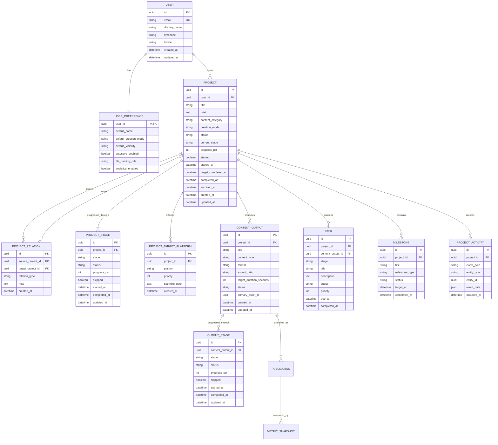
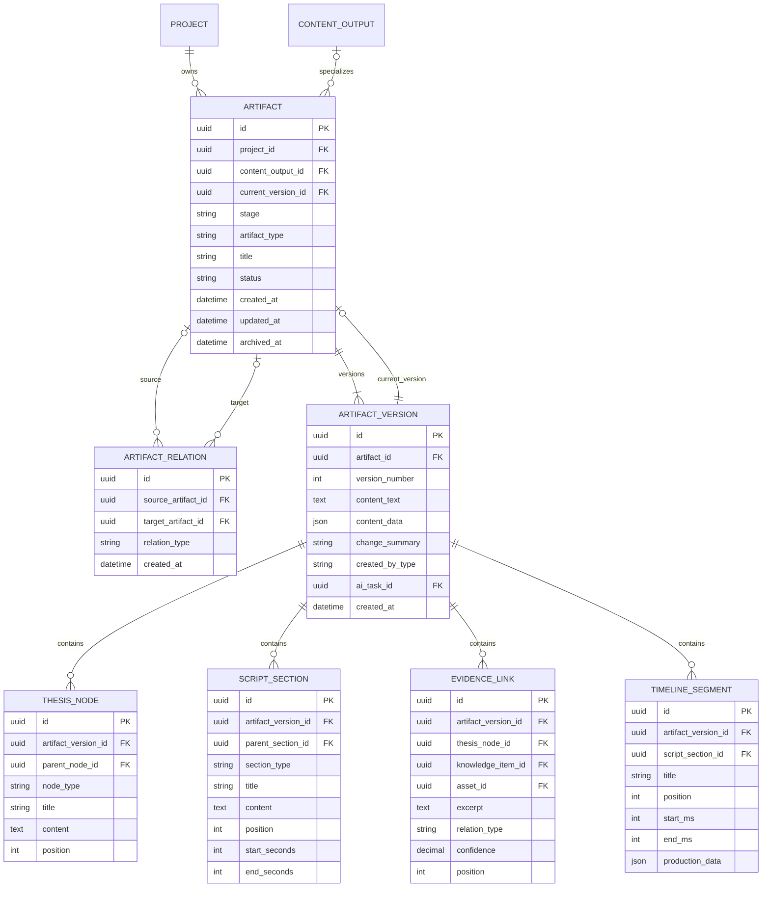
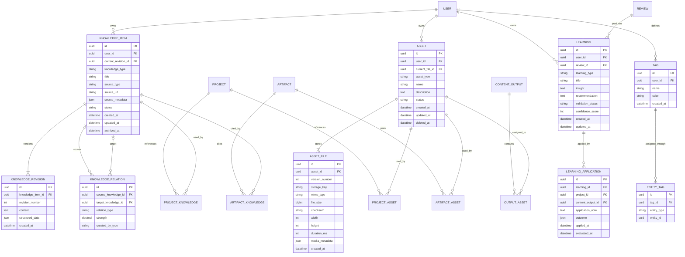
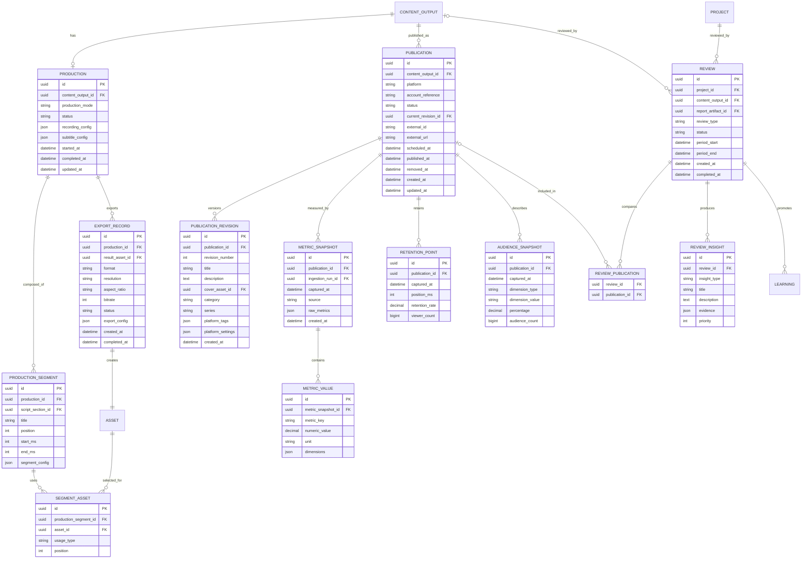
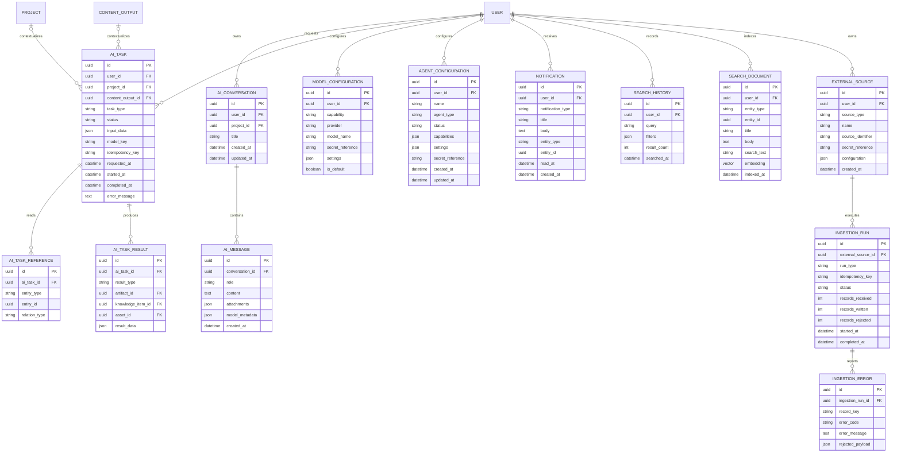

# CreatorOS 完整数据模型

## 1. 文档目标

本文定义 CreatorOS 愿景版本的逻辑数据模型。模型覆盖当前 `ui` 目录中的 17 个页面，同时遵循以下已确认原则：

- 产品面向个人创作者，所有业务数据归属于 `User`，不引入 Workspace、团队成员、角色和权限。
- 每个内容选题对应一个 `Project`。
- 六阶段固定为 `Research → Planning → Script → Production → Publishing → Review`，允许跳过，不允许增删或排序。
- Research 与 Planning 是 Project 共享阶段；从 Script 开始，每个 `ContentOutput` 可独立推进。
- `ContentOutput` 表示一个视频、图文或音频成品，同一成品可以产生多个平台 `Publication`。
- 阶段产物采用 `Artifact + ArtifactVersion + 专用结构表` 的混合模型。
- 知识、素材和经验是用户级资源，可以独立存在，也可以被多个 Project 引用。
- 平台发布、指标采集和其他数据写入由外置脚本或 Skill 完成，CreatorOS 只定义稳定的数据契约。

## 2. 领域划分

| 领域 | 主要职责 |
|---|---|
| Identity | 用户、偏好和模型配置 |
| Project | 项目、固定阶段、内容成品、任务、里程碑、动态 |
| Artifact | 各阶段产物、不可变版本和派生关系 |
| Research & Planning | 论点、证据、竞品、受众和内容策划结构 |
| Knowledge & Assets | 全局知识、素材、标签和跨项目复用 |
| Production | 制作记录、时间线、素材使用和导出 |
| Publishing | 平台发布实例与平台适配信息 |
| Analytics & Review | 指标、留存、复盘、洞察和经验 |
| AI & System | AI 对话、AI 任务、通知、搜索历史和外部写入溯源 |

## 3. 核心生命周期 ER Diagram

## 4. 阶段产物与版本 ER Diagram

### 4.1 Artifact 类型

`artifact_type` 是可扩展类型，不通过新增表表达每一个页面区块。首批支持：

| 阶段 | Artifact 类型 |
|---|---|
| Research | `project_idea`、`trend_analysis`、`market_analysis`、`competitor_analysis`、`audience_research`、`research_note` |
| Planning | `content_contract`、`thesis_tree`、`evidence_map`、`audience_profile`、`differentiation`、`content_outline` |
| Script | `master_script`、`output_script`、`golden_quotes`、`script_review` |
| Production | `production_plan`、`shot_list`、`timeline`、`subtitle_plan`、`export_config` |
| Publishing | `publish_package`、`platform_copy`、`cover_brief` |
| Review | `review_report`、`comparison_report`、`optimization_plan` |

### 4.2 Artifact 关系

`relation_type` 首批支持：

- `derived_from`：输出脚本派生自主脚本。
- `references`：策划产物引用研究产物。
- `replaces`：新产物替代旧产物，但不删除历史。
- `supports`：证据或分析支撑某个结论。
- `summarizes`：复盘报告总结指标或其他产物。

## 5. 全局资源 ER Diagram

### 5.1 资源关联表

| 实体 | 关键字段 | 业务含义 |
|---|---|---|
| `ProjectKnowledge` | project_id, knowledge_item_id, relation_type | Project 收藏、引用或产出的知识 |
| `ProjectAsset` | project_id, asset_id, usage_type | Project 的共享素材 |
| `ArtifactKnowledge` | artifact_id, knowledge_item_id, citation_note | 产物的资料来源和证据引用 |
| `ArtifactAsset` | artifact_id, asset_id, usage_type, position | 产物使用的附件、截图或媒体 |
| `OutputAsset` | content_output_id, asset_id, role | 成品、封面、字幕、音轨和预览图 |

`EntityTag` 是唯一保留的轻量多态关联。若物理数据库要求所有关系均有强外键，可拆为 `ProjectTag`、`KnowledgeTag`、`AssetTag`、`ArtifactTag` 和 `LearningTag`。

## 6. 制作、发布与分析 ER Diagram

## 7. AI、外部写入与系统能力 ER Diagram

## 8. 实体目录

### 8.1 核心实体

| 实体 | 作用 |
|---|---|
| `User` | 个人数据所有权根节点 |
| `UserPreference` | 默认首页、创作模式、自动保存等偏好 |
| `Project` | 一个内容选题及其完整生命周期 |
| `ProjectRelation` | Project 之间的系列、延续、派生、参考或相关关系 |
| `ProjectStage` | Project 六阶段总状态 |
| `ProjectTargetPlatform` | 新建项目和策划阶段记录的平台意向，不代表已经发布 |
| `ContentOutput` | 视频、图文或音频内容成品 |
| `OutputStage` | 单个成品从写稿到复盘的独立状态 |
| `Task` | 待办事项，可关联 Project、Output 和阶段 |
| `Milestone` | 计划或系统生成的关键时间点 |
| `ProjectActivity` | 项目动态审计流 |

### 8.2 产物实体

| 实体 | 作用 |
|---|---|
| `Artifact` | 阶段产物的稳定身份和当前状态 |
| `ArtifactVersion` | 不可变内容版本 |
| `ArtifactRelation` | 派生、引用、替代和总结关系 |
| `ThesisNode` | 论点树结构 |
| `ScriptSection` | 脚本章节、时间码和正文 |
| `EvidenceLink` | 论点与知识、素材之间的证据关系 |
| `TimelineSegment` | 制作时间线的结构化片段 |

### 8.3 资源实体

| 实体 | 作用 |
|---|---|
| `KnowledgeItem` | 全局笔记、参考资料、灵感和复用片段 |
| `KnowledgeRevision` | 知识内容历史版本 |
| `KnowledgeRelation` | 知识图谱关系 |
| `Asset` | 可复用素材的业务身份 |
| `AssetFile` | 素材物理文件版本 |
| `Learning` | 可复用经验、策略、Hook、结构或失败案例 |
| `LearningApplication` | 经验在新项目中的应用及效果 |
| `Tag` / `EntityTag` | 跨项目和资源分类 |

### 8.4 制作与发布实体

| 实体 | 作用 |
|---|---|
| `Production` | 一个 ContentOutput 的制作状态和设置 |
| `ProductionSegment` | 制作时间线片段 |
| `SegmentAsset` | 时间线片段使用的素材 |
| `ExportRecord` | 导出配置、状态和成品文件 |
| `Publication` | 一个成品在某个平台的一次发布实例 |
| `PublicationRevision` | 平台标题、简介、封面和设置版本 |

### 8.5 分析与复盘实体

| 实体 | 作用 |
|---|---|
| `MetricSnapshot` | 某个时间点的平台原始指标快照 |
| `MetricValue` | 可跨平台聚合的标准化指标 |
| `RetentionPoint` | 内容时间轴留存数据 |
| `AudienceSnapshot` | 性别、年龄、来源等受众维度 |
| `Review` | Project 或 Output 的一次复盘 |
| `ReviewPublication` | 复盘覆盖的发布实例 |
| `ReviewInsight` | 成功原因、待优化点和行动建议 |

### 8.6 AI 与系统实体

| 实体 | 作用 |
|---|---|
| `AIConversation` / `AIMessage` | AI Copilot 对话历史 |
| `AITask` | 可审计的 AI 工作请求 |
| `AITaskReference` | AI 任务读取的上下文 |
| `AITaskResult` | AI 任务产生的产物或结构化结果 |
| `ModelConfiguration` | 各能力使用的模型配置 |
| `AgentConfiguration` | 可供 AI Copilot 或外置执行器使用的 Agent 配置 |
| `ExternalSource` | 外置 Skill 或脚本的数据来源 |
| `IngestionRun` / `IngestionError` | 外部写入批次、幂等和错误记录 |
| `Notification` | 任务、发布、导入和系统通知 |
| `SearchHistory` | 全局搜索历史 |
| `SearchDocument` | 关键词和向量检索使用的派生索引，不是业务真相源 |

## 9. 关键约束

1. 所有顶层业务实体必须直接或间接归属于一个 `User`。
2. `ProjectRelation` 的源项目和目标项目必须属于同一 User，且不能指向自身。
3. 每个 Project 对六个 `ProjectStage.stage` 最多一条记录。
4. 每个 Project 对同一平台最多一条 `ProjectTargetPlatform`；它只表达意向。
5. `OutputStage` 只允许 `script`、`production`、`publishing` 和 `review`。
6. `ArtifactVersion` 创建后不可更新；编辑必须创建新版本。
7. `Artifact.current_version_id` 必须指向同一 Artifact 的版本。
8. `ContentOutput.primary_asset_id` 必须引用该 Output 的 `OutputAsset`。
9. 一个 `Publication` 只属于一个 ContentOutput；同一 ContentOutput 可有多个平台发布。
10. `Publication(platform, external_id)` 在 external_id 非空时唯一。
11. `MetricSnapshot(publication_id, source, captured_at)` 唯一，确保外部脚本重复写入时幂等。
12. `IngestionRun(external_source_id, idempotency_key)` 唯一。
13. `SearchDocument(entity_type, entity_id)` 在 User 范围内唯一，可随时从业务表重建。
14. 删除 Project 默认执行归档；全局知识、素材和经验不会因项目归档而删除。
15. Asset 物理文件删除前必须确认不存在有效引用，或先进入回收站保留期。

## 10. 派生数据与视图

以下 UI 数据应通过查询、物化视图或搜索索引生成，不建立重复的业务主表：

| UI 功能 | 数据来源 |
|---|---|
| Dashboard 统计卡片 | Project、Publication、MetricValue 聚合 |
| 继续创作 | 最近更新且未完成的 Project / ContentOutput |
| 待办事项 | Task |
| 项目进度 | ProjectStage 与 OutputStage 聚合 |
| 项目资产概览 | Artifact、ProjectAsset、OutputAsset 计数 |
| 发布中心 | Publication + ContentOutput + 最新 MetricSnapshot |
| 数据概览 | MetricValue 时间窗口聚合 |
| 经验沉淀 | Learning + LearningApplication |
| 知识图谱 | KnowledgeRelation |
| 全局搜索 | Project、Artifact、KnowledgeItem、Asset、Publication、Learning 的搜索索引 |
| 存储空间 | AssetFile.file_size 和派生文件聚合 |
