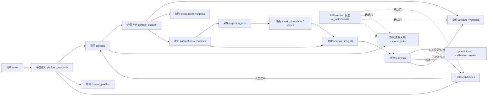
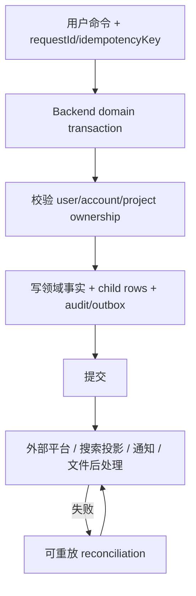

# CreatorOS 数据地图：现状、全链路与修复后目标

> 文档状态：T-327 架构单一真值之一
>
> 代码快照：`main@68443e4`，2026-07-15
>
> 事实来源：`backend/src/schema/*.ts`、`backend/drizzle/0000..0039`、contract resource/operation、backend service/repository 与 T-326 实跑审查。旧设计文档只作历史背景。

## 1. 怎么读这份地图

这份文档同时保留两张图：

- **AS-IS（当前）**：代码和迁移现在真正做到什么，包括缺陷。
- **TO-BE（修复后）**：关闭 T-326 风险后必须长期成立的数据规则，不表示当前已经实现。

当前应用层有 **83 张现役 schema 表**；完整执行 `0000..0039` 后的物理数据库有 **88 张表**。差额是 5 张已经退出应用模型但仍留在用户数据库中的变现历史表。迁移早期还创建过 `thesis_nodes`、`evidence_links`，但已在 `0015_drop_artifact_structured_tables.sql` 删除，不能计入当前物理表。业务关系几乎全部是 text ID **软引用**；迁移中没有真正的业务 `FOREIGN KEY REFERENCES`。因此，关系完整性目前主要依赖 backend service 的 ownership 守卫、事务和唯一索引，而不是数据库自动兜底。

## 2. 一张大白话数据图

大白话：`platform_account` 是“哪个抖音号”，`project` 是“一条内容的工作空间”，`content_output` 是这条内容的具体产出，`publication` 是某个平台上的真实作品。真实表现必须从 publication 回来，经过指标、复盘、经验，再影响下一条内容；否则只是做稿工具，不是“越用越准”的 CreatorOS。

## 3. 数据归属模型

### D-OWN-01 用户根

`users.id` 是本机创作者身份根。`sessions`、设置、通知、搜索历史等纯个人数据只需要 `userId`。

### D-OWN-02 平台账号根

凡是会因“哪个账号”而改变语义的数据，归属键必须是 `(userId, accountId)`：定位、选题、真实作品、采集、指标、复盘、经验、校准、日历、自动化源。`accountId = null` 只允许表示迁移期全局/未绑定数据，不得在新写入中偷偷当“当前账号”。

### D-OWN-03 项目根

`projects.id` 是创作链根；`content_outputs.project_id` 是具体产出根。稿件、制作、发布、素材用料、盲预测、复盘必须能沿软引用回到项目，同时还要校验相同 `userId/accountId`。

### D-OWN-04 外部作品根

真实作品的业务唯一键是 `(platform, externalId)`，并且全系统只能有一个 canonical `publication`。manual 项目优先于 imported 空壳；重锚必须事务化迁移 publication、metrics、review links、topic attribution，并归档空壳项目。

### D-OWN-05 AI 候选根

`ai_tasks` / execution workspace 是过程和候选，不是领域事实。只有用户确认后，backend service 才能把候选物化为 candidate、artifact、asset、material link、learning 等实体。

## 4. 83 张现役表完整目录

“父锚继承”表示该行自身没有 `userId/accountId`，必须先通过父实体 ownership gate 才能读写。所有 `id` 默认为 text 主键；例外会单独标明。

### 4.1 身份、激活、平台账号与定位（7）

| 表 | 直接归属 / 父锚 | 作用与关键状态 |
|---|---|---|
| `users` | `id` 身份根 | 本机用户；email 有唯一索引 |
| `sessions` | `userId` | 登录 session；`token_hash` 唯一 |
| `activation_state` | 全局单机单行 | 桌面授权状态，独立于用户身份 |
| `platform_accounts` | `userId` | 平台账号；`active/archived`；目标应以 external account ID 唯一 |
| `creator_profiles` | `(userId, accountId)` | 每账号定位母版；复合唯一索引 |
| `positioning_statements` | `profileId` + 冗余 `(userId, accountId)` | 定位版本；`(profileId, versionNumber)` 唯一 |
| `notifications` | `userId` | 站内通知；`readAt` 表示已读 |

### 4.2 项目、产出、稿件和审核门（15）

| 表 | 直接归属 / 父锚 | 作用与关键状态 |
|---|---|---|
| `projects` | `(userId, accountId)` | 项目根；`manual/topic/imported`；`active/paused/archived/completed`；底层保留七个 stage 值 |
| `project_activities` | `projectId` 父锚 | 项目审计事件，记录状态跃迁和关键动作 |
| `project_stages` | `projectId` 父锚 | `(projectId, stage)` 唯一；`pending/in_progress/needs_review/completed/skipped` |
| `project_target_platforms` | `projectId`，可带 `accountId` | 项目目标平台；`(projectId, platform)` 唯一 |
| `content_outputs` | `projectId` 父锚 | 具体内容产出；`drafting/recording/editing/ready/published` |
| `output_stages` | `contentOutputId` 父锚 | `(contentOutputId, stage)` 唯一；产出内部进度 |
| `tasks` | `projectId`，可带 `contentOutputId` | 用户任务；`todo/in_progress/done/blocked` |
| `artifacts` | `(userId, accountId, projectId, contentOutputId)` | 可版本化稿件根；`active/archived` |
| `artifact_versions` | `artifactId` 父锚，可溯源 `aiTaskId` | 稿件正文版本；目标应唯一 `(artifactId, versionNumber)` |
| `artifact_relations` | `sourceArtifactId/targetArtifactId` 父锚 | 稿件关系图 |
| `script_sections` | `artifactVersionId` 父锚 | 脚本段落与顺序 |
| `timeline_segments` | `artifactVersionId` 父锚 | 时间线语义段，不代表通用 NLE |
| `review_rules` | `userId` | 文案审核规则；`active/disabled` 等状态与规则来源 |
| `script_review_reports` | `(userId, projectId)` | L1/L2 稿面审核结果与 verdict |
| `material_links` | `(userId, projectId, contentOutputId)` | 项目用料链，连接 knowledge/asset；entity 为软多态引用 |

### 4.3 素材、知识、标签与搜索（13）

| 表 | 直接归属 / 父锚 | 作用与关键状态 |
|---|---|---|
| `assets` | `(userId, accountId)` | 素材根；`active/trashed`，当前文件由 `currentFileId` 指向 |
| `asset_files` | `assetId` 父锚 | 文件版本；`storageKey` 唯一；提取状态 pending/done/failed/unsupported |
| `asset_uploads` | `userId` | 临时上传会话；`created → completed`，带过期时间 |
| `knowledge_items` | `(userId, accountId)` | 知识条目；`active/archived`；当前 revision 必须有效 |
| `knowledge_revisions` | `knowledgeItemId` 父锚 | 知识正文版本 |
| `knowledge_relations` | 两端 knowledge 父锚 | 知识图谱软关系 |
| `tags` | `userId` | 标签字典；`(userId, name)` 唯一 |
| `entity_tags` | `userId` + 多态 entity | 标签绑定；`(tagId, entityType, entityId)` 唯一 |
| `search_documents` | `(userId, accountId)` | 多实体搜索投影；当前唯一键仍是 user/entity，TO-BE 需核对账号语义 |
| `search_history` | `userId` | 搜索历史与筛选条件 |
| `benchmark_sources` | `(userId, accountId)` | 对标账号来源，按平台 external account 唯一 |
| `benchmark_works` | `(userId, accountId)` + `sourceId` | 对标作品；按 aweme 唯一；拆解状态 pending/done |
| `trend_sources` | `(userId, accountId)` | 通用热点信源；当前 URL 唯一键未含 account |

### 4.4 选题、需求信号和正向归因（8）

| 表 | 直接归属 / 父锚 | 作用与关键状态 |
|---|---|---|
| `candidates` | `(userId, accountId)`，可溯源 `aiTaskId` | 选题池；source=trend/benchmark/demand/idea/favorites；`pool/promoted/dropped` |
| `topic_preferences` | `(userId, accountId)` | 避免/偏好规则；`candidate/active/archived`；AS-IS 唯一键漏 account |
| `audience_signals` | `(userId, accountId)`，可连 `publicationId` | 评论/私信/咨询/复盘需求信号；外部 ID 幂等 |
| `topic_promotions` | `(userId, accountId)` + `candidateId/projectId` | 选题立项事实；candidate 唯一 promotion |
| `topic_attributions` | `(userId, accountId, publicationId, projectId)` | 发布后正向/负向归因；publication 唯一 |
| `favorites_folders` | `(userId, accountId)` | 指定抖音收藏夹；AS-IS `(userId, name)` 唯一漏 account |
| `favorites_items` | `(userId, accountId)` + folder | 收藏作品；AS-IS `(userId, awemeId)` 唯一漏 account；含蒸馏状态 |
| `content_calendar_entries` | `(userId, accountId)` | 排期槽；绑定 output 或 candidate（二选一）；`planned/published/missed` |

### 4.5 制作与受控执行（4）

| 表 | 直接归属 / 父锚 | 作用与关键状态 |
|---|---|---|
| `productions` | `userId` + `contentOutputId` | 每 output 唯一制作单；`drafting→recording→editing→rendering→ready` |
| `production_segments` | `productionId` 父锚 + 冗余 `userId` | 制作分段，可溯源 script section |
| `segment_assets` | `productionSegmentId` 父锚 + 冗余 `userId` | 分段用料；video/broll/overlay/audio/caption |
| `export_records` | `productionId` 父锚 + 冗余 `userId` | 导出记录；`queued/rendering/ready/failed` |

Execution 不另建领域表，复用 `ai_tasks`、`ai_task_results`、`ai_task_steps`；沙箱产物在确认前只是 workspace 文件，确认后才变成 `assets/asset_files`。

### 4.6 发布、采集、指标与日历（16）

| 表 | 直接归属 / 父锚 | 作用与关键状态 |
|---|---|---|
| `publications` | `(userId, accountId, contentOutputId)` | 平台作品根；`draft/scheduled/published/removed/failed`；外部作品唯一锚 |
| `publication_revisions` | `publicationId` 父锚 + 冗余 `userId` | 发布文案/封面版本；TO-BE 唯一 `(publicationId, revisionNumber)` |
| `external_sources` | `(userId, accountId)` | 采集源与凭据引用 |
| `ingestion_runs` | `(userId, accountId)` + `externalSourceId` | 一次采集；`pending/running/completed/partial/failed`；source/idempotency 唯一 |
| `ingestion_errors` | `ingestionRunId` 父锚 + 冗余 `userId` | 被拒记录和错误原因 |
| `ingestion_records` | `ingestionRunId` 父锚 + 冗余 `userId` | 每个 record 的 written/rejected 幂等账 |
| `douyin_throttle_state` | `channel` 主键，全局 | creator-center/iesdouyin 退避状态 |
| `metric_snapshots` | `(userId, accountId, publicationId)` | 指标快照；`(publicationId, source, capturedAt)` 唯一 |
| `metric_values` | `metricSnapshotId` 父锚 + 冗余 `(userId, accountId)` | 单指标值；必须和 snapshot 同事务 |
| `retention_points` | `(userId, accountId, publicationId)` | 留存曲线点 |
| `audience_snapshots` | `(userId, accountId, publicationId)` | 观众画像快照 |
| `publishing_cadences` | `(userId, accountId)` | 每账号发布频率；复合唯一 |
| `scheduled_job` | `(userId, accountId)` | 自动化定义；cron/sourceKind/toolGrants/recipe |
| `job_run` | `jobId` 父锚 + 冗余 `userId` | 运行记录；`running/succeeded/failed/needs_reconnect` |
| `review_publications` | `(reviewId, publicationId)` + 冗余 `userId` | 复盘与作品的连接表 |
| `platform_accounts` | 见 4.1 | 同时是发布、采集、日历和指标的第二归属根，此处不重复计数 |

上表为链路解释重复引用 `platform_accounts`，83 表计数仍以每张表只计一次为准。

### 4.7 复盘、经验与校准（13）

| 表 | 直接归属 / 父锚 | 作用与关键状态 |
|---|---|---|
| `reviews` | `(userId, accountId, projectId, contentOutputId)` | project/output 复盘；`in_progress/completed/abandoned` |
| `review_insights` | `(userId, accountId, reviewId)` | success/issue/action/hypothesis 证据项 |
| `learnings` | `(userId, accountId, projectId, reviewId)` | 经验候选；`candidate/validated/discarded` |
| `learning_applications` | `(userId, accountId, projectId, contentOutputId)` | 某条经验在后续项目的应用与结果 |
| `rubrics` | `(userId, accountId)` | 校准规则集 |
| `rubric_versions` | `(userId, accountId)` + `rubricId` | 规则版本；`(rubricId, versionNumber)` 唯一 |
| `predictions` | `(userId, accountId)` | 发布前盲预测；`draft/locked` |
| `calibration_results` | `(userId, accountId)` + prediction | 实际结果与偏差；prediction 唯一 |
| `calibration_rule_suggestions` | `(userId, accountId)` + learning | 规则调整候选；pending/adopted/dismissed |
| `topic_attributions` | 见 4.4 | 正向归因是复盘飞轮输入，此处不重复计数 |
| `metric_snapshots` | 见 4.6 | 真实表现是复盘证据，此处不重复计数 |
| `audience_signals` | 见 4.4 | 评论需求信号是复盘证据，此处不重复计数 |
| `positioning_statements` | 见 4.1 | 经人工确认后可承接定位修正，此处不重复计数 |

### 4.8 AI、会话、任务、配置与运行支撑（17）

| 表 | 直接归属 / 父锚 | 作用与关键状态 |
|---|---|---|
| `ai_conversations` | `(userId, accountId, projectId)` | global/project/surface 对话作用域 |
| `ai_messages` | `conversationId` 父锚 | user/assistant/system 消息、tool parts、用量元数据 |
| `ai_tasks` | `(userId, accountId, projectId, contentOutputId)` | AI/Execution 任务；`queued/running/awaiting_confirmation/succeeded/failed/cancelled` |
| `ai_task_references` | `aiTaskId` 父锚 | 输入实体溯源 |
| `ai_task_results` | `aiTaskId` 父锚 | 候选/manifest/adoption 结果 |
| `ai_task_steps` | `aiTaskId` 父锚 | 可观测步骤流；按 `(task, stepNo)` 索引 |
| `user_preferences` | `userId` 主键 | 首页、创作模式、隐私/分析开关 |
| `model_configurations` | `userId` | capability 模型路由；当前 `(userId, capability)` 唯一 |
| `storage_configs` | `userId` 主键 | local/S3 存储配置 |
| `agent_configurations` | `userId` | Agent 能力与凭据引用 |
| `skill_config_overrides` | 以 skill ID 为根 | 当前 prompt/system/template 覆盖；全局配置语义 |
| `skill_config_override_versions` | override ID 软父锚 | prompt 覆盖历史与回滚 |
| `publishing_cadences` | 见 4.6 | 用户账号节奏配置，不重复计数 |
| `scheduled_job` | 见 4.6 | 自动化定义，不重复计数 |
| `job_run` | 见 4.6 | 自动化运行，不重复计数 |
| `search_documents` | 见 4.3 | 派生读模型，不重复计数 |
| `search_history` | 见 4.3 | 用户行为记录，不重复计数 |

## 5. 计数对账

为避免分组中的跨域引用造成误解，现役 83 表按 schema 文件一次性对账如下：

| Schema | 表数 | 表名 |
|---|---:|---|
| `activation.ts` | 1 | `activation_state` |
| `ai.ts` | 6 | `ai_conversations`, `ai_messages`, `ai_tasks`, `ai_task_references`, `ai_task_results`, `ai_task_steps` |
| `analytics.ts` | 4 | `metric_snapshots`, `metric_values`, `retention_points`, `audience_snapshots` |
| `artifacts.ts` | 5 | `artifacts`, `artifact_versions`, `artifact_relations`, `script_sections`, `timeline_segments` |
| `assets.ts` | 3 | `assets`, `asset_files`, `asset_uploads` |
| `benchmark.ts` | 2 | `benchmark_sources`, `benchmark_works` |
| `calibration.ts` | 5 | `rubrics`, `rubric_versions`, `predictions`, `calibration_results`, `calibration_rule_suggestions` |
| `candidate.ts` | 4 | `candidates`, `topic_preferences`, `audience_signals`, `topic_promotions` |
| `content-calendar.ts` | 2 | `content_calendar_entries`, `publishing_cadences` |
| `favorites.ts` | 2 | `favorites_folders`, `favorites_items` |
| `identity.ts` | 2 | `users`, `sessions` |
| `ingestion.ts` | 5 | `external_sources`, `ingestion_runs`, `ingestion_errors`, `douyin_throttle_state`, `ingestion_records` |
| `knowledge.ts` | 3 | `knowledge_items`, `knowledge_revisions`, `knowledge_relations` |
| `learnings.ts` | 2 | `learnings`, `learning_applications` |
| `material-links.ts` | 1 | `material_links` |
| `notifications.ts` | 1 | `notifications` |
| `platform-account.ts` | 1 | `platform_accounts` |
| `positioning.ts` | 2 | `creator_profiles`, `positioning_statements` |
| `production.ts` | 4 | `productions`, `production_segments`, `segment_assets`, `export_records` |
| `projects.ts` | 7 | `projects`, `project_activities`, `project_stages`, `project_target_platforms`, `content_outputs`, `output_stages`, `tasks` |
| `publishing.ts` | 2 | `publications`, `publication_revisions` |
| `review-gate.ts` | 2 | `review_rules`, `script_review_reports` |
| `reviews.ts` | 3 | `reviews`, `review_insights`, `review_publications` |
| `scheduling.ts` | 2 | `scheduled_job`, `job_run` |
| `search.ts` | 2 | `search_documents`, `search_history` |
| `settings.ts` | 6 | `user_preferences`, `model_configurations`, `storage_configs`, `agent_configurations`, `skill_config_overrides`, `skill_config_override_versions` |
| `taxonomy.ts` | 2 | `tags`, `entity_tags` |
| `topic-attribution.ts` | 1 | `topic_attributions` |
| `trend-sources.ts` | 1 | `trend_sources` |
| **合计** | **83** | 应与 schema 机械扫描一致 |

## 6. 物理数据库中的 5 张历史表

迁移是追加式的，以下表仍存在于已升级数据库，但不在 `backend/src/schema` 出口，也没有现役业务模块使用：

| 历史表 | 原语义 | 当前规则 |
|---|---|---|
| `products` | 变现产品 | 冻结；不新增数据、不向用户展示 |
| `offers` | 产品报价版本 | 冻结 |
| `leads` | 线索 | 冻结 |
| `conversion_events` | 转化事件 | 冻结 |
| `content_output_products` | 内容与产品关系 | 冻结 |
TO-BE：先做只读数据量审计和导出兼容，再决定迁移归档或删除；不得仅因代码不用就静默 drop 用户历史数据。`thesis_nodes/evidence_links` 已被物理删除，但 contract 的 artifact resource 仍保留旧类型，属于契约残留，应通过兼容期和使用面扫描后有计划退役。

另外有两处“物理列存在、Drizzle 现役对象不建模”的漂移：`projects.positioning_statement_id` 与 `project_target_platforms.account_id`。任何依赖这两列的目标设计必须先决定是恢复建模还是做迁移清理，不能继续保持不可读写的幽灵列。

## 7. 五条真实数据链

### D-FLOW-01 定位到立项

`platform_accounts → creator_profiles/positioning_statements → candidates → topic_promotions → projects → content_outputs`

AI 可以生成定位或选题候选，但 `candidates.promote` 和项目创建是人工动作。账号上下文必须从 RequestContext 贯穿每次读写。

### D-FLOW-02 项目到稿件与素材

`projects → content_outputs → artifacts → artifact_versions → script_sections`，同时由 `material_links` 连接 `knowledge_items` 与 `assets`。搜索只写 `search_documents` 派生投影，不得反向作为领域真值。

### D-FLOW-03 稿件到受控成片

`content_output → production → production_segments → segment_assets → export_records → execution task → awaiting_confirmation → assets/asset_files`。产物在确认前留在隔离 workspace；确认后才进入素材库，并成为 output primary asset。

### D-FLOW-04 发布到真实数据

`content_output → publication → publication_revision → ingestion_run → metric_snapshot/metric_values + retention/audience + audience_signals`。外部 aweme ID 是幂等锚；同一作品不得因日拉和手工登记产生两个 canonical 项目。

### D-FLOW-05 复盘飞轮

`publication + prediction + metrics + comments → review → review_insights → learning(candidate) → 人工 validate/application → calibration suggestion / topic preference / 下一项目上下文`。没有证据时字段保持 null/0/空，不生成“为什么有效”的想象文本。

## 8. 修复后必须成立的数据不变量

| ID | TO-BE 不变量 | 对应 T-326 | 可执行验收 |
|---|---|---|---|
| D-G01 | 所有按号数据以 `(userId, accountId)` 过滤、唯一和写入；新行不得隐式 null account；RSC 与 browser RPC 使用同一服务端可验证账号上下文 | DATA-H01/H02、RT-H01 | 双账号同名收藏/偏好/作品/指标隔离测试；切号刷新首屏一致；无效/越权 ID 返回 ownership error |
| D-G02 | publication contract 与存储一致；每个 publication 始终有合法 revision，或 contract 明确 nullable | B-02 | 真实 contract client 解析 imported publication list/detail |
| D-G03 | `(platform, externalId)` 只有一个 canonical publication；manual 项目优先并可事务化 re-parent | B-03、DATA-H03/H08 | “先日拉后登记”与并发登记测试，指标和复盘全部归 manual 项目 |
| D-G04 | 远端发布、local status、project rollup 有 outbox/reconciliation；重试不重复发布 | DATA-H04 | 在每个副作用点故障注入，恢复后最终一致且外部只发一次 |
| D-G05 | AI/Execution 多项采纳使用事务、幂等 item key 和 adoption ledger | DATA-H06/H07、RT-H10 | 第 N 项失败后重试不重复前 N-1 项；拒绝候选不出现 active 资产 |
| D-G06 | metric snapshot 与 value、revision number、scheduler run 由数据库约束防并发竞争 | DATA-M01/M02、RT-H08 | 双并发测试只有一个逻辑结果，无缺 child row、无重复 revision/run |
| D-G07 | 删除/归档有显式级联清单，覆盖 production、analytics、attribution、learning、search、workspace | DATA-H05 | 建满关联数据后删除，逐表与文件系统断言无孤儿；需保留的审计数据匿名/归档 |
| D-G08 | file-PGlite 只在明确损坏签名下进入恢复流程；迁移/权限/磁盘错误绝不自动切空库 | DATA-H09 | 注入三类错误，原库目录不改名；提供备份、诊断与人工恢复入口 |
| D-G09 | `next build`、类型检查、静态分析完全只读，不连用户库、不 seed、不扫任务、不启 scheduler | ENG-H02 | 用临时 HOME/appData 监控文件与进程，build 前后 hash/进程数一致 |
| D-G10 | 所有外部文本、网页和本地文件标记为不可信数据；不得凭内容触发写类/付费工具 | RT-H04/H05 | SSRF 与 prompt injection 回归集；默认 deny、逐重定向复检 |
| D-G11 | execution 的 network/环境变量约束由 OS/进程层真正执行 | RT-H06 | deny 模式无法联网；子进程环境只含 allowlist，不含模型/DB/S3 secrets |
| D-G12 | 所有读模型（dashboard/search）可从领域真值重建，绝不成为唯一数据来源 | FE-H02/H03、ENG-H02 | 清空投影后重建一致；读取失败展示真实空/错误，不回退 fixture |

## 9. 数据事务边界

规则：领域事实和必需子行同事务；外部不可回滚副作用走 idempotency + outbox/reconciliation；通知、搜索等派生副作用失败不能伪装主事务失败，但必须留下可重试记录。

## 10. 删除、保留与恢复

- **归档优先**：项目、知识、素材、账号有用户可恢复语义时，先归档/软删。
- **硬删闭包**：明确删除时先枚举软引用闭包，再同事务删除 DB 行，事务后清对象文件/workspace；文件清理失败进入重试账。
- **发布事实保留**：外部已发布作品不因本地隐藏而变成 removed；`hiddenAt` 与平台删除分开。
- **历史表保护**：5 张 legacy 表在没有导出/迁移报告前不 drop。
- **数据库恢复**：启动前快照、迁移日志、失败不换空库；恢复动作必须由用户确认。

## 11. 代码证据入口

- 现役 schema：[`backend/src/schema`](../backend/src/schema)
- 物理迁移：[`backend/drizzle`](../backend/drizzle)
- contract 状态与 ID：[`contract/src/primitives.ts`](../contract/src/primitives.ts)
- 项目状态机：[`projects.service.ts`](../backend/src/modules/projects/projects.service.ts)
- 发布与重锚链：[`publishing.service.ts`](../backend/src/modules/publishing/publishing.service.ts)
- 日拉与 imported project：[`ingestion.service.ts`](../backend/src/modules/ingestion/ingestion.service.ts)
- AI 候选确认：[`ai.service.ts`](../backend/src/modules/ai/ai.service.ts)
- Execution 采纳：[`execution.service.ts`](../backend/src/modules/execution/execution.service.ts)
- 上线审查证据：[`2026-07-15-prelaunch-full-engineering-data-audit-research.md`](research/2026-07-15-prelaunch-full-engineering-data-audit-research.md)
