# CreatorOS 功能模块与端到端链路地图

> 文档状态：T-327 架构单一真值之一
>
> 代码快照：`main@68443e4`，2026-07-15
>
> 状态含义：**已实现** = 代码存在真实主路径；**部分实现** = 主路径存在但关键分支/数据/恢复不完整；**未实现** = 没有真实实现；**发布阻断** = T-326 证明当前不能带风险上线。状态不是完成百分比。

## 1. 系统到底怎么跑

CreatorOS 当前不是“浏览器前端 + 独立 REST 后端”。桌面端由 Tauri 启动一个 Next standalone sidecar，WebView 访问本机随机端口；绝大多数业务请求进入统一 dispatch route，再在同一 Node 进程里调用 contract client、composite transport、backend service/repository 和 PGlite。

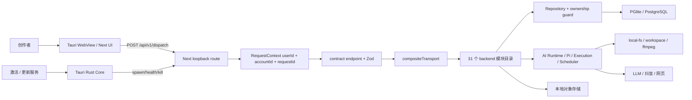

关键现实：

- `frontend` 承载 UI、Next route 和当前 composition root；backend 是业务库，不是独立 server。
- `contract` 有 195 个 operation ID，是 UI/backend 之间的公开合同。
- `backend/src/modules` 有 31 个目录，其中 `ai-runtime`、`execution`、`query-services` 属横切编排/读模型。
- 现役 schema 有 83 表；完整迁移后的物理库有 88 表，详见[数据地图](CreatorOS-data-model.md)。
- 当前用户可见项目工作面是 **脚本 → 制作视频 → 复盘** 三项；底层为兼容历史仍保留七个 stage 值。
- 当前正式打包目标只有 macOS `app/dmg`；Windows 不在已证明范围内。
- 当前账号选择只写浏览器 `localStorage` 并作为 `x-account-id` 注入客户端 RPC；多数 RSC 首屏通过 user-only `session.ctx` 读取。于是“切号后的客户端写入”和“刷新后的服务端首屏读取”可能使用不同 scope，这是当前多账号最核心的架构断层。

## 2. 统一调用链

### 2.1 同步读写

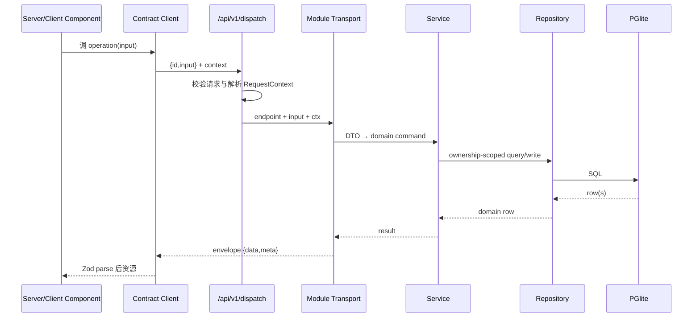

TO-BE：loopback route 在进入 RequestContext 前必须验证启动令牌、Host、Origin 与 Content-Type；任何 account ID 都要验证属于 user，而不是只信 header/cookie。

### 2.2 异步 AI / Execution / Ingestion

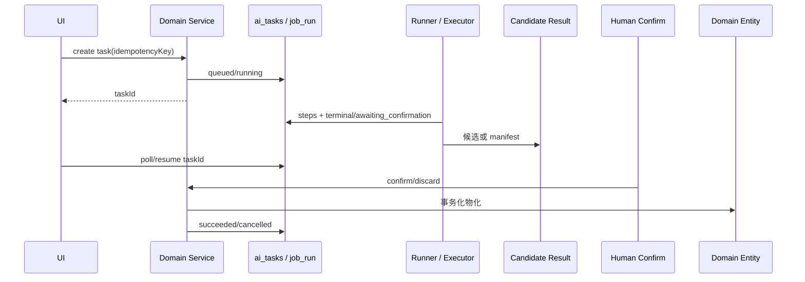

TO-BE：所有异步任务必须能跨切页/刷新/重启恢复；失败进入终态并停止轮询；确认操作幂等；runner 不能绕过 service 写领域表。

## 3. 信息架构与真实页面

### 3.1 一级导航

当前侧栏九个入口按代码顺序为：

1. 首页 `/`
2. 定位中心 `/positioning`
3. 选题 `/topics`
4. 项目 `/projects`
5. 知识库 `/knowledge`
6. 素材中心 `/assets`
7. 发布中心 `/publishing`
8. 自动化 `/automations`
9. 设置 `/settings`

账号切换器位于侧栏用户区，不是第十个导航。`/accounts`、`/calendar`、`/search` 是可达页面/入口但不在一级导航；`/experience` 重定向到知识库；project 的 research/planning/script/publishing 旧路由重定向到稿面锚点。

### 3.2 项目三工作面

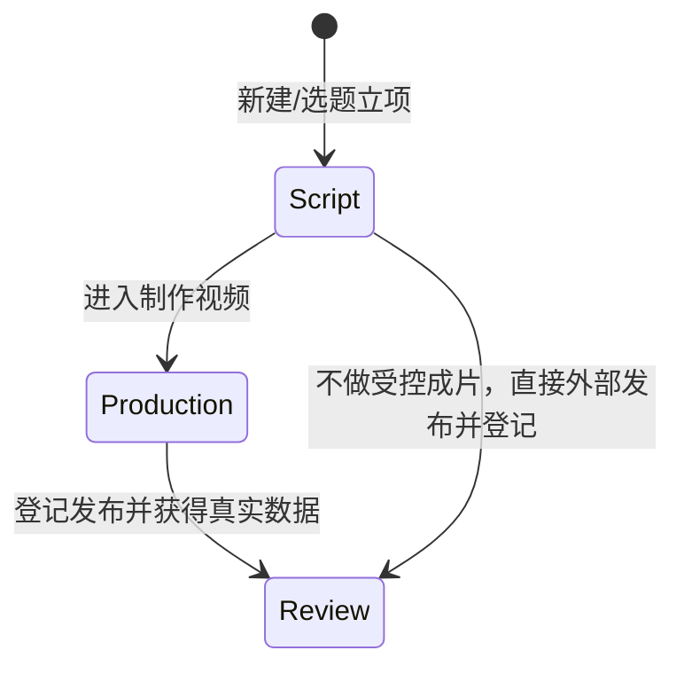

- **脚本**：`/projects/:id`，包含 Brief、选题卡、论点/结构、口播稿版本、弹药、审核、盲预测、发布包和登记已发布。
- **制作视频**：`/projects/:id/production`，包含粗剪/SRT/B-roll、四项 AI 决策、受控渲染、预览与确认入库。
- **复盘**：`/projects/:id/review`，包含预测与实际、指标、洞察、复盘记录、learning 与校准建议。

底层 `project_stages` 仍保存 `brief/research/planning/script/production/publishing/review`，展示层映射到上述三个工作面；这是兼容实现，不是七个用户页面。

### 3.3 物理页面清单（25 个 `page.tsx`）

- **公开入口（3）**：`/activate`、`/login`、`/register`。
- **Creator 一级/独立页面（13 个物理文件）**：`/`、`/accounts`、`/assets`、`/automations`、`/calendar`、`/experience`、`/knowledge`、`/positioning`、`/projects`、`/publishing`、`/search`、`/settings`、`/topics`。其中根页 `/` 是首页，`/experience` 只负责重定向，因此实际独立工作面为 12 个。
- **项目页面（8）**：`/projects/new`、`/projects/:projectId`、`/projects/:projectId/planning`、`/projects/:projectId/production`、`/projects/:projectId/publishing`、`/projects/:projectId/research`、`/projects/:projectId/review`、`/projects/:projectId/script`。research/planning/script/publishing 是兼容路由或稿面锚点，不是四套新工作台。
- **并行路由（1）**：`/(creator)/@modal/(.)projects/new`，为项目新建弹层；与 `/projects/new` 指向同一用户任务，不另计产品功能。

上面按用户 URL 统计时是 25 个物理 `page.tsx`：3 + 13 + 8 + 1。一级导航仍只有九项，物理路由数不能被误写为导航项或产品阶段数。

## 4. 12 个功能域串联矩阵

| ID | 功能域 / 用户入口 | Frontend | Contract / backend | 主数据 | 现状 |
|---|---|---|---|---|---|
| F-01 | 身份、激活、账号 `/activate` `/accounts` | activation、account manager、account switcher | identity、platform-account、ingestion login/status | `activation_state`, `users`, `sessions`, `platform_accounts`, `external_sources` | 部分实现；loopback 信任边界发布阻断 |
| F-02 | 首页 `/` | dashboard、layout、notification popover | query-services、notifications、pages.dashboard | projects/tasks/publications/metrics/notifications 的读模型 | 部分实现；通知单点与错误推断未关 |
| F-03 | 定位 `/positioning` | positioning center、Copilot | positioning、ai-runtime positioning runner | `creator_profiles`, `positioning_statements`, `ai_tasks` | 主路径已实现；多账号验收仍需发布门 |
| F-04 | 选题 `/topics` | topics、source cards、candidate cards | candidate、benchmark、trend-sources、favorites、topic-attribution | candidates/signals/preferences/promotions/sources/works | 部分实现；收藏/偏好 account 唯一键阻断 |
| F-05 | 项目与稿面 `/projects` `/projects/:id` | projects、draft-workbench、script、review-gate | projects、artifacts、material-links、review、calibration、publishing | project/output/artifact/material/prediction/publication | 主路径已实现；删除闭包与跨域原子性不足 |
| F-06 | 知识、素材、搜索 `/knowledge` `/assets` `/search` | knowledge、assets、search | knowledge、assets、taxonomy、search、material-links | knowledge/assets/files/tags/search_documents | 部分实现；AI 资产确认门、索引/account 语义需修 |
| F-07 | 制作与执行 `/projects/:id/production` | production workbench | production、execution、ai、ai-runtime | productions/segments/exports/ai_tasks/assets | 已实现但发布阻断；恢复、ffmpeg、执行隔离不成立 |
| F-08 | 发布与日历 `/publishing` `/calendar` | publishing center、draft publish region、calendar | publishing、content-calendar、projects | publications/revisions/calendar/cadence | 发布阻断；contract、canonical anchor、真实 publisher、日期 UX 有缺口 |
| F-09 | 采集与自动化 `/automations` | automations、账号连接状态 | ingestion、scheduling、ai-runtime collectors | external_sources/ingestion/job_run/metrics/signals | 主路径已实现但可靠性不足；并发、幂等、依赖随包需修 |
| F-10 | 指标、复盘、经验 `/projects/:id/review` `/knowledge` | analytics-review、learning cards | analytics、reviews、learnings、calibration、topic-attribution | metrics/reviews/insights/learnings/predictions/results | 部分实现；真实性受 publication/ingestion 阻断，部分读侧仍有 fixture base |
| F-11 | 编导 ChatBox 与模型 | global/project Copilot、AI task cards | ai、ai-runtime、execution、settings | conversations/messages/tasks/results/steps/model configs | 主路径已实现；Pi prompt/loader/假端口发布阻断 |
| F-12 | 设置与桌面运行时 `/settings` | settings、Tauri shell/updater | settings、activation、本地 API routes | preferences/models/storage/skill overrides/local grants | 部分实现；fixture 回退、CSP、更新、端口和构建副作用阻断 |

### 4.1 后端物理模块覆盖（31 个目录）

功能域是产品视角，目录是代码视角。当前 `backend/src/modules` 的 31 个一级目录全部落入上述功能域：

| 功能域 | 后端目录 |
|---|---|
| F-01 | `identity`, `platform-account` |
| F-02 | `notifications`, `query-services` |
| F-03 | `positioning` |
| F-04 | `benchmark`, `candidate`, `favorites`, `topic-attribution`, `trend-sources` |
| F-05 | `artifacts`, `material-links`, `projects`, `review` |
| F-06 | `assets`, `knowledge`, `search`, `taxonomy` |
| F-07 | `execution`, `production` |
| F-08 | `content-calendar`, `publishing` |
| F-09 | `ingestion`, `scheduling` |
| F-10 | `analytics`, `calibration`, `learnings`, `reviews` |
| F-11 | `ai`, `ai-runtime` |
| F-12 | `settings` |

`review` 与 `reviews` 是两个真实目录：前者服务稿面审核/校准组合，后者服务发布后复盘记录。目标架构应在命名上消除歧义，但在完成迁移前不可把两者误当成重复目录删除。

## 5. 195 个 operation 的命名空间归属

公开 contract 当前有 195 个 operation，分属 36 个顶级命名空间。下表确保每个 namespace 都有唯一业务归属；某个 op 是否被 UI 使用仍需以调用点为准。

| Namespace | 数量 | 功能归属 |
|---|---:|---|
| `identity` | 2 | F-01 身份 |
| `accounts` | 10 | F-01 账号 + F-08 日历 |
| `positioning` | 6 | F-03 定位 |
| `candidates` | 5 | F-04 选题 |
| `audienceSignals` | 2 | F-04/F-10 评论需求 |
| `benchmark` | 4 | F-04 对标 |
| `trend` | 4 | F-04 热点信源 |
| `favorites` | 4 | F-04 收藏夹 |
| `topics` | 2 | F-04 选题总览/归因 |
| `projects` | 13 | F-05 项目 |
| `outputs` | 8 | F-05/F-07/F-08 内容产出 |
| `tasks` | 1 | F-05 项目任务 |
| `artifacts` | 7 | F-05 稿件 |
| `reviewRules` | 4 | F-05 稿面审核规则 |
| `scriptReviews` | 2 | F-05 稿面审核报告 |
| `materialLinks` | 3 | F-05/F-06 用料链 |
| `knowledge` | 10 | F-06 知识 |
| `assets` | 11 | F-06 素材 |
| `taxonomy` | 8 | F-06 标签 |
| `search` | 1 | F-06 搜索 facets |
| `productions` | 3 | F-07 制作分段/导出 |
| `exports` | 1 | F-07 导出完成 |
| `execution` | 5 | F-07 受控执行 |
| `publications` | 5 | F-08 发布/评论 |
| `calendar` | 3 | F-08 日历条目 |
| `ingestion` | 7 | F-09 采集 |
| `scheduledJobs` | 6 | F-09 自动化定义 |
| `jobRuns` | 2 | F-09 自动化运行 |
| `analytics` | 2 | F-10 指标 |
| `reviews` | 5 | F-10 复盘 |
| `learnings` | 7 | F-10 经验 |
| `calibration` | 12 | F-10 盲预测/校准 |
| `ai` | 12 | F-11 对话/任务/确认 |
| `settings` | 12 | F-11/F-12 模型/技能/存储 |
| `notifications` | 2 | F-02 通知 |
| `pages` | 4 | F-02/F-03/F-05/F-06 组合读模型 |
| **合计** | **195** | contract 机械扫描结果 |

未被 UI 使用但仍保留的 operation 不能自动算“可用功能”。处理规则只有三种：标内部能力、补真实入口，或经过兼容期退役；禁止为了显得功能多而在 PRD 中列为已交付。

## 6. 九条核心用户旅程

### FLOW-01 首启、激活与绑定账号

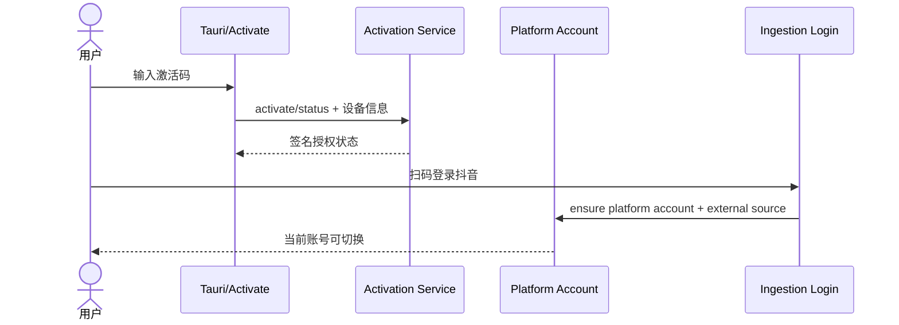

当前：激活和扫码入口存在。修复后：激活失败不初始化领域数据；loopback 请求都带启动令牌；扫码登录态、source、platform account 三者状态一致；当前账号进入服务端可验证 session/cookie，使 RSC 与 browser RPC 得到同一个 RequestContext。

### FLOW-02 定位到选题

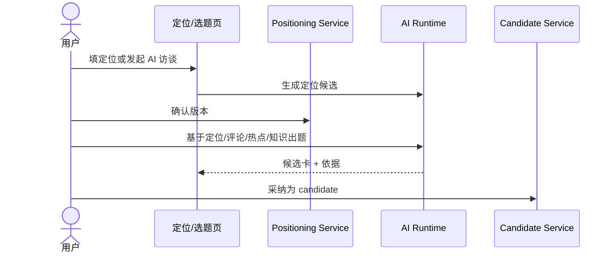

不变量：AI 候选未确认前不得改变当前定位或候选池；选题必须保留 source 与证据；所有读写绑定当前 account。

### FLOW-03 选题立项到稿面

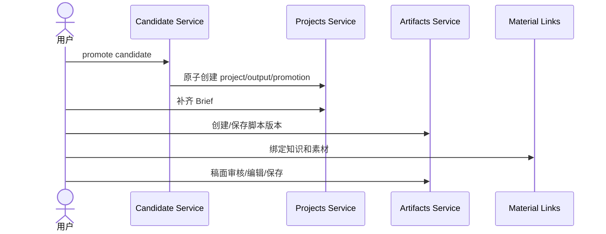

当前稿面还包含盲预测、发布包和登记。修复后选题 promotion 与 project 创建必须同事务；删除项目必须清理全部软引用。

### FLOW-04 知识与素材喂料

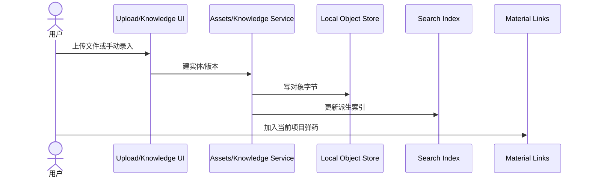

失败语义：对象字节、元数据、索引三者必须可对账；搜索投影失败不回滚真实素材，但留下重建路径；AI 生成内容确认前不能是 active 资产。

### FLOW-05 四决策到渲染确认

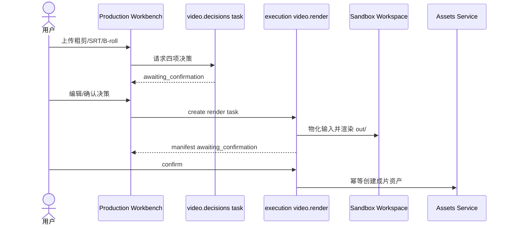

TO-BE：切页/刷新重挂 queued/running/awaiting/failed；failed 停止轮询；网络 deny 和环境 allowlist 真执行；ffmpeg 随包或启动时诚实禁用。

### FLOW-06 发布物料与登记真实作品

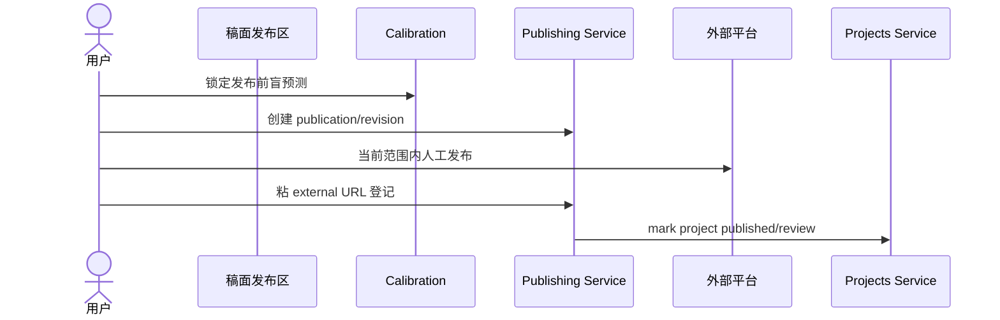

当前真实发布 adapter 仍是 MockPublisher，因此对外能力只能写“生成物料 + 人工发布 + 登记”。修复后 imported publication 必须有合法 revision；先日拉后登记时 publication 原子重锚到 manual 项目。

### FLOW-07 每日采集真实数据

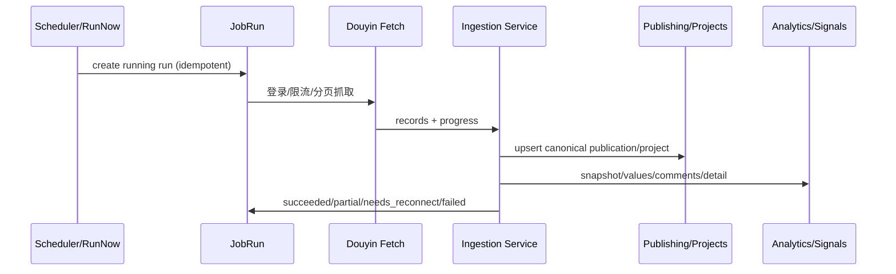

TO-BE：run 唯一约束先于任何项目创建；限流、0 新数据、部分成功和需重连必须是不同状态；同一外部作品不产生重复项目。

### FLOW-08 复盘到经验回流

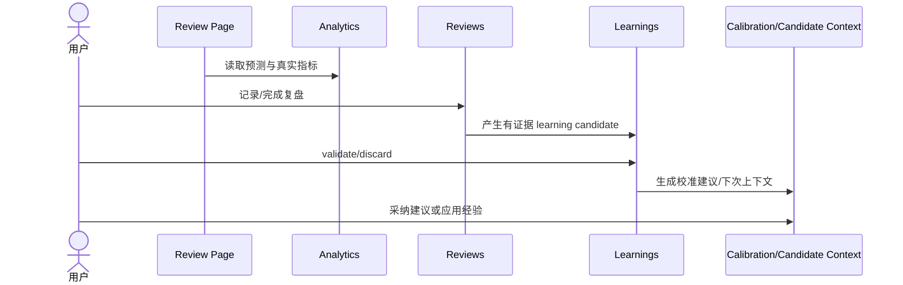

无 prediction、无 metrics、数据过旧必须分别展示；缺证据不能生成确定性因果结论；跨账号 learning 不得进入当前上下文。

### FLOW-09 自动化任务生命周期

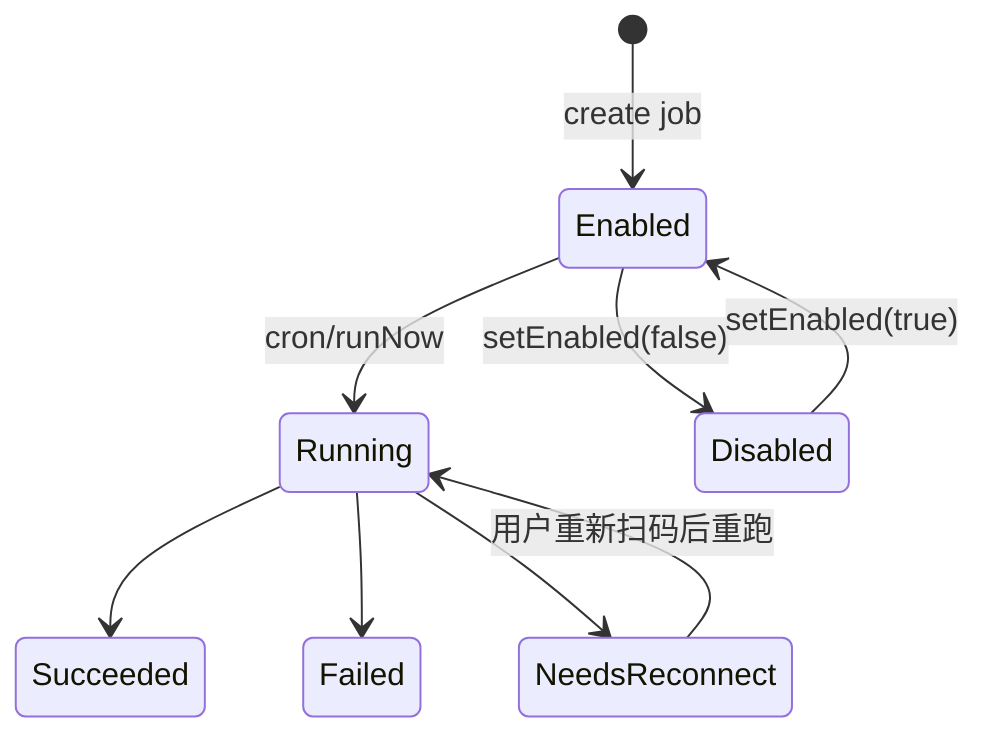

作业定义与每次运行分开；`scheduled_job` 不能用 `lastRunAt` 代替 run ledger。并发 scheduler 必须依赖 DB 唯一键/CAS，而不是“先查再建”。

## 7. 核心状态机对账

| 实体 | 合法状态 / 迁移 | 责任模块 | 当前恢复缺口 |
|---|---|---|---|
| Project | `active/paused/archived/completed`；展示三工作面，底层七 stage | projects | 删除闭包不完整；部分显示回退 fixture |
| Stage row | pending→in_progress→completed；gate 可到 needs_review；可带 reason skipped；内部 blocked 可回 in_progress | projects | contract 不暴露 blocked，诊断需统一 |
| ContentOutput | drafting/recording/editing/ready/published | projects/production/publishing | publication rollup 非原子 |
| AI/Execution task | queued→running→awaiting_confirmation→succeeded；running 可直接 succeeded/failed/cancelled | ai/execution | production 恢复漏 queued/running/failed；fallback 可能重放副作用 |
| Production | drafting→recording→editing→rendering→ready，只允许相邻前进 | production | UI 和异步 render 状态恢复未闭合 |
| Export | queued/rendering→ready，或 failed | production/execution | 超时进程树和重复 adoption |
| Publication | draft→scheduled→published→removed；scheduled→failed | publishing | revision contract、re-parent、外部副作用补偿 |
| IngestionRun | pending/running/completed/partial/failed（存储为 text） | ingestion | run 前先建项目、PGlite 恢复风险 |
| JobRun | running→succeeded/failed/needs_reconnect | scheduling | scheduler 并发竞态 |
| Review | in_progress→completed；abandoned 不可再写 insight | reviews | 部分页面读侧仍混 fixture |
| Learning | candidate→validated/discarded；application 另记结果 | learnings | bulk adoption 无事务；跨号范围需收紧 |
| CalendarEntry | planned→published/missed | content-calendar | 固定“今天”、过去日期、时区和失败反馈 |

## 8. 模块边界的修复后目标

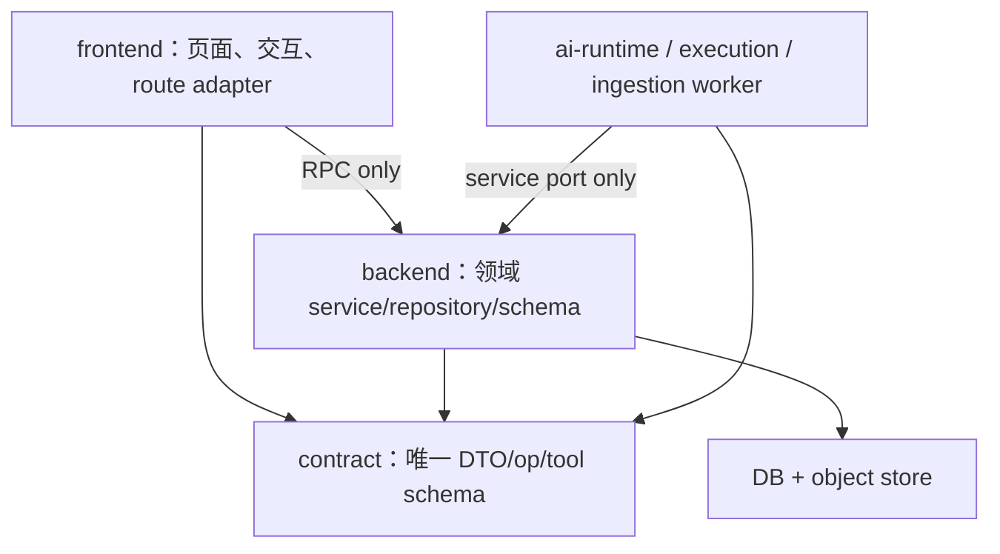

- frontend 不承载业务 repository、Agent SDK 或领域写入。
- backend 模块之间只调 public service port，不跨模块 import repository。
- runtime 只产候选/manifest，写领域实体必须经 service + ownership + confirm。
- query-services 只做组合读模型，不拥有领域事实。
- composition/build 阶段不得 seed、迁移、扫任务或启动 scheduler。

## 9. 当前链路断点

| ID | AS-IS 断点 | 修复后目标 |
|---|---|---|
| GAP-01 | 当前账号只在 localStorage/client header，RSC 首屏是 user-only context | 账号写入签名/服务端可读 session；RSC/RPC 共用 context resolver |
| GAP-02 | 无效 `x-account-id` 会静默降级成全账号查询 | 无效/归档 account 拒绝；全账号必须显式 scope |
| GAP-03 | Web Session domain 可路径穿越并递归删除 | hostname 规范化 + resolve/relative/realpath containment + 启动令牌 |
| GAP-04 | imported publication 没有 revision，transport 用空字符串伪装 | contract 与 DB 一致；导入时建 revision 或合法 nullable |
| GAP-05 | execution 多产物 confirm 逐项写资产，无事务 | adoption item ledger + 单事务/可补偿采纳 |
| GAP-06 | production render failed 不终止轮询，恢复漏多种任务态 | 统一 task resume 选择器覆盖全部非终态和失败态 |
| GAP-07 | active review ID 只在组件 state，刷新可重复新建 review | 从 reviews.list 恢复当前 in_progress review，并加并发唯一语义 |
| GAP-08 | scheduler “先查再建”无唯一约束，build 还能启动 cron | `(job,account,scheduledFor)` 唯一/CAS；runtime bootstrap 与 build 分离 |
| GAP-09 | candidate promote 顺序写 project/candidate/promotion，无事务且项目 source 退成 manual | promotion Unit of Work；source 固定 topic；重试返回同一 project |
| GAP-10 | publication/export 等主写后的 fan-out 只 catch，无 outbox | 事务 outbox + 持久 retry/reconciliation |
| GAP-11 | settings 真实读取失败显示 fixture 模型/容量 | 错误态 + retry；未知显示 0/未知 |
| GAP-12 | 通知读取失败可拖垮 creator layout，全部已读失败不回滚 | 辅助模块隔离降级；mutation allSettled + 回滚/错误反馈 |

## 10. 文档与代码冲突清单

- `docs/产品定位.md` 的两阶段已被当前三工作面代码取代。
- `2026-07-03-two-stage-project-design.md` 要求删除 production UI，已被后续 T-254c 反向决策覆盖，只能作为历史记录。
- 生命周期七阶段文档仍可解释底层兼容状态，但不是当前用户 IA。
- “不做视频编辑器”应改为“不做通用 NLE；做编导决策驱动的受控成片”。
- “只准 Vercel AI SDK、禁 Agent SDK”已与 Pi 引擎代码冲突；现行规则应是能力路由 + 隔离 ResourceLoader + 工具白名单。
- 自动真发布到抖音未实现；MockPublisher 不能包装成平台发布能力。
- 旧产品进度百分比、旧 product-audit 页面和历史 walkthrough 不能作为当前完成证明。

## 11. 代码证据入口

- 当前三工作面：[`shell-router.tsx`](<../frontend/src/app/(creator)/shell-router.tsx>)
- 一级导航：[`sidebar.tsx`](../frontend/src/components/shell/sidebar.tsx)
- 统一 dispatch：[`route.ts`](../frontend/src/app/api/v1/dispatch/route.ts)
- composition root：[`persistence-client.ts`](../frontend/src/server/persistence-client.ts)
- contract operations：[`contract/src/operations`](../contract/src/operations)
- backend 模块：[`backend/src/modules`](../backend/src/modules)
- 制作工作台：[`production-workbench.tsx`](../frontend/src/features/production/production-workbench.tsx)
- 复盘页：[`analytics-review-page.tsx`](../frontend/src/features/review/analytics-review-page.tsx)
- 上线审查：[`T-326 报告`](research/2026-07-15-prelaunch-full-engineering-data-audit-research.md)
- 完整数据地图：[`CreatorOS-data-model.md`](CreatorOS-data-model.md)
