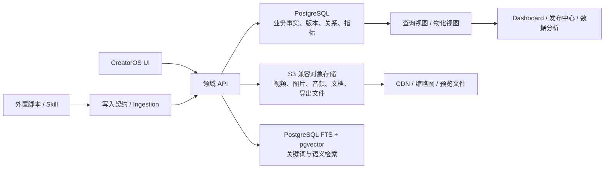

# CreatorOS 存储方案与产品业务逻辑

## 1. 产品业务模型

CreatorOS 是以 `Project` 为中心的个人创作操作系统。它管理的不是单篇文档，而是一个选题从研究、策划、写稿、制作、发布到复盘的完整生命周期。

核心闭环：

```text
Project
  → 共享研究与策划
  → 一个或多个 ContentOutput
  → 每个 Output 独立写稿与制作
  → 每个 Output 产生多个 Publication
  → 外部脚本写入平台指标
  → Review 形成 Learning
  → Learning 被后续 Project 复用
```

## 2. 推荐存储架构



### 2.1 PostgreSQL

PostgreSQL 是业务数据唯一真相源，存储：

- User、Project、ContentOutput 及阶段状态。
- Artifact 和不可变版本。
- 知识、素材元数据、资源关系和标签。
- Production、Publication 和 Review。
- 标准化指标、受众维度和留存曲线。
- AI 任务、通知、搜索历史和外部写入记录。

推荐能力：

- `UUID` 作为公开主键。
- `JSONB` 保存平台差异字段、AI 输入输出摘要和可扩展配置。
- `GIN` 索引支持 JSONB、全文检索和标签查询。
- `pg_trgm` 支持模糊搜索。
- `pgvector` 支持知识、产物和经验的语义检索。
- `SearchDocument` 作为可重建派生表统一承载关键词文本和 embedding。
- 对 `MetricSnapshot`、`MetricValue` 和 `RetentionPoint` 按月分区。
- 使用数据库约束维护版本、唯一性和外部写入幂等。

### 2.2 对象存储

视频、图片、音频、PDF、表格、封面、字幕和导出文件不进入数据库二进制字段，统一存入 S3 兼容对象存储。

推荐对象键：

```text
users/{user_id}/assets/{asset_id}/v{version}/{filename}
users/{user_id}/projects/{project_id}/exports/{export_id}/{filename}
users/{user_id}/derived/{asset_id}/{variant}/{filename}
```

对象存储保存原始文件，PostgreSQL 的 `AssetFile` 保存：

- storage_key
- MIME 类型
- 文件大小
- checksum
- 宽高、时长、帧率等媒体元数据
- 版本号

缩略图、代理视频、波形图和转码文件作为派生 AssetFile 保存，不覆盖原文件。

### 2.3 搜索与向量

第一阶段不引入独立搜索集群：

- 标题、正文和标签使用 PostgreSQL 全文检索。
- 文件名和短文本使用 `pg_trgm`。
- ArtifactVersion、KnowledgeRevision 和 Learning 生成 embedding，存入单独的搜索索引表。
- 搜索索引以 `SearchDocument(entity_type, entity_id)` 指回业务实体，删除索引不会丢失业务数据。
- 搜索结果通过 `entity_type + entity_id` 回到业务实体。

当单用户数据量或搜索吞吐超过 PostgreSQL 可接受范围时，再通过变更事件同步到 OpenSearch。OpenSearch 只能作为派生索引，不能成为业务真相源。

### 2.4 指标存储

平台数据分为三层：

1. `MetricSnapshot.raw_metrics`：保留外部脚本提交的原始字段。
2. `MetricValue`：映射为标准指标，如 views、likes、comments、shares、followers_gained、ctr、completion_rate。
3. 专用曲线表：`RetentionPoint` 和 `AudienceSnapshot` 存放高密度分析数据。

外部脚本需要提交：

```text
source
idempotency_key
platform
external_id
captured_at
raw_metrics
normalized_metrics
retention_points
audience_dimensions
```

写入必须先解析 `Publication`，再创建 `MetricSnapshot`。重复的幂等键或相同采集时间不能产生重复快照。

### 2.5 AI 数据存储

- `AIConversation` 和 `AIMessage` 保存用户可见对话历史。
- `AITask` 保存任务状态、模型和结构化输入，不保存大文件。
- AI 生成的正式内容必须落为 ArtifactVersion、KnowledgeItem、Asset 或 ReviewInsight。
- `AITaskResult` 只保存结果引用和小型结构化摘要，避免同一内容存两份。
- 模型密钥不直接写入普通字段，只保存密钥管理系统中的 `secret_reference`。

### 2.6 缓存与异步处理

CreatorOS 核心模型不依赖消息队列：

- Dashboard 和发布中心优先使用查询视图或定时刷新物化视图。
- 外置脚本通过 Ingestion API 直接写入。
- AI、转码和 embedding 任务以 `AITask` 或独立作业记录作为持久状态。
- Redis 可以用于短期缓存、限流和会话，但不是业务状态源。

## 3. 数据归属与生命周期

### 3.1 User

User 是唯一所有权边界。所有全局资源直接带 `user_id`；Project 子实体通过 Project 间接归属 User。

系统不设计：

- Workspace
- 团队成员
- 角色和权限
- 多人审批
- 组织级资源

### 3.2 Project

Project 表示一个选题，而不是一个平台帖子或一条视频。

ProjectRelation 用于表达系列、后续篇、派生选题、参考项目和相关项目，不承担文件或知识引用职责。

Project 状态：

```text
draft → active ↔ paused → completed → archived
```

规则：

- 创建 Project 时自动生成六个固定 ProjectStage。
- 新建项目选择的平台保存为 ProjectTargetPlatform，只表达创作意向。
- Research 和 Planning 由 Project 直接推进。
- 创建 ContentOutput 后，自动生成 Script、Production、Publishing、Review 四个 OutputStage。
- Project 可以没有 ContentOutput，但进入 Script 前至少需要创建一个 Output。
- archived Project 只读，不参与首页的进行中统计。

### 3.3 阶段

Stage 状态：

```text
not_started → in_progress → completed
                    ↘ blocked
not_started / in_progress → skipped
```

规则：

- 阶段可跳过，但跳过必须保留原因和操作时间。
- 后一阶段允许提前开始，不强制严格串行。
- UI 的“进入下一步”表示完成或确认当前阶段，并激活下一阶段。
- 阶段进度可以来自任务和产物完成度，也允许用户手动修正。

Project 总进度：

1. Research、Planning 使用 ProjectStage.progress_pct。
2. Script、Production、Publishing、Review 分别聚合所有未取消 ContentOutput 的对应 OutputStage。
3. 被跳过的阶段视为完成，但 UI 必须显示“已跳过”而非“已完成”。
4. Project.progress_pct 是六个阶段进度的平均值，作为查询缓存，不是独立事实。

### 3.4 ContentOutput

ContentOutput 表示可独立消费的内容成品：

- 视频：横屏长视频、竖屏短视频、录屏教程。
- 图文：文章、长图、轮播图文。
- 音频：播客、口播音频、语音摘要。

同一 Project 可以有：

```text
AI Native Browser 深度解析
├── 8 分钟横屏视频
├── 60 秒竖屏短视频
├── 小红书图文
└── 播客音频
```

ContentOutput 状态：

```text
draft → active → ready → published → retired
                  ↘ cancelled
```

`published` 表示至少存在一个已发布的 Publication，不表示所有平台都已发布。

## 4. 六阶段业务逻辑

### 4.1 Research

目标：把选题想法转化为可验证的研究基础。

主要数据：

- Project brief / idea Artifact
- KnowledgeItem
- ProjectKnowledge
- 研究笔记、趋势、市场、竞品和受众 Artifact
- EvidenceLink
- Tag

业务逻辑：

1. 用户创建项目想法、关键词和研究目标。
2. 用户或外置 Skill 收集网页、视频、文章、报告和图片。
3. 原始资料保存为 KnowledgeItem 或 Asset。
4. 研究结论保存为 ArtifactVersion，并通过 EvidenceLink 指向来源。
5. 研究产物可沉淀到全局知识库，不因 Project 归档而消失。
6. Research 完成不要求所有假设均得到验证，但必须有明确的研究结论或跳过原因。

### 4.2 Planning

目标：确定“为谁创作、解决什么问题、传递什么核心观点”。

主要数据：

- Content contract
- Audience profile
- Thesis tree / ThesisNode
- Evidence map / EvidenceLink
- Differentiation
- Content outline
- ContentOutput 规划

业务逻辑：

1. Planning 默认引用当前 Project 的研究产物和知识。
2. 内容合同定义目标受众、受众现状、期望结果和核心张力。
3. 论点树通过 ThesisNode 表达父子结构和顺序。
4. 每个核心论点可以关联多个 EvidenceLink。
5. Planning 阶段确定一个或多个 ContentOutput，但允许后续追加。
6. ContentOutput 只描述成品，不绑定具体发布平台。
7. ProjectTargetPlatform 可帮助规划 Publication，但不会自动创建发布记录。

### 4.3 Script

目标：从共享策划生成主脚本，并为各 ContentOutput 生成适配脚本。

主要数据：

- master_script Artifact
- output_script Artifact
- ScriptSection
- Golden quotes Artifact
- ArtifactRelation
- ArtifactVersion

业务逻辑：

1. Project 可以有一份共享主脚本。
2. 每个 ContentOutput 可以直接使用主脚本，或创建 output_script。
3. output_script 通过 `derived_from` 指向主脚本。
4. ScriptSection 保存章节、层级、顺序和时间码。
5. 每次正式保存创建不可变 ArtifactVersion。
6. AI 改写先生成候选版本；用户采纳后才成为 current_version。
7. 恢复旧版本通过创建一个内容相同的新版本实现，不移动历史记录。

### 4.4 Production

目标：把脚本和素材组合成可发布成品。

主要数据：

- Production
- ProductionSegment
- SegmentAsset
- Asset / AssetFile
- ExportRecord
- OutputAsset

业务逻辑：

1. 一个 ContentOutput 最多有一个当前 Production，可保留多个 ExportRecord。
2. Production mode 支持真人口播、知识演示、AI 数字人及未来扩展模式。
3. 时间线片段可以引用 ScriptSection 和多个 Asset。
4. 录制、字幕和导出设置保存为可扩展 JSONB，但关键可查询字段单独存列。
5. 导出成功后创建新 Asset，并通过 OutputAsset 标记为成品。
6. 更换成品不删除旧 Asset，只更新 ContentOutput.primary_asset_id。

`TimelineSegment` 与 `ProductionSegment` 的职责不同：

- TimelineSegment 属于 ArtifactVersion，是可版本化的制作方案。
- ProductionSegment 属于 Production，是当前实际制作状态。
- 从方案进入制作时复制必要结构并保留来源引用，后续实际调整不会改写历史方案。

### 4.5 Publishing

目标：记录一个成品在不同平台的发布适配和发布结果。

主要数据：

- Publication
- PublicationRevision
- cover Asset
- ExternalSource / IngestionRun

业务逻辑：

1. 一个 ContentOutput 可以创建多个 Publication。
2. 每个 Publication 对应一个平台发布实例。
3. 平台标题、简介、封面、标签、分类、系列和设置属于 PublicationRevision。
4. CreatorOS 不负责内置自动发布队列。
5. 用户可以手动登记链接，也可以由外置脚本写入 external_id、URL 和状态。
6. 发布状态以外部平台事实为准，外置脚本更新时记录 ProjectActivity。

Publication 状态：

```text
draft → ready → scheduled → published
                    ↘ failed
published → removed
```

### 4.6 Review

目标：从跨平台表现中形成可执行经验。

主要数据：

- MetricSnapshot / MetricValue
- RetentionPoint / AudienceSnapshot
- Review / ReviewPublication
- ReviewInsight
- review_report Artifact
- Learning / LearningApplication

业务逻辑：

1. Review 可以面向整个 Project，也可以面向单个 ContentOutput。
2. Review 必须明确时间范围和包含的 Publication。
3. 分析页面的整体、平台、观众、内容、收益和对比视图是同一批指标的不同聚合。
4. ReviewInsight 分为 summary、success、problem、action。
5. 只有被用户确认的洞察才提升为 Learning。
6. Learning 是全局资源，可标记为 hypothesis、validated、rejected 或 deprecated。
7. LearningApplication 记录经验在后续项目中的使用和结果，形成二次验证。

## 5. 全局资源中心

### 5.1 知识库

KnowledgeItem 类型包括：

- note
- reference
- inspiration
- reusable_snippet
- interview
- dataset
- report

知识可以：

- 独立创建。
- 从 Project 研究产物沉淀。
- 被多个 Project 引用。
- 通过 KnowledgeRelation 形成知识图谱。
- 通过 embedding 支持语义检索和 AI 上下文召回。

### 5.2 素材中心

Asset 类型包括：

- video
- image
- audio
- document
- screenshot
- screen_recording
- cover
- subtitle
- b_roll
- export

素材中心是全局文件库。ProjectAsset、ArtifactAsset、SegmentAsset 和 OutputAsset 表达不同使用语义，不能用复制文件代替关联。

### 5.3 发布中心

发布中心不拥有独立内容实体。它是：

```text
Publication
+ ContentOutput
+ Project
+ 最新 MetricSnapshot
```

的全局查询视图。

### 5.4 经验沉淀

Experience Center 由 Learning 驱动。

Learning 类型：

- hook
- structure
- content_strategy
- topic_selection
- publishing_timing
- title_optimization
- failure_case
- general

“热门经验”由应用次数、验证成功率和近期效果计算，不保存静态排名。

## 6. 全局搜索

搜索范围：

- Project
- Artifact 当前版本
- KnowledgeItem 当前版本
- Asset 文件名、描述和标签
- Publication 标题、描述和外部链接
- Learning

搜索逻辑：

1. 先执行用户隔离。
2. 应用时间、项目、来源、类型和创建者过滤。
3. 合并关键词、模糊和向量相似度。
4. 返回统一搜索结果 DTO，但实体数据仍来自各自主表。
5. 搜索历史只用于快捷访问和改进排序，不作为业务事实。

## 7. AI Copilot

AI Copilot 是跨页面入口，不是独立业务数据中心。

AI 任务流程：

```text
用户请求
→ 创建 AITask
→ 记录引用上下文
→ 外部 Agent / Skill 执行
→ 写入候选结果
→ 用户确认
→ 转化为 Artifact / Knowledge / Asset / ReviewInsight
```

核心规则：

- AI 不直接覆盖用户当前版本。
- 所有 AI 生成内容都可追踪到 AITask 和模型配置。
- AI 任务失败不影响已有业务数据。
- 大型结果写入 Asset 或 Artifact，不塞入 AIMessage。
- AI 建议、正式产物和已采纳修改必须区分。
- AgentConfiguration 只保存能力、设置和密钥引用；Agent 的实际执行可由外置 Skill 完成。

## 8. 页面与数据映射

| 页面 | 主要实体 |
|---|---|
| Dashboard | Project、Task、Publication、MetricValue、Learning |
| Projects | Project、ProjectStage、ContentOutput、OutputStage |
| New Project | Project、ProjectStage、ProjectTargetPlatform、ContentOutput |
| Project Overview | Project、Stage、Artifact、Asset、Milestone、Activity |
| Research Workspace | Artifact、KnowledgeItem、EvidenceLink、KnowledgeRelation |
| Planning Workspace | Artifact、ThesisNode、EvidenceLink、ContentOutput |
| Script Workspace | Artifact、ArtifactVersion、ScriptSection、AITask |
| Production Workspace | Production、ProductionSegment、Asset、ExportRecord |
| Publishing Workspace | Publication、PublicationRevision、Asset |
| Analytics & Review | MetricSnapshot、MetricValue、RetentionPoint、Review、Learning |
| Knowledge & Memory | KnowledgeItem、KnowledgeRevision、KnowledgeRelation、Tag |
| Assets Center | Asset、AssetFile、各类资源关联 |
| Publishing Center | Publication、ContentOutput、Project、MetricValue |
| Experience Center | Learning、LearningApplication、Review |
| Search | 派生搜索索引、SearchHistory |
| AI Chat | AIConversation、AIMessage、AITask |
| Settings | User、UserPreference、ModelConfiguration、AgentConfiguration、AssetFile 聚合 |

### 8.1 与个人产品边界冲突的 UI 元素

当前 UI 中存在负责人、协作者、评论和分享入口，但已确认 CreatorOS 不做团队协作：

- Project owner 始终是当前 User，不建立负责人实体。
- 协作者头像和成员列表从产品范围移除。
- 评论不建立协作评论模型；个人备注使用 Artifact、Task 或 KnowledgeItem。
- 分享仅生成导出文件或只读快照，不授予其他用户编辑权限。
- 通知仅用于任务、外部写入、AI 和系统事件，不用于成员互动。

## 9. 外部脚本写入契约

每个外置 Skill 或脚本注册一个 ExternalSource，并为每次执行创建 IngestionRun。

通用写入规则：

1. 请求必须带 `idempotency_key`。
2. 写入记录必须能解析到 User，以及目标 Project、Output 或 Publication。
3. 批次允许部分成功，但必须记录拒绝数量和逐条错误。
4. 外部 payload 原样保留在 raw JSONB 或对象存储中。
5. 平台字段先标准化，再写 MetricValue。
6. 外部写入不能覆盖 ArtifactVersion；需要创建新候选版本。
7. 所有成功写入产生 ProjectActivity 或系统审计事件。

## 10. 删除、归档与恢复

- Project、Artifact、KnowledgeItem 和 Learning 默认归档。
- Asset 删除先进入回收站，保留期内可恢复。
- 被引用的 Asset 不允许立即物理删除。
- ArtifactVersion、MetricSnapshot 和 IngestionRun 属于审计数据，不进行普通编辑。
- Publication removed 表示平台内容已删除，不删除历史指标。
- 用户账户删除时执行异步全量清理，并保留可审计的删除任务状态。

## 11. 备份与安全

- PostgreSQL 每日全量备份与持续 WAL 归档。
- 对象存储开启版本控制和生命周期规则。
- 数据库与对象存储分别加密。
- 下载和预览使用短时签名 URL。
- API 始终根据 user_id 校验数据归属。
- 密钥只存 secret reference，不存明文。
- Ingestion 和 AI 接口需要独立令牌、限流和幂等校验。
