# CreatorOS 完整使用手册：从第一次打开到跑通内容飞轮

> 适用版本：2026-07-26 当前代码工作区
> 适用对象：第一次使用 CreatorOS，希望真正完成“定位—选题—脚本—制作—发布—复盘—再创作”的创作者
> 事实依据：[CreatorOS 新用户 0→1 功能盘点调研](research/2026-07-26-user-journey-feature-inventory-research.md)
> 文档原则：只讲当前产品中真实存在的入口和行为。需要模型、抖音登录态、桌面环境或人工操作的地方，都会明确写出。
> 配图说明：标有“实机截图”的图片来自 2026-07-26 本机 CreatorOS；本次按用户确认直接使用当前桌面端真实账号与数据。仍写着“截图内容 / 建议标注”的位置是待补图位，不代表已经完成截图。标有“信息图”的图片用于解释跨页面逻辑，不代表某个具体界面的像素级样式。

---

## 先说结论：你会用 CreatorOS 完成什么

CreatorOS 不是“输入一句话，自动生成并发布视频”的工具，也不是通用剪辑软件。

它是一套围绕一个自媒体账号长期经营的编导工作台。你会在这里：

1. 给账号建立明确定位；
2. 持续收集真实信号，而不是凭空猜选题；
3. 把信号变成可判断、可淘汰、可立项的选题；
4. 在一张项目稿面里完成 Brief、论点、素材、脚本、审核和发布准备；
5. 制作视频，或者把外部剪好的成片接回来；
6. 在抖音真实发布后，把作品链接登记回 CreatorOS；
7. 回收真实数据和评论，复盘预测与结果的偏差；
8. 只把你确认过的经验带入下一轮选题和写稿。

整套产品的核心不是“替你做完”，而是“让每一次创作都留下可以复用的判断”。

> **信息图 A｜CreatorOS 内容飞轮**

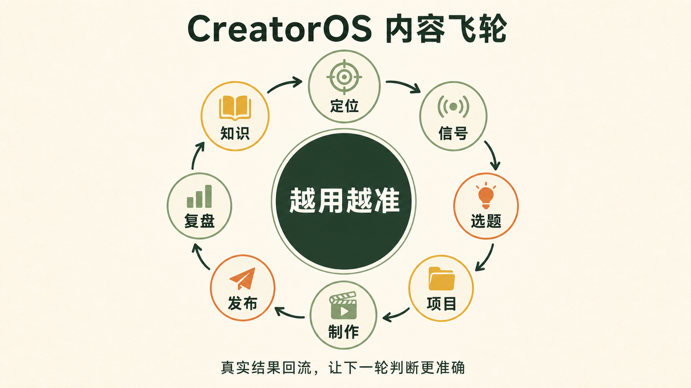

不要把这 8 个节点理解成必须每天完整跑一遍的固定流程。它表达的是长期关系：真实发布结果经过复盘和知识沉淀，会回到下一轮定位判断、信号选择、选题与创作中。

> **配图 01｜CreatorOS 产品功能总览**

图中先看中间的“数据飞轮”，再看外围 11 个功能域：所有页面最终都服务于“采集真实信号 → 做内容 → 发布 → 复盘 → 让下一轮更准”。

---

## 一、开始前必须理解的 5 条产品逻辑

如果不先理解这 5 条，用户很容易把页面当成一堆互不相关的功能。

### 1. 一个抖音号，就是一个独立工作区

侧栏左下角当前选中的抖音号，决定你正在操作哪个工作区。

按账号隔离的内容包括：

- 定位；
- 内容雷达来源；
- 选题；
- 项目；
- 知识库；
- 素材；
- 自动化任务；
- 发布记录；
- 复盘和经验。

切换抖音号，不是只切换一张数据表，而是切换整套经营上下文。模型配置和部分本机偏好属于本机用户级配置，不会因为切号而重新配置。

> **信息图 B｜账号工作区隔离**

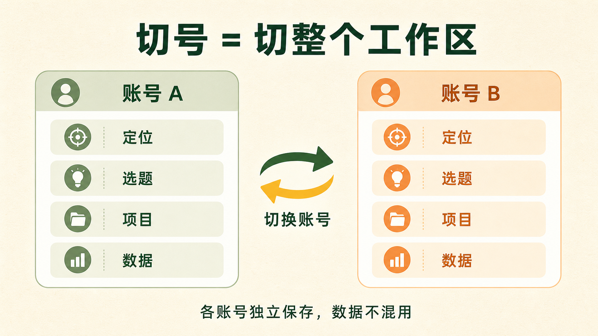

图中的双向箭头只表示你可以主动切换当前账号，不表示两个账号会互相同步数据。账号 A 的定位、选题、项目和数据不会自动出现在账号 B 中。

### 2. AI 负责提出候选，你负责决定是否写入

CreatorOS 里的 AI 不是数据的最终决定者。

以下动作都要经过你的确认：

- AI 定位提案 → 你采纳后写入；
- AI 选题 → 你确认后进入候选池；
- AI 补全 Brief → 你点击“写入选题卡”；
- AI 脚本 → 你点击“写入稿面”；
- 审核改写 → 你逐条点击“应用改写”；
- 盲预测 → 你点击“锁定为盲预测”；
- 视频决策 → 你确认后才开始渲染；
- 知识蒸馏 → 你勾选后采纳；
- 复盘经验 → 你验证后才进入下一轮生成。

所以，看到 AI 给出一张候选卡时，不要以为数据已经被改了。真正的写入动作通常发生在“采纳”“确认”“写入”“应用改写”或“锁定”按钮上。

> **信息图 C｜AI 候选与正式写入的边界**

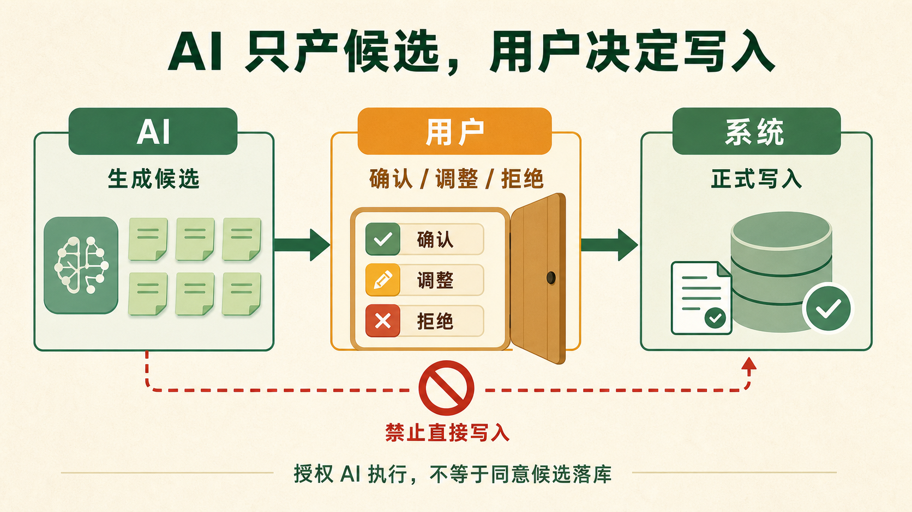

主路径永远是“AI 生成候选 → 用户判断 → 系统写入”。即使你已经授权 AI 读取文件或执行工具，也不等于同意它把候选直接变成正式数据。

### 3. 发布动作目前发生在抖音，不发生在 CreatorOS

CreatorOS 可以帮助你准备标题、标签、封面候选、视频和排期，但当前不会自动替你把作品发布到抖音。

真实流程是：

1. 在 CreatorOS 完成作品；
2. 在抖音客户端或创作者中心发布；
3. 把真实作品链接粘贴回 CreatorOS；
4. CreatorOS 登记发布记录并回收后续数据。

“发布中心”是发布记录和表现中心，不是自动发布控制台；“内容日历”是排期工具，不是定时自动发布器。

### 4. 空数据就显示空，不会用演示数据填满页面

第一次打开时，很多指标会是“—”、0 或空态。这通常表示：

- 还没有绑定账号；
- 还没有采集数据；
- 还没有完成对应操作；
- 当前能力没有真实数据源。

这不是让用户“看起来热闹”的演示系统。没有数据时，它应当诚实告诉你下一步去哪里补数据。

### 5. 真正闭环的是“经验回到选题和脚本”

复盘后，只有状态为“已验证”的经验，才会进入后续选题、脚本、策划、校准和 Copilot 上下文。

当前不要理解成“系统会自动修改账号定位”。经验对定位的影响走校准建议旁路，定位母版仍需要你主动调整和确认。

---

## 二、先认清整个界面

进入主应用后，你会长期使用四个区域。

### 1. 左侧栏：产品功能入口

| 入口 | 解决的问题 | 什么时候来 | 主要产出 |
|---|---|---|---|
| 首页 | 我现在该做什么，账号整体怎样 | 每天开始工作时 | 引导、待办、继续创作、数据摘要 |
| 定位中心 | 这个账号为谁服务、做什么、不做什么 | 首次搭建和方向调整时 | 定位母版、定位版本、5 类下游规则 |
| 内容雷达 | 最近有什么真实内容和信号值得观察 | 选题前、日常采集后 | 来源、作品、公开指标、逐字稿、选题候选 |
| 选题 | 哪些选题值得做，为什么做 | 立项前 | 候选卡、证据、排序、淘汰原因、项目 |
| 项目 | 一条内容现在做到哪里 | 日常创作时 | Brief、论点、脚本、成片、发布包、复盘 |
| 知识库 | 哪些长期知识和经验值得复用 | 学习、复盘、写稿前 | 知识原子、关系、观点、已验证经验 |
| 素材中心 | 有哪些图片、视频、音频、文档可复用 | 备料和制作时 | 素材、文档抽取结果、使用记录 |
| 发布中心 | 已发布什么，表现怎样 | 发布后和运营复查时 | 发布记录、表现汇总、日历入口 |
| 自动化 | 哪些数据要定时或立即采集 | 首次初始化和日常维护时 | 采集任务、运行记录、真实回流数据 |
| 设置 | 模型、账号、偏好、技能、存储怎样配置 | 首次配置和故障排查时 | 本机配置 |

侧栏底部还有三个高频入口：

- 当前抖音号切换器；
- AI 助手；
- 问题反馈。

### 2. 顶部栏：当前位置和全局搜索

普通页面顶部显示当前页面；进入项目后，顶部会显示当前项目，并提供三个工作面：

- 脚本；
- 制作视频；
- 复盘。

顶部搜索框或 `⌘K / Ctrl+K` 可以进入全局搜索。

### 3. 页面主区：当前任务的操作区

不同页面的主区可能是三栏工作台、列表、卡片、月历或项目稿面。不要按页面从上到下机械点击，先看本手册每章写的“这一页解决什么问题”。

### 4. AI 区：全局浮层或项目右栏

- 从侧栏打开的是全局 AI 助手；
- 项目稿面右侧是绑定当前项目上下文的编导；
- 页面中的“帮我补全”“帮我审核”“帮我复盘”等按钮，会把对应任务送进正确的 AI 上下文。

> **配图 02｜主界面全景（桌面端实机截图）**

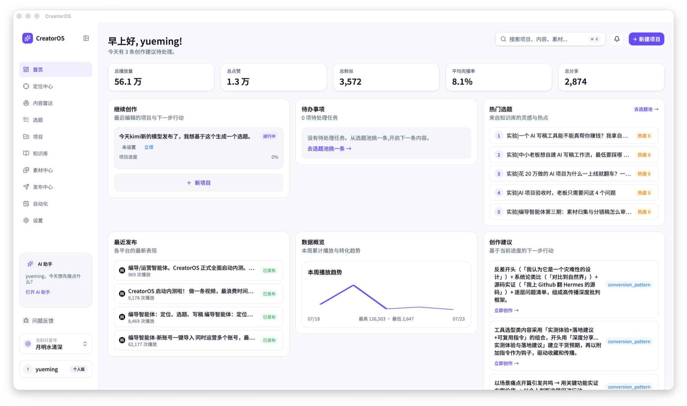

从左到右看：侧栏负责切换功能域，顶部显示搜索和当前账号，主区呈现当前任务或经营数据；右下角两个固定入口分别打开 AI 助手和问题反馈。截图中的播放、点赞、粉丝与项目数据均为当前账号的真实工作区数据。

> **配图 03｜项目内三个工作面**
> 截图内容：进入任意项目后的顶部区域。
> 建议标注：“脚本 / 制作视频 / 复盘”是三个工作面，不是项目成熟度的六七个阶段。

---

# 第一部分：第一次启动，把工作区搭起来

> **信息图 D｜第一次打开 CreatorOS 的五步路线**

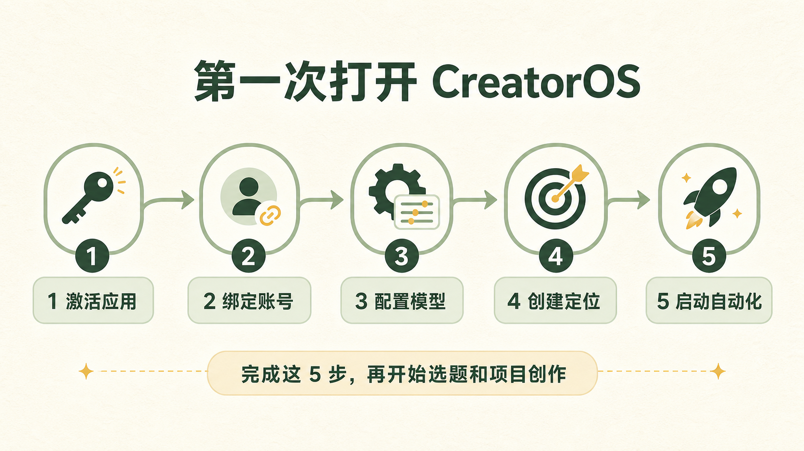

第一次使用先按这 5 步搭好工作区，再进入选题和项目创作。已有存量内容的用户仍然遵循同一顺序，只是在后续起点选择中改走“已有存量”路线。

## 第 0 步：启动并激活 CreatorOS

### 这一阶段解决什么问题

让桌面应用确认这台设备有权使用 CreatorOS。激活完成后，才会进入正式工作区。

当前桌面产品采用本机单用户模式，没有面向普通用户的注册、登录和退出流程。你需要激活 CreatorOS，并绑定用于创作经营的抖音号；不要把“CreatorOS 本机用户”和“抖音工作区账号”混为一件事。

### 你要准备

- 有效的 CreatorOS 激活码；
- 可以联网完成首次验证的电脑。

### 操作步骤

1. 第一次打开 CreatorOS。
2. 应用自动进入“激活 CreatorOS”页面，不需要从侧栏寻找入口。
3. 在“激活码”输入框中粘贴激活码。
4. 点击“激活”。
5. 等待应用重新启动。

### 你应该看到什么

- 未激活时：显示“激活 CreatorOS”；
- 授权过期时：显示“授权已过期”；
- 成功时：应用重新启动并进入首页；
- 失败时：页面直接显示可读错误，不会假装激活成功。

### 系统在背后做了什么

- 激活码与本机绑定；
- 桌面端校验授权；
- 成功后重启应用，使新的授权状态生效；
- 运行过程中继续检查授权状态。

### 卡住时怎么判断

- “激活码无效”：检查是否复制了空格，或联系授权方；
- “已被其他设备使用”：这不是模型或网络问题，需要联系授权方；
- “授权已过期”：需要续期或更换有效授权；
- 成功后仍回到激活页：完整退出应用，再重新打开一次；
- Web 开发环境和正式桌面版的激活行为不同，验收以桌面版为准。

### 完成标准

应用重启后进入首页，而不是再次停留在激活页。

> **配图 04｜首次激活页**
> 截图内容：完整激活卡。
> 建议标注：激活码输入框、激活按钮、授权说明、联系授权方区域。
> 图注建议：“首次运行只需完成一次设备激活。”

---

## 第 1 步：绑定你的抖音号

### 这一阶段解决什么问题

创建一个有明确数据归属的创作工作区。没有抖音号时，CreatorOS 不知道定位、选题、项目和数据属于谁。

### 入口

任选其一：

- 首页“上手引导” →“绑定你的抖音号”→“去做”；
- 侧栏左下角账号切换器 →“绑定新抖音号”；
- 直接进入账号管理页。

### 操作步骤

1. 点击“扫码绑定新抖音号”。
2. 等待本机弹出 Chrome 窗口。
3. 在 Chrome 中使用抖音扫码登录。
4. 等待 CreatorOS 检测到登录态。
5. 回到 CreatorOS，确认“我的抖音号”列表出现真实昵称或抖音号。

### 你应该看到什么

- 绑定前：“还没有绑定抖音号”；
- 扫码成功：账号列表出现真实账号；
- 未扫码或超时：明确提示未检测到登录；
- 不会自动创建“演示账号”或假账号。

### 系统在背后做了什么

- 为这个抖音号保存独立的浏览器登录资料；
- 按真实账号标识去重；
- 创建这个账号对应的工作区；
- 幂等创建日常采集任务；
- 以后切换账号时，定位、选题、项目、知识、素材和数据一起切换。

### 多账号用户要注意

- 当前号显示在侧栏左下角；
- 切号后页面会刷新为另一个工作区；
- 有 AI 生成或表单提交正在进行时，系统可能提示你确认是否切换；
- “隐藏账号”是归档，不是删除数据；
- 最后一个活动账号不能随意隐藏，避免整套工作区失去入口。

### 完成标准

侧栏左下角显示真实抖音号，首页引导中的绑定步骤变成“已完成”。

> **配图 05｜未绑定账号时的工作区保护页（实机截图）**

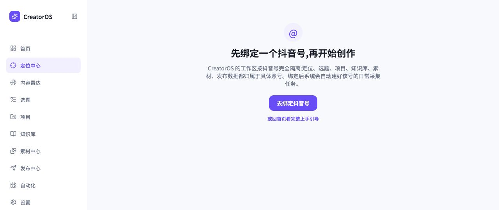

这不是报错。它在阻止定位、选题、项目等内容落到错误的账号工作区；点击“去绑定抖音号”进入账号管理。

> **配图 06｜扫码绑定过程**
> 截图内容：CreatorOS 发起绑定后的状态 + 弹出的 Chrome 二维码窗口。
> 注意：截图时遮盖头像、昵称、二维码和任何敏感账号信息。

> **配图 07｜侧栏账号切换器（桌面端实机截图）**

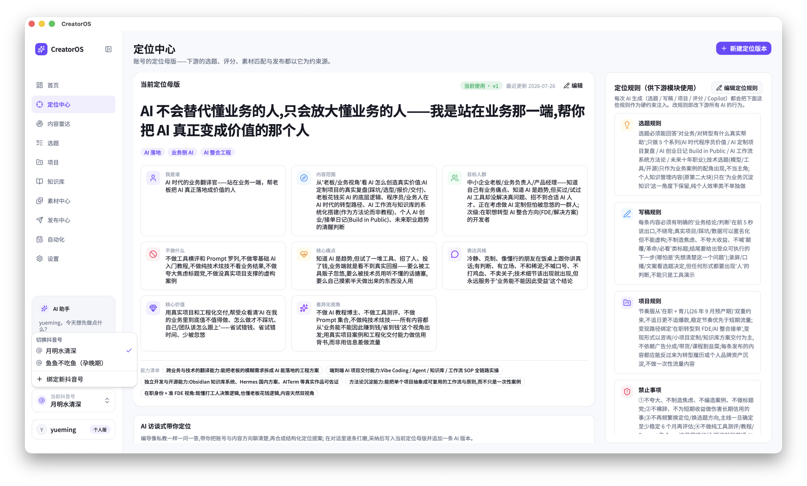

右侧带勾的是当前账号。点击其他已绑定账号会切换整套工作区；最下方“绑定新抖音号”用于新增账号，不会覆盖现有账号。

---

## 第 2 步：配置文本模型

### 这一阶段解决什么问题

给选题、定位、脚本、审核、复盘和 Copilot 提供可用的 AI 模型。文本模型是整个 AI 链路的基础配置。

### 入口

侧栏“设置” → 左侧“模型配置” →“必配”。

首页引导也会直接把你带到对应模型卡。

### 操作步骤

1. 打开“设置”。
2. 点击左侧“模型配置”。
3. 在“必配”区域选择供应商预设。
4. 填写模型 ID。
5. 粘贴 API Key。
6. 如果你使用中转服务，展开高级设置：
   - 填写 `baseUrl`；
   - 选择匹配的接口格式；
   - 必要时调整温度。
7. 点击保存。
8. 点击“测试连接”。

### 如何判断测试结果

- “连通”：配置和鉴权探测成功；
- “无法探测”：供应商不支持当前探测方式，不一定代表配置错误；
- “失败”：根据错误检查 Key、模型 ID、地址和接口格式。

### 密钥安全规则

- 设置页不会回显已保存的完整密钥；
- 已配置后，密钥框留空表示保持原值；
- 再输入新密钥才会覆盖；
- 导出模型配置可能包含密钥，只能保存在可信位置。

### 按需配置的更多能力

| 能力 | 什么时候需要 |
|---|---|
| 生图 | 生成封面、配图或素材 |
| 生视频 | 使用相关视频生成能力 |
| 语音转写 | 音视频转文本 |
| 视觉理解 | 自动理解素材画面 |
| Embedding | 知识库语义搜索 |
| 文案审核 | 使用专门审核模型 |
| 联网搜索 | Copilot 搜索网页和资料 |
| 备用对话 | 主模型不可用时的备用对话能力 |

这些能力不必一次全配。先保证文本模型可用，再按你的真实工作流补充。

### 完成标准

文本模型显示“已配置”，并且测试连接给出“连通”或你已经确认“无法探测但配置有效”。

> **配图 08｜设置中的模型配置（实机截图）**

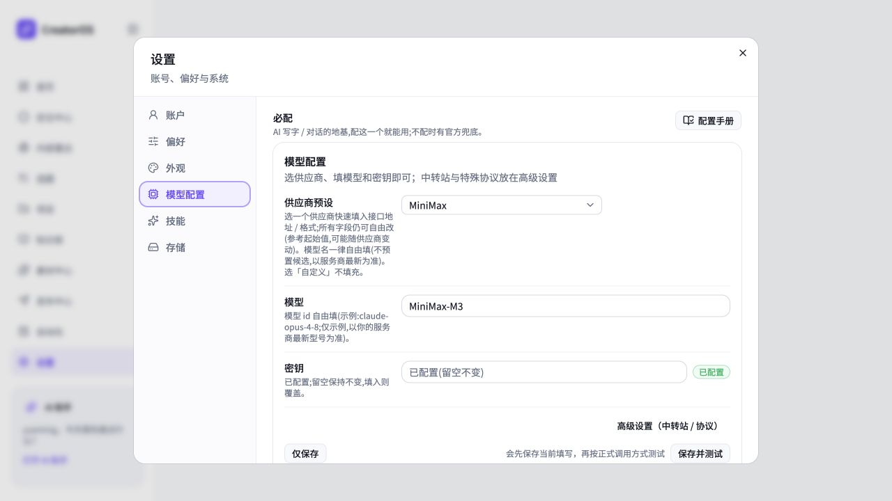

先在“必配”卡完成供应商、模型和密钥配置；只有使用中转站或特殊协议时，才需要展开“高级设置”。

> **配图 09｜更多模型能力（实机截图）**

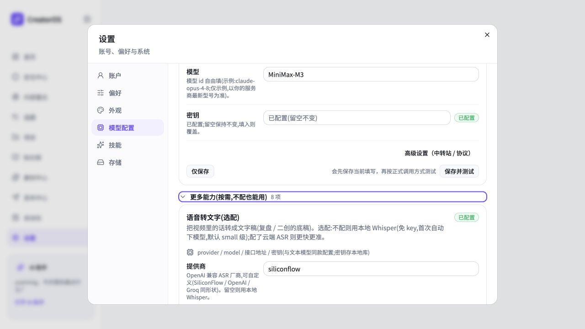

“更多能力”按需展开配置；语音转写、生图、视频、语义搜索等能力不要求在第一次使用时全部配齐。

---

## 第 3 步：在首页选择你的起点

### 这一阶段解决什么问题

告诉系统你是新账号，还是已经有历史作品的账号。这个选择决定是否先初始化历史数据。

### 入口

侧栏“首页” → 顶部“上手引导”。

### 首页引导的真实顺序

全体用户都会看到：

1. 绑定抖音号；
2. 配置文本模型；
3. 确认起点；
4. 创建定位；
5. 创建首个项目。

选择“已有存量”后，会多出“后台初始化你的数据”。

### 选择方式

- **从零开始**：账号没有历史作品，或你暂时不想导入历史内容；
- **已有存量**：账号已经发布过作品，希望先导入作品和指标。

这个选择只决定引导顺序，不会编造任何历史数据。

### 首页引导怎么使用

- 当前可做步骤会高亮；
- 前置未完成的步骤会置灰并说明原因；
- 这是推荐顺序，不是强制锁死所有页面；
- 全部可见步骤完成后，引导卡会自动隐藏；
- 你也可以点“不再显示”；
- 想重新打开时，进入“设置” →“偏好” →“重新打开新手引导”。

### 完成标准

首页引导已经记录“从零开始”或“已有存量”，并显示下一步是初始化数据或创建定位。

> **配图 10｜首页上手引导（实机截图）**

紫色描边的是当前可做步骤；灰色步骤会直接说明缺少哪个前置条件。右侧“去做”会带你进入正确入口。

> **配图 11｜起点二选一**
> 截图内容：“从零开始 / 已有存量”两个按钮。
> 图注建议：“这一步只改变引导分支，不会自动导入或伪造数据。”

---

## 第 4 步：已有账号先初始化真实数据

> 从零开始的账号可以跳过本步，直接进入“第 5 步：建立账号定位”。

### 这一阶段解决什么问题

把已有作品、作品明细和后续评论回收到 CreatorOS，让定位、选题和复盘不再从空白开始。

### 入口

侧栏“自动化”，或首页引导中的“后台初始化你的数据”。

### 先理解自动化里的 6 类任务

绑定抖音号后，系统会为该账号准备 6 类日常任务。并不是 6 类都应该立刻启用。

| 任务 | 作用 | 新用户何时启用 |
|---|---|---|
| 每天抓我的新作品指标 | 同步主页作品和公开计数 | 绑定后即可使用 |
| 每天拉我的作品明细数据 | 回收完播、封面点击、留存等深度指标 | 绑定后即可使用 |
| 每天抓我作品的最新评论 | 为受众信号和复盘提供评论 | 已有作品后再启用 |
| 每天抓对标号的爆款作品 | 同步内容雷达里登记的博主来源 | 先在内容雷达添加对标来源 |
| 每天自动出题 | 用定位、评论、知识和热点生成候选 | 有定位且文本模型可用后 |
| 每天采我的指定收藏夹 | 同步内容雷达里登记的收藏夹 | 先在内容雷达选择收藏夹 |

### 自动化中心不只可以“立即运行”

你还可以：

1. 点击模板卡，用预填配置创建任务；
2. 点击“新建任务”，从空白任务开始；
3. 用友好频率编辑器设置：
   - 周期运行；
   - 按间隔运行；
   - 单次运行；
4. 启用或停用任务；
5. 编辑任务名称、提示和频率；
6. 查看最近一次运行、历史运行和每一步记录。

界面不会要求普通用户手写 cron。任务创建后，来源类型不能随意改成另一种采集器；如果源类型选错，应删除错误配置并从正确模板重新创建。

### 第一次初始化的推荐顺序

1. 打开“每天抓我的新作品指标”。
2. 点击“立即运行”。
3. 打开运行详情，确认能看到真实进度和最终状态。
4. 再运行“每天拉我的作品明细数据”。
5. 作品已经进入系统后，再启用并运行“每天抓我作品的最新评论”。
6. 暂时不要启用没有前置来源的对标、收藏和自动出题任务。

### 如何理解运行状态

- **运行中**：任务还在采集，查看进度和步骤；
- **已完成**：成功结束；
- **已完成·无新数据**：执行成功，但没有新增或变化；
- **需重连抖音**：登录态失效，需要重新扫码；
- **限流保护中**：系统正在退避，不要连续重复点击；
- **失败**：打开详情看具体失败步骤。

“同步到 0 条”不能自动等同于成功。系统会尽量区分“真的没有新数据”和“登录或解析失败”。

### 完成标准

- 至少有一次“作品指标”真实成功运行；
- 已有账号能在项目、发布或复盘相关页面看到真实作品；
- 运行记录能区分成功、无变化、需重连和失败。

> **配图 12｜自动化首页（桌面端实机截图）**

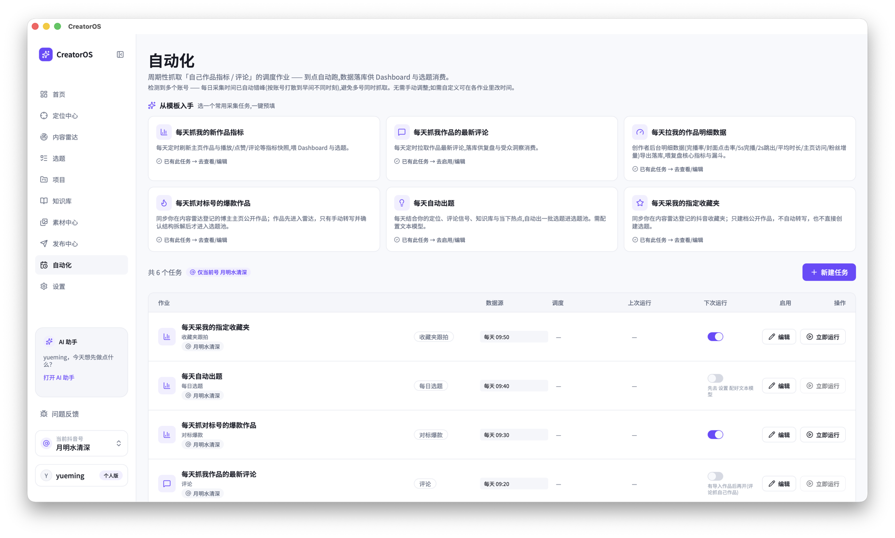

顶部 6 张模板卡用来快速新建常用采集任务；下方任务列表只显示当前抖音号自己的任务。实机图展示了 6 个真实任务，以及启停、上次运行、下次运行和“立即运行”入口。

> **配图 13｜立即运行与进度**
> 截图内容：运行中的任务行和进度条。
> 建议标注：当前阶段、累计条数、“运行详情”。

> **配图 14｜运行详情与终态**
> 截图内容：历史运行、步骤记录和一种可读终态。
> 建议同时准备“需重连抖音”或“限流保护中”的异常示例。

---

## 第 5 步：学会读首页，而不是把首页当报表

### 这一阶段解决什么问题

首页负责告诉你“今天应该继续做什么”，不是替代所有专业页面。

### 首页主要区域

1. **上手引导**：只在未完成或未隐藏时显示；
2. **5 个指标**：用于快速判断当前账号是否已有真实数据；
3. **继续创作**：回到未完成项目；
4. **待办**：显示可行动事项；
5. **热门选题**：进入值得继续判断的候选；
6. **最近发布**：查看最近作品；
7. **数据概览**：需要多日数据才有趋势；
8. **创作建议**：基于当前可用信息给出建议。

### 新账号看到空态时怎么办

- “—”不表示系统坏了，表示还没有可计算数据；
- “继续创作”为空：先创建定位和项目；
- “热门选题”为空：去内容雷达、选题或运行自动出题；
- 趋势为空：先累积至少多个采集日；
- 最近发布为空：完成真实发布并登记作品链接。

### 完成标准

你能够从首页判断下一步去“定位、选题、项目、自动化或发布中心”中的哪一个，而不是在首页等待数据自动出现。

> **配图 15｜有数据后的首页**
> 截图内容：问候区、指标区和 3×2 卡片区。
> 建议标注：每张卡的下一步入口。

> **配图 16｜新账号的诚实空态**
> 截图内容：至少一张空态卡。
> 图注建议：“空态会告诉你补数据的下一步，不会展示虚构增长。”

---

# 第二部分：建立经营底座，找到值得做的内容

## 第 6 步：建立账号定位

### 这一阶段解决什么问题

回答三个问题：

- 这个账号是谁；
- 要为哪类人解决什么问题；
- 什么内容可以做，什么内容不能做。

没有定位，系统可以生成文字，但很难判断什么适合这个账号。

### 入口

侧栏“定位中心”。

### 两种创建方式

#### 方式 A：AI 访谈式定位

适合不知道如何组织表达的用户。

1. 点击“开始访谈式定位”。
2. 在 Copilot 中回答关于方向、受众、优势、边界和表达的问题。
3. 查看 AI 给出的定位提案。
4. 修改不准确的字段。
5. 点击采纳，写入定位中心。

已有作品的账号，AI 可以基于已导入作品帮助反推第一版定位，但仍需要你确认。

#### 方式 B：手动创建定位

适合已经有清晰经营策略的用户。

1. 点击“手动创建定位”。
2. 填写画像字段，例如：
   - 人设；
   - 领域；
   - 目标人群；
   - 差异化；
   - 能力；
   - 内容范围；
   - 不做什么；
   - 核心痛点。
3. 切换到规则页。
4. 填写 5 类下游规则：
   - 选题规则；
   - 写稿规则；
   - 项目规则；
   - 禁止规则；
   - 表达规则。
5. 保存。

### 定位中心保存了什么

- 当前定位母版；
- 一句话定位陈述；
- 画像字段；
- 5 类下游规则；
- 不可变的历史版本。

每次更新会追加版本，不会静默覆盖所有历史记录。下游选题、写稿、项目、评分和 Copilot 会读取这些规则。

### 一份可用定位的最低标准

至少能够说清：

- 我是谁；
- 我主要服务谁；
- 他们最常见的问题是什么；
- 我能提供什么不同价值；
- 我明确不做什么；
- 我的内容应该用什么语气表达。

### 完成标准

定位中心不再显示空态，页面上能看到当前定位母版和 5 类下游规则。

> **配图 17｜定位中心空态**
> 截图内容：AI 访谈和手动创建两个入口。
> 建议标注：两条路线最终都要由用户确认。

> **配图 18｜定位母版与下游规则（桌面端实机截图）**

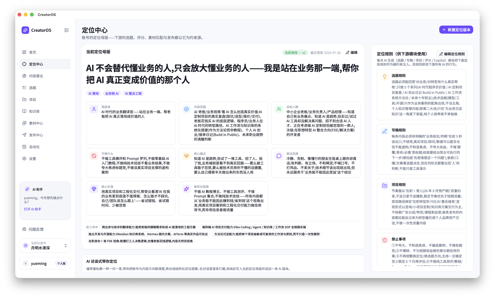

左侧是当前定位母版，右侧把它拆成内容、结构、写作、审核和素材规则。定位不是写完就放着：后续选题、脚本和审核都会消费这些规则，所以修改后要检查下游规则是否仍然符合账号方向。

---

## 第 7 步：在内容雷达建立真实信源

### 这一阶段解决什么问题

让选题有来源、有证据，而不是只靠 AI 凭空想。

内容雷达回答：“最近有哪些真实内容值得我观察和转化？”

### 入口

侧栏“内容雷达”。

### 可以添加的来源

| 来源 | 适合解决什么问题 |
|---|---|
| 抖音博主主页 | 长期观察对标博主的公开作品 |
| 我的收藏 | 把自己保存的内容变成待研究素材 |
| 网页 | 跟踪单个网页或文章 |
| RSS | 持续接收站点更新 |
| 黑马关键词 | 观察特定关键词下的机会 |

### 添加来源的标准流程

1. 点击“添加来源”。
2. 选择来源类型。
3. 填写主页、网页、RSS、关键词，或读取收藏夹。
4. 点击“测试来源”或“读取我的收藏夹”。
5. 检查预览是否真的是你想要的来源。
6. 验证成功后，点击“保存并开始首次同步”。
7. 等待首次同步结束。

除了黑马关键词需要通过首轮任务验证外，普通来源应当先验证再保存。

### 如何整理来源

- 可以新建分类；
- 可以粘贴抖音分享链接，快速建立“分类—博主—视频”记录；
- 左侧来源和分类目前主要帮助你聚焦信息；
- 不要假设每一个左侧分类都能严格过滤中央作品全集。

### 从真实作品转成选题的完整流程

1. 在作品列表中选中一条内容。
2. 在右侧查看：
   - 来源；
   - 公开指标；
   - 来源快照；
   - 逐字稿状态。
3. 点击“手动转写”。
4. 等待逐字稿状态变成完成。
5. 点击“生成选题候选”。
6. 检查并编辑候选内容。
7. 点击“确认写入选题池”。

内容雷达不会自动批量生成所有逐字稿，也不会自动把每条作品灌进选题池。

### 当前边界

- 只采集允许的公开作品和公开计数；
- 评论正文不在内容雷达自动采集；
- 逐字稿需要手动排队；
- 生成候选前需要有定位版本；
- 左侧分类不是完整的归属过滤器；
- 登录型来源依赖有效抖音登录态。

### 完成标准

至少有一个验证成功的真实来源，并且至少完成一次“真实作品 → 逐字稿 → 选题候选 → 写入选题池”。

> **配图 19｜内容雷达三栏工作台（桌面端实机截图）**

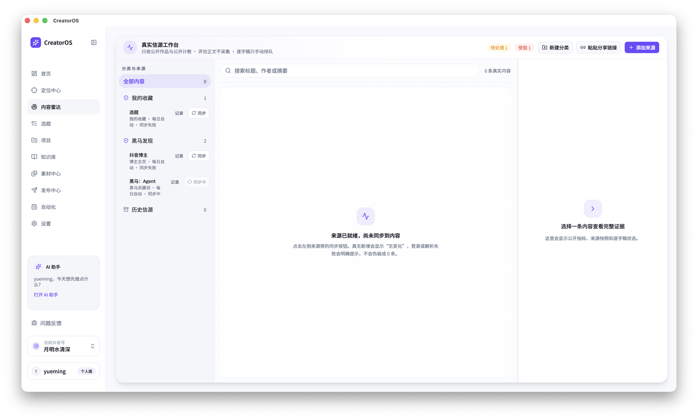

左栏管理信号来源，中栏查看同步到的作品，右栏查看选中作品的证据、逐字稿和候选生成入口。先选择或新增来源，再同步作品；没有选中作品时，右栏保持真实空态。

> **配图 20｜添加来源弹窗**
> 截图内容：5 类来源选择和测试按钮。
> 建议标注：“先验证，再保存”。

> **配图 21｜来源同步结果**
> 截图内容：同步中或同步结束状态。
> 建议准备“无变化 / 需登录 / 失败”中的至少两种状态。

> **配图 22｜作品详情转选题**
> 截图内容：逐字稿完成后的“生成选题候选”和候选编辑区。
> 建议标注：证据、逐字稿、确认写入选题池。

---

## 第 8 步：在选题中心判断，而不是只收集

### 这一阶段解决什么问题

内容雷达负责“看到什么”，选题中心负责“哪一个值得做”。

一个候选进入选题池，并不代表你一定要做。你需要补全、比较、淘汰，最后才立项。

### 入口

侧栏“选题”。

### 选题从哪里来

1. **手动灵感**：自己输入一句话；
2. **AI 选题会**：基于热点、评论、知识和定位生成候选；
3. **受众信号**：把评论需求转成候选；
4. **内容雷达**：真实作品经过转写和确认后进入；
5. **自动化任务**：对标、收藏或每日出题进入候选池。

### 路线 A：一句话快速起草

1. 在“一句话编导起草”输入一个灵感。
2. 提交后，系统先创建一张基础候选卡。
3. Copilot 打开“补全选题卡”任务。
4. 查看补全建议。
5. 确认需要写入的字段。

### 路线 B：手动详填

直接填写目标受众、痛点、冲突、Hook、结构和证据等字段，适合你已经想清楚的选题。

### 路线 C：AI 选题会

1. 打开“AI 选题会”。
2. 选择使用热点、评论、知识等方向。
3. AI 给出候选卡。
4. 逐条判断是否采纳。
5. 采纳后候选才进入选题池。

### 路线 D：受众信号

1. 点击“受众信号”。
2. 查看真实评论或需求信号。
3. 选择一条信号。
4. 点击“转为候选”。
5. 如列表未立即刷新，手动刷新页面再检查新候选。

### 判断一张候选卡

至少检查：

- 来源是什么；
- 有没有真实证据链接；
- 它服务哪个目标受众；
- 用户痛点是否具体；
- 核心冲突是否清楚；
- Hook 是否承诺了正文能兑现的内容；
- 与定位是否契合；
- 与已做内容是否重复；
- 是否值得现在投入制作。

### 排序方式

可以按以下角度重排：

- 推荐；
- 定位契合；
- 需求热度；
- 防茧房。

“防茧房”不是追求最高相似，而是避免系统永远只推荐同一种内容。

### 淘汰候选

1. 点击淘汰。
2. 填写淘汰原因。
3. 确认。

淘汰原因会帮助后续判断，但不是必填项。建议尽量写清：

- 与定位不符；
- 证据不足；
- 已经做过；
- 时效已过；
- 制作成本不合理；
- 受众价值不够。

### 立项

1. 选中最终候选。
2. 点击“立项为 Project”。
3. 系统创建项目，并跳转到项目稿面。

### 当前风险

选题立项当前由连续写入完成，还不是单一数据库事务。正常路径可用，但极端中断可能留下孤儿项目。若点击后报错，不要连续狂点；先去项目列表确认是否已经出现项目。

### 完成标准

你已经从多个候选中明确选出一个，并成功进入对应项目稿面。

> **配图 23｜选题中心全景（桌面端实机截图）**

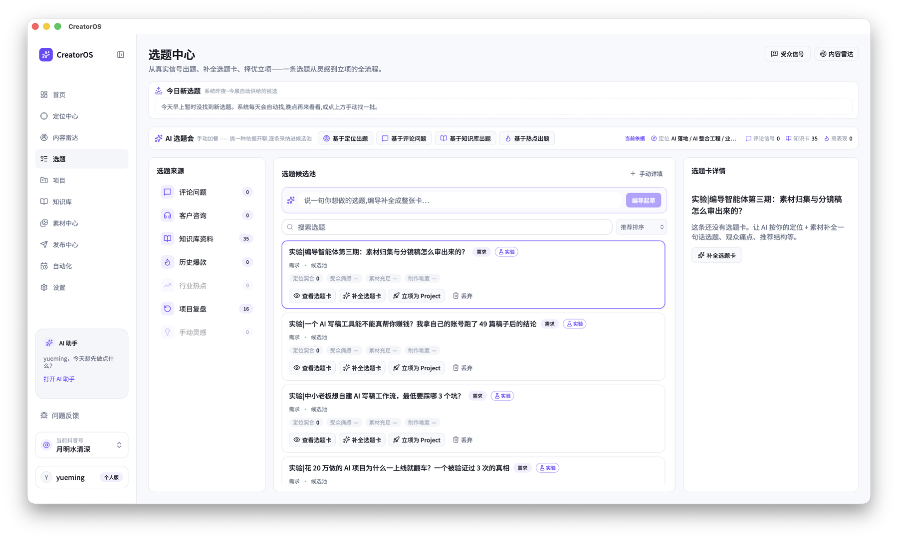

左侧按来源查看候选，中间是可排序和筛选的选题池，右侧显示证据、受众、痛点、Hook 与结构。顶部“AI 选题会”和受众信号用于辅助判断；最终是否立项仍由你确认。

> **配图 24｜候选卡的来源与证据**
> 截图内容：一张信息完整的候选卡。
> 建议标注：来源、证据、受众、痛点、Hook、结构。

> **配图 25｜补全、排序和淘汰**
> 截图内容：排序控件、补全按钮和淘汰弹窗。
> 图注建议：“选题池的目标是做判断，不是囤积灵感。”

> **配图 26｜立项为 Project**
> 截图内容：立项按钮和跳转后的项目稿面首屏。

---

# 第三部分：把一个选题做成可以发布的作品

## 第 9 步：创建项目——两条入口，一个终点

### 入口 A：从选题立项

这是推荐入口。选题卡里的受众、痛点、Hook 和结构会成为项目 Brief 的地基。

### 入口 B：手动新建项目

适合临时任务、明确命题或不需要经过选题池的内容。

入口：

- 首页“新建项目”；
- 项目列表“新建项目”；
- 直接进入 `/projects/new` 对应的新建弹窗。

### 手动创建时需要填写

1. **项目名称**：必填；
2. **一句话描述**：选填；
3. **画幅**：竖屏 9:16 或横屏 16:9，必选；
4. **创作模式**：
   - AI 全流程；
   - AI 协作；
   - 手动；
5. 是否“创建后进入工作区”。

创作模式当前主要作为偏好和元数据，不要理解成三套完全不同的强制工作流。

### 创建失败时

输入内容会保留。修正问题后再次提交，不需要重新填写全部表单。

### 项目列表怎么管理

进入侧栏“项目”后，可以：

- 按“全部项目 / 进行中 / 写稿中 / 制作中 / 已发布 / 复盘中 / 已归档”筛选；
- 按最近更新、进度、阶段、标题、播放量、点赞或评论排序；
- 在存在平台隐藏作品时，切换“显示已隐藏作品”；
- 点击项目行继续进入；
- 从行尾菜单归档项目；
- 对确定不再需要的项目执行永久删除。

“归档”和“永久删除”不是一回事：

- 归档是软隐藏，只在“已归档”页签中查看；
- 永久删除不可恢复，并会一并清除项目脚本、发布记录、复盘和关联数据；
- 如果只是暂时不想在主列表看到它，使用归档。

### 完成标准

项目列表出现新项目，并且你能进入 `/projects/<项目>` 对应的稿面。

> **配图 27｜新建项目弹窗**
> 截图内容：名称、描述、画幅、创作模式和“创建后进入工作区”。
> 建议标注：名称和画幅是必填。

> **配图 28｜项目列表（桌面端实机截图）**

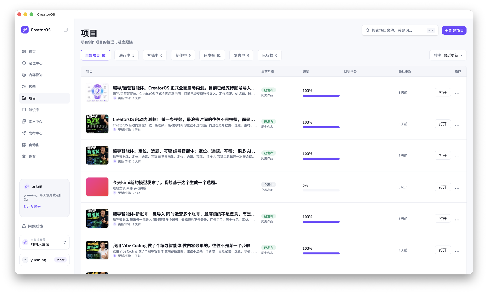

顶部页签按项目状态筛选，右侧可以排序和显示已隐藏作品。每一行都能看到项目标题、当前工作面和最近更新时间；点击项目进入稿面，行尾菜单处理隐藏等管理动作。

---

## 第 10 步：先理解项目的三块工作面

每一个项目都只有三个主要工作面：

1. **脚本**：完成选题卡、备料、论点、脚本、审核、盲预测和发布包；
2. **制作视频**：完成粗剪、字幕、B-roll、AI 决策和成片；
3. **复盘**：查看真实表现、记录洞察、确认经验。

旧版本中的研究、策划、脚本、发布等多个阶段，现在已经收进这三块工作面。脚本面不是“只写脚本”，而是整张稿面的核心工作台。

> **信息图 E｜一个项目的三个工作面**

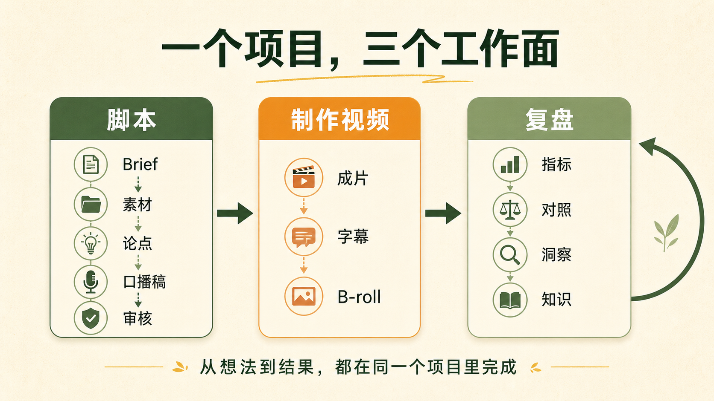

脚本面负责从 Brief 到审核，制作视频面负责把内容变成可发布成片，复盘面负责把真实结果变成洞察和知识。三者属于同一个项目，不需要在多个独立项目之间搬运。

### 稿面从上到下的正确顺序

1. 补全选题卡；
2. 上传或搜索素材；
3. 建立论点骨架；
4. 写或生成口播稿；
5. 保存脚本版本；
6. 审核最新脚本；
7. 做并锁定盲预测；
8. 生成发布物料；
9. 制作或上传成片；
10. 站外发布后登记链接。

右侧编导贯穿以上过程，但它不会绕过你的确认直接改数据。

> **配图 29｜项目稿面全景（桌面端实机截图）**

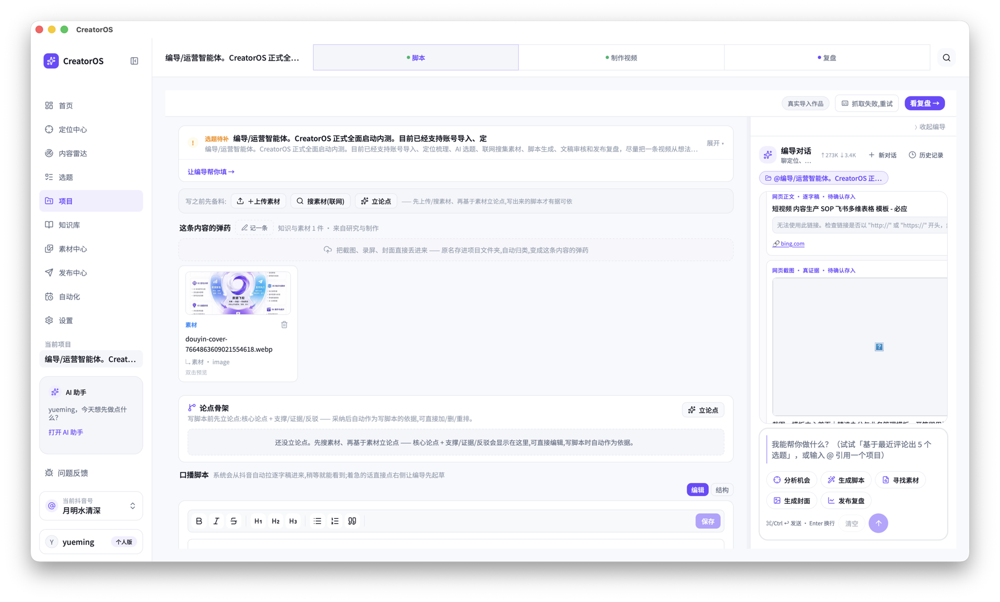

项目顶部固定为“脚本 / 制作视频 / 复盘”三个工作面。脚本面从左到右依次承载项目步骤、当前编辑区和项目编导；向下继续完成审核、盲预测与发布物料。右侧编导始终绑定当前项目，不会混入其他项目上下文。

---

## 第 11 步：补全选题卡，也就是项目 Brief

### 这一阶段解决什么问题

把“一个想法”变成“可以指导写作的任务说明”。

### 入口

项目“脚本”工作面顶部“选题卡”。

### 已完成的判断

以下三项都不为空时，选题卡会显示“选题已定”：

- 目标观众；
- 内容目标；
- 核心信息。

### 手动方式

1. 展开选题卡。
2. 填写目标观众。
3. 填写内容目标。
4. 填写核心信息。
5. 保存。

### AI 方式

1. 点击“让编导帮你填”。
2. 右侧编导生成字段对照卡。
3. 逐项检查是否准确。
4. 点击“写入选题卡”。

AI 给出内容不等于已经保存。必须点击“写入选题卡”才会落入项目。

### 完成标准

选题卡显示“选题已定”，而且你能用一句话说清“这条内容发给谁、想让对方得到什么、最核心的信息是什么”。

> **配图 30｜选题待补状态**
> 截图内容：“选题待补”和“让编导帮你填”。

> **配图 31｜完整 Brief**
> 截图内容：目标观众、内容目标、核心信息三项。
> 建议标注：“写入选题卡”是 AI 候选的确认门。

---

## 第 12 步：备料——上传素材、搜素材、立论点

### 这一阶段解决什么问题

在写稿前准备证据、案例、截图、视频和论点，避免脚本只有观点没有支撑。

### 三个主操作

#### 1. 上传素材

1. 点击“上传素材”。
2. 选择图片、视频、PDF、Word、Markdown 或文本文件。
3. 等待上传和校验完成。
4. 素材会进入当前项目的弹药区，同时进入素材中心。

#### 2. 搜素材

1. 点击“搜素材”。
2. 右侧编导打开联网备料任务。
3. 检查它找到的网页、观点和素材候选。
4. 只采纳真正与项目相关的内容。

联网搜索需要对应模型或能力配置。未配置时，按页面提示去设置。

#### 3. 立论点

1. 点击“立论点”。
2. 让编导提出核心论点和支撑结构，或手动建立。
3. 检查：
   - 核心论点；
   - 支撑证据；
   - 反驳或质疑；
   - 每个论点使用的素材。
4. 保存论点树。

### 弹药区怎么用

- 拖入截图、录屏和文档；
- 就地记录一条备注；
- 双击预览素材；
- 把素材挂到当前项目；
- 不需要时解除项目关联，不必删除原素材。

### 完成标准

至少有一条明确核心论点，并且关键事实有真实素材或证据支撑。

> **配图 32｜“写之前先备料”三个入口**
> 截图内容：上传素材、搜素材、立论点三个按钮。

> **配图 33｜项目弹药区**
> 截图内容：素材卡、备注、预览和解除关联位置。

> **配图 34｜论点骨架**
> 截图内容：核心论点、支撑、证据和反驳分支。
> 图注建议：“先把论证站稳，再让 AI 写成口播稿。”

---

## 第 13 步：写口播稿，并用版本管理保护修改

### 这一阶段解决什么问题

把 Brief、定位、论点和素材写成可以录制的完整口播稿，并保留每次修改历史。

### 两种写法

#### 手动写

1. 在脚本编辑器中直接输入。
2. 使用编辑视图或结构视图。
3. 修改完成后保存。

#### 让编导起草

1. 在右侧编导中发起脚本起草。
2. 等待整稿候选卡。
3. 检查开头、结构、论据、节奏和结尾。
4. 点击“写入稿面”。
5. 在编辑器中继续人工修改。
6. 保存。

### 版本逻辑

- 每次保存都产生一个新版本；
- 新版本不会静默覆盖历史版本；
- 可以回滚到旧版本；
- AI 写入、审核改写和手动保存都可能产生新版本；
- 审核前应先保存，保证审核的是最新稿。

### 判断脚本是否可进入下一步

- 前 3—5 秒是否让目标观众知道“为什么要听”；
- 标题承诺是否在正文中兑现；
- 论点是否有证据；
- 表达是否符合定位规则；
- 是否有明显无法口播的长句；
- 是否能明确拆成录制和制作素材；
- 脚本至少保存过一个版本。

保存第一版后，发布包区域会解锁。

### 完成标准

脚本至少有一个版本，内容能够直接用于录制，并且你知道如何回滚。

> **配图 35｜脚本编辑器**
> 截图内容：编辑/结构切换、版本号、保存区域。

> **配图 36｜AI 脚本候选卡**
> 截图内容：右侧编导的脚本候选和“写入稿面”。
> 建议标注：“生成”不等于“保存”。

> **配图 37｜脚本版本历史与回滚**
> 截图内容：至少两个版本及回滚入口。

---

## 第 14 步：审核最新脚本，并逐条决定是否改

### 这一阶段解决什么问题

检查违禁词、表达风险和语义问题，但不让 AI 擅自改稿。

### 操作步骤

1. 保存当前脚本。
2. 点击“审核”。
3. 系统先确保编辑器最新内容已经落为版本。
4. 右侧编导运行审核。
5. 查看审核结论：
   - 通过；
   - 风险；
   - 阻断。
6. 阅读每条命中原因和改写建议。
7. 对认可的建议点击“应用改写”。
8. 不认可的建议保持原文。
9. 应用后再次检查新版本。

### 审核结果怎么理解

- **通过**：当前报告没有发现需要处理的问题；
- **风险**：可以继续，但应人工判断；
- **阻断**：发布登记会被硬性限制；
- **报告已过期**：脚本在审核后又改过，需要重新审核；
- **非专用审核模型**：当前使用的是通用模型，结果只能作为辅助。

### 为什么有“先去审核”提示

盲预测或发布前，如果没有审核报告，或者报告对应旧脚本版本，系统会提醒你先审核。风险提醒不会代替你的内容判断，但阻断结论会影响发布登记。

### 完成标准

审核报告对应当前最新脚本版本；你已经处理或明确接受所有关键风险。

> **配图 38｜脚本审核入口和状态**
> 截图内容：未审核、报告过期或当前报告状态。

> **配图 39｜审核报告与逐条改写**
> 截图内容：结论、命中内容、建议、“应用改写”和撤销。

---

## 第 15 步：发布前做盲预测，并锁定

### 这一阶段解决什么问题

在看到真实结果之前，先记录你和系统对作品表现的判断。发布后才能诚实对照“当时怎么想”和“实际发生了什么”。

### 操作步骤

1. 确保脚本已保存。
2. 在发布包区域点击“先盲预测”。
3. 右侧编导运行诊断。
4. 查看总分和各维度判断。
5. 修改或确认候选。
6. 点击“锁定为盲预测”。

### 锁定意味着什么

- 锁定后不可修改；
- 不能因为发布结果不好，再回头改成“我早就知道”；
- 发布后可以录入真实表现；
- 复盘页会显示预测和实际的偏差。

如果还没想清楚，不要急着锁定。

### 完成标准

发布包区域显示“已锁定”的盲预测，而不是草稿。

> **配图 40｜盲预测候选**
> 截图内容：各维度预测和“锁定为盲预测”。

> **配图 41｜已锁定状态**
> 截图内容：锁定徽标和预测分。
> 图注建议：“锁定后不可改，才能用于真实校准。”

---

## 第 16 步：准备发布包

### 这一阶段解决什么问题

把脚本转成发布时需要的标题、标签和封面候选。

### 前置条件

- 脚本至少保存过一个版本；
- 最好已完成当前版本审核；
- 最好已锁定盲预测。

### 操作步骤

1. 在稿面底部找到发布包。
2. 点击生成发布物料。
3. 右侧编导调用发布包能力。
4. 查看标题、标签和封面候选。
5. 修改不准确或过度承诺的内容。
6. 采纳最终方案。

### 你要人工检查

- 标题是否和正文一致；
- 标签是否真的相关；
- 封面是否准确传达核心冲突；
- 是否出现平台敏感表达；
- 是否夸大结果；
- 是否符合账号定位和表达规则。

### 完成标准

你已经得到一套可以直接用于抖音发布的标题、标签和封面方案。

> **配图 42｜发布包未解锁与已解锁**
> 建议用两张对比图：脚本未保存时的锁定状态、保存后可操作状态。

> **配图 43｜发布物料候选**
> 截图内容：标题、标签、封面候选和采纳动作。

---

# 第四部分：制作成片、真实发布并登记

## 第 17 步：选择制作路线

进入项目顶部“制作视频”后，有两条路线。

### 路线 A：用 CreatorOS 制作

适合已经有口播稿、粗剪视频和 SRT 字幕，希望系统完成受控分场和渲染的用户。

### 路线 B：直接上传成品视频

适合已经在剪映、Premiere、Final Cut 等外部工具完成剪辑的用户。

这两条路线最终都会得到当前项目的成片。不要为了体验功能强行走路线 A；真实工作中已有成熟剪辑流程，就直接上传成品。

> **配图 44｜制作方式二选一（桌面端实机截图）**

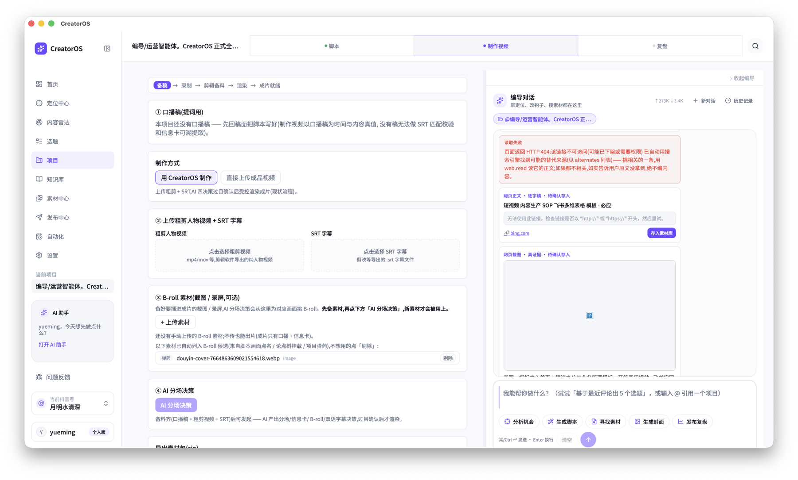

左侧先选择“用 CreatorOS 制作”或“直接上传成品视频”；中间按实际进度处理成片、字幕、B-roll 与 AI 决策，右侧编导继续提供当前项目帮助。两条路线最终都回到同一项目成片。

---

## 第 18 步：用 CreatorOS 完成受控视频制作

### 这一阶段解决什么问题

把口播稿、粗剪和字幕组合成一条可确认、可渲染的成片流程。

CreatorOS 在这里是受控制作工具，不是有完整时间线的通用剪辑器。

### 先看懂顶部制作状态

| 状态 | 含义 |
|---|---|
| drafting | 还在准备脚本和制作输入 |
| recording | 正在准备或上传口播、粗剪等录制素材 |
| editing | 粗剪、字幕和 B-roll 已进入编辑准备 |
| rendering | 已确认决策，正在渲染 |
| ready | 已有可预览、可用于发布的成片 |

### 1. 确认口播稿

- 制作页会读取项目脚本；
- 没有口播稿时，会提示先回稿面完成脚本；
- 可以复制纯口播文本作为提词稿；
- 画面、字幕和时长标记会从提词文本中剥离。

### 2. 上传粗剪视频

1. 选择粗剪视频。
2. 等待上传完成。
3. 系统读取视频时长。

### 3. 上传 SRT

1. 上传匹配当前视频的 SRT。
2. 系统检查：
   - 字幕时长是否匹配视频；
   - 字幕文本是否和口播稿相似。
3. 如果不匹配，先确认是不是传错文件。
4. 只有你确定无误时，才勾选覆盖校验继续。

### 4. 准备 B-roll

B-roll 是可选项，来源可能包括：

- 手动上传；
- 脚本里点名的画面；
- 论点树挂载素材；
- 项目弹药区素材。

你可以提前剔除不合适的候选。

### 5. 发起 AI 分场决策

当口播稿、粗剪视频和 SRT 齐全后：

1. 点击“AI 分场决策”。
2. 等待后台任务运行。
3. 进入确认预览。

系统会给出四类决策：

- 场景；
- 信息卡；
- B-roll；
- 双语字幕。

### 6. 人工确认决策

当前可以重点调整：

- 删除不需要的信息卡；
- 替换或移除 B-roll。

场景边界和双语字幕当前主要用于只读预览，不是完整时间线编辑。

### 7. 确认后渲染

1. 检查所有决策。
2. 点击确认。
3. 系统创建渲染任务。
4. 在任务卡中查看运行步骤。
5. 等待生成成片。
6. 预览结果。
7. 采纳为当前项目成片。

### 依赖和异常

- 需要可用模型配置；
- 需要本机 `ffmpeg` 和 Chromium 环境；
- 环境缺失时，按错误提示安装或修复；
- 不确认视频决策，系统不会直接渲染；
- “导出素材包”是 ZIP 素材集合，不是可直接导入剪映的工程文件。

### 完成标准

制作状态进入 ready，页面中可以预览当前项目成片。

> **配图 45｜口播稿与上传区**
> 截图内容：提词稿、粗剪视频、SRT 上传区域。

> **配图 46｜SRT 校验**
> 截图内容：时长/文本匹配结果和人工覆盖确认。

> **配图 47｜B-roll 候选**
> 截图内容：不同来源的 B-roll、剔除操作和来源徽标。

> **配图 48｜AI 四类视频决策**
> 截图内容：场景、信息卡、B-roll、字幕四块预览。
> 建议标注：哪些可编辑，哪些当前只读。

> **配图 49｜渲染任务与成片预览**
> 截图内容：运行步骤、完成状态、视频预览和采纳动作。

---

## 第 19 步：直接上传外部剪好的成片

### 适用场景

- 已经在其他剪辑软件完成成片；
- 不需要 CreatorOS 分场和渲染；
- 希望仍然使用发布、数据回流和复盘能力。

### 操作步骤

1. 进入“制作视频”。
2. 选择“直接上传成品视频”。
3. 选择支持的视频文件。
4. 等待上传和文件校验。
5. 预览成片。
6. 确认它属于当前项目。

### 系统会做什么

- 保存真实视频字节；
- 读取视频时长；
- 跳过分场和渲染；
- 把它登记为当前项目成片；
- 将制作状态推进到 ready。

### 完成标准

成片可以在项目中预览，发布包能够继续使用。

> **配图 50｜直接上传成品**
> 截图内容：切换后的上传区和支持格式提示。

> **配图 51｜成品上传完成**
> 截图内容：ready 状态和视频预览。

---

## 第 20 步：在抖音真实发布，再回 CreatorOS 登记

### 这一阶段解决什么问题

把平台上的真实作品和 CreatorOS 项目关联起来，让后续数据知道属于哪条内容。

### 正确操作顺序

1. 在 CreatorOS 确认脚本、成片和发布物料。
2. 打开抖音客户端或创作者中心。
3. 完成真实发布。
4. 复制真实作品链接。
5. 回到 CreatorOS 的项目“脚本”工作面。
6. 在发布包区域找到“登记已发布”。
7. 粘贴真实抖音作品链接。
8. 提交登记。

### 链接要求

- 使用可以解析真实作品 ID 的作品链接；
- 某些短链可能被诚实拒绝；
- 不要粘贴主页链接、搜索页链接或草稿页链接。

### 登记后系统会做什么

- 创建真实发布记录；
- 保存抖音作品标识；
- 尝试触发一次指标采集；
- 让发布中心、内容日历和复盘页能找到这条作品。

### 不要误解

- CreatorOS 没有替你点击抖音发布；
- 登记成功不代表抖音平台操作刚刚发生；
- 发布中心的记录来自你登记的真实链接和后续采集。

### 完成标准

项目显示已经登记发布，发布中心出现这条作品并带有真实抖音作品标识。

> **配图 52｜发布包中的“登记已发布”**
> 截图内容：作品链接输入框和提交按钮。

> **配图 53｜登记成功状态**
> 截图内容：已发布标识、作品链接或平台标识。
> 注意：遮盖真实用户隐私和不适合公开的作品信息。

---

## 第 21 步：用发布中心看结果，用内容日历管节奏

### 发布中心解决什么问题

回答：

- 这个账号已经发布了什么；
- 每条作品属于哪个项目；
- 表现如何；
- 最近发布节奏是否正常。

### 发布中心的使用方式

1. 进入侧栏“发布中心”。
2. 查看真实发布列表。
3. 使用内容类型、近 7 天 / 30 天、待优化、搜索、显示已隐藏和分页缩小范围。
4. 查看右侧真实指标、平台对比、趋势和 Top 内容。
5. 点击项目相关入口回到项目。

发布中心是只读总览，不提供批量真发布、下架或改发布时间。

### 内容日历解决什么问题

回答：

- 过去哪天发布了什么；
- 哪些天断更；
- 未来准备在哪天发布什么；
- 本月发布和排期节奏怎样。

### 内容日历操作

1. 在发布中心顶部点击“打开日历”。
2. 过去日期查看真实已发布作品和表现。
3. 点击今天或未来日期。
4. 新建排期，填写计划时间、备注和可选内容。
5. 需要时修改或删除排期。
6. 切换月份查看长期节奏。

### 日历边界

- 过去日期只读；
- 排期只是计划登记；
- 排期不会自动发布；
- 当前账号决定日历内容；
- 没有发布或排期时会显示真实空态。

### 完成标准

发布中心能找到真实作品，日历能同时表达过去发布和未来计划。

> **配图 54｜发布中心（桌面端实机截图）**

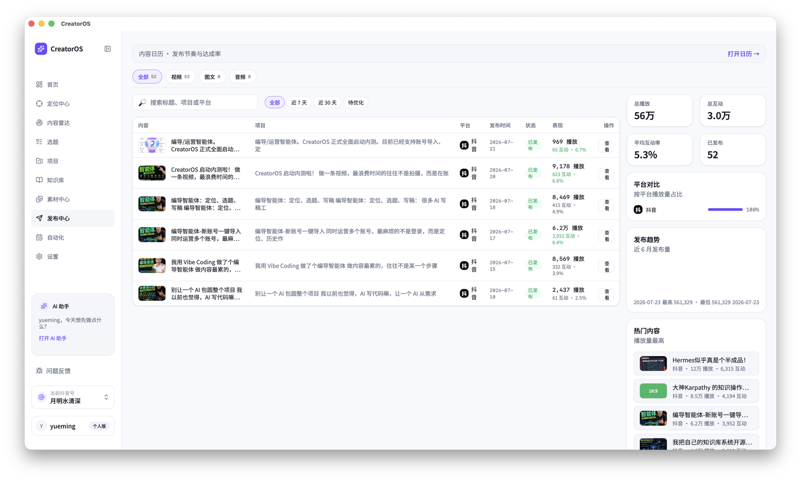

左侧是已经登记或同步的真实作品，右侧查看选中作品的核心指标；顶部切换内容日历。这里负责记录、观察和排期，不会替你自动发布到抖音。

> **配图 55｜内容日历月视图**
> 截图内容：过去发布、空窗日、未来排期。
> 建议标注：过去只读、未来可排期。

> **配图 56｜新建或编辑排期**
> 截图内容：日期抽屉、时间、备注、保存和删除操作。

---

# 第五部分：回收数据，完成复盘和经验闭环

## 第 22 步：发布后让自动化回收数据

### 这一阶段解决什么问题

把抖音的真实指标和评论送回项目复盘，而不是在发布后凭感觉总结。

### 推荐顺序

1. 进入“自动化”。
2. 运行“每天抓我的新作品指标”。
3. 运行“每天拉我的作品明细数据”。
4. 已有作品后，启用并运行“每天抓我作品的最新评论”。
5. 打开运行详情确认终态。
6. 回到项目“复盘”工作面刷新。

### 为什么要按这个顺序

- 作品指标先让系统认识发布作品；
- 明细任务补充完播、点击和留存等数据；
- 评论任务依赖已有作品；
- 复盘页只能显示已经回流的数据。

### 登录失效时

1. 在任务行看到“需重连抖音”；
2. 点击“登录抖音”；
3. 在弹出的 Chrome 中重新扫码；
4. 登录成功后重新运行任务；
5. 不要删除任务再重建，除非任务本身配置错误。

### 限流时

- 等待系统提示的退避时间；
- 不要短时间连续点击“立即运行”；
- 不要同时为多个账号启动大量登录型任务；
- 限流不是“同步到 0 条”。

### 完成标准

自动化任务成功结束，复盘页出现真实指标或明确的无数据说明。

> **配图 57｜发布后的三类回流任务**
> 截图内容：作品指标、作品明细、最新评论三条任务。

> **配图 58｜需重连抖音的恢复动作**
> 截图内容：错误状态、“登录抖音”按钮和恢复后的再次运行。

---

## 第 23 步：在复盘页看预测、真实表现和评论

### 这一阶段解决什么问题

把发布前判断和发布后事实放在同一页，找出哪些判断正确、哪些需要修正。

### 入口

项目顶部“复盘”。

### 复盘页主要区域

1. 核心指标；
2. 播放趋势和转化漏斗；
3. 预测 vs 实际；
4. 热门评论；
5. 手动复盘编辑；
6. AI 复盘候选；
7. 本期可采纳经验；
8. 校准建议。

当前没有可靠数据源的观众画像、观众来源、留存曲线和关键时刻，不会为了“页面完整”画假图。你应以页面当前显示的核心指标、趋势、漏斗、评论和预测对照为准。

### 没有指标时

指标区会提示去自动化同步明细，但不会吞掉整张复盘页。你仍然可以：

- 记录人工洞察；
- 查看已有评论；
- 查看盲预测；
- 发起 AI 复盘；
- 处理经验候选。

### 读数据时要问的 5 个问题

1. 播放是否达到预期；
2. 封面和开头是否获得点击与停留；
3. 完播和平均观看是否支持原来的结构判断；
4. 评论里出现了哪些真实问题、误解和需求；
5. 哪些表现来自内容本身，哪些可能来自发布时间、账号状态或外部因素。

### 完成标准

你已经把至少一个发布前假设，与一个真实指标或评论证据进行了对照。

> **配图 59｜复盘页全景（桌面端实机截图）**

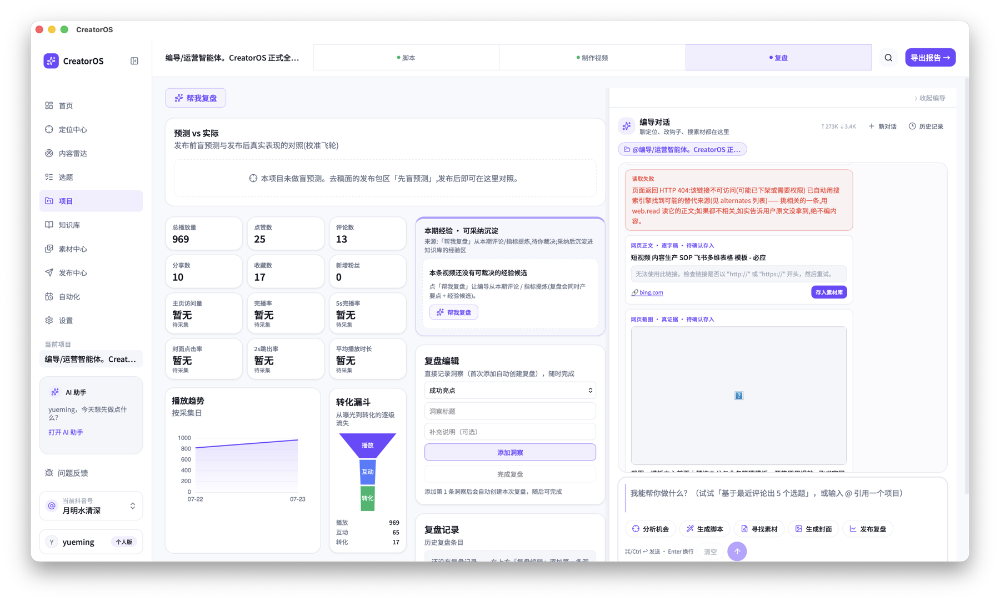

复盘页把真实表现、发布前预测和本轮洞察放在同一工作面。先确认指标是否已经同步，再对照原先假设；右侧编导可以辅助总结，但经验是否采纳仍由你决定。

> **配图 60｜指标为空但复盘仍可用**
> 截图内容：指标区空态，以及仍然可见的洞察/经验区域。
> 图注建议：“没有指标时诚实空，不影响记录本轮判断。”

---

## 第 24 步：录入实际结果，完成预测对照

### 前置条件

发布前已经锁定盲预测。

### 操作步骤

1. 在“预测 vs 实际”区域查看锁定预测。
2. 等待真实发布数据回流。
3. 打开“录入实绩”。
4. 如果系统给出 AI 评分候选，先检查每个维度。
5. 没有候选时，手动录入。
6. 确认提交。
7. 查看逐维度偏差。

### 如果发布前没做盲预测

页面会明确显示“本项目未做盲预测”。不要补拍历史判断，也不要把发布后的结论伪装成发布前预测。下一条内容从发布前锁定开始。

### 完成标准

页面显示“已回流”的预测与实际对照，而不是“等待发布数据回流”。

> **配图 61｜等待真实结果的预测对照**
> 截图内容：已锁定预测和“等待发布数据回流”。

> **配图 62｜录入实绩与偏差表**
> 截图内容：维度录入、确认动作和对照结果。

---

## 第 25 步：先记录洞察，再让 AI 帮你归纳经验

### 手动记录洞察

复盘编辑区支持四类内容：

- 成功亮点；
- 待优化；
- 行动项；
- 假设。

操作：

1. 选择类型。
2. 写一个具体标题。
3. 补充可验证的事实。
4. 点击“添加洞察”。
5. 完成本轮后点击“完成复盘”。

一条好洞察应当写成：

> “开头 3 秒直接展示结果，5 秒完播率高于账号近期中位数；下一条继续测试结果前置。”

而不是：

> “这条做得不错。”

### 让 AI 生成经验候选

1. 点击“帮我复盘”。
2. AI 读取当前项目可用的预测、指标、评论和复盘记录。
3. 系统生成经验候选。
4. 候选进入“本期经验·可采纳沉淀”。

AI 只负责归纳候选，不会自动让它影响后续创作。

### 完成标准

至少有一条有证据的人工洞察，并且 AI 已生成可判断的经验候选。

> **配图 63｜手动复盘编辑**
> 截图内容：四种洞察类型、标题输入、“添加洞察”和“完成复盘”。

> **配图 64｜“帮我复盘”生成候选**
> 截图内容：AI 入口和生成后的经验候选区。

---

## 第 26 步：验证或驳回经验，让它进入下一轮

### 这一阶段解决什么问题

防止一次偶然结果被系统当成长期规律。

### 操作步骤

1. 逐条阅读经验候选。
2. 检查它是否有真实数据或评论支撑。
3. 判断它是：
   - 可复用规律；
   - 只对本条内容成立；
   - 证据不足；
   - 与定位冲突；
   - 需要再测试。
4. 对可靠经验点击采纳或验证。
5. 对错误经验点击驳回。

### 只有已验证经验会去哪里

- 下一轮选题；
- 下一轮脚本；
- 策划和校准；
- Copilot 对话上下文。

### 不会自动发生什么

- 不会自动改写账号定位母版；
- 不会自动替你删除旧经验；
- 不会因为一次高播放就永久改变内容方向；
- 候选经验不会直接进入生成。

### 验证闭环是否真的发生

下一轮进入选题或脚本时，检查 AI 是否引用了经过验证的历史经验，而不是引用未采纳候选。

### 完成标准

至少有一条经验变成“已验证”，并在下一轮选题或写稿中被正确引用。

> **配图 65｜经验候选裁决**
> 截图内容：候选内容、证据、采纳/验证和驳回动作。

> **配图 66｜已验证经验进入下一轮**
> 截图内容：下一轮选题或脚本的 AI 上下文中，出现对应历史经验。
> 注意：应使用只可能来自该经验的特异内容，避免“看起来像引用”的巧合。

---

# 第六部分：把知识、素材和 AI 助手变成长期工具

## 第 27 步：用知识库沉淀长期可复用内容

### 知识库解决什么问题

项目解决“一条内容”，知识库解决“长期应该记住什么”。

适合放入：

- 可复用观点；
- 数据证据；
- 原话引用；
- 问答；
- 参考原文；
- 已验证复盘经验。

### 入口

侧栏“知识库”。

### 路线 A：知识倾倒场 + AI 蒸馏

1. 粘贴文本或 URL，或拖入 `.md` / `.txt`。
2. 点击“AI 蒸馏”。
3. Copilot 打开独立蒸馏对话。
4. 查看拆出的知识原子。
5. 勾选要保留的条目。
6. 为每条选择类型：
   - 观点；
   - 证据；
   - 引用；
   - 问答。
7. 修改标题、正文或出处。
8. 需要时勾选“原文同时存档”。
9. 点击“采纳选中 N 条”。

### 路线 B：手动补录

1. 点击“手动补录”。
2. 填标题。
3. 选择知识类型。
4. 填正文。
5. 保存。

### 路线 C：评论回流

1. 先在自动化中采集评论。
2. 在知识库点击“评论回流”。
3. 系统进行规则预筛和 AI 蒸馏。
4. 人工确认值得保留的问答或需求。
5. 采纳后进入知识库，并保留评论来源。

### 搜索和组织

- 工具栏输入会过滤当前列表；
- 回车后运行知识搜索；
- 配置 Embedding 后可使用语义搜索；
- 未配置时会明确提示，而不是伪装语义能力；
- 可以按标签过滤；
- 可以切换：
  - 关系图；
  - 观点地图；
  - 全部。

### 关系图

1. 点击“AI 找关联”。
2. 查看候选关系。
3. 人工确认后才创建关系边。

### 修订和归档

- 打开知识详情；
- “编辑正文”会创建新修订版本；
- “归档”是软删除，需要二次确认；
- 知识详情主要通过弹窗查看，不要寻找不存在的独立详情 URL。

### 已验证经验在哪里

复盘中已经验证的经验会作为知识库中的一等类型只读展示。经验的采纳或驳回仍在复盘页完成，不在知识库重新裁决。

### 完成标准

至少有一条人工确认的知识原子，并且你能通过标签、搜索或关系视图重新找到它。

> **配图 67｜知识库全景（桌面端实机截图）**

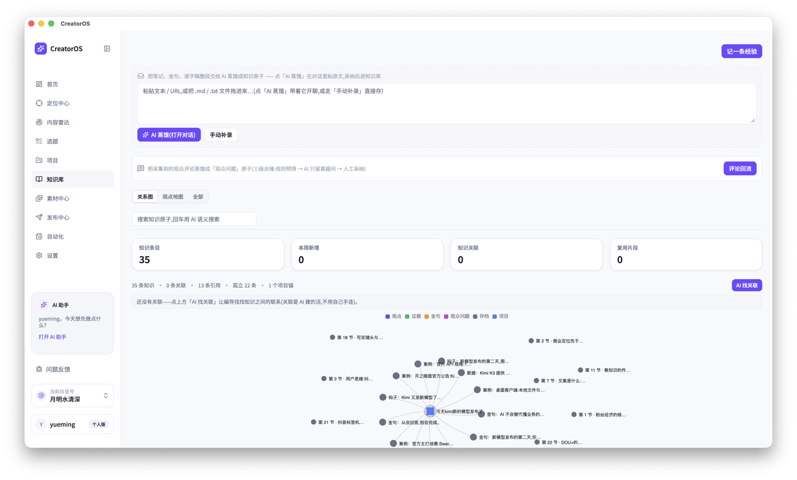

知识可以从手动输入、评论反馈和复盘经验进入，再通过类型、标签、搜索与关系图重新找到。实机图展示了真实知识节点及其关系；AI 蒸馏只产生候选，确认后才进入长期知识。

> **配图 68｜知识原子确认门**
> 截图内容：勾选、类型、标题、出处、“采纳选中 N 条”。

> **配图 69｜知识详情、修订和归档**
> 截图内容：详情弹窗、编辑正文、版本和归档。

> **配图 70｜关系图与观点地图**
> 截图内容：两种视图和“AI 找关联”入口。

---

## 第 28 步：用素材中心管理真实文件

### 素材中心解决什么问题

集中保存图片、视频、音频、文档和字幕，并让它们可以被项目复用。

### 入口

侧栏“素材中心”。

### 上传流程

1. 点击“上传素材”。
2. 选择文件。
3. 系统创建上传。
4. 写入真实文件字节。
5. 完成校验后创建素材记录。
6. 页面刷新后出现素材卡。

只有完成真实字节校验后，素材才算入库。

### 文档素材

- 支持 PDF、Word、Markdown、TXT 等当前允许类型；
- 文档上传后可触发后台抽取；
- 大于 20MB 的文档会提示拆分；
- 抽取能力依赖对应模型和文件可解析性。

### 找素材

- 左侧按图片、视频、音频、文档、字幕过滤；
- 顶部按名称、描述或标签搜索；
- 按新旧排序；
- 使用分页浏览；
- 选中素材后，在右侧固定详情栏查看预览、元数据、标签和使用历史。

素材中心还提供三种视图：

- **全部**：查看当前账号的通用素材；
- **按项目**：把已经由项目产生或挂载的素材按项目文件夹查看；
- **回收站**：查看已移入回收站的素材，并经过确认后还原。

右侧详情中的真实操作包括：

- 复制本机文件地址；
- 下载；
- 收藏或取消收藏；
- 在 Finder 中显示；
- 移入回收站。

素材只有两条清晰来路：

- 在素材中心上传，成为通用素材；
- 在项目稿面上传，直接成为该项目素材。

“从素材中心把一份通用素材再附到项目”的旧操作已经退役。需要项目专属素材时，应在项目弹药区上传或使用项目内备料流程。

### 当前筛选边界

素材库的分页是真实的，但 `type` 和关键词过滤主要作用于当前已读取页。大素材库跨页搜索可能漏项。找不到时：

1. 清除筛选；
2. 翻页检查；
3. 使用全局搜索；
4. 从项目弹药区确认是否已关联。

### 存储用量

素材中心、侧栏存储卡和设置中的存储信息读取同一真实来源。

- 已知磁盘总量时显示用量；
- 总量未知时只显示已用，不画假百分比；
- “存储不可用”表示读取失败，不会回退演示数字。

### 完成标准

至少上传一个真实素材，在详情中看到元数据，并实际完成一次下载、收藏、Finder 定位或回收站还原操作。另在项目弹药区上传一份项目素材，理解两条来路的区别。

> **配图 71｜素材中心全景（桌面端实机截图）**

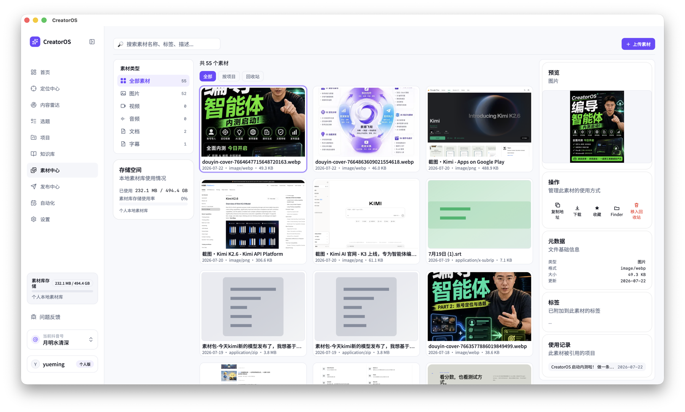

左侧按类型筛素材，中间搜索和浏览真实素材，右侧查看元数据、来源与使用情况。素材中心是跨项目的全局库；项目脚本中的弹药区只服务当前项目。

> **配图 72｜真实上传过程**
> 截图内容：选择文件、上传状态和完成后的素材卡。

> **配图 73｜素材详情和使用历史**
> 截图内容：预览、标签、元数据和关联项目。

---

## 第 29 步：用全局搜索跨域找内容

### 入口

- 任意页面顶部搜索框；
- `⌘K / Ctrl+K`。

全局搜索没有独立侧栏项。

### 可以搜索

- 项目；
- 知识；
- 素材；
- 视频。

### 操作步骤

1. 在顶部输入关键词。
2. 按回车。
3. 在结果页查看四类分组。
4. 点击类型页签进一步收窄。
5. 点击结果：
   - 项目进入项目详情；
   - 知识回到知识库；
   - 素材回到素材中心；
   - 视频回到发布中心。

右侧搜索历史可以重新运行过去的查询；类型页签和分面只缩小当前结果范围，不会修改任何业务数据。

知识、素材和视频当前没有统一的独立详情 URL，所以结果可能回到对应中心，而不是直接打开单条详情。

### 搜索范围

搜索只在当前抖音号工作区内进行。切号后，同一个关键词可能得到完全不同的结果。

### 完成标准

你能够通过一个关键词，找到当前账号中的项目、知识、素材或视频。

> **配图 74｜顶部搜索和快捷键**
> 截图内容：顶部输入框，并在图注中写明 `⌘K / Ctrl+K`。

> **配图 75｜全局搜索结果页**
> 截图内容：四类页签、分组结果、右侧分面和搜索历史。

---

## 第 30 步：正确使用 Copilot

### Copilot 的两种形态

#### 全局 AI 助手

入口：侧栏底部“AI 助手”。

适合：

- 跨项目提问；
- 基于最近评论出选题；
- 查找工作区内容；
- 处理不属于某个项目的任务。

#### 项目右侧编导

入口：项目稿面右侧常驻。

适合：

- 补 Brief；
- 搜素材；
- 立论点；
- 起草或改写脚本；
- 审核；
- 盲预测；
- 生成发布物料。

### 快捷指令怎么用

- 点击快捷 chip 通常只是预填，不会自动发送；
- 稿面中的专用按钮可能自动发送预设话术；
- “自动发送”只代表发起任务，不代表自动采纳结果。

普通输入时，`Enter` 用于换行，`⌘/Ctrl + Enter` 用于发送；当前出现 `@` 提及下拉时，先用方向键选择，再按 `Enter` 确认对象。

### 上下文隔离

Copilot 会区分：

- 全局会话；
- 当前项目会话；
- 某个页面或功能的专用会话；
- 当前选中的对象。

所以，讨论具体项目时尽量使用项目右栏，不要在全局助手里让它猜当前项目。

### 工具授权

部分工具需要读取本机文件或执行受控操作时，会弹出授权：

1. 阅读它要做什么；
2. 确认对象和范围；
3. 点击允许或拒绝；
4. 授权完成后，同一回合可以继续。

### 生成结果怎么处理

优先寻找候选卡上的明确动作：

- 写入选题卡；
- 写入稿面；
- 应用改写；
- 锁定；
- 采纳；
- 驳回。

只有这些动作能告诉你“AI 建议”和“正式数据”的边界。

### 完成标准

你能区分全局会话和项目会话，并能在 AI 给出候选后，主动决定是否写入。

> **配图 76｜全局 AI 助手（实机截图）**

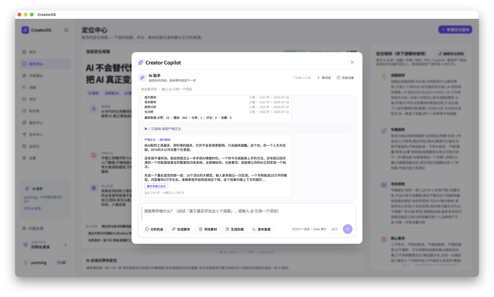

没有关联项目时，它处于全局上下文；可以直接描述目标，也可以输入 `@` 引用一个项目，再使用“分析机会、生成脚本、寻找素材、生成封面、发布复盘”等快捷任务。实机图使用真实会话，能看到用户输入、AI 回复和工具过程如何留在同一条对话里。

> **配图 77｜项目右侧编导**
> 截图内容：绑定项目上下文的右栏和一个专用任务。

> **配图 78｜工具授权与候选确认**
> 截图内容：一张授权卡和一张候选采纳卡。
> 图注建议：“授权工具执行，不等于同意候选写入。”

---

## 第 31 步：认识设置中的其他能力

设置是居中弹窗，左侧有 6 个页签。

### 1. 账户

主要包括：

- 本机账户信息；
- 抖音扫码绑定；
- 网站登录保管库；
- 激活状态；
- 软件更新；
- 诊断日志。

网站登录保管库用于让受控网页读取带登录态工作，不要把账号密码粘进普通对话。

### 2. 偏好

保存日常使用偏好，例如默认创作模式和重新打开新手引导。

### 3. 外观

调整主题等界面设置。

### 4. 模型配置

文本模型和按需多模态能力，详见本手册第 2 步。

### 5. 技能

查看官方技能和当前账号可用的增量技能。技能决定 AI 在特定场景下使用什么规则和工具。

### 6. 存储

查看真实存储使用情况，并提供高风险的工作区重置入口。

重置工作区属于危险操作。执行前确认备份、当前账号和影响范围，不要把“解决单页问题”误用成“清空整个工作区”。

> **配图 79｜设置六个页签（桌面端实机截图）**

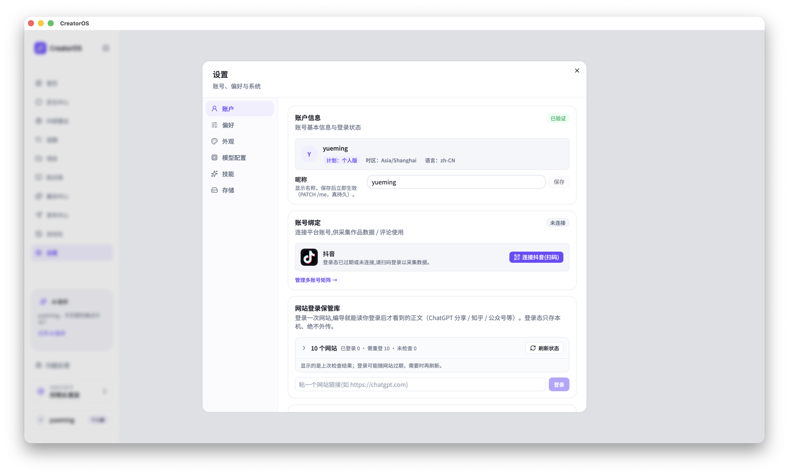

设置弹窗左侧依次是账户、偏好、外观、模型配置、技能和存储。先在账户页确认激活与版本，再按需配置模型；存储页涉及清理和重置，操作前先核对当前账号与影响范围。

> **配图 80｜账户与诊断区**
> 截图内容：激活状态、软件更新、诊断日志和网站登录保管库。

---

## 第 32 步：遇到问题时提交一份可处理的反馈

### 入口

侧栏底部“问题反馈”。

### 操作步骤

1. 在发生问题的页面直接打开“问题反馈”。
2. 用 10—4000 字描述：
   - 你想做什么；
   - 点击了什么；
   - 期待看到什么；
   - 实际看到什么；
   - 是否可以稳定复现。
3. 检查“反馈内容预览”。
4. 点击“复制反馈内容”。
5. 点击“打开反馈渠道”。
6. 在外部渠道中粘贴并提交。
7. 需要排查桌面问题时，点击“打开日志文件夹”。

### 系统会自动加入

- 应用版本；
- 操作系统；
- 当前页面；
- 发生时间；
- 可用的关联编号。

### 隐私边界

- 本地预览会遮盖部分敏感字段；
- 不自动上传日志；
- 不上传 API Key、Cookie、激活码或本机路径；
- 打开反馈渠道不等于已经发送；
- 当前版本需要你在外部渠道最终确认提交。

### 一份好反馈示例

> 我在“内容雷达 → 我的收藏”点击同步。运行约 20 秒后显示“浏览器档案被占用”。我已经关闭所有抖音 Chrome 窗口，再次点击仍复现。期待系统恢复登录资料并继续只读同步，实际没有新增作品。

### 完成标准

你已经检查预览，并在外部反馈渠道真正点击提交；不要把“已复制”或“已请求打开渠道”当成“反馈已发送”。

> **配图 81｜问题反馈弹窗（实机截图）**

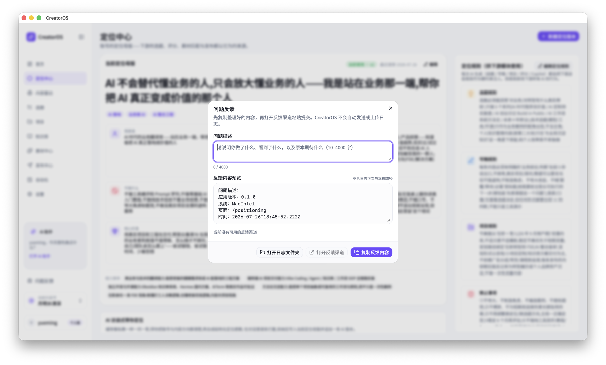

先写问题、检查预览，再复制并到外部渠道最终提交。截图中“打开反馈渠道”置灰，表示当前没有可用渠道，不代表反馈已经发送。

> **配图 82｜复制成功与外部提交**
> 截图内容：CreatorOS 内的复制成功提示 + 外部渠道粘贴后的页面。
> 注意：必须遮盖真实反馈内容中的隐私。

---

# 第七部分：把所有功能放回日常经营节奏

## 每天开始工作时

1. 在侧栏左下确认当前抖音号；
2. 回首页看“继续创作”和待办；
3. 去自动化检查是否有“需重连”或失败；
4. 打开内容雷达看新同步作品；
5. 去选题池判断候选；
6. 继续一个最值得推进的项目。

## 每条内容发布前

1. Brief 完整；
2. 论点有证据；
3. 脚本已保存版本；
4. 审核报告对应最新脚本；
5. 盲预测已锁定；
6. 成片已预览；
7. 发布物料已人工确认；
8. 再去抖音发布。

## 每条内容发布后

1. 粘贴真实链接登记；
2. 运行作品指标；
3. 运行作品明细；
4. 运行最新评论；
5. 回复盘页；
6. 录入实际结果；
7. 写人工洞察；
8. 让 AI 生成经验候选；
9. 验证或驳回；
10. 在下一轮选题或脚本中验证经验是否正确回流。

## 每周一次

1. 查看发布中心和内容日历；
2. 检查是否有明显断更；
3. 比较本周已发布内容；
4. 清理长期未判断的选题候选；
5. 整理知识库中的新经验；
6. 检查素材是否重复或失去关联；
7. 调整自动化任务和频率；
8. 只有证据充分时，才修改定位规则。

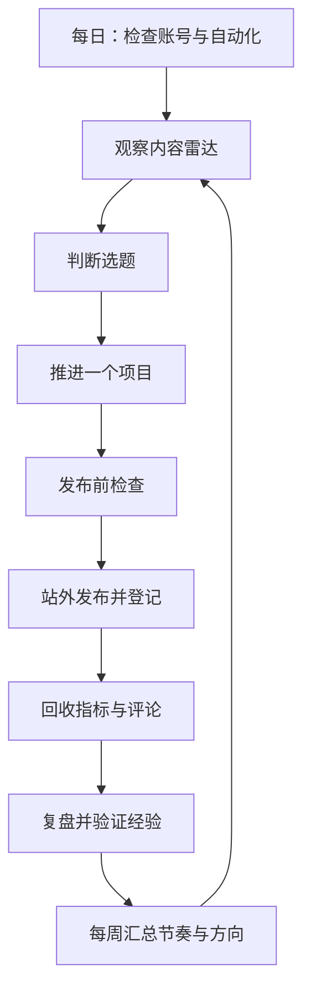

> **配图 83｜日常经营节奏**
> 建议使用信息图，而不是产品截图。把“每日、每条发布前、每条发布后、每周”做成四段清单。

---

# 第八部分：状态词、边界和常见误解

## 常见状态词

| 状态 | 用户应该怎么理解 |
|---|---|
| 候选 | AI 或系统提出，尚未正式采纳 |
| 已采纳 / 已验证 | 用户确认，允许进入正式数据或后续上下文 |
| 已锁定 | 不允许再修改，用于发布后对照 |
| 已完成·无新数据 | 任务成功，但没有新增内容 |
| 需重连抖音 | 登录态失效，需要重新扫码 |
| 限流保护中 | 系统在等待平台风险窗口，不要频繁重试 |
| 报告已过期 | 当前脚本已经比审核报告更新 |
| 规划中 | 页面有明确展示，但当前没有可用真实能力 |
| — | 没有足够数据，不是虚构的 0 |

## 当前版本必须说清的能力边界

1. 真实激活、抖音扫码、采集恢复和视频渲染依赖桌面真机环境；
2. macOS 与 Windows 桌面版均已完成完整验收；首次安装、激活、核心创作链路和发布物以对应平台安装包为准；
3. CreatorOS 当前不会自动发布到抖音；
4. 发布中心主要是发布记录和表现总览；
5. 内容日历只做排期，不自动发布；
6. 选题立项当前不是单一事务，异常后先查项目列表；
7. 内容雷达部分左侧分类不是完整过滤器；
8. 内容雷达不会自动批量生成逐字稿；
9. 素材中心的大库关键词和类型过滤可能漏掉其他分页；
10. 知识、素材和视频没有统一的单条详情 URL；
11. 视频制作不是通用时间线剪辑器；
12. 场景边界和双语字幕当前主要只读；
13. 经验真实回到选题和脚本，不会自动重写定位；
14. AI 的自动发送不等于自动采纳；
15. 问题反馈当前仍需要用户在外部渠道确认提交。

## 最容易犯的 10 个误解

### 误解 1：“绑定抖音号后，所有数据会立刻出现”

绑定只是建立工作区和登录态。历史作品、明细和评论还需要自动化任务回收。

### 误解 2：“AI 生成了，所以稿面已经改了”

没有。找候选卡上的“写入”“采纳”或“应用改写”。

### 误解 3：“发布中心可以自动发作品”

不可以。真实发布在抖音，CreatorOS 负责登记和回流。

### 误解 4：“排进内容日历就会定时发布”

不会。日历是计划，不是平台发布器。

### 误解 5：“审核通过后脚本再改一点也没关系”

脚本版本变化后，旧审核报告会过期，应重新审核。

### 误解 6：“复盘必须等所有指标都有了才能写”

不用。指标为空时仍可记录人工洞察和处理经验。

### 误解 7：“一次高播放就能沉淀成长期经验”

不能。经验需要证据和人工验证，必要时继续实验。

### 误解 8：“切换抖音号只会切换发布数据”

不是。整个定位、选题、项目、知识、素材和经验工作区都会切换。

### 误解 9：“素材中心搜不到就是素材不存在”

大库过滤可能只覆盖当前页，尝试清筛选、翻页或全局搜索。

### 误解 10：“打开反馈渠道就已经提交成功”

没有。你仍需在外部渠道粘贴并确认提交。

---

# 第九部分：第一条完整闭环验收清单

只有下面全部完成，才算真正跑通 0→1。

## 工作区

- [ ] 桌面版已激活；
- [ ] 已绑定真实抖音号；
- [ ] 当前账号选择正确；
- [ ] 文本模型已配置并验证。

## 经营底座

- [ ] 已选择“从零开始”或“已有存量”；
- [ ] 已有账号至少成功运行一次作品指标和作品明细；
- [ ] 已建立定位母版；
- [ ] 已建立 5 类下游规则。

## 选题

- [ ] 至少有一个真实来源或真实受众信号；
- [ ] 至少有一条候选保留来源和证据；
- [ ] 候选经过补全和判断；
- [ ] 已立项为项目。

## 创作

- [ ] Brief 的目标观众、内容目标、核心信息完整；
- [ ] 至少有一条核心论点和证据；
- [ ] 脚本至少保存过一个版本；
- [ ] 审核报告对应最新脚本；
- [ ] 盲预测已锁定；
- [ ] 已有成片或明确制作结果；
- [ ] 发布物料已人工确认。

## 发布与复盘

- [ ] 已在抖音真实发布；
- [ ] 已把真实作品链接登记回 CreatorOS；
- [ ] 发布中心能看到作品；
- [ ] 真实指标或评论至少回流一项；
- [ ] 已完成预测与实际对照；
- [ ] 已记录至少一条人工洞察；
- [ ] 已验证或驳回 AI 经验候选；
- [ ] 至少一条已验证经验进入下一轮选题或脚本。

---

# 第十部分：全手册配图拍摄清单

为了让教程最终能直接给新用户使用，配图建议遵循同一规范。

## 截图规范

1. 使用同一窗口尺寸和缩放比例；
2. 每张图只解释一个核心动作；
3. 用统一颜色和编号做标注；
4. 截图前遮盖：
   - API Key；
   - 激活码；
   - Cookie；
   - 二维码；
   - 私人昵称和头像；
   - 私密作品链接；
   - 本机路径；
5. 空态、成功态、失败态分别截图，不用一张图混讲；
6. 图注写“这一步要判断什么”，不要只复述按钮名称；
7. 有弹窗时保留背后的页面上下文，让用户知道从哪里打开；
8. 项目稿面、内容雷达、选题和复盘建议使用长截图；
9. 动态过程可补 GIF，但仍保留一张静态关键帧；
10. 产品改版后，先更新入口图和状态图，再更新装饰性图片。

## 配图分组

| 分组 | 编号 | 重点 |
|---|---|---|
| 产品理解 | 01—03 | 飞轮、主界面、项目三工作面 |
| 首次启动 | 04—16 | 激活、绑号、模型、引导、自动化、首页 |
| 经营底座 | 17—22 | 定位、内容雷达、来源、逐字稿 |
| 选题 | 23—26 | 候选、证据、排序、立项 |
| 项目稿面 | 27—43 | 新建、Brief、素材、论点、脚本、审核、预测、发布包 |
| 视频制作 | 44—51 | 路线选择、SRT、B-roll、决策、渲染、成品 |
| 发布运营 | 52—58 | 登记、发布中心、日历、数据回流 |
| 复盘闭环 | 59—66 | 指标、预测、洞察、经验、下一轮 |
| 长期工具 | 67—82 | 知识、素材、搜索、Copilot、设置、反馈 |
| 经营节奏 | 83 | 每日/每条/每周信息图 |

---

## 最后记住一句话

CreatorOS 的正确用法不是“把每个按钮都点一遍”，而是：

> 用定位决定方向，用真实信号选择内容，用项目稿面完成作品，用真实发布结果校准判断，再把经过你确认的经验带回下一轮。

当你能稳定重复这条链路时，CreatorOS 才真正从一个功能集合，变成你的内容经营系统。
