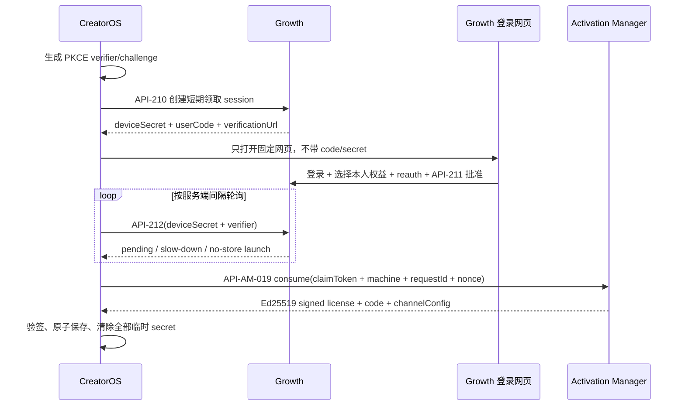

# CreatorOS T-575 权益安全领取消费者契约

> 状态：`CONTRACT / AM-pinned / Growth-device-flow-Round2-PASS / BUILD-verified-flag-off`
> 日期：2026-07-27
> Creator 任务：T-575 / T-076-CREATOR
> AM contractVersion：`growth-entitlement-delivery-v1`
> 权威：Growth 拥有订单、owner/ownership/reauth；AM 拥有 entitlement/license/claim/签名；
> CreatorOS 只消费短期授权结果并保存验签后的本地授权事实。

## 1. 当前 Gate

AM Round 2 独立评审已 PASS，下列工件已从 AM 逐字复制到 Creator：

| 工件 | Creator 路径 | 最终 SHA-256 | 状态 |
| --- | --- | --- | --- |
| descriptor | `docs/contracts/growth-entitlement-delivery-v1.descriptor.json` | `52ce9b41c1bc2288b89440166afac8f66872fe7ad506e69cfab27edd73c8c2d3` | `cmp` 与 AM 相同 |
| fixture | `docs/contracts/fixtures/growth-entitlement-delivery-v1.vector.json` | `e4992497203571199d289dc9a794bba83bad878b932293666cf04534fb688384` | `cmp` 与 AM 相同 |

AM 其他最终 pin：

- 主契约 SHA-256：
  `97ad11e3399acb7feb7e11a4d60f66d29eb91308bd6c471af5daee7537aeef67`
- verifier SHA-256：
  `19aff60d9637caa6983ed4b8c1a6b9f85c20985b3406b2b437170ef01541dde2`
- verifier 已在 Creator 工作区重新执行，provision/reissue/lookup/consume 四个 digest PASS。

Growth API-210..212 Round 2 已 PASS（spec SHA `4bd686f9ccc1`、review receipt
`3bb73429a8e3`）；0028 migration、API-210..212、durable delivery/readiness 本地 BUILD 已实现
并全量通过。Creator 已对当前 closed shape 完成默认关闭的 BUILD；下列条件是 capability 启用、
真实 E2E 与任务完成门：

1. Growth API-210..212 独立评审 PASS（已满足）；
2. Growth/AM 本地 device-flow + claim 契约与 fixture 互操作通过（已满足）；
3. 本 consumer CONTRACT 三轮历史与用户裁决均保留，禁止 Round 4；
4. §10 的恢复 blocker 已由 Growth exact contract 关闭；
5. T-538 同路反馈写集合已冻结或由 T-575 正式接管。

## 2. 大白话流程



浏览器不接收 claimToken，Creator 不接收 Growth Cookie、reauth token、customer ID 或
entitlement 内部引用。Creator 不成为 entitlement 真相源。

## 3. 可信 origin 与 path

### 3.1 Growth

- Growth origin 只能来自签名的产品级 release configuration
  `GROWTH_ENTITLEMENT_API_ORIGIN`。
- 正式包必须将该值固化在受签名桌面产物的 native 配置中；运行时环境变量只允许开发/测试，
  不得覆盖正式包 pin。
- 禁止从 `purchaseUrl/renewalUrl/bugFeedbackUrl/channelSupportUrl` 截取 origin，禁止用户输入，
  禁止跨 origin redirect。
- API-210/212 使用 exact HTTPS origin；`verificationUrl` 必须同一 allowlist 中的固定网页，
  不得含 query、fragment、userCode、deviceSecret。

### 3.2 Activation Manager

- AM origin 复用现有受信任 `CREATOROS_LICENSE_BASE_URL` 的正式包 pin；claim consumer 不新增
  第二个 AM origin。
- 正式 claim 请求不得把 bearer 发到可被运行时环境任意覆盖的 origin；开发 override 必须显式
  debug/test build 且不能进入发布包。
- `consumePath` 必须逐字等于复制 descriptor 的
  `/api/license/entitlement-claims/consume`；Growth 响应不能提供 absolute URL，也不能改 path。
- AM 请求禁止 redirect。

## 4. Creator 本地状态与 secret 生命周期

### 4.1 用户可见 view model

```ts
type EntitlementClaimView =
  | { state: "disabled" }
  | { state: "starting" }
  | { state: "code_ready"; userCode: string; expiresAtLabel: string }
  | { state: "waiting_for_web_approval" }
  | { state: "activating" }
  | { state: "already_claimed" }
  | { state: "expired" }
  | { state: "revoked" }
  | { state: "offline" }
  | { state: "unavailable"; retryable: boolean };
```

普通页面只能显示验证码、剩余时间和人类任务。origin、path、deviceSecret、verifier、claimToken、
requestId、nonce、project/channel identity、签名和 digest 不得进入普通 UI。

### 4.2 临时敏感状态与 pending-consume journal

- PKCE verifier、deviceSecret 默认只存在 native 进程内存；需要跨重启继续 poll 时可写 OS
  受保护凭据存储，但禁止 master-key 的普通文件兜底。
- userCode 可以展示，但不得写日志/遥测/URL。
- API-212 approved `200 no-store` 返回 launch 后，**在首次调用 AM consume 前**，native 必须先
  原子写入唯一 `creatoros-pending-entitlement-consume-v1` journal。只有这一窄化恢复用途允许
  claimToken 短期持久化；它不是业务数据库、缓存或通用 secret store。
- journal 必须使用独立的 OS 原生凭据条目（macOS Keychain / Windows Credential Manager；
  Linux 正式目标如启用则为 Secret Service）。keyring 不可用或写后读不一致时 fail-closed，绝不
  退到 `.master-key`、appData 普通文件、数据库、Web storage 或环境变量。
- journal closed payload 只含：
  `schemaVersion/contractVersion/claimToken/consumePath/requestId/nonce/launchExpiresAt/
  localBindingDigest/attemptState/createdAt`。`attemptState` 只允许 `prepared|attempted`。
- `localBindingDigest` 是 Creator 本地恢复校验，不冒充 AM consume digest：
  `sha256(RFC8785 JCS({contractVersion,consumePath,claimTokenSha256,projectKey,
  machineIdSha256,requestId,nonce}))`；其中 machineId 只做带 namespace 的 SHA-256，不把原文写
  journal。
- 写 journal 成功并读后核对 exact payload 后，先原子更新为 `attempted`，再允许调用 AM。
  `attempted` 表示“结果可能未知”，即使崩溃发生在真正 socket write 前，重试同 exact request
  仍安全。
- 重启发现 journal 时，必须重新计算当前 project/machine binding，逐字校验 consumePath，再
  复用原 requestId/nonce/token/exact body 调 AM；禁止新 requestId、禁止新 session 覆盖未知结果。
- 只有 `.license` 授权快照原子 replace 成功且读后验真，才删除 pending-consume journal。AM
  网络错误、响应丢失、验签失败或本地落盘失败都必须保留 journal。
- 未曾写成功 journal 时绝不调用 AM；因此若崩溃发生在 API-212 response 后、journal 完成前，
  AM 尚未消费，重启可安全新建 device session/reissue。
- `prepared/attempted` 的删除规则只认下表，不得用 UI 取消、墙钟到期、旧 `.license` 存在或
  “大概率没发出去”代替：

| journal 状态 / 证据 | 是否可删除 | 唯一后续 |
| --- | --- | --- |
| `prepared`，用户取消或 `launchExpiresAt` 已过，且 AM 调用计数可证明为 0 | 是 | 清除 session；需要时新建 device session |
| `prepared`，写后读不一致或无法证明 AM 调用为 0 | 否 | fail-closed，进入人工诊断；不出网、不覆盖 |
| `attempted`，用户取消、墙钟/launch TTL 到期、网络未知、response 丢失 | 否 | 后台或用户重试时复用原 exact request |
| `attempted`，response malformed、坏签名、date/requestId/nonce 不匹配或字段为 null | 否 | 保留并重试；不得相信错误语义 |
| `attempted`，验签 exact success，且 `.license` 已按该响应原子 replace 并读后逐字段一致 | 是 | 先展示成功，再清除其他 session secret |
| `attempted`，本机存在 `.license` 但没有本次 replay 的验签 success 可作对应证据 | 否 | 先 exact replay；不得把旧授权当本次成功 |
| `attempted`，验签且 requestId/nonce exact 的 `CLAIM_INVALID` 或 `CLAIM_EXPIRED` | 是 | 因 AM 规定已 commit 的同 exact request 必须 replay `200`，该终态证明本请求未 commit；可新建 session |
| `attempted`，验签且 requestId/nonce exact 的 `CLAIM_REVOKED` | 是 | 保持旧授权事实，不再领取；显示撤权并联系服务方 |
| `attempted`，`CLAIM_ALREADY_CONSUMED`、`CLAIM_IDEMPOTENCY_MISMATCH`、未知错误或其他 4xx/5xx | 否 | 视为协议/实现异常，保留 journal 并 fail-closed |

- `.license` 写成功但 journal 删除失败时，重启也必须先用原 request exact replay 重新取得并验签
  success，再把本地 code/project/expiry/runtime identity 与该响应逐字段核对；一致才补删
  journal。journal 不保存 AM 成功响应，不能仅凭“本地有授权”推定对应关系。
- journal 内容禁止进入 Debug、错误、clipboard、crash report、日志、APM 或 analytics；内存副本
  使用 zeroize/secret wrapper，Drop 时清除。

## 5. Growth device authorization 消费

本节 shape 取自 Growth 已获 Round 2 PASS 的 `SERVICE_CONTRACT.md §21.3`，是当前 BUILD
canonical；共同 fixture/closed bytes 已在本地 BUILD 互操作通过，仍不能把该本地证据冒充
live HTTPS 上线证据。

### API-210 create

Request exact：

```json
{"client":"creatoros","codeChallenge":"<43-char base64url>","codeChallengeMethod":"S256"}
```

201 exact：

```json
{"deviceSecret":"<43-char base64url>","userCode":"ABCD-EFGH","verificationUrl":"https://<official-growth-host>/app/entitlements/connect","expiresAt":"<UTC ms>","pollIntervalSeconds":5}
```

Creator 必须本机生成高熵 verifier，challenge 固定为
`BASE64URL(SHA256(ASCII(verifier)))`。create response 丢失时创建新 session，旧 session 等 TTL
回收，不能猜测或复用未知 deviceSecret。

### API-211 approve

API-211 只在 Growth 浏览器内执行。Creator：

- 调用次数必须为 0；
- 不接收或提交 `entitlementPublicRef`；
- 不接触 Cookie、CSRF token 或 `X-Reauth-Token`；
- 只通过 API-212 状态知道是否已经批准。

### API-212 poll

Request exact：

```json
{"deviceSecret":"<43-char base64url>","codeVerifier":"<43..128 unreserved chars>"}
```

pending 202：

```json
{"status":"authorization_pending","expiresAt":"<UTC ms>","retryAfterSeconds":5}
```

approved 200：

```json
{"claimToken":"<opaque>","consumePath":"/api/license/entitlement-claims/consume","expiresAt":"<UTC ms>"}
```

Creator 必须遵守 `pollIntervalSeconds/Retry-After`；429 只延长轮询间隔，不能并发加速。404 表示
本次 session 不可恢复，410 expired 可重新开始；503 保留本地已激活状态并允许稍后重试。任何
非 closed body、redirect、错误 Content-Type 或超限响应都 fail-closed。

收到 approved launch 后不得直接调用 AM：必须先完成 §4.2 journal 的原子写入与读后核对。journal
写入失败时保留“领取尚未完成”，不调用 AM，也不把 claimToken 转交 Web UI。

## 6. AM API-AM-019 consume exact consumer

Creator 对 copied descriptor/fixture 的 pin 是 Gate，不自行重生 fixture。

Request 为 closed 6-key：

```json
{
  "contractVersion": "growth-entitlement-delivery-v1",
  "claimToken": "<opaque>",
  "projectKey": "creatoros",
  "machineId": "<native opaque device id>",
  "requestId": "<UUID>",
  "nonce": "<existing license nonce>"
}
```

要求：

1. `projectKey` 只能来自正式包内置产品 key，不来自 Growth、网页或用户输入。
2. `machineId` 复用现有 native 设备标识，不返回 Web UI。
3. 同一次 consume 的网络超时重试固定复用 requestId、nonce、token 和 exact body；不得换
   requestId 盲重试。
4. 首次请求前必须存在 exact pending-consume journal；重启恢复也只能从该 OS credential 条目
   构造同一请求。
5. request body、响应 body、header 和错误都不得进入日志；只允许稳定阶段、错误码和耗时桶。
6. journal 未进入 `attempted` 且 claimToken 到期时可以删除并重新开始 device authorization；
   journal 已是 `attempted` 时必须先以同 request exact replay 向 AM 收敛，不按 TTL 猜“未消费”。
7. 不回退旧激活输入框承接 token。

## 7. AM 响应验证与持久化顺序

必须在 native 层复用 `frontend/src-tauri/src/license.rs` 现有可信链，不在 React、Next route 或
sidecar 另写 JS 验签器：

1. 对 raw response bytes 验证 `X-License-Digest`；
2. 用既有 Ed25519 public key 验证
   `(request-target)/host/date/digest`，target 固定
   `post /api/license/entitlement-claims/consume`；
3. 验证 `X-License-Date` 时间窗；
4. parse closed success/error envelope；
5. success 必须回显本次 requestId/nonce，且
   `contractVersion="growth-entitlement-delivery-v1"`；
6. `data.projectKey` 必须等于正式包 projectKey；
7. `data.license` 必须 closed 5-key、`valid=true/revoked=false`，TIME 的 `expiresAt` 为 AM
   权威期限；Creator 不从购买时间或“年费”计算期限；
8. `data.channelConfig` 只能为 null 或 T-534 已锁的 `channel-runtime-v2` closed object。对象
   存在时，其已签名内部 `projectKey/channelRef` 作为本次新 identity，继续执行 sourceDigest、
   snapshotVersion、防降级和 URL 净化；null 不清除同 identity LKG，也不猜渠道；
9. 全部通过后，才把 `activationCode`、license、identity/runtime 与 last-seen 作为一个原子
   `.license` 快照写入；原子 replace 后必须读回并核验同一 code/project/expiry/runtime identity，
   成功后才删除 pending-consume journal 与其他 session secret；
10. 任一步失败零持久化、零 UI 成功、零 runtime 更新。

错误 envelope 中 requestId/nonce required-but-nullable。malformed/missing-field exact vectors 与
独立 `CLAIM_INVALID` domain vector 均来自 copied fixture；Creator 不把服务端 message 当授权事实。

## 8. 可恢复体验

| 输入/结果 | 用户体验 | 本地事实 |
| --- | --- | --- |
| capability/config disabled | “当前暂未开放领取，请使用已有激活方式” | 不渲染领取按钮；旧激活不变 |
| API-210 429/503 | “领取服务繁忙/暂未开放，稍后重试” | 零 session 或安全清理 |
| waiting approval | 显示 userCode、剩余时间和“我已在网页确认”状态 | 只保留临时 session |
| API-212 slow-down | “仍在等待确认” | 按服务端间隔延后 |
| session expired | “验证码已过期，重新获取” | 仅 `prepared` 且 AM 调用数为 0 时清除；`attempted` 继续 exact replay |
| AM `CLAIM_INVALID/EXPIRED` | “领取入口已失效，重新获取” | 不改变旧授权 |
| AM `CLAIM_REVOKED` | “该权益已被撤销，请联系服务方” | 不写新授权 |
| AM unavailable/timeout | “激活服务暂时不可用，稍后重试” | 同 request exact retry；旧授权不变 |
| signed success | “激活成功”及真实到期时间 | 原子写+读后验真，再删 journal、再显示成功 |
| 已领取但本地无成功快照 | “正在恢复上次领取” | 从 OS journal 复用同 request exact replay，不新建 session |

## 9. 测试合同

### Contract fixture

- `cmp` Creator/AM descriptor 与 fixture；
- 固定 SHA-256 pin；
- 执行 AM verifier，并额外用 Creator consumer test 读取同 fixture；
- 5 个 Ed25519 vector、v1/v2 HMAC、AES-GCM、TIME term 均必须通过；
- descriptor/fixture 任一字节变化立即使 Creator review 与 BUILD Gate 失效。

### Security negative

- Growth/AM origin 被 channel URL、用户输入或 redirect 替换时零出网；
- API-210 verifier/challenge 不匹配、响应多键、verificationUrl 带 query/fragment；
- API-211 从 Creator 被调用；
- deviceSecret/verifier/userCode/claimToken/requestId/nonce 出现在 URL、clipboard、Web storage、
  DB、文件、日志、APM、analytics、错误正文；
- API-212 轮询过快、并发 poll、slow-down 未退避；
- consume path 不等于 descriptor、body 多键/缺键、换 requestId 重试；
- API-212 response 后、journal 写前 kill：断言 AM 调用数为 0，重启可新建 session；
- journal write 失败/读后不一致：断言 AM 调用数为 0，普通文件/DB fallback 为 0；
- journal prepared→attempted 前后每个 kill point：重启只复用原 requestId/nonce/token；
- AM commit 后在 response byte 0、验签前、`.license` temp write、fsync、rename、读后验真前逐点
  kill：重启均以同 request exact replay 得到同一 signed success，grant/code/claimVersion 各一；
- `.license` 写成功但 journal delete 失败：重启必须先 exact replay 并验签同一 success，再把
  本地 code/project/expiry/runtime identity 与响应逐字段核对；一致后只补删 journal，不再次
  创建 session 或产生第二次业务消费；
- `attempted` 后用户 cancel、launch TTL 到期或旧 `.license` 共存：均不得删除 journal，必须
  exact replay；签名错误、requestId/nonce null/不匹配也不得按 error code 清理；
- `CLAIM_INVALID/CLAIM_EXPIRED/CLAIM_REVOKED/CLAIM_ALREADY_CONSUMED/
  CLAIM_IDEMPOTENCY_MISMATCH` 分别按 §4.2 表执行删除/保留，未知错误一律保留；
- raw digest、Ed25519、date、nonce、requestId、projectKey、channelConfig identity/sourceDigest/
  version 任一失败；
- AM 成功但本地原子写失败时不得显示成功，临时恢复状态不得提前删除。

## 10. Release-critical mismatch ledger

### GAP-575-001：三仓本地 BUILD 已 PASS，live 上线闭环尚未完成

- **现状**：Growth API-210..212、0028 migration、durable delivery/readiness 本地 BUILD
  全绿（backend 719 passed/81 skipped、frontend 124 passed、production build PASS）；Creator
  和 AM 本地消费链也已通过。仍缺 live HTTPS 非 fixture 三仓 E2E、实际部署、正式密钥和最终
  release receipt。
- **owner**：Growth T-076。
- **关闭条件**：live HTTPS 环境使用正式部署/密钥完成 API-210→212→AM consume 与反馈链路，
  三仓 release receipt 固定实际部署 commit。
- **当前动作**：允许默认关闭的 Creator consumer BUILD/TDD；禁止启用 capability、发布或用
  fixture 冒充真实 E2E。

### GAP-575-002：AM 已提交、Creator 落盘前崩溃的恢复窗口

- **裁决**：主调度已选择 Creator OS protected pending-consume journal；不新增 Growth ack wire。
- **安全理由**：journal 必须在 AM 首次出网前原子写成，保存 AM exact replay 所需的原
  requestId/nonce/token；因此 AM commit 后任何崩溃都可绕过已 consumed 的 Growth session，
  直接向 AM 重放同 consume request 并取得同一 signed success。
- **唯一 secret 持久化例外**：claimToken 只可存在这一 OS 原生凭据条目，禁止普通文件、DB、
  URL、clipboard、日志或通用 secret projection。
- **状态**：CONTRACT 与本地确定性 BUILD 验证已闭合；真实 OS keychain/进程强杀与跨系统
  非 fixture 场景仍属 RELEASE 验证门。
- **关闭 Build Gate 条件**：§9 所列全部 kill point fault-injection 通过，证明 journal-before-
  network、同 request exact replay、`.license` 原子写+读后验真、成功后删除，以及零第二
  grant/code/claimVersion。

## 11. 发布与回滚

- 当前正式包两项新能力保持关闭；旧激活码流程、T-534 runtime 与手动反馈降级不变。
- deploy 顺序：AM/Growth/Creator 本地 BUILD（已完成）→ 正式部署/密钥 → live HTTPS E2E →
  小流量 capability → 观察 → GO。
- rollback 先关闭 Growth claim-session capability；Creator 显示不可用并保留旧授权/LKG，不清
  `.license`、不发 tombstone、不回退其他渠道。
- 本契约 PASS 也不代表实现、部署或发布完成；发布由用户在整体 GO 后决定。
