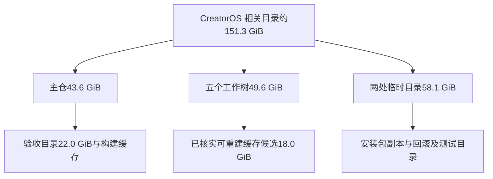

# T-1383：内盘空间告急只读核查

日期：2026-10-20。用户反馈「又没有存储空间了……是不这个项目又在海量占用空间」。

结论：是。项目主仓、五个内盘工作树及已确认归属的临时副本，目录占用合计约 **151.3 GiB**。主要是反复构建、验收与保全产生的副本；刚拉取的 148 个工作文件从 17.96 MiB 变为 18.29 MiB，净增加 **0.33 MiB**，不能解释当前规模。这个差值不包含 Git 对象新增。

首次 `df`：内盘仅剩 409 MiB；后续复查仅剩 334 MiB。T7 外盘剩余约 814 GiB。正在运行其他会话的类型检查、测试及 stop-reconcile；本轮未触发构建、未停止进程、未删除任何文件。

## 主仓

| 目录 | GiB | 说明 |
|---|---:|---|
| 主仓全部 | 43.608 | 包含下列各项，不能重复加总 |
| `docs/verification` | 22.049 | 验收证据和验收内的构建副本；不能整目录当缓存删除 |
| `docs/verification/t1289` | 5.483 | 大部分在 candidate/owned 构建目录 |
| `docs/verification/t1278` | 4.796 | 含两份约1.81 GiB的 native-owned 副本 |
| `frontend/src-tauri/target` | 8.053 | Rust debug/release-fast 构建输出 |
| `frontend/.next` | 3.377 | Next 构建缓存，dev/cache/turbopack约2.16 GiB |
| `node_modules` | 2.212 | 依赖 |
| `.worktree-preservation` | 1.943 | 历史保全，不直接删除 |
| `.codegraph` | 1.657 | 可重建索引 |
| `.git` | 1.622 | Git历史，不能当构建缓存删除 |

## 五个内盘工作树

根目录为 `/Users/zyongzhu/.codex/worktrees/`，每项内的仓库名均为 `Thirdspace-creator`。

| 工作树目录 | GiB | 工作区状态 |
|---|---:|---|
| `account-binding-daily-candidate` | 14.997 | 已跟踪、未跟踪均干净 |
| `t1364-wechat-navigation` | 11.030 | 已跟踪、未跟踪均干净 |
| `t1367-collapsed-navigation` | 8.688 | 已跟踪、未跟踪均干净 |
| `t1370-t1371-ui-data` | 7.786 | 3个已跟踪文件修改 |
| `t1369-filter-navigation` | 7.114 | 3个未跟踪测试文件 |

合计49.614 GiB；其中历史验收目录17.240 GiB、依赖11.024 GiB。**可重建缓存候选18.025 GiB** = `.next` 10.647 + Rust `target` 5.763 + `.codegraph` 1.615。这些缓存均命中对应工作树Git忽略规则，检查时 `lsof`、进程命令与cwd未发现使用者。执行清理前仍需重新核对并发变化。

这些工作树HEAD不是当前main的祖先；均有本地历史保留分支。不能用「都已合并」作为整树删除理由。`.codex/sessions` 15.161 GiB及 `thread_history_1.sqlite` 6.010 GiB属于聊天记录，不在候选中。

## 项目临时副本与应用目录

| 位置 | GiB | 内容 |
|---|---:|---|
| `/private/tmp/t1300-artifact-*`，8个 | 27.238 | App、DMG、sidecar重复副本 |
| `/private/tmp/` 下7个 before-final/rollback/before-build目录 | 11.917 | 打包前及回滚副本 |
| `/private/tmp/t1375-*`，3个已核实目录 | 8.886 | safe-main、final-safe-main、unique-gitleaks副本 |
| 系统临时目录 `T/t238-creator-00i2if0x` | 5.850 | 源码与验收副本 |
| 同一 `T` 下238个 `creatoros-*` 目录 | 4.165 | 测试、Playwright临时目录 |
| `~/Library/Application Support/CreatorOS-validation` | 2.141 | T1255验证runtime，未计入上面151.3 GiB |
| `~/Library/Application Support/cloud.aitongban.creatoros` | 4.225 | 正式runtime、数据库、恢复备份，未计入上面151.3 GiB |
| `~/Library/Caches/cloud.aitongban.creatoros` | 1.422 | 主要为登录浏览器数据，未计入上面151.3 GiB |

系统临时目录的完整根为 `/private/var/folders/0f/yn6rgq1j2lj2n8_868n28jzc0000gn/T`。`/private/tmp`的CreatorOS三组精确小计50,374,468 KiB。没有将Growth临时验收3.63 GiB或其他App归入本项目。

## 后续可执行范围与验证边界

优先处理五个工作树内18.025 GiB可重建缓存。旧验收、安全副本及回滚内容需逐项核对来源、活动占用和独有内容后再归档到T7或清理；正式数据库、登录数据、未提交源码、历史证据不在直接删除范围。

命令依据：`df -h`、`du -x -k -d`、`git worktree list --porcelain`、各树 `git status` / `git check-ignore`、`lsof` / `ps`、`git cat-file --batch-check`。`lsof +L1`未发现当前用户可见的超过100 MB的已删除仍打开文件。目录统计可能包含APFS共享块，候选大小不等于承诺释放量，实际回收必须清理后以`df`核实。

这是空间诊断，未执行产品测试、完整reconcile、脚手架升级或任何清理。
