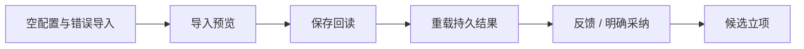

# 观众任务选题区的旅程验收契约

本页补充已评审SPEC的验收绑定，不改变业务范围或数据归属。入口 `/topics`，页面区块“观众任务与双九宫格”。1440×900为常规窗口，1024×768为本轮桌面最小支持窗口；不以缩放同一截图冒充两次运行。

用户打开空配置 → 错误文件保留原配置并显示可处理提示 → 实际月明配置仅预览 → 显式保存回读当前账号 → 持久结果重载 → 原提案反馈 → 明确采纳 → 现有候选立项。生成和立项的公共API回归在报告中单独注明，不冒充页面按钮已点击。真实页面、PGlite和Worker与本地模拟模型输出分开记。



```frontend-journey-contract
{
  "schema": "frontend-journey-contract/v2",
  "task_id": "T-1019",
  "copy_guard": {
    "forbid_internal_ids": true
  },
  "watched_paths": [
    "frontend/src/features/topics/audience-task-workspace.tsx",
    "frontend/src/features/topics/audience-task-detail.tsx",
    "frontend/src/components/ai/adopt-candidate-card.tsx",
    "frontend/tests/e2e/audience-task-topics.spec.ts",
    "contract/src/resources/audience-task.ts",
    "backend/src/modules/candidate/topic-workspace.service.ts",
    "backend/src/modules/candidate/audience-task-assessment.ts",
    "backend/src/modules/ai/topic-candidate-adoption.service.ts",
    "backend/src/modules/candidate/candidate.service.ts",
    "frontend/src/server/persistence-client.ts"
  ],
  "required_checks": [
    {
      "id": "UI-AT-empty",
      "test_id": "E2E-audience-task-topics"
    },
    {
      "id": "UI-AT-invalid",
      "test_id": "E2E-audience-task-topics"
    },
    {
      "id": "UI-AT-import",
      "test_id": "E2E-audience-task-topics"
    },
    {
      "id": "UI-AT-save",
      "test_id": "E2E-audience-task-topics"
    },
    {
      "id": "UI-AT-review",
      "test_id": "E2E-audience-task-topics"
    },
    {
      "id": "UI-AT-refresh",
      "test_id": "E2E-audience-task-topics"
    },
    {
      "id": "UI-AT-feedback",
      "test_id": "E2E-audience-task-topics"
    },
    {
      "id": "UI-AT-adopt",
      "test_id": "E2E-audience-task-topics"
    }
  ],
  "required_conditions": [
    "empty",
    "invalid-input",
    "reload",
    "stale-version",
    "account-isolation",
    "forged-patch"
  ],
  "viewports": [
    {
      "width": 1440,
      "height": 900
    },
    {
      "width": 1024,
      "height": 768
    }
  ],
  "coherence_groups": []
}
```

所有检查须有当场日志、可见文案或API回执；前置RED未存证仍记缺失。历史T-1017工作树中的混合文件仍未提交，严格HEAD与watched_paths检查须如实显示，不把未提交文件隐藏成干净验收。正式report status通过前禁止taskctl complete。
