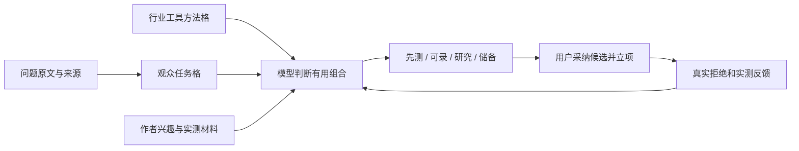

# T-1019 从观众要干的活持续生成可实测选题

确认来源：2026-10-02 用户委派及外部交接 `/Users/zyongzhu/moonlit-creator/research/creatoros-requirements/2026-10-02-观众任务九宫格与持续选题.md`。受众、240 分钟备料、来源使用均已获授权；作为账号可编辑配置，不硬编码到所有账号。复用定位、选题中心、资讯来源与雷达；不改 T-1017 首稿主路径，不发布、不部署、不 push。

## 用户结果与入口

选题中心新增“观众任务与双九宫格”可折叠区：观众要做什么、行业有什么方法、已有问题材料及作者实测依据可保存；原 AI 选题会和每日出题消费这些真实配置。候选首先展示帮谁干什么、输入/步骤/输出/验收、观众入口、作者测试计划，明确可录/先测/研究/储备/不适合。用户选择候选才沿现有采纳和立项路径进入项目；选择不等于实测或播放表现。

## 已确认需求与验收

| ID | 行为与删除损失 | 验收 |
|---|---|---|
| FR-AT-01 | 账号内保存两个最多9格的网格；稳定ID、角色、来源、证据/假设、版本；可空。作者材料独立，不能投射成观众兴趣 | AC-AT-01：保存/回读、CAS冲突、空格、账号隔离、项目材料显式scope |
| FR-AT-02 | 问题材料包含原文、角色、来源URL/记录、事件/采集日期、读取范围、公开性；手动链接+正文与现有评论读取并用 | AC-AT-02：无评论不编需求，一条不称高频；ID唯一及重复材料幂等 |
| FR-AT-03 | 模型先规划公开任务查询，再读取已启用资讯来源（HF/Discord/PH/X可在既有信源管理配置），真实回执展示成功/部分/未调用/失败/权限不足 | AC-AT-03：规划不含私人作者材料；来源失败如实降级，重跑沿现有调用账本恢复 |
| FR-AT-04 | 模型判断受众相关性、工具映射、格子关系、同命题与改造；每题任务、输入步骤输出验收、入口/成本语言硬件限制、作者能力与观众能力分离 | AC-AT-04：三正例和工程方法反例的结构测试；模型语义效果另列真实待验 |
| FR-AT-05 | 可录需作者真实结果引用与已核验入口；半天内可补证据→先测；入口未知→研究；超过配置预算→储备；不适合不入推荐短名单 | AC-AT-05：代码只验证事实引用、显式模型判定与时间，不算词分、不按总分覆盖错受众；局部缺口降级，不反杀旧稿 |
| FR-AT-06 | 当前配置/定位版本与拒绝候选原文原因冻入生成；模型承接反馈，被拒同命题需实质改造说明；服务端验证拒绝ID和重复命题ID。定位变更标待重审 | AC-AT-06：冻结版本+拒绝接续+显式新尝试；新任务字段在候选/立项保留；旧改写、保存、采纳回归 |

## 契约、归属和实现边界

唯一新存储 `topic_workspaces`，candidate 域拥有，按 user/account 唯一；JSON保存配置、两个网格、问题、作者材料。项目材料携带projectId，只消费当前明确项目；外部context引用可携带project_key/context_id/version，未接外部记忆时诚实显示手动引用。不得全库召回，私人材料不进入公开查询。

新增2操作 `topics.workspace.get` / `topics.workspace.save`，只读当前账号，save带 expectedVersion（0代表首次）与 idempotencyKey；CAS+幂等重放一致性，重放内容不同冲突。配置与材料保存是显式用户写入，AI不能更新。问题/格子稳定ID不得重复；来源记录引用由服务端确认归属或明确手工引用（不是已采集证明）。保存不会修改定位母版。

现有 `topic.generate` / `scheduled.topic.daily` 读取 workspace、当前定位版本、已拒绝候选（ID/原文/原因/任务卡）；冻结输入扩展可选字段，旧任务兼容。当前定位版本取服务port，不信任客户端。新候选 `audienceTask` 可选扩展，包含模型任务判断与服务端冻结版本、真实来源读取状态，随已有 candidate.card 落库；采纳与每日供给经原service端口。旧候选无此字段继续可读可立项。新字段不能通过公共card patch伪造来源/版本或“已实测”，证据从用户保存的作者结果材料回读。用户改配置/定位后旧推荐仍可看，显式提示待重审；采纳旧结果返回明确版本冲突，旧 rewrite_only 不受影响。

单条输出缺必要任务字段→保留研究而非冒充推荐；不适合仍可在审读结果里展示原因，批量采纳跳过。新推荐只使用模型显式关联的格子ID/来源ID；不存在的引用清除并降为研究，不捏造来源。模型输出命题键用于 exact ID 去重，不用标题相似度；拒绝命题ID原样重推跳过，实质改造须changedFromCandidateId与changeReason。模型识别换标题同题属于Skill职责，真实模型验收才证明效果。

公开查询是独立模型步骤，仅输入公开问题和观众/行业格，明确禁止私人作者经历；搜索调用通过现有受控读取端口，query类型/长度/账本/安全边界由代码守。新来源未经调用显示not_called；读取前的模型规划不能当作搜索成功。供应商未知结果仍沿现有unknown机制；已确认单源失败不阻断有证据的待测候选。

FR链路均feasible：01/02显式材料→workspace表→两操作回读；03现有trend source+受控call ledger→模型结果来源状态→任务/候选卡；04/05可配置topic.generate模板→候选结果→候选详情；06现有候选dropReason+当前定位→冻结任务→确认/立项与下次生成。无新actor/runtime/外部SDK；2操作、1表、无新权限。

## 页面与异常

折叠区默认按需加载，两个3×3网格可留空；受众、平台与作者预算可编辑。问题和作者材料通过带示例的JSON材料编辑区导入（稳定ID及来源必填，保存错误中文），不强制填满。生成前可保存配置；未配置仍沿原定位生成，假设候选保持待测。配置读取失败显示重试，不以空配置覆盖。仅折叠打开后加载；卸载/账号切换旧响应不回写；同页链接按LED-047本地路径。候选详情显示真实来源与时间，评分在原次级区。

## DEC-T1019 与验证

用户委派授权完整实现与本地验证，遵循上述已确认范围。默认新workspace为空、240分钟为可编辑预算初值；不替未选择的账号写“小白”受众。当前定位正文为受众基准，workspace补充需明确模型处理冲突。定位版本或workspace版本改变触发重审；不改已采纳正文。

先独立SPEC评审，TDD真实RED→GREEN；contract typecheck/test、workspace PGlite隔离/CAS/幂等、worker流水线与真实引用降级、候选采纳/每日供给/立项、frontend组件交互、T1017回归、LED047、boundary/semantic/orphan、pmem sync/reconcile。真实桌面/供应商/外部权限未发生时记录待验；全局已有欠债单独登记，不补拍PASS。禁止夹带现有未提交改动。

## 首轮缺口的确定契约（REV-001/002/003）

选题中心新增直接调用持久 `topic.generate` 的“按观众任务生成”按钮，走原任务轮询、结果回读、显式confirmTask；原Copilot聊天入口兼容，不宣称旧聊天卡已带完整审读回执。新结果每条带服务端生成的稳定proposalId（taskId+原始索引）；前端筛选只保留真实proposalId，不能替换audienceTask。confirmTask由服务端回读保存的候选与冻结上下文；公共patchResultItems只能删除或修改标题/角度等表达，不得改审读、证据、状态、版本、proposalId。新增第三操作 `topics.proposals.feedback`（taskId、proposalId、reason枚举与可选说明、idempotencyKey），服务端按当前归属回读结果，保存原任务/命题/正文/定位版本/反馈时间，不信任客户端提供正文。反馈由candidate域服务端口持久在 `topic_proposal_feedback` 表，next run按账号及显式项目读，拒绝键不只依赖标题。已有正式candidate.dropReason继续消费；已实测反馈不单独升级可录，需具体结果和入口记录。

受众冲突由模型判断并返回 `audienceFit: matched | uncertain | mismatched` 与 `audienceReason`；当前定位为基准，workspace仅补充。模型若识别冲突且未明确化解，必须uncertain，最高研究；mismatched进入不适合。代码不按字符串不同认定语义冲突，但mechanically按显式enum落实研究/不适合，分数不能覆盖。验收加入定位“开发者”与workspace“小白”的冲突候选，确保uncertain不进可录/先测短名单。

作者材料可记录 `entryVerification: {status: verified|unverified|unavailable, checkedAt, entryUrl, expiresAt, conditions}` 与 `result: {input, steps, output, acceptance, resultRef}`；用户显式保存为核验声明（界面标“用户记录”，不冒充系统网络实测），默认unverified。仅verified、checkedAt不在未来、expiresAt晚于生成时点、入口URL与候选匹配，且完整resultRef、输入步骤输出验收存在时，服务端才能给可录；过期/未知/不存在引用降到研究或先测，原证据保留。checkedAt、expiresAt是ISO时间，conditions说明语言/费用/设备前提；结果是作者测试，不证明所有观众成功。JSON材料编辑显示用户记录及有效期要求。

共3新增操作、2新增表，仍属于原candidate域和同一权限边界，无新runtime、actor或发布承诺。上述补足已确认需求，不缩范围，不以Skill效果测试替代真实模型验收。

## 用户后续确认的 v02 个性化交付

[完整约束与验收](v02-clarification.md)：已授权消费月明当前版个性化网格；新增兼容可选配置字段保存中心、位置、语义配对和代表材料范围，提供通用文件导入与月明可导入工件。不向其他账号写入默认人设。
