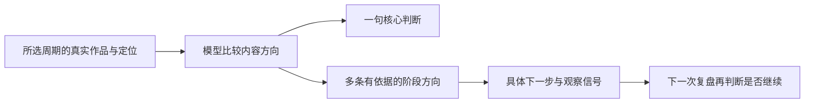

# T-1000 周期运营建议与内容战略方向

## 用户问题

当前运营分析选择近 7 天或近 30 天后，顶部“本期建议”只有一句标题和两三句摘要。用户需要从运营角度看到更多有依据的建议，以及接下来一段时间的内容战略方向。日分析仍应简洁，分享战报不公开私密复盘。

## 设计

保留顶部一句核心判断，下面新增独立的“接下来怎么做”区块。周/月报告由模型针对真实作品和定位给出若干相互不同的方向，每个方向明确“观察到什么、建议做什么、下一步怎样验证”；按优先顺序展示。可以包含内容类型布局、受众与账号定位、从播放到关注的承接、创作节奏等，但不能用固定词表替模型判断，也不能为了凑数编造数据。样本不足时如实减少方向，说明待补证据。

当前结构化报告协议增加可选方向数组，旧缓存与已生成报告仍能展示。既有下一步实验用于单条可验证的内容动作，战略方向用于跨作品的阶段性取舍，两者不互相重复。新字段只用于内部运营复盘，不进入分享图或 CSV。

## 验收

- 周/月分析提示词要求从内容组合与账号经营层面提出不重复的方向，有观察依据、具体行动与验证标准；证据不足不凑数。
- 页面将这些方向单独展示，不塞进标题或 140 字摘要；旧报告没有该字段也正常显示。
- 原始来源绑定、作品 ID 校验、缓存恢复、跨账号隔离保持不变；分享战报和数据导出不携带战略文字。
- 补协议、页面及展示转换测试，运行相关前端/合同测试与架构门卫。
