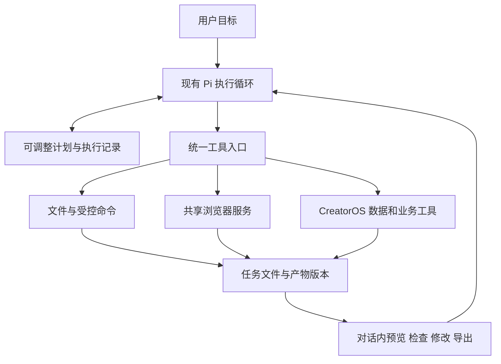

# T-1003 多步 Agent 与 NomiFun 能力迁移 SPEC

## 1. 目标、授权与范围

用户确认：CreatorOS 接受一个目标，自主连续执行必要步骤，检查结果并调整，最终交付可打开和修改的文件；不要求每一步输入“继续”。参考用户参与开发的 NomiFun 工具和 browser_use，复用已有核心实现。本轮授权为规格设计、全部子任务拆分和独立评审，不包含运行时实施、发布或修改 NomiFun 仓库。

产品总纲沿用 `docs/产品定位.md`，本模块细节只在本文维护。当前为既有桌面产品的 PLAN/CONTRACT/DESIGN 变更规格；全局 manifest 仍为 BUILD，不把规格完成冒充功能完成。本文经独立评审后才能作为后续实施依据。

范围包括：可更新计划、连续工具循环、NomiFun 通用工具适配、文件工作目录、受控命令执行、浏览器能力与既有采集共存、Skill/扩展装配、产物预览修改导出、恢复和双端安装验收。不限于预设报告模板。不引入多 Agent 编队、插件市场、远程服务器部署；不重做定位、稿件采纳、发布和收费系统。

## 2. 已核实的现状与决策

依据 [T-1002](../research/t1002-agent-capabilities.md)：聊天使用 `ai-worker/src/runtime/chat/chat-pi-loop.ts` 的 pi-agent-core；另一执行入口 `runtime/agentic/pi-engine.ts` 使用 coding-agent SDK 并禁用宿主内置文件工具和资源自动发现。现有执行账本、恢复、业务工具和专用报告继续复用，不是从零实现 Agent。Pi 当前锁定 0.80.7。

NomiFun 本地参考 `/Users/zyongzhu/Workbase/nomifun-desktop`，审查 HEAD `e27bd5de`。迁移以完整提交和依赖锁为准，不依赖用户本机该路径：

| 来源 | 复用内容 | 必须适配 |
|---|---|---|
| apps/pi-sidecar/src/nomifun-gateway.ts | 工具目录、调用、进度、取消 | 当前 core 注册方式；账号、执行回执和错误归属 |
| apps/pi-sidecar/src/tool-result-adapter.ts | 长结果分页、媒体处理 | 已有 tool.result.read 与保存索引 |
| crates/backend/nomifun-gateway/src/caps_files.rs | 文件工具契约与服务接口 | 账号任务目录、产物与导出授权 |
| crates/backend/nomifun-gateway/src/caps_agent_execution.rs | 步骤、依赖、重规划 | 原 execution_tasks 状态真相；不复制其数据库 |
| crates/backend/nomifun-browser-platform | Hub、Lane、租约、调度、身份和清理 | CreatorOS 账号域与任务域 |
| crates/agent/nomi-browser-engine、nomi-browser | CDP 操作、观察、截图、站点记忆与视觉回退 | net/process/common/redact 等依赖闭包及宿主配置端口 |

实施选择：保留当前聊天 core，采用工具适配器接能力目录；不为加载一个 Extension 全量换引擎。原 coding-agent 业务入口共用能力协议，不能各造一套能力状态。浏览器 Rust 库通过版本化共享包或锁定提交的源码包引用，桌面宿主承载；不得要求安装 NomiFun。抽取上游包的写入另需明确授权，当前仓可先维护有来源与锁定版本的依赖包，不能复制后无版本追踪。

## 3. 用户旅程与交互

示例：“结合我的定位和近30天作品，查询相关热点和案例，提出值得做的选题，写稿并生成带图表的 HTML 报告。”

助手读取上下文→列必要步骤→获取作品和外部来源→比较判断→写稿/制作文件→检查数据和页面→必要时修正→对话内交付。语义判断和计划由模型/Skill 完成，代码校验真实 ID、权限、依赖、状态和文件事实。用户继续说“第二部分精简，换柱状图”，在原产物上生成新版本。

已有 AI 助手入口保留，不增加独立任务大厅作为必经流程。发送后立即显示本地等待状态；多步任务显示紧凑步骤、当前操作、停止按钮和产物卡。简单问答直接回复，不强制计划审批。关闭助手面板不等于停止；重新打开订阅原任务。停止明确取消执行。缺关键输入在原对话提出具体问题；需要登录打开该账号受管登录入口。失败展示具体步骤与下一步，禁止正常读取失败一律显示“结果待核对”。

## 4. 需求与契约

### FR-AW-01 连续执行与计划

复用现有任务 ID 和 execution_tasks 执行权。计划包含 planRevision、stepId、title、dependsOn、status、operationRefs、artifactRefs。同一步骤可有多次尝试。更新需 expectedRevision 并校验无环依赖。模型提出计划变更；已成功步骤及其回执不可改写，替换步骤保留 supersedes 引用。完成由回执/产物核验支持，不能仅凭模型宣称成功。

普通目标在原 loop 中持续推进，正文里的“我来调用”不是完成条件；当模型提前结束但存在已接受的未完成步骤，宿主向原 loop 返回剩余事实供继续，只有用户等待、停止、不可恢复失败或目标完成才结束该轮。无进展重复循环停止并给具体原因，不无限自动重试；次数/成本预算由现有执行策略提供，不能隐藏截断合法长任务。

### FR-AW-02 通用能力目录

统一工具描述含 name、schemaVersion、inputSchema、resultSchema、effects、requiredCapabilities、platforms。后端从可信调用上下文注入 accountId/taskId/attempt/lease；不接受模型自报身份。复用当前工具调用与回执，不绕过费用记录、provider thought signature、取消与续跑链路。

结果含 operationId、status、content、artifactRefs、progressCursor；错误含 code、retryable、dispatched、nextAction。大文本分页回读，截图保留模型可见媒体，历史媒体不重复无限塞入上下文。执行前错误与确已提交但结果未知分开；只读操作按实际状态安全重试，产生外部状态的未知操作先核对回执。

### FR-AW-03 文件与工作目录

账号/任务范围目录存放输入引用、工作文件和交付文件。files.list/read/write/edit/stat；编辑带 expectedVersion/hash，冲突返回当前版本，不覆盖他人修改。写入采用临时文件与原子提交，版本化保留已交付产物。路径规范化、符号链接和 Windows 路径按真实文件系统校验；模型不能越出授权根。外部导入由用户选择后复制或受控引用。

用户要求生成文件即授权该任务目录内创建与修改，不逐个弹确认。业务实体仍先产候选、用户采纳由 backend service 落库。工作文件与业务正式稿件不是同一种写入权限。凭据与应用数据库不作为工作目录输入暴露。

### FR-AW-04 命令执行

execution.run/status/cancel 以 argv 数组、cwd、runtimeId、输入输出引用调用已打包 Node/Python 或明确可用的程序。跨平台不得假设 bash 存在。任务目录不是安全隔离本身：子进程使用受控环境与文件授权，禁止继承模型密钥和应用凭据；实际 OS 隔离能力由 T-1007 实现并测试。不能宣称仅检查 cwd 就支持任意安全脚本。

支持程序化计算、图表与 HTML 制作。按进程树取消、记录 stdout/stderr 与退出码、截断输出后提供文件回读。长任务允许持续运行；单个外部等待需失活检测与进度，不能按整单固定分钟数强杀。崩溃后核对实际进程身份和输出，不盲目重跑产生外部副作用的命令。

### FR-AW-05 浏览器与采集共存

桌面 Rust 宿主为 Chromium/profile 唯一生命周期所有者，Worker 经受限 IPC 调用 open/observe/act/extract/screenshot/download/status/close。每个账号独立身份域；同 Lane 语义操作串行、不同 Lane 在资源允许下并发；匿名检索不读取账号登录态。只读身份副本可用性需站点实测，失效时重新认证或排队使用主身份，不伪造副本成功。

任务租约控制操作范围，取消/关闭只清理对应 Lane，旧租约不能关闭新任务。浏览器 epoch 改变后旧元素引用失效，重新 observe。内存压力按既有平台策略排队或回收，UI 展示排队状态，不把等待当抓取失败。

现有 Playwright 采集器接入同一所有权协调端口：保留采集业务逻辑，通过受管连接适配，或逐动作迁移至 Rust；同一 profile 不允许新旧管理器双启动。尚未完成交接的账号继续由旧所有者独占，新能力不得抢锁。交接失败保持旧能力可用。不能把“新引擎能查公开网页”当作采集迁移完成。

### FR-AW-06 方法与扩展

按需加载研究、选题、写稿、报告/HTML 方法；Skill 不提供隐含权限。内置能力包声明版本、平台、依赖与工具，锁定 NomiFun/Pi 兼容版本；缺依赖明确不可用。当前支持经审查的内置扩展与适配过的 Pi 扩展，不扫描任意 ~/.pi，也不承诺所有第三方插件直接兼容。原有 RedFox 设置、官方模型与用户自配模型共用能力，不额外要求更换模型服务。

### FR-AW-07 产物与交付

artifact.register/read/preview/export 使用后端生成的真实 artifactId、version、mime、size、hash、relativePath、provenance、taskId。复用现有 assets/service port，禁止 worker 直连数据库。文件先落盘再登记；失败可依据 operationId 核对恢复，未登记暂存文件不作为完成结果。产物不因关闭对话丢失。

HTML 与相对资产在隔离预览源显示，不获得主应用凭据或原生 bridge；离线图表不依赖远程 CDN。支持 Markdown、CSV、HTML 和图表图片；HTML 可导出 PNG/PDF。导出在 Mac/Windows 通过原生位置选择，取消不报成功、不写文件；已存在文件先按用户选择处理。截图/布局检查失败可回退基础样式并交付可用内容，不新增审美硬门阻断生成。

### FR-AW-08 恢复与可用性

不新增与原账本平行的调度状态机。计划步骤投影为 pending/running/waiting_user/succeeded/failed/cancelled/skipped；任务仍沿原 execution 状态与命令转换。停止期间禁止新工具 admission，在途回执完成结算或标明未知；重启后先核对租约、文件和外部回执再继续。关闭面板只取消 UI 订阅，不能终止任务。

恢复沿原 taskId，不重复建单、不抹掉历史、不重置成本累计。用户再次发送相同文字可属于新意图，不能仅凭文本判重；提交 requestId 与执行 operationKey 才负责幂等。

## 5. 工程与依赖边界

- `contract/`：计划、工具、文件、浏览器和产物协议；无上层依赖。
- `backend/src/modules/execution/` 与 `ai-runtime/`：原执行账本、服务编排、账号归属和回执；通过 assets 等既有服务保存产物索引。
- `ai-worker/src/runtime/chat/`：原 Pi loop；`ai-worker/src/execution/`：工具执行适配；通用能力子目录按所属模块建立，不另造调度器。
- `frontend/src-tauri/`：共享 Rust 浏览器宿主、进程/文件授权与本机 IPC；不写业务数据库。该新增职责在实施任务 T-1004 更新 SYSTEM_ARCHITECTURE 与门卫后生效。
- `frontend/`：现有助手的步骤/产物组件，按需加载和渲染；不得在页面引入 Agent SDK。
- 外部共享库锁版本与依赖闭包，保留许可证、来源、对应回归测试。安装包自带必需运行环境，不能依赖开发机全局 PATH。

## 6. 验收与测试映射

| 验收 | 可观察结果 | 覆盖任务 |
|---|---|---|
| AC-AW-01 | 单次目标完成至少数据读取、网页查询、写稿、生成文件和检查，无人工“继续”；计划与真实调用对应 | T-1005/1006/1010/1012 |
| AC-AW-02 | HTML 图表数字与来源一致，可预览；反馈后产生新版本，旧版可找回；空数据不编造 | T-1007/1009/1010/1011/1012 |
| AC-AW-03 | 错误重试、停止、面板关闭、应用重启各有测试；不重复未知外部动作或重复费用记录 | T-1005/1006/1012 |
| AC-AW-04 | 两任务并发浏览、同账号协调、双账号隔离；旧取消不关新 Lane；重启重新 observe | T-1008/1012 |
| AC-AW-05 | 原作品/评论/封面/流量独立采集及错峰仍可用；千条作品保留分页进度，不因新浏览器抢锁失败 | T-1008/1012 |
| AC-AW-06 | 文件越界、冲突、导出取消、Windows Unicode/空格路径有回归；命令取消无遗留进程树 | T-1007/1009/1012 |
| AC-AW-07 | 助手本地打开反馈目标≤200ms；缓存历史首屏目标≤1s；记录硬件及冷/热测量，连点不堆请求，重型预览按需加载 | T-1011/1012 |
| AC-AW-08 | 官方/自配模型工具循环、RedFox 长任务及所支持的 Pi 协议保持兼容；缺插件/运行时明确提示 | T-1006/1010/1012 |
| AC-AW-09 | Mac/Windows 安装包完整上述核心链路，无 NomiFun/开发工具前置；已有数据升级保留，兼容回退不删除产物 | T-1013 |

实现时先为各 AC 建失败测试并保存真实证据，再改代码。夹具用于故障与边界；真实模型/浏览器/安装版另列实测，不得互相冒充。最终给出 trace：用户输入、步骤、工具回执、文件 hash、预览截图、导出结果、失败恢复及耗时。无条件时记录未验收，禁止写 PASS。

## 7. 完整子任务（均属同一确认范围，不分版本交付）

| 任务 | 工作与写入范围 | 前置依赖 | 完成证据 |
|---|---|---|---|
| T-1004 | 冻结迁移依赖与能力契约；contract、版本清单、SYSTEM_ARCHITECTURE/门卫 | T-1003 规格评审 | 协议兼容测试；Rust 依赖闭包与双端编译可行性；端口和所有权明确 |
| T-1005 | 计划、持续执行、重规划与续跑；chat loop/execution 服务 | T-1004 | AC01/03；计划冲突、无进展、停止恢复测试 |
| T-1006 | 通用工具网关适配和结果分页；chat tool registry/host | T-1004 | AC03/08；工具进度、取消、错误与费用回归 |
| T-1007 | 工作目录、文件读写与受控命令；worker/桌面宿主文件与进程端口 | T-1004 | AC02/06；真实跨平台路径、隔离、冲突与进程取消 |
| T-1008 | NomiFun 浏览器共享包接入与采集所有权交接；Rust/browser adapter | T-1004、T-1006 | AC04/05；并发/隔离/旧采集/故障恢复实测 |
| T-1009 | 产物版本、预览与导出服务；assets/service/contract/桌面导出端口 | T-1006、T-1007 | AC02/06；登记中断恢复、原生导出与离线 HTML |
| T-1010 | Skill 与兼容扩展装配；方法包/manifest/runtime loader | T-1005、T-1006、T-1007、T-1008、T-1009 | AC01/02/08；完整任务自主选工具，安装依赖与版本验证 |
| T-1011 | 对话内计划、进度、文件预览及继续修改；frontend 助手组件 | T-1005、T-1006、T-1009 | AC02/07；真实绑定、连点/卸载/慢请求 LED-047 回归 |
| T-1012 | 完整链路及旧功能回归；集成/e2e/性能测试与证据 | T-1008、T-1010、T-1011 | AC01–08；真实模型、多步浏览生成、故障注入及性能 |
| T-1013 | 双端安装版迁移与交付验证；打包与验证记录 | T-1012 | AC09；干净安装、已有数据升级、真实打开/生成/导出 |

任务完成状态仅由 BACKLOG/taskctl 管理。共享文件由主集成者修改；需要并行时使用隔离工作树，每项先 context-compile 明确 write_set 与 verify。T-1004 对共享 contract 先冻结，避免后续工具/浏览器/UI 各自定义协议。

## 8. 门、旧任务关联与未决证据

T-1003 完成条件：SPEC、BACKLOG、ID/追溯、决策和 manifest 一致；独立规格评审记录 hash；仅标规格通过。实施各项执行 contract/TDD/boundary；UI 执行 LED-047/语义边界与实际交互；最终执行集成与双端安装门。全局 reconcile 原有欠债不得隐去，也不把文档设计等同部署。

关联 T-915/934/976 的执行恢复与聊天入口、T-983/985 的采集拆分与恢复、T-977/978/987/988 的性能约束：本范围相关路径统一回归，历史任务未验收部分不能批量标完成。T-992 Windows 启动问题不在本规格顺便改动，AC09 若仍受影响必须引用真实阻断。

待实施验证：Rust 依赖跨平台构建、Playwright 受管连接适配、站点登录副本实际可用性、命令 OS 隔离与打包体积。T-1004/1007/1008 分别负责证据；失败时保持旧功能，提出具体修订并复审，不悄悄缩小本文验收范围。
