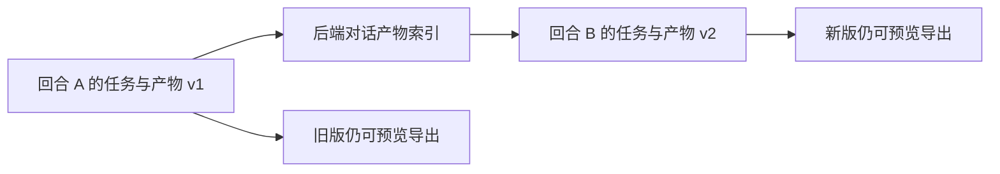

# T-1009 跨回合产物版本补充规格（已确认）

状态：**独立规格复审 PASS，用户已于 2026-09-20 确认，实施授权记录为 DEC-AW-1009**。本文件补足 [T-1003 工作台规格](t1003-agent-workbench.md) FR-AW-07、AC-AW-02 中“用户反馈后产生新版本”的跨回合语义；不改变已确认的任务租约、账号隔离、产物真实字节及原生导出要求。

## 实际缺口与用户可见结果

当前每条新用户消息都建立新的 execution task。现有 `artifactId + expectedVersion` 只能修订**同一 taskId** 内的产物，因此“把刚才报告的第二部分精简”在下一回合无法读取旧版并登记版本 2。完成本补充后，同一对话的已登记报告可由新回合读取来源、写出新任务文件并登记版本 2；旧版仍以版本 1 的真实字节可预览与导出。不同对话即使同账号，也不能通过模型工具把产物串成同一谱系。

## 所有权与版本真相

- `artifactId` 的版本谱系归属 `(userId, accountId, conversationId)`；每个版本仍归登记时的真实 `taskId`、`operationId` 和 Blob。旧任务及已结算回执不可修改。非聊天任务继续沿原 taskId 范围修订，不被其他任务借用。
- 后端新增唯一对话产物索引，记录谱系当前版本及每版 `artifactId/version → taskId/operationId/hash/mime/size/relativePath`。版本与任务 payload 的正式回执必须在同一数据库事务提交；索引是跨任务版本解析与 CAS 的唯一真相，task payload 是该任务的执行回执。旧版预览 URL 继续使用旧版所属的 taskId。
- 首次登记产生版本 1；后续登记须传 `artifactId` 与 `expectedVersion`，后端以谱系最新版本原子比较。并发两个回合不能同时抢同一下一版本；一个成功后，另一个收到当前版本并重新读取。Blob 提交前保留按 `(artifactId, operationId)` 唯一的待登记占位；中断后同一 operationId 依据已保存的源文件版本、哈希和 Blob 回执恢复，不能换键重复登记或把变化的工作文件冒充旧操作。占位不应无限锁死：恢复或明确失败后可释放，但未知 Blob 结果先对账。
- 升级时保留旧 task payload 和 Blob。已登记的聊天产物需按可信 `消息 → aiTask → executionTask → conversation` 关系幂等补索引；冲突、缺元数据或哈希不一致应明确待人工处理，不用新版本覆盖旧版。新代码读取旧任务必须在映射有效且补索引成功后进行。
- HTML 登记时冻结其相对 PNG 依赖清单：服务端从 HTML 原字节提取并规范化相对路径，只绑定**当时**同任务已正式登记且哈希已验的 `path → artifactId/version/taskId/hash`。清单与 HTML 版本元数据、原字节哈希一起在正式结算事务中固定；预览和 PNG/PDF 转换只按该清单读取精确图片版本并再次验哈希，不能沿用“同路径最后登记 PNG”。当时缺失或超出 12 张、2 MiB 预算的图片不入清单，渲染时省略该图并保留正文。HTML 原字节内的合法 data PNG 仍受原 HTML 哈希与相同图片预算约束。升级前未保存清单的旧 HTML，仅能从可信旧登记顺序和可验证的图片版本确定原依赖；无法确定时省略相对图片，不借后来版本补全。

### 并发、调用账本与中断恢复

对话谱系行是同一 `artifactId` 的串行化锁。数据库强制 `(userId,accountId,conversationId,artifactId,version)` 唯一、`(taskId,operationId)` 唯一；索引行记录 `currentVersion` 与一个可空的占位 `{nextVersion,operationId,taskId,requestDigest,source,state}`。`source` 是互斥两型：`register` 冻结本任务 `path/fileVersion/hash`；`copy` 冻结经后端核验的旧 `artifactId/version/taskId/hash` 与当前任务 `targetPath`，不伪造当前任务文件版本。占位状态只允许 `pending_blob → reconciling/unknown → committed` 或 `pending_blob → reconciling/unknown → failed_confirmed`，对账处理中或结果未知时仍占有下一版本，不按 TTL 抢占。

1. `reserve` 在当前任务 admission 与谱系行锁内完成。相同 operationId、相同入参摘要返回原占位或正式版本；相同键不同摘要拒绝。不同 operationId 即使传相同 `expectedVersion`，若已有占位则返回 `revision_busy`，不得开始 Blob 上传。无占位时 CAS 比较 `expectedVersion === currentVersion`，记录下一版本号与本任务待登记回执：`register` 冻结当前任务文件版本/哈希，`copy` 冻结旧版正式产物及哈希和目标路径；若登记 HTML，连同当时已正式登记 PNG 的精确版本清单一并冻结，并在最终结算时重验每项哈希，才释放事务锁。首次登记也创建谱系行并遵守同一规则。
2. `store` 用占位中的同一 operationId 与任务范围对象键提交 Blob，并逐字节校验大小/哈希。重复请求先读同键 Blob；存在且一致则跳过上传。失败或超时为未知，不换操作键，不释放占位。
3. `operationId` **恒等于**原 `executionCalls.id`（已有 Workbench Host 的 `scope.callId`），不是模型自选键。原工具执行端口先领取 `toolExecutionClaimId`，冻结绑定已记录 `toolCallId`、工具名、参数摘要与效果；产物宿主只准备占位和 Blob，不单独公布正式版本。`execution-agentic-tool-ports` 为 `artifact.register/copy` 增加专用 `commitAndSettleArtifact` 分支：在原调用的 settlement 权限内锁谱系、任务与原调用，复核领取凭证、冻结入参、同一 operationId/摘要、占位和 Blob 哈希，并用 `workerToolResultReceiptSchema` 生成唯一正式回执；同一事务写入索引正式版、任务 payload 与原 `executionCalls` 的 `settled/resultText`。只有该事务成功后才返回 `AgenticToolOutcome` 与 artifactRef。外层 Worker 随后已有的 `settleAgenticTool` 是**精确相同回执的幂等确认**：比对原 callId、toolCallId、规范化结果摘要后返回原 settled 行，任何差异拒绝；不会再次写版本或费用。若 commit 已成功但 ACK 丢失，Worker 的 unknown 尝试不得覆盖 settled，重新 reserve 原 callId 回放同一回执。
4. 若 Blob 状态不明，原调用与占位保持 `unknown`，当前谱系拒绝下一版本，用户可看到待对账而旧版仍可用。原 fence 未换时可由原 settlement 路径核对；fence 已换或进程重启时仅 backend 专用 `reconcileArtifactOperation` 可按原 callId、冻结绑定、claimId、占位、Blob 与任务映射完成**同一** commit-and-settle，不开放新 admission 或生成新操作 ID。只有 Blob 服务给出权威“同键无字节”、原 writer 确认停止且再次检查没有晚到字节，后台才能结算为已确认失败并释放占位。已派发的调用不能标成“未执行拒绝”；为此需扩展 `workbenchResult` 错误契约，表达 `dispatched=true, confirmedNoCommit=true` 的后端证明，并让 `workbenchToolOutcome` 将其映射为 `status:error, sideEffect:none` 的已结算错误回执。无法取得证明就维持 unknown，不按租约过期或固定时间自动释放。确认失败后其他回合需重新读 `currentVersion`、用新 operationId 提交，不重用旧回执。

对账是持久工作，不依赖用户保持聊天页打开：backend 启动时扫描**全部未终结**的 `pending_blob/reconciling/unknown` 占位，随后用有界批次定期扫描；用户在产物卡点击“重新核对”可请求**同一** `operationId` 立即入队。队列按谱系与 operationId 去重，读取持久占位和原调用状态后调用上述专用端口。`reconciling` 另存处理者领取凭证及有限执行租约；进程重启或处理租约失效时，新处理者在行锁内以新凭证接管**同一 operationId**，旧处理者须因凭证变化停止，结算 CAS 拒绝旧凭证。处理租约只授予对账权，不释放产物占位、不新建调用、不重传未知 Blob；重启恢复扫描游标不能漏掉已标记 `reconciling` 的行。每次结果写回 `reconciling/unknown/committed/failed_confirmed` 的可查询状态及最近错误码；无权威结论时退避重试且保持旧版可读，账号隔离与取消后晚到字节仍须复核。验收必须覆盖 Blob 已写入后进程退出、fence 更换、启动扫描完成同一回执、进程死于 `reconciling` 后安全接管，以及 Blob 真正未知时保持占位且用户能看到下一步。

旧版兼容：迁移只影响**跨回合谱系发现与修订**。旧预览/导出 URL 始终走原 task payload + Blob 的账号归属和哈希校验，不依赖新索引，故补录失败时旧版仍可读。补录按同一对话内原任务顺序逐版核对 artifactId、版本连续性、hash、Blob、原 `operationId → executionCalls` 映射与该工具调用的正式回执；只有原调用 `settled`、回执中的 artifactRef 和元数据一致才原子补入整个谱系。旧代码可能已把正式版本写入 task payload，却尚未结算工具：这种 `started/unknown` 调用先走原操作 ID 的专用对账；缺调用、回执不符或对账无法确认时，标记该谱系 `migration_blocked` 并暂停**跨回合**发现/修订，不把 task payload 单方面事实升级为“已结算谱系”。原子写入全谱系或全部回滚，不补半截，不修改旧任务、旧链接或其它正常谱系；修复后同键幂等重试补录。

迁移状态按 `artifactId` 单独返回 `ready` 或 `migration_blocked(reason)`，不能因一条坏谱系隐藏同对话其它正常产物。受阻时 `artifact.versions` 不把旧 payload 行伪装为正式索引版本；UI 可通过现有旧任务读取端口逐项核验并展示 `legacyReadOnly` 卡，卡片仍可按原 taskId 预览/导出，但禁用“继续修订”并显示待对账原因。缺元数据、哈希不符或 Blob 不可读的卡只显示明确不可用状态，不猜版本或图片；补录完成后由后端正式索引替换只读卡。特别覆盖“旧 payload 已登记、原工具调用仍为 started/unknown”与同对话一条受阻、一条正常的升级样例。

新旧写入路径由**提交时后端冻结的任务协议版本**排他选择：升级后新建、已验证会话映射的聊天任务固定 `artifactProtocolVersion=2`，其 `artifact.register/copy` 只能经原调用 claim 的 `commitAndSettleArtifact` 分支，旧 `workbench-artifact-host → artifacts.register` 独立公布路径对它返回协议冲突，不能双写；升级前已存在的 v1 任务和非聊天任务继续走原同任务登记路径，旧链接可读。版本标志不由模型、UI 或宿主自报，且同一 taskId 不允许切换路径。混合版本回归须验证新聊天调用不能落到旧提交端口、旧任务重放不误写新索引、正式版与原调用绝不出现一方成功一方未结算。

## 读取、修订与来源

- 当前任务租约仅允许进入当前任务；跨任务 `artifact.read` 只接受模型提供 `artifactId + version + 分页参数`。后端从当前冻结聊天来源和对话索引解析真实源 taskId，复核两端用户、账号、对话及旧版 Blob 哈希；不接收模型自报源 taskId，也不为旧任务重新领取执行租约。`artifact.versions` 返回本对话可见版本、真实所属 taskId 和元数据，供长历史截窗后的恢复；不返回对象存储键。
- 模型在新任务读取旧版后，使用当前任务文件工具写出修订稿并回读核查。登记修订时需声明 `baseArtifactRef`（旧 artifactId/version）；后端验证它是当前谱系的 `expectedVersion`，并记录在新版本来源字段。原 `provenance` 继续只接受**本任务**已结算调用 ID，旧回合调用 ID 不能伪装成新回合证明。`baseArtifactRef` 证明版本来源，不单独证明模型完整阅读或内容质量。
- HTML 相对 PNG 仍只解析**当前版本所属任务**且被该 HTML 版本冻结清单精确引用的图片。沿用旧版 PNG 时通过可信 `artifact.copy` 端口将已验证的旧图片登记到新任务，再让新 HTML 版本绑定复制后 PNG 的版本与哈希；不能直接跨任务借路径、读取旧任务任意文件或把外部 URL 当作已登记资源。复制失败时交付不依赖该图片的安全 HTML/正文。

### 工具与服务端口形状

- `artifact.read({artifactId,version,offset=0,limit≤128000})`：聊天任务从当前冻结会话解析源 task；非聊天任务继续只读当前 task。返回原 MIME、哈希、总字节数、分页字节、nextOffset 与**版本所属 taskId**，不返回存储键。执行时重查当前用户/账号/任务租约和两端冻结消息映射；旧任务无需领取新租约。
- `artifact.versions({artifactId?,cursor?,limit≤50})`：`artifactId` 省略时分页列出当前冻结对话的全部谱系与正式版本，提供无需预知 ID 的发现；提供 ID 时只列该谱系。后端由当前任务映射取得会话，按用户/账号/会话过滤，按 `(artifactId,version)` 稳定分页，返回 `artifactId/version/taskId/mime/size/hash/relativePath`、精确 HTML 资源清单与绑定该会话的 nextCursor；每个谱系另给状态：占位 `pending_blob → pending`、`reconciling → reconciling`、`unknown → unknown`，正式结算 `committed → ready`，迁移受阻 `migration_blocked(reason)`。`failed_confirmed` 释放占位后保持 `currentVersion` 不变、旧正式版仍列出，并附最近失败操作 ID/错误码及 `failed_confirmed` 状态供 UI 显示“可重新发起修订”；新修订必须先重读版本并用新 operationId。受阻项不伪装完成版本，模型工具不返回未经索引确认的 `legacyReadOnly`。非聊天任务只列本 task 的已有版本。UI 走同一后端只读服务，以页面已验证的 conversationId 取全会话列表；不能信任模型写入的卡片 JSON。
- `artifact.register({path,mime,artifactId?,expectedVersion?,baseArtifactRef?,provenance?})`：首次登记不得传旧版本字段；同对话修订必须三者同时传 `artifactId`、`expectedVersion`、`baseArtifactRef={artifactId,version}`，且 base 等于当前最新正式版。文件只读当前任务路径，`provenance` 仍仅允许当前任务的真实调用；返回当前 taskId 的新版本元数据。非聊天任务沿原同任务注册规则，不强制 base 字段。
- `artifact.copy({sourceArtifactId,sourceVersion,targetPath})`：仅复制当前冻结对话内正式登记的 PNG，源字节≤2 MiB，目标路径须为当前任务的合法相对 `.png` 路径。后端验证旧版哈希和两端归属后，将同字节经当前任务 Blob 端口登记成当前任务的新 PNG 产物，返回新 `artifactId/version/taskId/hash/relativePath` 及已验证源引用；同一 operationId 幂等，目标同路径冲突拒绝。这是受审查的已登记字节复制例外，不能谎称读取了当前任务工作文件；它不读取任意旧任务文件、不把源调用 ID 写成本任务 provenance。预览仍最多内联 12 张、总计 2 MiB；复制失败可省略图片交付静态正文。

## 交付、兼容与失败语义

- 同一对话的历史产物卡保留旧版；新回合只有 `artifact.register` 成功且实际回执含版本 2 才显示新版。预览和导出各自根据版本真实 taskId 重新核对用户、账号、字节哈希；预览路由仍允许用户查看其本人、当前账号的旧任务版本，**跨对话限制由模型工具及谱系索引执行**。取消导出不报保存成功。
- 页面加载或历史消息截窗时，从后端当前会话的已结算谱系列表恢复版本卡；先按 `artifactId/version/taskId` 去重，再与仍可见的已保存 `artifact.register` 工具回执合并。卡片只能用服务端正式版本元数据，不能从助手正文重建。旧版和新版分别以各自真实 taskId 请求预览/导出；服务端列表不可用时保留已有已保存卡片并显示版本列表暂不可用，不把缺卡解释为产物删除。
- 本轮没有可用源版、跨对话/跨账号、过期 `expectedVersion`、未知提交或 Blob 缺失时，不生成伪版本；旧版继续可用。缺少复制图片或可选排版能力时降级交付可用正文。已有非聊天 taskId 内版本、旧预览链接和已保存 Blob 必须继续可读。

## 实施前与验收门

本补充改变服务契约与产物数据归属。先通过独立规格评审，再由用户确认并记录 DEC；确认前只保留现有同任务版本行为。实现应按 T-1009/T-1010/T-1011 写集与各自 Packet 更新，不另建任务分级。

2026-09-20 的独立只读评审先后两次指出旧 HTML 图片版本绑定、重启对账、`register/copy` 来源及状态展示的阻断问题；修订后复审结论为 **PASS，未见新的 blocker/major**。评审者未修改文件；此结论只覆盖本补充规格，不代表运行时代码已实现、通过测试或取得用户确认。

红测先覆盖：同对话跨回合版本 1→2 的真实字节回读；两个回合并发与过期 `expectedVersion`；同 operationId 重放及 Blob 写入后崩溃、fence 更换、启动扫描与用户重核对，以及死于 `reconciling` 后接管但不重传未知 Blob；`register/copy` 两型来源各自幂等恢复；跨用户、跨账号、跨对话和伪造消息映射拒绝；旧任务不重领租约；旧 HTML 的相对 PNG 在同路径后续登记后仍固定原版本、无法核实的旧图省略、复制/降级；新旧任务协议排他切换、`failed_confirmed` 释放占位与旧版可用、受阻谱系只读卡与其它正常谱系并存；历史截窗后的版本发现、两版卡片、预览与导出；非聊天原同任务版本及升级前旧链接回归。测试夹具不能代替真实模型与 Mac/Windows 安装版验收。
