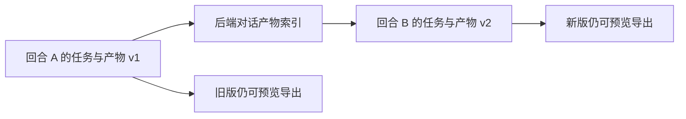

# T-1009 跨回合产物版本补充规格（待确认）

状态：**候选，未获用户确认，不得据此修改运行时契约**。本文件补足 [T-1003 工作台规格](t1003-agent-workbench.md) FR-AW-07、AC-AW-02 中“用户反馈后产生新版本”的跨回合语义；不改变已确认的任务租约、账号隔离、产物真实字节及原生导出要求。

## 实际缺口与用户可见结果

当前每条新用户消息都建立新的 execution task。现有 `artifactId + expectedVersion` 只能修订**同一 taskId** 内的产物，因此“把刚才报告的第二部分精简”在下一回合无法读取旧版并登记版本 2。完成本补充后，同一对话的已登记报告可由新回合读取来源、写出新任务文件并登记版本 2；旧版仍以版本 1 的真实字节可预览与导出。不同对话即使同账号，也不能通过模型工具把产物串成同一谱系。

## 所有权与版本真相

- `artifactId` 的版本谱系归属 `(userId, accountId, conversationId)`；每个版本仍归登记时的真实 `taskId`、`operationId` 和 Blob。旧任务及已结算回执不可修改。非聊天任务继续沿原 taskId 范围修订，不被其他任务借用。
- 后端新增唯一对话产物索引，记录谱系当前版本及每版 `artifactId/version → taskId/operationId/hash/mime/size/relativePath`。版本与任务 payload 的正式回执必须在同一数据库事务提交；索引是跨任务版本解析与 CAS 的唯一真相，task payload 是该任务的执行回执。旧版预览 URL 继续使用旧版所属的 taskId。
- 首次登记产生版本 1；后续登记须传 `artifactId` 与 `expectedVersion`，后端以谱系最新版本原子比较。并发两个回合不能同时抢同一下一版本；一个成功后，另一个收到当前版本并重新读取。Blob 提交前保留按 `(artifactId, operationId)` 唯一的待登记占位；中断后同一 operationId 依据已保存的源文件版本、哈希和 Blob 回执恢复，不能换键重复登记或把变化的工作文件冒充旧操作。占位不应无限锁死：恢复或明确失败后可释放，但未知 Blob 结果先对账。
- 升级时保留旧 task payload 和 Blob。已登记的聊天产物需按可信 `消息 → aiTask → executionTask → conversation` 关系幂等补索引；冲突、缺元数据或哈希不一致应明确待人工处理，不用新版本覆盖旧版。新代码读取旧任务必须在映射有效且补索引成功后进行。

## 读取、修订与来源

- 当前任务租约仅允许进入当前任务；跨任务 `artifact.read` 只接受模型提供 `artifactId + version + 分页参数`。后端从当前冻结聊天来源和对话索引解析真实源 taskId，复核两端用户、账号、对话及旧版 Blob 哈希；不接收模型自报源 taskId，也不为旧任务重新领取执行租约。`artifact.versions` 返回本对话可见版本、真实所属 taskId 和元数据，供长历史截窗后的恢复；不返回对象存储键。
- 模型在新任务读取旧版后，使用当前任务文件工具写出修订稿并回读核查。登记修订时需声明 `baseArtifactRef`（旧 artifactId/version）；后端验证它是当前谱系的 `expectedVersion`，并记录在新版本来源字段。原 `provenance` 继续只接受**本任务**已结算调用 ID，旧回合调用 ID 不能伪装成新回合证明。`baseArtifactRef` 证明版本来源，不单独证明模型完整阅读或内容质量。
- HTML 相对 PNG 仍只解析**当前版本所属任务**登记的图片。沿用旧版 PNG 时通过可信 `artifact.copy` 端口将已验证的旧图片登记到新任务，保留源引用与字节哈希；不能直接跨任务借路径、读取旧任务任意文件或把外部 URL 当作已登记资源。复制失败时交付不依赖该图片的安全 HTML/正文。

## 交付、兼容与失败语义

- 同一对话的历史产物卡保留旧版；新回合只有 `artifact.register` 成功且实际回执含版本 2 才显示新版。预览和导出各自根据版本真实 taskId 重新核对用户、账号、字节哈希；预览路由仍允许用户查看其本人、当前账号的旧任务版本，**跨对话限制由模型工具及谱系索引执行**。取消导出不报保存成功。
- 本轮没有可用源版、跨对话/跨账号、过期 `expectedVersion`、未知提交或 Blob 缺失时，不生成伪版本；旧版继续可用。缺少复制图片或可选排版能力时降级交付可用正文。已有非聊天 taskId 内版本、旧预览链接和已保存 Blob 必须继续可读。

## 实施前与验收门

本补充改变服务契约与产物数据归属。先通过独立规格评审，再由用户确认并记录 DEC；确认前只保留现有同任务版本行为。实现应按 T-1009/T-1010/T-1011 写集与各自 Packet 更新，不另建任务分级。

红测先覆盖：同对话跨回合版本 1→2 的真实字节回读；两个回合并发与过期 `expectedVersion`；同 operationId 重放及 Blob 写入后崩溃恢复；跨用户、跨账号、跨对话和伪造消息映射拒绝；旧任务不重领租约；旧 HTML 相对图片复制/降级；历史截窗后的版本发现、两版卡片、预览与导出；非聊天原同任务版本及升级前旧链接回归。测试夹具不能代替真实模型与 Mac/Windows 安装版验收。
