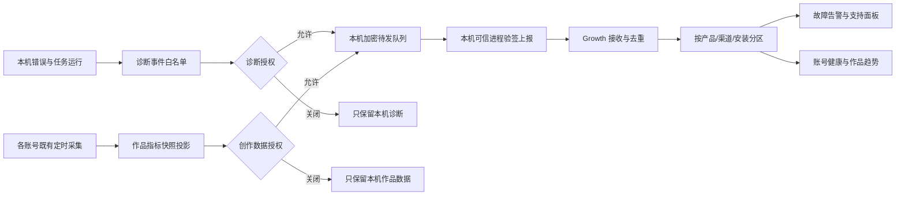

# T-1017 用户故障与创作数据授权上报设计

> 状态：设计方案；独立只读复核未发现残留 blocker/major，正式审核以 `reviewctl` receipt 为准。2026-09-29 用户提出“能感知用户报错，并定期了解账号绑定、作品和播放数据”。本文件是实现范围与跨仓契约草案，不代表客户端已经上传任何数据。既有 `docs/PROTECTION.md` §4 默认零收集继续生效，直到新授权流程、接收服务与发布验收同时落地。

## 一句话方案

CreatorOS 继续在用户电脑上按账号采集平台数据；增加两条**分别授权**的出站通道：一条只报结构化故障元数据，一条按账号报用户选择共享的作品指标。客户端离线排队、明确显示最后上报状态；Growth 按产品与渠道验签接收、隔离存储、去重和告警。用户目前可主动提交文字反馈、在本机查看加密日志；单次附加日志须另行实现并在提交前预览确认。



## 1. 现状与目标

现状核对：

- `frontend/src-tauri/src/logging.rs` 已将 sidecar 日志脱敏、信封加密并轮转，最多保留 30 天；设置页可打开日志位置。它没有自动回传。
- `frontend/src/components/shell/issue-feedback-dialog.tsx` 已有用户主动填写文字的入口；`product-feedback.server.ts` 通过本机可信 sidecar、AM 授权上下文和 Growth 的渠道绑定反馈 API 提交，当前界面明确说不发送日志和附件。
- T-983 已按账号拆分作品、流量、评论、封面/内容四项本机采集，默认每两小时错峰唤醒；作品随年龄按 2/6/24 小时增量。`metric_snapshots` 带 `user_id`、`account_id`、`publication_id`、`captured_at`；账号注册表的 `active/archived` 仅表示本地记录状态，不能充当真实登录健康。
- `analyticsEnabled` 虽在设置契约内，UI 因没有遥测实现而未展示，不能直接改为 true 就声称实现了上报。

目标是让运营人员看到**哪些安装发生什么错误、何时发生、是否恢复**；在获得账号数据授权后看到**每个账号是否能采、哪些作品、哪些指标何时更新**。上报故障不得阻断本机的启动、保存、生成、渲染或采集；上报数据不得跨用户、跨账号、跨产品渠道混在一起。

## 2. 用户可见流程

设置页“隐私与诊断”提供两个独立开关，均默认关闭；首次启用前展示字段清单、接收方、保存时间和后台用途，记录 `consent_version / scope / granted_at`。文案示例：

1. **帮助定位软件错误**：发送版本、功能名、错误码、参考编号和发生时间；不会发送原始日志、截图、聊天、提示词或文件。
2. **共享账号与作品数据**：按已授权的平台账号，发送绑定健康、采集完成状态以及作品播放、点赞、评论、分享等数字和采集时间；不发送登录凭据、作品正文和素材。页面可逐账号选择，且全局总开关关闭时全部停止。

同页显示最近一次成功上报、待发送条数、失败原因、所选账号和“清除待发数据”；关闭授权立即停止新事件入队和后续上传、清空对应数据队列，并保留一个不含创作内容的撤销/删除待办，直至服务端确认。取消或等待已在途请求结束；离线时明确显示“本机已停止，云端删除待联网完成”，不能承诺服务端即时知晓离线撤销。提供“申请删除云端数据”入口及删除结果，避免把本地关闭误称为云端已删除。用户手动反馈沿用原入口；若以后要附加加密日志或截图，必须在**该次提交**预览并确认，不受自动诊断开关代替。

授权只作用于当前安装和已验证的产品/渠道；升级不扩大旧授权范围，重新安装、渠道身份变化、授权主体变化或契约新增字段均需重新取得相应授权。后台不可远程打开开关。没有网络时本机主功能照常运行，设置页显示“等待连接”，且清楚区分“本机已采集”与“已上报”。

## 3. 数据边界与隔离

| 数据类 | 自动发送范围 | 禁止发送 |
| --- | --- | --- |
| 故障事件 | 事件类型、稳定错误码、模块/操作、时间、app/build/OS 大版本、参考编号、任务类型、可选耗时和重试终态 | 原始异常 message/stack、完整 URL/query、路径、用户输入、prompt/回复、网页内容、Cookie、token、激活码、日志正文、截图 |
| 账号健康 | 平台、安装内账号随机别名、`active/archived`、最近一次**真实登录探测**结果及时间、采集开关/最近运行状态/成功时间 | sec_uid、昵称、手机号、主页链接、Cookie、二维码、浏览器档案、secretReference；不得将 `active` 推断为已登录 |
| 作品指标 | 安装内稳定随机作品别名、所属账号别名、平台、公开发布时间、指标名及数值、`captured_at`、采集来源和可用性状态 | 标题、封面、视频、文案、评论正文、原始平台响应、私密 URL；未获授权的账号及作品完全不出站 |

“安装内随机别名”由本机为当前上报接收方生成，不用可逆的平台 ID、账号名或原始 `user_id`；同账号/作品在授权期内稳定，便于看趋势。Growth 不提供从别名反查平台身份的接口。若产品需要后台显示真实账号名、作品标题或公开链接，另提有单独字段与权限的增量 SPEC，不借这次授权暗中扩容。

本机读取每条数据前通过 backend service port 以 `RequestContext(userId, accountId)` 校验归属；按账号形成单独信封，且信封只含一个账号。创作共享仅投影仍为公开可见、未隐藏、未移除的已发布作品；本机作品转为隐藏/私密/移除时，对已上传的作品别名产生删除墓碑，Growth 收到后从作品列表与趋势中移除旧快照并回执。账号归档/解绑产生整个账号的删除墓碑；重绑到不同平台身份时旧别名失效，新身份取得新别名及单独授权，不能串接历史。接收端再次检查安装授权、产品、渠道、账号别名与父信封一致，拒绝额外字段。后台查询以产品+渠道+授权主体隔离；运营角色默认只看该渠道，跨渠道支持访问须显式角色与审计。不能把本地 `analyticsEnabled` 当作跨渠道写入权限。

## 4. 采集与上报调度

**本机采集**沿用 T-983 四项任务及用户已有开关和时间表；本功能不新增浏览器、不复制登录档案、不替代原调度、不因云端失败重复抓取平台。绑定健康只能来自既有真实探测或采集运行结果，未知时写 `unknown` 并保留 `observed_at/source`，不能编成“已绑定”。作品数量、播放量等字段缺失时标记 `unavailable`，不能填 0；真实数值 0 才报 0。

**上报**是本机独立的轻量待发队列，有两类独立事件源：① 本地采集事务成功提交后，通过后端 service 读取已落库快照并投影作品指标白名单；② 账号绑定/解绑、真实登录探测以及 `job_run` 的 `succeeded/failed/needs_reconnect` 终态，通过现有 service port 投影状态事件，即使没有新作品快照也入队。状态事件必带 `observedAt/source` 和原运行参考编号；不从错误文字或 `active` 注册状态猜测已登录。启动/联网/定时唤醒可发送，网络失败指数退避加抖动；按账号保序但账号之间相互独立。重复采集的同一快照不重复入队；一批失败不回滚本地采集结果，不覆盖较新的快照，不造成无限内存或磁盘增长。诊断事件采用允许列表和采样/聚合抑制刷屏，严重错误不能被采样掉。作品/账号删除墓碑和授权撤销比普通指标优先发送；同一账号的删除在旧快照之后结算，接收端以版本阻止迟到快照复活。

建议发送节奏：严重故障在授权且网络可用时尽快发送；普通故障按短窗合并；**作品指标**在本地对应采集成功后批量发送，并每日补发尚未确认的快照；绑定和运行失败状态在对应状态落库后独立发送。已授权时每日最多一次发送最小状态心跳：安装/账号别名、客户端最近在线时间、采集开关与最近实际运行终态/时间、outbox 是否有未确认项，不含作品或登录资料；诊断授权与创作共享授权各自限定心跳字段，逐账号心跳须有该账号共享授权。具体频率和队列容量由容量实测校准，不能承诺“每两小时云端必有新作品”：本机任务可能关闭、离线、登录失效或平台无数据。接收回执只确认已持久化，不等于平台采集成功；没有新快照但心跳明确说采集关闭/需重连，后台显示对应原因。

## 5. 跨仓服务契约草案

新增 CreatorOS 本机可信进程到 Growth 的**专用接收接口**，不能把数据塞进文字反馈的 `description`。复用 T-538 的官方 origin 固定、AM 签名上下文/渠道归属思路；但反馈 token 的 scope 仅供反馈，不能拿来提交遥测。AM/Growth 需定义独立的短期上传权限与撤销校验。浏览器 UI 不持有该 token、激活码或机器标识，不能控制目的 URL；HTTPS、无跳转、请求体上限、批量上限、服务端限流和模式版本均 fail-closed。

请求信封（示意，正式字段以双方共享 contract 为准）：

```json
{
  "schemaVersion": "creator-report-v1",
  "consentVersion": "2026-09-29",
  "scope": "diagnostics",
  "installationAlias": "random-install-alias",
  "batchId": "random-id",
  "events": [{"eventId":"random-id","occurredAt":"ISO-8601","code":"COLLECTION_NEEDS_RECONNECT","module":"collection","referenceId":"random-id"}]
}
```

创作指标使用不同 `scope` 和**单账号**信封；作品事件必带 `accountAlias`、`workAlias`、`capturedAt`、`source`、`metrics`（字段白名单及非负/有限数值校验）、`availability`。接口返回按事件的 accepted/duplicate/rejected 回执和服务端 `referenceId`；客户端只删除 accepted/duplicate 项，rejected 项保留可诊断终态但不得无限重试。幂等键覆盖 `installationAlias + scope + eventId`；作品事件的 `eventId` 由账号别名、作品别名、来源、采集时间及版本确定性派生，避免离线重放增计。服务端时间与客户端 `capturedAt` 分列，展示“最后收到”与“最后采到”。

Growth 侧新增隔离接收、去重持久化、只读支持面板与告警；不要让 CreatorOS worker 直连 Growth 数据库。异常错误率、同一版本集中崩溃、采集连续失败、账号需重连和**有新鲜授权心跳但作品水位超期**分别告警。告警有冷却/合并与“当前已恢复”状态，按渠道投递给有权限的运营人；后台支持按 `referenceId` 找单次故障，但不能凭此读取用户电脑或原始日志。未曾授权的安装对 Growth 不可见；旧心跳中断只能显示“最近未收到状态”，不能推断客户端故障、离线或用户关闭授权。

## 6. 保留、删除与故障语义

- 诊断元数据建议留存 30 天，按聚合错误码的无身份计数可留 90 天；创作指标建议留存 90 天。确定阈值后在产品说明和接收端强制清理中保持一致。**普通**加密本地待发数据最长 7 天，容量满时优先丢弃最旧普通事件并显示丢弃计数；严重事件仍有总容量上限。撤销/删除墓碑存于独立持久控制队列，不受普通数据的 7 天 TTL、容量淘汰或清除待发数据操作影响，直至云端“已完成”回执；其记录只含授权主体别名、scope、epoch 和删除请求 ID。原有本机加密日志按既有 30 天轮转，不因启用上报自动上传。
- 授权按 `installationAlias + scope + accountAlias?` 维护单调 `consentEpoch`；创作信封必带账号授权版本。每批上传前本机校验最新授权，Growth 每批依据 AM/Growth 授权台账核验 epoch 与账号集合，旧 epoch 或撤销后批次拒收。授权关闭即本机停止入队/发送、清空对应数据队列，并持久保留最小撤销墓碑；联网后先提交撤销和该 scope/账号的云端删除，再等待服务端“已完成”回执。离线撤销和已在途上传可能在服务端知晓撤销前到达，因此 UI 必须显示“云端删除待完成”，服务端完成撤销后按同一授权主体清除这段竞态内收到的数据；旧 token 立即失效。删除失败不能显示已完成。产品渠道终止、AM 无法确认授权、别名不匹配、签名过期时 fail-closed，不回退到匿名上传。
- 卸载/重装前若云端删除仍待完成，界面明确要求先联网等回执；用户没有照做时本机队列可能丢失，不能承诺即时删除。Growth 的用户自助删除入口允许凭 AM 校验的原授权主体重新发起/查询删除，不依赖旧安装的本地队列；无法完成自助验证时提供人工支持渠道和受理编号。无论客户端是否再次上线，服务端 30/90 天到期清理仍须执行，不能用“用户未再上线”无限保留。
- 接收服务不可用不阻断本机功能；上报失败本身只记本地受限状态，不递归产生日志风暴。未授权、认证失败、格式不符的 payload 不能因重试绕过边界。隐私字段在客户端投影、出站前校验、服务端解析三处守卫；密钥/路径/输入中的换行控制字符不得进入结构化日志。
- 运营面板只对**已知且仍获授权**的安装/账号显示“等待首次采集”“最近采集关闭”“登录需重连”“平台无数据”“正常更新”和有心跳证据的“上报积压”；后台无法单凭没有请求判断“已采到未上报”或“上报失败”，这两项仅由本机设置页显示。已撤销授权只显示撤销/删除处理状态；从未授权者不出现在面板。旧心跳显示“状态未知/最近未收到”，不能把无数据统一显示为 0 或把未收到误判为客户端故障。

## 7. 接口与实现归属

| 责任 | 归属 |
| --- | --- |
| 用户授权与状态 UI | `frontend` 设置页；开关动作走 backend service，当前用户/安装授权校验 |
| 本地故障事件、参考编号、加密 outbox | 可信本机进程/后端模块；采用结构化白名单，不解析原始日志上传 |
| 账号与作品投影 | `backend` 组合现有 platform-account、scheduling、publishing、analytics service port；保持 `userId + accountId` 双维校验 |
| 安全上传 | 本机 server-only adapter；AM 独立 scope 授权 + Growth 固定官方 origin；不在浏览器或 AI worker 保存上传凭据 |
| 接收、存储、告警、支持视图、删除 | `Thirdspace-growth` 新契约及服务，按产品/渠道/安装授权分区，服务端清理与访问审计 |

本 SPEC 涉及 CreatorOS ↔ AM ↔ Growth 的新服务契约和 `docs/PROTECTION.md` §4 适用范围变更。代码前先由三方契约 owner 形成共享字段/权限/回执 fixture，并完成独立 SPEC/安全与数据归属评审；确认记录进 DECISION_LOG。现有“手动文字反馈”和本地采集是可复用基础，不能被称为已经实现自动上报。

## 8. 验收场景

1. 新安装默认两开关均关：抓包确认无诊断、账号或作品上报；本机采集仍按原开关运行。
2. 仅打开诊断：制造安全的前端、sidecar、采集/AI 任务失败，用户侧参考编号与 Growth 接收记录一一对应；上报体不含机密、正文、路径、原始 stack。未捕获异常、启动前故障和进程退出后的下一次恢复分别核对。
3. 仅打开账号 A 创作共享：A 的绑定健康、作品与数值抵达；账号 B、隐藏/未授权作品以及原始平台 ID、标题、Cookie 均不出现。切换当前账号、重绑、归档、重新安装、白标渠道切换逐项验证。
4. 一千条作品、多批采集、重复快照、断网、服务端超时与部分回执：本机原任务继续、上报最终去重且不串号；界面如实显示本机采集时间/上报时间。离线撤销、旧 epoch 在途请求、重连后优先删除及删除失败重试验证云端终态。
5. 登录过期、平台页面未提供数据、真实播放量 0、未知绑定状态分别显示不同结果；后台不会把未知说成绑定成功或把缺值补 0。无新作品快照时模拟真实探测 `expired` 与 `job_run.needs_reconnect/failed`，后台仍收到状态事件并可定位原运行参考编号。
6. 授权关闭、撤销、删除、作品改为私密/隐藏/移除、账号解绑/换绑、版本升级扩大字段、伪造渠道或目的地址、额外 payload 字段、非本人账号 ID：均 fail-closed；旧作品和旧账号云端不残留且迟到快照无法复活，云端删除与访问审计有可追踪回执。
7. 安装包真实失败从界面取得参考编号，后台查到唯一事件；安全扫描确认出站 payload 和日志无禁传字段。CreatorOS 与 Growth 合同测试、边界检查、跨渠道隔离和 Mac/Windows 安装实测通过后方能称“已可用”。
8. 授权心跳分别验证采集关闭、需重连、平台无数据和长时间无新快照；断网、应用退出、从未授权时后台只显示有证据的状态或未知，不触发伪故障告警。

## 9. 待评审的关键决定

- 建议默认关闭、诊断与创作数据分别授权，逐账号选择；这是现行默认零收集承诺下的最小变更。
- Growth 作为接收与运营后台，AM 只负责短期授权及渠道归属，不存作品明细；这样复用已有反馈信任链，但不复用反馈 token 的权限。
- 第一版后台只显示匿名账号/作品别名、健康与数值。若确需让运营看到真实账号或作品标题，需重新确认用途、告知和保留范围。
- T-518 历史的“不得自动上传日志/截图”继续有效；本功能只自动发送白名单元数据。用户主动反馈可在将来的独立方案中选择加密日志附件。
