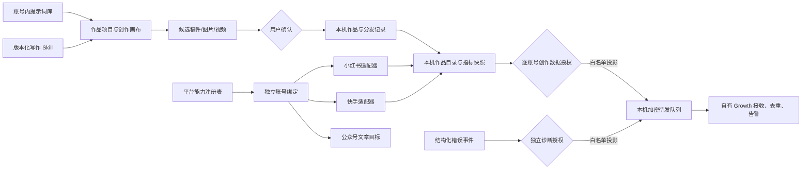

# T-1018 创作提示词资产、跨平台接入与数据上报统一架构

> 状态：待用户审核的设计稿。2026-09-29 先盘点本地实现，再核对开源和官方资料。本文件定义共同边界与任务依赖；T-1019—T-1025 是实施 SPEC。代码、服务器接口、授权开关和新平台采集均未因本文件上线。

## 一句话方案

创作者在同一个作品项目里保存可复用的创作提示词，按目标平台生成文章、图片或视频；绑定自己授权的平台账号后，在本机采集真实作品与表现。若分别开启诊断和创作数据共享，本机仅把许可的轻量结构化数据送到自有服务器，素材字节、登录凭据和提示词正文留在本机。

## 1. 本地真相与可复用边界

本次盘点时的来源快照：小红书仓 `34301ee`（干净），JY_IPAgent 仓 `fdf4311`（干净）；公众号 Skill 仓 `658b719` 含未提交改动，本文按当时工作树读取。实施前需冻结具体文件内容与许可证，并对照差异复核，不能把未提交内容当成已发布接口。其中 `moonlit-wechat-article/SKILL.md` 的 SHA-256 为 `0af05e487a3e45fbcffc91d568a100f486c787474ca7cb3a60687a76fdfed77d`，`moonlit-wechat-publisher/SKILL.md` 为 `6cdbe8465a1dfe5926a711f4b71cbfc395e5634f7e5fc72f4505d61a97a489eb`；发布 Skill 仅作为写作后续流程参考。

| 方向 | 本地证据与可复用部分 | 当前缺口 |
| --- | --- | --- |
| 创作提示词 | `codex/creator-canvas` 的画布文档随节点保存 `prompt`；设置模块另有产品级 `skill_config_overrides` 版本历史。可复用画布 CAS、账号隔离和生成时冻结输入 | 没有创作者自己的独立提示词资产、从节点一键收藏、跨画布检索/复用；产品级 Skill 配置不能充当用户库 |
| 小红书 | `/Users/zyongzhu/Workbase/Thirdspace-xhs-creator` 的 `worker/src/collector.ts`、`analytics-parser.ts`、`session-pool.ts` 和 `backend/src/bindings.ts` 已有扫码、独立档案、身份核验、全量笔记目录及统计读取逻辑 | CreatorOS 虽有 `xiaohongshu` 平台枚举与改写文案，却未将该工程的账号采集适配进当前服务；单号证据不能证明多号真机隔离 |
| 快手 | `/Users/zyongzhu/Workbase/JY_IPAgent/script/platforms.py`、`browser.py`、`share_link.py` 有快手分享链接识别和独立浏览器档案经验 | 尚无可证明的快手创作者账号全量作品、粉丝和作品表现采集；单视频读取不是账号数据接入 |
| 公众号 | `/Users/zyongzhu/Workbase/moonlit-skills/skills/moonlit-wechat-article/SKILL.md` 提供主张、事实、因果、审读和配图交接；`moonlit-wechat-publisher` 负责排版与授权写草稿 | 该 Skill 固定月明品牌和本机 `works/` 目录，不能原样给所有账号；`wechatVideo` 不等于公众号文章 |
| 数据上报 | [T-1017](t1017-diagnostics-creator-reporting.md) 已评审两种授权、逐账号别名、加密 outbox、Growth 接收和删除回执 | 未实施；尚未明确粉丝**总量**和账号级统计快照字段，扩充上传范围须重审 |

### 开源与官方对照

- 提示词库：MIT [AI Prompt Manager](https://github.com/Enterprise-DNA-OS/ai-prompt-manager) 展示不可变版本、分组与复用交互。借鉴资产模型，不引入其 Supabase/OpenRouter/公开社区数据面。
- Skill 形态：[Agent Skills 官方规范](https://github.com/agentskills/agentskills/blob/main/docs/specification.mdx) 提供 `SKILL.md` 与引用资源的可移植目录形态。CreatorOS 仍由自己的工具白名单、执行快照和账号权限决定能力。
- 平台采集：[MediaCrawler 架构](https://github.com/NanmiCoder/MediaCrawler/blob/main/docs/%E9%A1%B9%E7%9B%AE%E6%9E%B6%E6%9E%84%E6%96%87%E6%A1%A3.md) 说明“平台适配器 + 统一结果”可行，但其源码标注[非商业许可](https://github.com/NanmiCoder/MediaCrawler/blob/main/config/base_config.py)，只作结构对照。多平台创作者项目 [data-scientist-community](https://github.com/Xavier-168/data-scientist-community) 使用 AGPL-3.0-only，同样不直接复制代码。
- 日志管线：[OpenTelemetry Collector](https://opentelemetry.io/docs/collector/) 的接收/处理/导出分层可借鉴；客户端不直接发送原始日志，按 T-1017 白名单投影后交自有服务。
- 快手：[官方用户资料接口](https://open.kuaishou.com/platform/openApi?menu=17) 说明授权后可读取粉丝数；[官方视频内容管理资料](https://open.kuaishou.com/platformDocs/openAbility/contentManagement/createAVideo) 表明存在发布能力。作品目录及细粒度表现权限需在真实应用和账号下验证，不能由其他能力推断。

## 2. 顶层领域与物理边界

1. **平台账号**：既有 `PlatformAccount` 保留 `userId + accountId` 归属和各账号独立本机档案。平台稳定 ID 仅本机映射；云端用 T-1017 不可逆别名。注册表 `active`、真实登录探测和采集运行结果分别表示不同事实。
2. **平台能力描述**：每个平台声明 `bind / accountOverview / workCatalog / workMetrics / publishDraft / publish / comments` 等实际能力、授权方式、作品形态、字段字典和最小采集间隔。UI 只展示真实接线并验证的操作；不为每个平台复制项目、作品和任务实体。
3. **作品与指标**：引入账号所属的 `PlatformWork` 作为平台目录真相，允许与现有要求 `contentOutputId` 的 `Publication` 按真实外部 ID 显式关联；外部导入作品不能捏造项目稿件去满足 `Publication` 必填列。作品可见性必须有平台来源与观察时间，未知时禁止云端共享。每条指标快照含平台、账号、作品、指标名、单位、值或 `unavailable`、统计范围、来源、来源时间、采集时间及入库时间。粉丝总量是**账号级**快照，不混入单作品 `follower_gain`。本地小红书工程的 `followers` 实际映射 `net_rise_fans_count`（区间净增），不能冒充总粉丝；总量来源需另行核验。曝光、阅读、播放、观看不能仅凭名称相近就相加。
4. **创作资产**：用户提示词是账号私有 `PromptAsset`，可选关联项目、画布/节点、形态和用途；每次显式保存形成不可变版本。生成任务冻结当次文本与版本引用，不因后来编辑改写历史。系统 Skill 配置与用户创作提示词在 ID、权限、版本、UI 上分离。
5. **Skill 方法包**：公众号写作分通用论证方法、账号品牌配置、平台稿件输出契约；模型负责语义，代码守真实 ID、归属、版本和发布授权。Skill 可按目录形态导入，脚本、网络和发布工具默认不自动获权。
6. **出站报告**：仅从已提交的本机服务真值投影 T-1017 字段；诊断与账号/作品/粉丝指标独立授权，素材、正文、Prompt、Cookie、路径、原始日志和截图不进自动队列。Growth 接收和运营，AM 只提供上传 scope 与渠道身份。

### 轻量数据与故障链路清单

“低存储成本”不是自动上传一切文本的授权。拟采用可审的字段目录：账号绑定/真实登录探测及采集终态、粉丝总量、作品目录的随机别名与公开发布时间、各平台能证明口径的播放/阅读/曝光/点赞/评论/分享数字、时间范围与来源、产品/版本/功能/错误码/参考编号/重试终态。这些字段逐项标 `source/availability/observedAt`，没有平台来源的字段保持 unavailable；新增字段或接收方必须升授权版本并重审。昵称、作品标题、公开链接虽小，也可能识别本人，本次不在自动上传清单，留给用户审核是否确有运营需要。素材字节、正文、提示词、Cookie、原始平台响应和完整原始日志均不自动上传。

故障事件从 UI 操作、backend 事务、Worker/AI 任务到 Growth 回执贯通 `referenceId → operationId → attemptId → eventId`，覆盖启动、账号绑定、定时采集、画布生成、稿件采纳、渲染、导出、发布和数据上报本身。只传稳定错误码、阶段、时长、重试/恢复终态与必要版本，不上传原始异常文字。用户在界面用参考编号定位；运营按同编号看到故障发生在哪一段及是否恢复，而不能远程打开日志。完整日志如需单次提交，沿 T-1017 的另行预览确认方案设计，不混入常驻自动上报。

物理依赖继续遵守 `contract ← frontend/backend/worker`、Worker 经 backend service port 写库、AI 只提交候选。共享平台能力合同放 `contract`，采集适配器在 Worker，账号与快照服务在 backend，UI 只调用合同操作。网页运行时不能持有平台 Cookie 或上报 token。

## 3. 关键产品流程

**保存提示词**：画布生成描述旁有“保存到提示词库”；选择名称、用途、可选项目与标签，保存后显示版本。修改已收藏内容时明确“更新为新版本”或“另存一份”；“插入”只填当前节点，不自动付费生成。库内可搜索、预览、复制、回滚和归档。画布自身仍自动保存草稿，即使未收藏也不丢当前节点文字。

**绑定、采集和回流**：按平台可用方式授权；绑定结束读取真实身份并确认归属。调度按账号与能力运行，先同步目录，再补作品及账号指标，完整分页、去重、断点恢复、限速、登录过期提示沿既有机制；一号失败不污染别号。失败保留旧值并显示来源时间。平台采集和云端报告是两套任务，上传失败不重抓平台。

**公众号写作**：用户选项目与“公众号长文”，编导读当前确认的 Brief、稿件和素材，通用写作 Skill 产生候选；可选账号品牌方法覆盖表达风格。逐段采纳后，文章版本和配图清单成为项目资产。当前范围交付写作和本机预览；微信草稿箱和群发不在这次写作集成中，日后另立发布 SPEC 和授权/回执链，界面不提前显示假按钮。

## 4. 决策、迁移与任务依赖

| 事项 | 设计决定与审核点 |
| --- | --- |
| 隐私 | T-1017 默认关闭、诊断与创作分别授权，创作共享再逐账号选择；一次授权持续到撤销或范围变化。当前方案不把昵称、标题、公开链接上传，运营只看别名和数字；如需真实身份须另审 |
| 粉丝 | 加账号级 `follower_count` 快照，值可缺且来源时间必填。T-1017 的出站字段变更需重审并升级 `consentVersion` |
| 快手 | 官方授权能力优先；拿不到作品/指标权限时显示“未接通/需授权”，不填估算数；真实应用主体与授权 scope 待实施时验证 |
| 公众号 | 新 `wechatOfficialAccount` 内容目标与 `wechatVideo` 分离；写作可无平台账号先用。本次不接草稿/群发，发布能力另立 SPEC |
| 本地仓库 | 小红书只迁入可隔离的解析/采集逻辑和夹具，不让两产品共写 DB 或共享 Cookie 目录 |
| 分支 | 本设计仓含 T-1017；画布实现目前在 `codex/creator-canvas`，T-995 仍在进行中。T-1019 实施先确认 T-993/T-995 代码与真实画布对话验收已进入目标集成分支，不把设计仓缺少画布代码误判为功能删除 |

实施任务按依赖排列：T-1019 提示词资产；T-1020 平台能力合同与本机快照；T-1021 小红书迁入；T-1022 快手授权和采集；T-1023 公众号写作；T-1024 T-1017 的 CreatorOS/AM/Growth 落地并补粉丝契约；T-1025 跨平台、隐私、性能与双端安装验收。顺序是依赖，不是 P0/P1 或删减版本。各任务的具体范围与证据见独立 SPEC。

## 5. 整体验收与待审核决定

原画布能保存、重用并回读提示词版本，跨账号不可见。小红书和快手各以真实授权账号证明身份、目录、账号/作品指标及失败恢复；缺能力如实展示。公众号候选与品牌层可独立复现，稿件采纳和发布权限分离。默认关闭上报时抓包无报告；开启后只有许可字段到 Growth，断网恢复、撤销删除且迟到快照不复活；跨用户、账号、渠道隔离。本机素材与提示词始终不自动出站。合同、迁移、两账号、Mac/Windows 安装 E2E 与旧链回归需当场证据。

请用户逐项审核：① 提示词库按账号私有、可选项目关联；② 云端自动上报结构化全链路故障与匿名别名/数字，是否还需经单次预览上传原始日志、真实昵称/标题；③ 月明品牌仅对应账号启用，本次公众号只做写作/预览；④ 快手能力以官方授权和实测为准，缺项保持不可用。未经确认，跨仓数据归属、授权范围和服务契约不进入代码实施。
