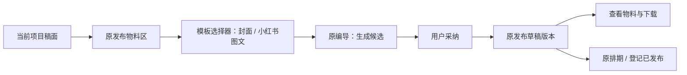
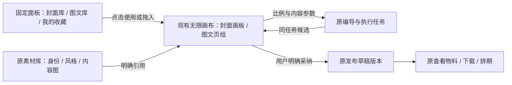

# T-1021：在现有发布物料里接入模板

用户已明确：结合CreatorOS现有发布功能改，沿用oil-ui-pro与既有UI，不建立独立系统。正式范围以[任务SPEC](../t1021-cover-template-library.md)为准。本说明定位代码接入点，不替代SPEC或另建任务计划。

## 用户看到的改动

仍然进入当前项目，编辑稿子，在底部「发布物料」做封面或准备小红书图文。挑封面/图文模板，筛行业，取本人照片或本期素材，改提示词与比例，再用原编导生成候选。挑好后采纳到当前发布草稿，回到原「查看发布物料」看封面、正文和图文图片顺序，下载后沿原排期或登记流程使用。

## 原功能与接入位置

| 现有位置 | 本次局部增加 | 继续沿用的行为 |
| --- | --- | --- |
| `draft-workbench-page.tsx`的`PublishPackSection` | 封面与图文操作入口 | 项目稿面、保存稿、原发布包与登记 |
| `publish-package-cta.tsx` | 同页模板选择器；物料查看里显示真实封面与图文图片顺序 | `flushSave`、真实ContentOutput、已有物料查看Dialog |
| 右侧`DraftChatRail`及`draft-chat-request.tsx` | 接收所选模板、参考素材和比例的本次创作要求 | 原编导对话、项目上下文与任务反馈 |
| `chat-generate-card.tsx`、`chat-publish-package-card.tsx` | 展示真实比例、逐页候选及采纳 | AI产候选、人明确采纳、原任务恢复 |
| `draft-workbench-data.ts` | 读取当前发布版本的封面与图文 | 按Publication.currentRevisionId回读，刷新后可见 |
| `publishing.service.ts`及原Revision | 正文、封面、typed图文图片顺序在同一发布版本；采纳比较当前版并幂等 | 原Publishing归属、版本历史与发布状态 |
| 现有素材中心与Assets | 本人照片/风格/内容参考选择；原图片下载 | 真实账号归属、上传、签名预览和下载 |
| 全局发布中心 | 同一发布稿显示真实图文类型 | 原排期、记录、数据表现与项目跳转 |

封面和图文是两套模板内容，收藏提示词与风格也是两种保存对象；它们都是发布物料里的辅助选择。真人模板使用用户自己的身份图，行业筛选不猜人物身份。比例从创作参数进入实际图片任务，供应商不支持时显示可用选项；已经生成的图按实际像素展示与下载。

## 当前证据边界

已核对正式源码调用链与服务归属，已有12张公共风格参考和2张私人真人参考。旧独立HTML预览与两张生成的完整工作区图已撤回为产品方案，保留研究记录。当前SPEC已经按现有发布功能修订，生产组件、公共契约和正式任务尚未实现，不把素材预览当成系统接入。

私人收藏按当前创作账号隔离跨项目复用，还是本人所有账号共享，前面的问题仍待用户回答；该范围不会改变发布正文仍归原PublicationRevision的既有边界。

## 无限画布补充（2026-10-04）

用户认可沿原发布功能接入，并补充当前宿主是无限画布。这里将「创作所在的空间」与「发布物料的保存归属」分开：前者沿现有无限画布，后者继续归原Publishing。以下为接入规则，未声称已经定位宿主组件或实现对应API。

### 画布上的内容

- 封面是一张具有明确输出比例的画板；同次创作的候选在附近比较，每张对应真实任务结果及图片资产。保留已采纳封面，重新生成增加候选，不覆盖旧图。
- 小红书图文是一组具有稳定页ID的画板，含首图与正文页，配文关联同一组。发布顺序以用户编辑的pageOrder为准；在无限画布上移动位置不自动改变发布顺序，不能用横坐标排序猜页序。
- 「采用模板」先建立可编辑的创作配置；模板样图是风格参考，不自动变成已生成、已采纳或已发布的图片。提示词收藏可以没有图片，不能伪装成成品节点。
- 身份图、风格图和本期内容图引用原素材ID，显示各自角色；公共模板不继承他人的脸或私人身份照片。

### 画布外围的工具

模板库、图文库、收藏、素材选择和选中对象的属性使用宿主已有的固定侧面板/浮层，按需打开，位于画布缩放层之外。缩小画布不会把按钮与输入框一起缩小；关闭后回到原选中对象和视口。沿用oil-ui-pro与原组件，不新增全局导航或第二套画布。

比例选择属于当前画板/页组的生成与导出设置，提供常用及更多比例，并按真实供应商能力呈现。它与无限画布的视口大小、画布缩放、节点预览尺寸独立。选择16:9不会把整个无限画布改成16:9；改变已有作品的目标比例保留原图片，用户明确再生成才产生新候选，不拉伸或悄悄裁切。

### 放置、生成与回到发布

点击使用模板放在当前可见创作区，拖入以宿主已有client→world坐标转换落点。坐标需考虑当前缩放、平移、容器偏移和固定面板，复用既有画布变换，不用浏览器屏幕坐标直接当节点位置。只定位当前对象或组，不因一次新增而缩放到全画布。

生成中节点关联原taskId，任务状态由服务端回读；完成后把候选关联到同一创作对象。用户生成期间移动画布或查看别处时，完成不会抢选中状态、强制平移或覆盖编辑。提供定位当前结果的明确动作。关面板、重进或重启后沿原taskId恢复，不新开重复任务。

用户在封面画板或图文页组点「用于发布物料」，沿原采纳链绑定当前项目、ContentOutput、Publication及基版Revision。画布关联只引用真实nodeId/frameId/groupId、taskId、resultId、assetId与publicationId/revisionId，不再保存第二份正式配文或发布状态。发布物料可反向定位已关联的画板/组；画板引用删除不删除正式素材、已采纳发布版本或原任务。组内移动及图文页序编辑需要沿宿主撤销/重做与保存机制区分，不能以视觉移动代替发布版本保存。

### 实施前须定位的宿主事实

当前检查的分支为`codex/t793-local-package`。在frontend/src、backend/src与contract/src未找到无限画布实现或ReactFlow/xyflow/tldraw/Excalidraw依赖；`bg-canvas`是背景样式，`@napi-rs/canvas`是位图渲染依赖，不能据此认定已接入无限画布。已询问用户实际入口或另一个代码位置，等待定位后再绑定真实节点类型、布局保存端口、撤销机制与发布关联操作。原稿面PublishPackSection是已验证发布入口，不直接认定它就是用户所说的画布宿主。

验收补充：不同平移/缩放下插入与拖入位置正确；画板比例不受视口缩放影响；图文自由摆放不更改页序；生成完成不抢视口；重进回读同一任务与候选；发布物料反向定位同一对象；删除画布引用不删已采纳物料；只渲染可见节点与按需缩略图，沿现有性能与LED-047规则限制在途请求。
