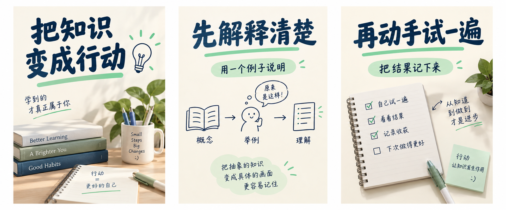

# 双模板库调研与样图说明

2026-10-04，通过ego-browser的同一个TaskSpace实际查看公开页面。这里是选择样例后提炼的方法，不是平台爆款排行榜，也不证明某种设计能提高点击率。

## 直接查看的作品

| 来源 | 实际看到的内容 | 接入模板时提炼什么 |
| --- | --- | --- |
| [舒芙蕾的素材圈：人像封面攻略](https://www.xiaohongshu.com/explore/691bbd740000000004004e4a) | 公开十页合集的首张，真人与标题组合，覆盖求职、家居智能、装修、读书等主题 | 真人身份与模板风格分别提供；标题不压住脸，主题物件与人物动作形成关系 |
| [浪浪吉：全屋收纳说明书](https://www.xiaohongshu.com/explore/6a38ad7b000000001603cf30) | 九图笔记首张，标题、空间分区、物件清单与柜体示意形成结构 | 图文不只是漂亮首图，要保存每页职责、内容顺序及可编辑配文；信息要用用户真实空间和物件替换 |
| [Canva小红书模板目录](https://www.canva.cn/rednote/templates/) | 实际浏览目录缩略图与行业下拉：零售、教育、旅游、文艺、医疗、宠物、餐饮、运动等；查看知识卡、行程拼贴、茶文化、表格备考、宠物指南等 | 行业与视觉形式是两个维度；同一行业需要照片、真人、知识图解等不同选择，图文需要首图与内页分别设计 |

浏览记录仅用于本机设计研究，截图保留在被Git忽略的research文件中。没有下载或内置这些作者的原图，没有保存浏览访问令牌，也没有点赞、收藏、评论或联系作者。平台链接可能需要登录；链接本身不带访问令牌。

Canva目录中实际出现并提取的原模板链接如下。目录缩略图已观察；旅行详情弹层未成功展示完整内容，因此不把它描述为逐页研究完成。

- [学习方法：模拟UI卡片](https://www.canva.cn/templates/EAGaG73QssQ/)
- [海外留学：蓝白商务封面](https://www.canva.cn/templates/EAHRfBmmWhg/)
- [旅行：绿黑白行程内页](https://www.canva.cn/templates/EAHRSCS8pdc/)
- [餐饮：米黄写实封面](https://www.canva.cn/templates/EAHPWTBI_5A/)
- [茶文化：米绿主视觉](https://www.canva.cn/templates/EAHPWFlZ2vc/)
- [专升本：蓝白表格内页](https://www.canva.cn/templates/EAHJgMW-8K8/)
- [公务员备考：文字内页](https://www.canva.cn/templates/EAHI20dh5Vc/)
- [学习：白蓝扁平插画](https://www.canva.cn/templates/EAHP_cAuaNM/)
- [宠物：猫饲养指南](https://www.canva.cn/templates/EAHK22LfHac/)
- [美食：暖棕照片拼贴](https://www.canva.cn/templates/EAHNEPMMbDk/)
- [留学：指南内页](https://www.canva.cn/templates/EAHJg277azE/)
- [对比：黑白表格封面](https://www.canva.cn/templates/EAHRgQxjfkk/)

## Skill源码依据

唯一源码目录按用户指定为`/Users/zyongzhu/Workbase/moonlit-skills/`。

- `skills/moonlit-video-cover/SKILL.md`提供「命题＋风格参考＋真人身份参考＋内容证据」方法。身份、风格与本期事实分别建模，横竖版分别构图，人物照片优先。
- `skills/moonlit-xiaohongshu/SKILL.md`以单封面加配文为默认，需要独立信息时才用多图。模板需支持首图、正文页与配文，而非机械九宫格。
- 旧`templates/xiaohongshu.md`仍有旧署名、宇航员及评论引流要求，与当前主说明不同，不能直接拷贝为产品默认。
- 源文档的多图最小页数存在不同表述；产品不据此阻断合法两页作品。私人字数和标签偏好不是平台永久限制。
- 品牌叠加参考文档在指定源码中未找到，因此公共模板不依赖该私人文件；用户品牌配置仍需独立输入。

按源码显式引用查看了本人的真实照片与已认可横版封面，用于生成两张私人真人候选。仅私人目录保留这些结果，公共包没有本人照片、私人候选或其来源路径。

## 本轮原创样图

公共：六张封面样图＋六张图文风格预览板。私人：使用本人照片生成的横版、竖版封面各一张。所有结果已实际生成并逐张查看；图文板有三页的视觉方向，但仍是一张位图，不是三张最终正文文件。

照片质感的美食、旅行、美妆和家居样图也是AI示意，不是实地摄影或实测证据。美妆板中日期、肤感等文字属于虚构示例；用户生成与发布时必须换成自己的实际记录。公共模板不把这些示例作为本期事实。

`templates.json`提供简体中文可编辑配方、行业与输入要求；`generation-requests.json`保存本轮实际模型请求，便于追溯样图。原始请求不自动成为平台默认提示词。行业目录有12类，尚无样图的筛选结果明确显示空态；不假称覆盖每个行业的所有类型。

## 集成与当前边界

正式接入：项目封面入口→双库挑选→换本期素材→用户确认生成→候选预览→明确采纳。封面复用既有任务；图文在同一任务账本新增完整笔记候选，配文、顺序、单页恢复及最终交付物都有正式合同。收藏拟按当前创作账号隔离并跨项目复用，保存范围仍待用户确认。

当前HTML是方案预览：筛选、修改提示词、收藏、删除、刷新回读、图片下载和生成配置下载是真实的本地操作；收藏保存在本浏览器。没有调用CreatorOS生产服务，没有模型生成或项目采纳按钮。独立SPEC评审通过只证明方案缺口已销账，不代表生产功能上线。
