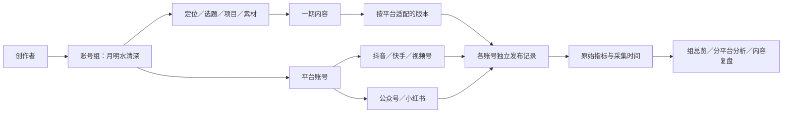

# T-1022：账号组与多平台工作区

日期：2026-10-04。状态：原版增补设计；生产实现未开始。用户已否定A/B新风格并要求保留原版丰富工作台；历史归属迁移仍待确认。独立SPEC回执随本轮页面约束更新复核。

## 用户要求

以账号组承接同一创作者在抖音、快手、视频号、公众号、小红书的账号与内容分发。全局切换从单个平台账号改为账号组；组内作品、创作者总览和数据可见。账号组在绑定账号入口管理。重构首页、运营分析、数据复盘以及受影响的页面。使用用户提供的 `oil-ui-pro 0.10.0`，形成持续适用的页面规范。

用户后续纠偏：“新的这种风格不喜欢，原来的版本更丰富一些，只是不支持总览和多平台切换”。据此确认沿用现有品牌、导航与丰富卡片，不再请求选择A/B。账号组能力作为原版增补，不能以简化风格删掉旧首页入口与信息。

## 调研与设计范围

核对现有账号、项目、定位、作品、发布和数据隔离的真实归属，明确多平台能力差异；形成可审阅的数据模型、迁移策略、接口边界、信息架构和页面原型；通过独立评审并记录尚未明确的数据迁移选择后进入实现。

用户已明确账号组方向与上述页面范围。旧账号合并、现有定位冲突与历史项目归属规则尚未确认，不假定可以自动合并或删除历史数据。

## 1. 大白话

一个账号组就是一个创作者或品牌的完整工作区。比如“月明水清深”这一组，下面放抖音、快手、视频号、公众号、小红书账号。选题、稿子、素材和项目一起管理；同一期内容可以有多个平台版本。看数据时先看这一组，再看某个平台、某个账号或者某一期内容。

## 2. 已核实的现状

代码证据索引见 [调研](t1022-account-group-workspace/RESEARCH.md)。这些结论针对本地当前工作树，不推断安装包或其他分支已经具备相同能力。

- 全局切换器和绑定主入口硬编码抖音。当前 `accountId` 是真实平台账号的隔离锚，不是账号组。
- 项目、素材、选题、雷达、定位、聊天、执行任务、知识库和复盘已按账号隔离。只改下拉框会继续看不到其他平台的数据，并可能错用定位和任务上下文。
- 平台枚举已有抖音、小红书、视频号及YouTube/B站/X；快手和公众号没有独立枚举。公众号适配标签 `wechat` 被采纳端映射为 `wechatVideo`，需要纠正。
- 作品发布、数据快照、浏览器身份和定时采集仍需真实的平台账号，不得用组ID替代它们。

## 3. 归属与模型（候选合同）

### 3.1 账号组及成员

新增 `account_groups(id,user_id,name,status,version,created_at,updated_at)`，`id` 不随名字变化。用户有多个组；同一组允许同平台多个账号。组内筛选层级为“全部平台 → 平台 → 平台下具体账号”，避免以为每个平台只能绑一个账号。

新增 `account_group_memberships(id,user_id,group_id,platform_account_id,joined_at,left_at,version)`。一个平台账号同一时刻只属于一个有效组；数据库部分唯一约束和事务锁落实。不采用可重叠标签组，否则定位、聊天和作品权限会产生多个归属。历史成员关系保留用于审计。

归档组只从默认选择中隐藏，历史数据可从管理页只读查看；可恢复，不提供硬删除。平台账号隐藏沿用现有停止采集的行为，组内仍能明确查看历史作品。归档组不擅自停止活跃平台账号的合法后台采集；采集任务是否停由平台账号状态决定。

### 3.2 共享创作数据与平台事实

| 数据 | 最终归属 | 规则 |
| --- | --- | --- |
| 定位、选题、雷达资料、手动项目、稿子、组内素材与知识、经验、聊天 | `userId + groupId` | 在组内可见，平台筛选不换定位或复制项目 |
| 项目平台版本、目标分发账号 | 项目所属组 + 真实平台/账号 | 复用contentOutputs、PublicationRevision，不新增平行内容主表 |
| 采集作品、发布记录、指标快照、粉丝快照、浏览器登录与采集任务 | `userId + accountId`；记录当时的组归属 | 保留accountId、externalId、publicationId和媒体storageKey |
| AI/执行任务、候选、通知、搜索索引 | 创建时冻结groupId；必要时含accountId与membershipVersion | 切换页面不改变在途任务归属；采纳时重新校验当前归属和版本 |
| 个人激活、渠道、模型凭据及产品设置 | 继续用户域 | 不复制成组域，不展示秘密 |

`RequestContext` 增加服务端解析的 `groupId` 与组版本，保留 `accountId` 的平台账号语义。明确 `user | group | platform-account | project-derived` 操作范围，逐条映射现有operation registry；不全局把accountId替换成groupId，不把null理解成所有账号。

组ID、账号ID及项目ID均由服务端验证user ownership、状态和成员关系。组读入口不能调用“任意用户账号的聚合”。**当前成员账号**用于新绑定、新采集、新发布及账号实时状态；**历史事实可见账号**从该组已经冻结的Publication/指标groupId解析，用于历史作品与复盘。历史筛选选项来自组历史事实与当前成员的去重并集，标记“已转出”；不得把历史读取也限制成当前成员列表，不把新组成员关系用于重新归属旧publication。client提供的账号列表只作筛选意图，服务端按操作的当前成员/历史事实范围验证非成员或无历史引用的ID并拒绝。账号秘密、登录态和新的采集权只按当前成员验证。新组聚合由backend application通过各模块service port组合，不在frontend查库或跨模块读repository。

共享领域表以groupId为必需归属，新建空组项目不要求accountId。原accountId在共享表降为可空的legacyOriginAccountId语义（迁移兼容期可保留列名，但新组入口从不以它授权），原值保留作来源而非新增假账号。平台事实表继续强制accountId且新增不可变的事实groupId；快照从父publication派生事实groupId。所有旧accountId-only操作先走显式legacy适配，仅允许原账号对应的历史范围，遇到没有legacy归属的组数据返回明确升级提示。保留旧SQL不能自动扩大到新组成员或把NULL当全局；过渡完成后逐域移除旧scope读写，不长期并存两套权限语义。

素材读取、blob下载、导出和分享按当前项目/组权限验证；原storageKey保持不变，不将路径中的账号ID自动判成当前组的默认账号。快手用 `kuaishou`，公众号用 `wechatOfficial`，视频号保留 `wechatVideo`。逐入口核对供应商、CLI、worker、平台图标、模板和采纳协议；已存wechatVideo不能根据正文猜测是否公众号，原值保留并提供用户显式修正。

### 3.3 平台账号转组

转组前出具影响预览：账号、将来采集、历史作品、当前组未完成发布目标、定位、项目、素材引用和在途任务数量。推荐规则：已发生的发布/采集事实继续在原组历史可见，转组后新事实进入新组。老指标增量仍更新原publication的原组归属，不再按当前成员关系追溯改写历史。

转组是version检查的原子事务；只允许账号属于该用户、新组有效且无该账号的非终态采集/发布/AI任务时执行。阻挡仅限该账号转组，原任务可继续、其他账号可用。原组未执行的该账号发布目标变成“需要重新选择账号”，保留内容与排期，不偷偷换目标。历史任务/候选跨组采纳须明确提示重新绑定目标，不用当前页面组覆盖创建时的冻结组。跨组内容搬移另需明确选中项目及依赖，不能因转账号隐式搬稿、聊天或定位。

转组、关联账号任务创建、定时任务认领必须经同一platform-account service port，在事务中按稳定顺序锁platformAccount与有效membership行。转组检查非终态任务后提交新membershipVersion；创建/认领任务在该锁内重读成员并冻结groupId/version/accountId，然后才提交执行权。Worker在外部副作用前复核冻结版本，版本不匹配返回“账号归属已改变，请重新选择目标”；不得发送后才发现旧归属。恢复执行继续持原任务冻结范围，不按当前组重新stamp。验收两个顺序：创建先持锁则转组被拒；转组先提交则旧版本创建被拒、新组新版本任务可执行。

## 4. 一期内容、多平台分发

以真实Project/ContentOutput关联多条Publication。项目列表和首页按内容计数；分发表按publication/目标账号计数。对同账号/平台重复采集使用现有稳定外部ID幂等，不按标题、发布时间或字符串相似度认定跨平台同一期。

历史独立导入作品保持独立；用户可显式选择关联到已有内容，后台验证同组、平台、真实ID和目标版本。AI可以建议关联，但只产候选，不自动合并、删除或改归属。

用户选定目标账号后生成各平台候选并逐条采纳；稿子、封面、比例和正文适配由配置的Skill/模型完成。无绑定账号或无自动发布能力时保留可编辑物料、导出/复制及手动发布事实录入。仅在真实externalId/url和回执确认后显示“已发布”；草稿或保存到平台草稿箱明确写“草稿”。一个平台失败只影响该目标，其他已成功结果保留，重试不重复发送。

## 5. 页面范围与交互

详细页面规范见 [PAGE_SPEC](t1022-account-group-workspace/PAGE_SPEC.md)，视觉规范见 [UI_RULES](t1022-account-group-workspace/UI_RULES.md)。

1. **全局工作区**：侧栏底部原账号选择位置改为账号组选择；其下保留个人身份，不把选择迁到侧栏顶部。组切换影响整个工作区，平台筛选只影响数据/作品；组间不继承旧平台账号筛选。数据页面显示当前组、平台、日期。生成或提交中的前台操作沿用已有离开保护。
2. **绑定账号**：`/accounts`保留稳定路由，标题“账号组与绑定账号”。左列组名，右区真实账号表；建组、改名、绑定、选择已有账号、隐藏/恢复和转组均在这里，不能分散在多个设置页。
3. **首页／创作者总览**：保留原问候、五指标卡及三列六区块：继续创作、待办事项、热门选题、最近发布、数据概览、创作建议。平台筛选置于首页指标上方；组总览不混算文章阅读、视频播放与百分比，单平台可沿用其原生五指标。新增创作者总览承接组内跨平台覆盖与内容分发，复用上述查询与筛选，不另建业务事实。平台筛选只更新指标、发布、趋势，不隐藏组内继续创作、待办、热门选题与建议。保留旧合法入口与任务提醒，不把逾期伪装成新建议。
4. **作品与发布中心**：同一期内容一行，展开各目标账号的版本、状态、发布时间和数据；保留“按发布记录查看”切换以排查具体作品。平台筛选不隐藏平台不限的创作项目；只过滤已经有平台目标或事实的作品。
5. **运营分析**：组概览、平台详情两层；所有图表与表格共享页面的组/平台/账号/日期筛选。按平台显示原生指标；日期按用户时区。
6. **项目复盘**：同一期的各平台表现并列；预测对比只使用同平台、同窗口和同口径的数据。AI经验与结论由模型候选生成，用户采纳后保存到组，仍保留平台来源与样本量。
7. **相邻页面贯通**：定位、选题、雷达、项目、知识、素材、画布、助手、自动化、全局搜索、通知、CLI上下文和账号提示统一改成正确的group scope。组内平台筛选不切换定位；浏览器和采集选择真实账号。

## 6. 指标口径

- 组概览优先展示独立内容数、发布记录数、待分发数及分平台表现。不能把公众号阅读数和视频播放数塞进一个“总播放”。
- 同口径视频播放可显示“视频播放合计”，阅读单独显示“文章阅读”；必须显示覆盖平台、已采集账号和截至时间。缺一个平台显示部分覆盖，不填假0。
- 粉丝展示“各账号粉丝合计（未去重）”，只加各账号最近一条有效快照，不能称独立受众数；不同采集时间要可查。
- 缺失/不支持显示 `—`、未采集或不支持；真实测到0显示 `0`。组为空时内容数是0，尚无指标不能等价成测到0。
- 完播率、互动率、平均观看时长先保留平台原生定义。只有相同分子/分母和窗口可合并；按分母加权，不能平均百分比或把未知字段补零。
- 累计播放曲线不冒充每日新增；增量由同一作品可比快照差分得到。负向修正注明数据修正，不做增长。新连入账号已有累计值不能算当天增长。
- 展示“期间发布的作品截至当前累计表现”与“期间产生的表现”是两个不同模式，不混在同一图中。原型优先按前者展示，有真实增量样本才启用后者。

## 7. 迁移与兼容（需确认的推荐）

1. 仅在隔离测试库验证迁移；真实用户库执行前需要备份、校验和可回退记录。
2. 为每个旧账号创建独立账号组，一对一回填共享数据groupId，不按昵称合并。原ID、外部ID、旧accountId、文件路径和旧历史可见性保留。唯一键和幂等键按业务域逐表迁移。
3. 将旧current-account选择映射到其唯一组；新请求显式带groupId。兼容期旧客户端只能访问由旧accountId验证派生的原组与原账号范围，不自动扩大读取到全部成员，也不把旧账号枚举换成组ID。
4. 用户在绑定账号页显式将同一创作者的账号收进组；冲突定位显示各原定位，明确选择组主定位并保留其它版本。旧项目、知识、素材与历史发布是否一起搬入通过预览分别选择，推荐复制引用而非复制文件。
5. 每次迁移输出按表前后记录数、组映射、孤儿引用、唯一冲突和校验结果；可重复执行且不会重复建组或改写已确认结果。遇到冲突保留原数据并中止该迁移事务，产品其它合法路径仍可继续。
6. 在确认迁移之前不执行真实库迁移，不用fixture宣称旧账号无损。

### 7.1 历史资料归组与依赖闭包

“账号转组”与“历史资料归组”是两个明确动作。首次将多个旧账号整合成同一创作者工作区时，选择的资料以project为最小内容闭包：项目、阶段、contentOutput、稿子版本、引用素材、该项目关联Publication及其全部快照、复盘/经验来源。关联Publication若迁入，其事实groupId与父项目一同迁入；只转账号而不选历史资料时则按3.3留在原组。已有资料归组不是根据当前成员关系自动重写历史，必须有显式预览digest、用户选择与全闭包事务。

资料迁移预览列出每个被选项目的所有关联发布账号（包括已转出账号）、定位版本、知识引用、共享素材及在途任务。非终态任务关联项目不能搬；拒绝只影响被选闭包。定位历史版本作为项目证据保留，组主定位另选，不拿新定位改旧稿证据。未关联采集作品按独立导入项目闭包搬，不能只搬孤立snapshot。组级聊天和独立知识条目不隐式迁入，用户可明确选中；含跨项目引用的记录先出闭包预览再选。

素材与知识被多个项目共享时，原实体及文件留原处，目标组只得到用户明确选中的资源访问引用。新增backend管理的resource access grant(userId,targetGroupId,resourceId,originGroupId,migrationId)，只允许同user明确授予且资源可用；读取/下载/导出经service和blob入口验证group拥有实体或有效grant。不复制媒体、不改变storageKey、不授予目标组浏览整个原组的权限。更新资源的权限仍属于实体原组；需要独立编辑时用户明确“另存为组内副本”，保留源关联。原组归档不自动撤销已确认grant；资源删除或grant撤销需单独影响预览，不能以路径前缀绕过。

新增 `accountGroups.migration.preview/apply/status`：请求sourceGroupIds、targetGroupId、显式projectIds/knowledgeIds/resourceIds、定位选择、expectedVersions、idempotencyKey；preview返回有序闭包IDs、资源grant清单、冲突、在途任务及digest。apply在同锁协议下重验digest与版本，并事务更新整个闭包和授权、留下migrationId与before-image；失败不留下部分组/引用。status可回读结果与计数。冲突不能靠自动忽略引用变成功。

### 7.2 回退窗口

先离线备份并暂停领域写入，只有校验通过才开放新版本写入。**开放写入前**可从完整备份回退，不丢增量。**开放写入后**不承诺把新组数据降回旧NOT NULL accountId schema；保留新schema和新数据，故障时关闭有问题的新入口、提供只读/导出与向前修复。回滚旧安装包只允许用户明确选择恢复迁移前备份且已导出新增资料，不能静默丢弃新增空组项目或重新塞进旧账号。每次资料归组的undo也只在所有相关版本未变、没有新任务/发布/grant消费时依before-image事务撤回；否则出冲突并提供向前修复，绝不覆盖后续写入。备份包含数据库、媒体索引/文件可读校验及manifest；不在迁移中搬实体文件。

## 8. 候选接口与物理边界

以下均为planned，需在contract建立schema/registry、backend实现transport并完成调用链测试后才能作为产品按钮上线。旧accounts.*保持真实平台账号语义。

| 操作 | 请求与结果 | 权限／错误／幂等 |
| --- | --- | --- |
| `accountGroups.list/get` | 分页、groupId → 组与成员、版本、能力状态 | 用户域；非属主404；空组仍可读取 |
| `accountGroups.create/update/archive/restore` | name或groupId、expectedVersion、idempotencyKey → 当前组 | 用户域；重名可用ID区分；409版本冲突；归档无数据删除 |
| `accountGroups.members.add` | groupId、accountId、expectedVersion、idempotencyKey → 已验证成员 | 同用户、账号active；已在其它组409；已在该组幂等返回 |
| `accountGroups.members.previewTransfer/transfer` | accountId、from/toGroupId、expectedMembershipVersion、确认的预览digest → 影响清单／结果 | 同用户、版本与预览未变化；在途任务409；历史规则见3.3 |
| `accounts.bindingCapabilities` | 平台列表 → bind/collect/publish/draft/manual能力和原因 | 用户域；provider未配置不伪装支持 |
| `accounts.bind/start/status/cancel` | groupId、platform、idempotencyKey → runId、等待验证/运行/完成/失败/取消 | 真实身份校验后建成员；取消只在runtime确认后显示；失败保留目标组与输入 |
| `pages.groupDashboard/groupAnalytics/groupWorks` | groupId、platform/accountIds、日期、metricWindow、分页 → 数据、coverage、asOf、口径 | 组域，账号必须属组；单平台失败分区返回，不伪装全成功 |
| `projects.linkPublication` | projectId、publicationId、expectedVersion、idempotencyKey → 明确内容关联 | 两者同组；已有不同关联409；禁止相似标题自动合并 |
| `pages.groupContentReview` | projectId、日期/窗口 → 内容与逐发布记录表现 | 从项目解析组；跨组拒绝；缺样本明确返回 |
| `positioning.selectGroupVersion` | groupId、versionId、expectedVersion → 当前组主定位 | 保存用户明确选择；保留旧版本，不混合定位 |
| `accountGroups.migration.preview/apply/status` | 7.1定义的选择、版本与digest → 闭包／migrationId／计数和回执 | 同用户；全闭包权限；在途/版本/授权冲突409；事务及幂等 |

组领域先归于backend platform-account模块内部的独立文件；application层组合跨模块查询。没有第二套调度、发布队列或浏览器profile权。任务写集需覆盖contract、backend schema/service、application、worker上下文、frontend transport/shell/各归属页面与CLI，实施前刷新CodeGraph并冻结写集。

## 9. 验收（一次完整任务，不拆已确认范围）

- 隔离迁移：至少两个不同创作者组、同平台多账号、空组、归档账号、定位冲突、旧客户端、历史任务、重复迁移、事务中断恢复。保留所有ID和storageKey；前后计数一致、blob可读、跨组读取/下载/采纳均拒绝。
- 完整公开链路：建组→绑定真实账号或显式接入已有账号→切组→创作项目→选择组内多个目标→生成候选→采纳→逐平台真实发布/草稿/手动记录→采集→首页/作品/运营分析/复盘一致→采纳经验后重新读回。
- 各平台分别有能力和实测回执，快手/公众号补完整枚举与适配，不把仅生成文案称为自动发布。没有凭据或安装环境的真机链路记录为待验。
- 指标：视频/文章混组、未知值与真实0、缺平台、快照不同日期、重连账号、累计/增量、加权比例、未关联作品、一个平台失败后其他区块仍可用。
- 页面：normal/empty/loading/error/permission、长名称、同平台多账号、键盘、1366×900及1280×800、窄窗、200%阅读；切换组和日期后晚到响应不得回写；后台任务按创建时归属继续。
- 必须运行contract相关回归、backend隔离与迁移、frontend旅程、LED-047、boundary/orphan、pmem sync和reconcile；全局失败必须分类登记，不能宣称全绿。历史TDD红测和真机回执缺失不补造。

## 10. 确认点与交付边界

用户已授权账号组方向、页面重构范围以及使用oil-ui-pro。仍需确认：**旧账号先各建一个组，用户再显式归组；冲突定位明确选主版本；历史资料按项目依赖闭包预览选入，共享素材以资源授权引用保留文件；开放新版本写入后只允许向前修复或明确恢复迁移前备份。** 视觉方向已由用户选定为原版丰富卡片增补，A/B退出当前候选；保留原品牌、五指标卡、三列六区块和原账号入口位置。

本轮先交付源码调研、可比较页面候选、组内页面流程与规范，并完成独立SPEC评审。原型为文档中的隔离交互小样，使用截图中已有标题及真实缺失状态；新增预览只在“抖音＋截图原有时间范围”展示截图原数字，并标注非实时样本，组总览与其它日期不复用这些数字，不连接数据库、不模拟绑定/发布成功。按oil-ui-pro存量项目规则，正式页面应在现有路由和共享组件中实现；本轮因服务契约与数据迁移待确认，未将探索稿接入生产路由。
