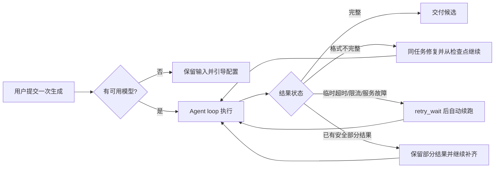

# T-1022 模型生成非阻断恢复契约

## 1. 用户问题

用户在 2026-09-21 提供两张真机截图：内容雷达在逐字稿拆解后显示“模型输出不完整，请重试生成选题卡”，AI 助手显示“这次没有生成成功”，两条链路都把本可恢复的生成问题变成手动重试。用户确认：除当前账号没有可用模型配置时应直接说明并引导配置外，模型超时、输出不完整和临时服务故障应由 Agent loop 继续处理，不得形成阻断性超时。

本任务复用 T-915 的持久任务、调用账本、检查点、有限退避和 Agent 自我循环，以及 T-1003 的原任务续跑契约；不建立第二套任务系统。

## 2. 大白话规则

用户提交一次生成后，系统负责把这一轮做到可用结果。单次模型调用可以有安全超时，但超时不能直接结束整个任务。系统应保留已经完成的拆解、候选和草稿，从断点自动继续；格式不完整时先在原循环内修复；明确的临时拒绝进入后台等待并自动续跑；有安全输出时交付已有结果并继续补齐。

只有当前账号没有可用文本模型时，页面才结束等待并给出“去设置 AI 模型”的直接入口。用户取消、输入无效、权限错误和外部写操作结果未知继续遵守既有安全边界，不伪造成功，也不盲目重复有副作用的操作。



## 3. 必须满足的行为

1. **内容雷达**：`topic_preview` 的 timeout、network、明确可重试 HTTP 拒绝和已结算但结构不完整，不得落成 `failed + 手动重试`；保留逐字稿拆解/选题/草稿检查点，沿原 `executionTaskId` 自动恢复。
2. **AI 助手**：普通生成的临时模型失败不得显示“这次没有生成成功 + 重试”终态；任务仍在恢复时显示“正在自动恢复/可离开页面”，恢复后把结果送回原对话。
3. **模型配置**：仅当前账号解析不到任何可用文本模型时进入 `waiting_user`，保留输入并显示直达设置入口；恢复配置后继续原任务，不创建重复任务。
4. **无阻断性超时**：允许单次网络/模型调用超时以释放资源；持续任务不得因为总截止时间结束。等待采用持久化 `retry_wait`、退避和检查点，页面关闭或应用重启不丢任务。
5. **安全边界**：已经提交但结果未知的外部写操作仍先对账；用户取消立即停止；权限、归属、输入损坏继续明确失败。不得把失败伪装成成功，也不得无限并发重试。
6. **公共防复发**：新增自动化检查，禁止用户可见生成入口再次把 `timeout`、`output_invalid` 或普通临时模型错误映射成手动重试终态。

模型连接中断的账本状态使用 `superseded`：它只适用于没有外部副作用的模型候选，表示本次不完整结果永久废弃、不可再提交为成功，但仍按原预留量占用预算；后续调用必须携带原调用 ID 作为重试来源。工具、发布、浏览器动作和素材供应商任务不得使用该状态。

## 4. 验收

```frontend-journey-contract
task: T-1022
journey: model-generation-nonblocking-recovery
entry: 内容雷达作品详情与 AI 助手
steps:
  - 触发一次可控的模型输出截断，确认逐字稿拆解检查点保留且原任务自动继续
  - 触发一次明确可重试的模型超时或 5xx，确认页面显示自动恢复且不出现手动重试终态
  - 恢复模型响应，确认同一任务和同一对话收到完整候选，没有重复任务或重复候选
  - 移除当前账号全部可用文本模型，确认输入保留并出现直达模型设置入口
assertions:
  - timeout/output_invalid/network 不产生用户可见 failed 终态
  - 页面关闭再打开仍能观察原任务并收到结果
  - 已完成检查点、账号归属、幂等键和调用账本保持一致
  - 没有可用模型时不循环空跑
```

## 5. 验证范围

- 后端与 Worker：失败分类、continuous budget、retry_wait、检查点恢复、配置缺失。
- 前端：内容雷达候选卡、AI 助手错误/恢复状态。
- 回归：未知外部写操作不重放，用户取消有效，已有成功和 partial 候选不被覆盖。
- 安装版：通过 CreatorOS CLI 与真机页面验证当前安装包，不以源码单测代替安装结果。
