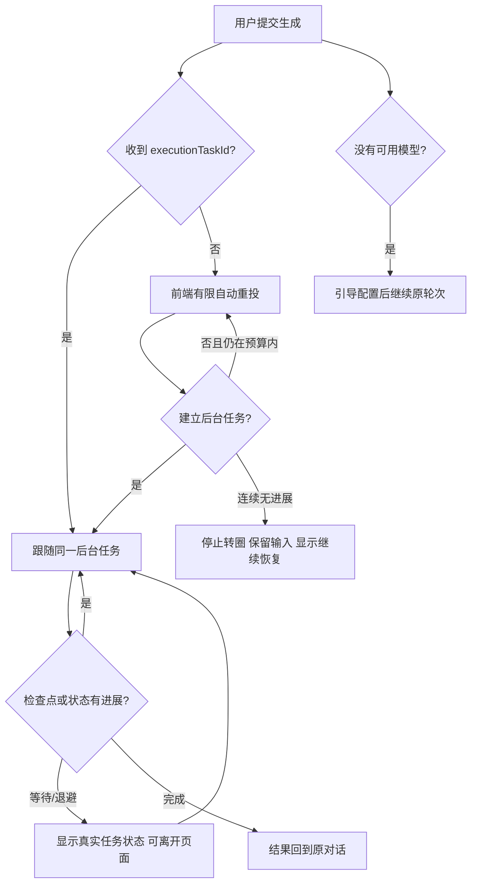

# T-1023 AI 助手恢复活性契约

## 1. 用户问题

用户在 2026-09-21 提供安装版截图：提交“把我近期的作品播放量情况生成可视化文…”后，AI 助手长期停在“正在恢复本轮生成 / 自动恢复中”，没有结果、没有进展，也没有可继续操作的出口。T-1022 把普通临时错误从手动重试改成自动恢复，但前端把未建立持久任务的重复请求失败也当成后台 Agent 正在工作，形成永久转圈和错误状态表达。

安装版公共 CLI 诊断确认该账号已有默认文本模型；两次同题对话都只有用户消息，任务列表中没有对应的 `copilot.assist`。沿同一公开消息入口复现到 `HTTP_400: 工具参数约束尚不支持：format`：Mac 内置浏览器公开了合法的 `browser.navigate` 参数 `format: "uri"`，聊天工具参数桥却仍把 `format` 全部拒绝，因此在持久任务创建前就终止。修复必须同时覆盖工具真实装配和前端恢复活性，不能只把错误文案藏起来。

本任务补齐 T-1022 的活性边界，不建立第二套任务系统。`execution_tasks` 仍是后台任务、恢复进展和完成结果的唯一真相。

## 2. 大白话规则

自动恢复必须能证明自己真的在推进。请求已经建立后台任务时，页面跟随同一个任务的状态和检查点，可以跨页面、跨重启继续等待；请求还没建立后台任务时，前端可以短暂自动重试，但不能永远声称“后台正在恢复”。连续尝试仍没有任务回执或任何新进展时，页面结束转圈，保留用户输入与已有内容，说明暂时没有取得进展，并提供“继续恢复”操作与诊断信息。

没有可用模型时仍直接引导配置模型。模型暂时不可用、网络中断或服务拒绝由 Agent loop 和持久任务恢复；前端有限重试只负责把请求可靠交给该循环，不冒充循环本身。



## 3. 必须满足的行为

1. **状态诚实**：只有拿到后台任务回执，或当前自动提交尝试仍在有限预算内时，才显示“自动恢复中”。没有持久任务且连续失败达到预算后，必须退出忙碌态。
2. **同任务续跑**：已拿到 `executionTaskId` 时只重连、查询或续跑原任务，不重复创建用户消息、候选、费用预留或外部操作。
3. **有限前端自救**：提交前的网络/HTTP 临时失败采用退避重试，并受连续次数与无进展时间共同约束；成功建立任务、收到新流事件或用户重新提交后重置预算。不得无限并发、不得卸载后回写。
4. **可继续状态**：自动恢复没有取得进展时，保留输入和已完成内容，显示实际原因、最后一次尝试和“继续恢复”操作；该操作沿原用户消息继续，不能要求用户重新输入。
5. **后台长任务不设总截止**：真正持久化且仍有等待/检查点状态的任务不因前端预算被宣告失败。页面可离开，回来后继续读取真实状态。
6. **配置缺失**：当前账号没有可用文本模型时直接引导设置，不进入重试预算。
7. **防复发**：自动化覆盖一次临时失败后成功、持续 503、持久任务长时间运行、组件卸载和手动继续五类场景；持续 503 时请求数必须停止增长，页面不得永久显示旋转状态。
8. **公开工具可装配**：内置工具目录使用的 JSON Schema 约束必须经过聊天真实装配回归。参数桥只显式支持并执行已验证的 `format: "uri"`，未知格式继续 fail-closed，不能静默丢弃约束。

## 4. 验收

```frontend-journey-contract
{
  "schema": "frontend-journey-contract/v2",
  "task_id": "T-1023",
  "journey": "AI 助手恢复有真实进展并且不会无限卡死",
  "entry": "CreatorOS AI 助手提交普通生成请求",
  "watched_paths": [
    "frontend/src/features/copilot/ai-copilot-content.tsx",
    "frontend/src/features/copilot/ai-copilot-interactions.test.tsx",
    "frontend/src/app/api/chat/route.ts",
    "frontend/src/server/chat-execution-stream.ts",
    "frontend/tests/e2e/ai-nonblocking-recovery.spec.ts"
  ],
  "required_checks": [
    {"id": "AC-T1023-TRANSIENT-RECOVERS", "test_id": "E2E-T1023-01"},
    {"id": "AC-T1023-NO-INFINITE-SPINNER", "test_id": "E2E-T1023-02"},
    {"id": "AC-T1023-SAME-TURN-CONTINUE", "test_id": "E2E-T1023-03"},
    {"id": "AC-T1023-DURABLE-TASK-WAITS", "test_id": "TEST-T1023-04"}
  ],
  "required_conditions": [
    "single-transient-failure",
    "repeated-submit-failure",
    "durable-task-recovery",
    "manual-continue",
    "component-unmount",
    "model-not-configured"
  ],
  "viewports": [
    {"width": 1280, "height": 720},
    {"width": 900, "height": 600}
  ],
  "coherence_groups": [],
  "copy_guard": {"forbid_internal_ids": true},
  "states": [
    {"id": "recovering", "visible": "正在恢复本轮生成"},
    {"id": "stalled", "visible": "自动恢复暂未取得进展 · 继续恢复"},
    {"id": "complete", "visible": "生成结果回到原对话"}
  ],
  "actions": [
    {"from": "recovering", "action": "一次临时故障后自动恢复", "to": "complete"},
    {"from": "recovering", "action": "连续失败达到无进展预算", "to": "stalled"},
    {"from": "stalled", "action": "点击继续恢复", "to": "recovering"}
  ],
  "honesty": [
    "没有后台任务或在途提交时不得声称 Agent 正在后台恢复",
    "持续失败后请求数停止增长且忙碌态结束",
    "已持久化任务不受前端提交预算截断",
    "继续恢复复用原用户消息和已有内容"
  ]
}
```

## 5. 验证范围

- 组件：恢复预算、退避、重置、卸载清理、可继续状态与同一轮次。
- 服务：持久任务回执和前端错误分类边界。
- 工具契约：Mac 内置 `browser.navigate` 的 `format: "uri"` 能进入真实聊天装配，非法 URI 和未知格式仍被拒绝。
- E2E：连续 503 后自动停止请求并退出转圈；用户点击继续后可在同一轮完成；一次 503 仍自动成功。
- 安装版：重新打包安装，通过 CreatorOS CLI 和真机页面验证，不以源码单测替代。
