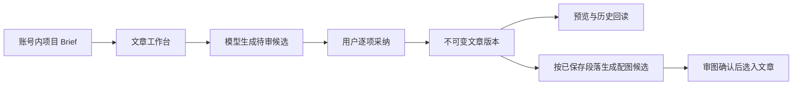

# T-1023 公众号文章创作实施与验收记录（2026-09-30）

## 当前可用流程

文章和视频可以属于同一个项目，正文分别保存。用户可以手写文章，也可以明确选择项目资料和品牌版本来生成候选；候选不会自动覆盖当前稿。标题、摘要、段落和待确认事实分别勾选采纳。来源与图片都保存精确版本。图片生成入口绑定已保存的文章版本与段落，服务端会重新核验账号、项目、版本和段落，不读取同项目的视频稿。

## 已取得的本地证据

- 后端平台/文章/配图组合：12 个文件、97/97 通过，串行运行于隔离数据库。包含账号隔离、目录完整性、文章候选、同键重放、普通与原子图片生成的文章段落快照。
- 前端相关回归：8 个文件、100/100 通过；随后新增的已有 Copilot 会话深链预填与请求上下文断言通过，Copilot 目标文件 52/52。`frontend` 和 `contract` TypeScript 编译通过。
- 同一隔离 PGlite 上的浏览器组合流程 9/9 通过：新建项目、平台账号隔离、作品目录、项目排期、发布物料与发布中心、公众号文章。文章用例覆盖手写保存、静态 SSE 模型候选审读/采纳、刷新与历史回读、跨账号拒绝访问，以及上传真实图片、选入指定段落和刷新后按精确文件版本展示。配图深链的参数与预填也经浏览器断言。
- 平台用例覆盖抖音与小红书本地账号的项目、稿件、发布草稿与回读。小红书和快手本机自动化接入代码已在 T-1021/T-1022 中接线；真实账号扫码验收仍待本次工作树执行。公众号文章工作台不依赖这两项绑定才可手写、生成候选及保存。
- 独立复验认为原两项代码 major 已修：采纳回执优先；文章配图普通与原子入口均按当前文章段落接地。复验结论仍为 `CONCERNS`，原因如下。

## 尚未通过的验收

本地 SSE 模型是隔离测试替身；上传图片不是实际模型生图。尚未用本机配置的真实图片模型和明确选定的两个真实账号，完成“生成图片候选 → 审图确认 → 入库 → 文章选用 → 刷新回读”。安装版仍是旧合同，尚未从当前工作树重新打包。依 SPEC，这些证据缺失时 T-1023 不记最终 PASS。

SPEC 写“候选图经 `assets.commit` 成为 active”；现有正式生成流程实际为 `ai.tasks.confirm` → `activateGeneratedAssetCandidate`，同样在账号与候选回执核验后把 pending 置为 active 并关联项目，但调用名称不同。须在 DEC 中确认服务合同措辞后对齐 SPEC；在确认前不宣称满足字面 `assets.commit` 条款。

后端全量 TypeScript 检查还有 14 条其他测试文件错误；旧 `chat-assembly.test` 有账号快照夹具等失败。全局 `reconcile` 结果另行记录，不把目标回归通过写成全库通过。
