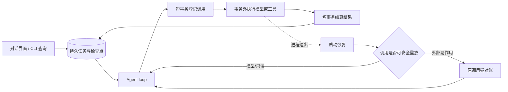

# T-1024 聊天运行时活性与未知结果恢复

## 用户问题

安装版 CreatorOS 已能成功创建聊天生成任务，但模型执行期间，任务查询和步骤查询会一直等待；应用重启后，原任务变成 `unknown_result`，界面只能持续显示“正在恢复本轮生成”。除未配置模型外，运行时故障必须由 agent loop 沿原任务解决，不能把无限等待留给用户。

## 真实失败证据

- 账号：`acct-ae1a8346-9`
- 对话：`ai-conv-1899afca-423`
- AI 任务：`ai-task-1899afca-690`
- 执行任务：`execution-task-1899afca-691`
- 创建消息已成功，说明 T-1023 的 JSON Schema `format` 阻断已修复。
- 任务运行期间，公开 CLI 的任务、步骤读取均被阻塞；状态接口仍可响应。
- 重启安装版后，同一任务返回 `runtimeStatus: unknown_result`，错误为“已有调用提交结果未知，须同键对账”。

## 目标

1. 模型或工具长调用期间不占用全局数据库事务或独占数据通道，任务、步骤和进度始终可查询。
2. 进程退出后发现未结算调用时，agent loop 使用原任务、原调用键和持久化检查点恢复；禁止悄悄创建替代任务。
3. 可安全重试的模型调用应自动重试；有外部副作用且结果未知的调用必须按同键对账，不能重复执行。
4. 自动恢复必须有次数、退避和进展边界。无法安全恢复时进入可操作终态并给出具体原因，禁止永久转圈。
5. 只有缺少可用模型配置时直接引导模型设置。

## 运行关系

## 验收

- 单元/集成测试证明外部长调用发生时，任务读取不会被事务阻塞。
- 重启恢复测试证明模型调用的 `unknown_result` 沿原任务恢复，调用次数有界，不产生第二个业务任务。
- 既有带副作用调用仍保持 fail-closed 与同键对账语义。
- 前端恢复回归、类型检查、边界与 reconcile 通过；若存在范围外既有欠债，证据中逐项记录。
- 重新构建并安装 macOS 包，使用公开 CreatorOS CLI 在唯一真实账号上创建一条生成任务；运行时可读取进度，最终可读取助手结果或文件交付。

## 范围边界

- 不修改用户已有对话或产物。
- 不用新任务替代失败的原任务。
- 不把失败吞成成功，不伪造播放量或生成结果。
- 本地包验收不等于官方签名、公证或公开发布。

## 实现与自动化证据（2026-09-21）

- 浏览器和本机 socket 改为短事务读取可信身份、事务外执行、短事务复核租约；浏览器等待期间同一
  PGlite 的任务读取在 300ms 门内完成。
- 启动恢复只把没有 provider job、provider result、result ref 的纯模型未知调用标记为
  `superseded`，沿原任务与原 operation key 续跑；外部工具未知回执保持 `unknown_result`。
- 模型 `length` 截断自动续写两次；持续截断后提交已生成内容为 `partial`，不保留永久 `running`。
- 动态工具装配受运行预算和业务截止时间监督，即使解析器不响应 AbortSignal 也能结束原等待。
- 自动化结果：前端 85 passed / 4 skipped；后端账本与恢复 19 passed；Worker 协议 17 passed；
  正式 Worker/Workbench 集成 26 passed；非阻断恢复 Playwright 4 passed；前端与 AI Worker 类型检查、
  物理边界、语义边界均通过。
- 安装版与公开 CLI 证据在本地包安装后补录。
