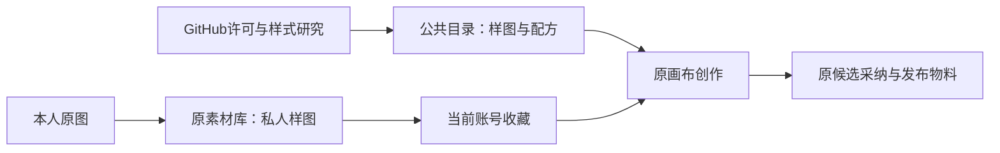

# T-1025 双模板库样图扩充

用户2026-10-04明确要求制作真人知识与产品实拍封面，真人可以使用本人，并到GitHub查找资源扩充封面与小红书图文模板。任务承接T-1021已经实现的独立案例库，不改变IA、公共服务合同、数据归属或发布流程；T-1021全局和安装版待验不因此销账。

## 内容与接入

- 读取本人固定原图与认可品牌参考，经image_gen制作至少3张私人真人封面；身份、文字、手机阅读分别检查。私人图经原Assets上传，配方经原visualTemplates.save保存为当前账号收藏，不进公共包。
- 补齐公共真人配方的可辨预览（通用人像示意，不使用本人照片），提供至少2种可替换照片的真人构图。
- 制作至少3种产品实拍配方的样图，样图明确AI示意；使用时选择本期真实产品照片。外观、文字、参数与效果不得由示例充当事实。
- GitHub只读查找与许可核对，下载获准复用的样图或提炼视觉结构后原创生图。保留来源、SHA和许可；不引入第三方编辑器、安装Skill或执行仓库脚本。
- 扩充至少6种封面/图文风格，有真实预览图、行业标签、可编辑提示词；图文有首图与独立内页职责，可选单图与多图。仅选风格不调用模型，原画布/发布流程继续复用。
- 现有私人收藏没有独立previewPath，可用已冻结的style参考图经原MediaPreview显示，身份参考仍优先作为生成输入；私人样图须校验冻结SHA256后才显示，避免素材更新竞态。普通画布预览保持原调用；这是既有参考角色的呈现，不改变合同。

## 验收

检查所有新增目录项通过既有Zod资源校验、ID唯一、本地预览文件真实存在、真人/实拍输入边界保持。运行相关目录/收藏服务与前端模板回归、类型检查；浏览器实际查看真人/产品筛选、私人收藏预览和原选用表单。记录每张实际生成/下载来源、工具、prompt与私人路径；生成样图不冒充产品实拍或实际供应商结果，不公开发布。完成后pmem sync/reconcile并如实列出既有全局失败。
