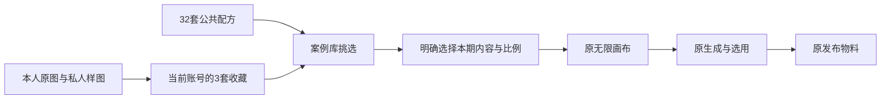

# 模板样图与配方

原案例库扩充到32套公共配方：17套封面、15套小红书图文，覆盖原13种可选行业标签。26张不同公共预览均有实际PNG文件。用户从案例库挑选后，继续沿原系统新建/追加无限画布、生成、选用与发布物料流程。

本轮实际生成11张样图：3张本人真人封面、2张公共人物构图示意、3张产品摄影构图示意、3张小红书首图。公共人物是虚构示意；产品图标明AI示意，不冒称实际摄影、测试结果或真实供应商输出。小红书每套配方包含首图与两张独立正文职责，本轮预览只展示首图，正文图片需按本期内容生成。

本人原图及3张私人样图存入当前**隔离预览账号**的原素材库，并经原收藏服务保存3套真人模板。生成身份使用本人原图，构图参考使用独立样图。私人PNG、完整prompt、实际原图路径及导入回执留在Git忽略的`.data/t1025-private/`与`.data/t1025-generation-inputs.json`，不进入公共模板包。本轮没有更新安装版或公开发布。

GitHub采用[Lieflat HTML Design](https://github.com/larashero3-dotcom/lieflat-html-design)的MIT许可资源，固定提交`313369de067d27372ddfdb4407e92051d22196ad`。精选6张完整首图：杂志留白、纸感手账、深蓝报告、日光编辑、银色科技、点阵浅色，每种分别提供封面/图文配方（12套配方共用6张预览）。未执行第三方脚本，没有引入另一套编辑器。其他无明确许可或需额外许可安排的资源没有复制。

逐图工具、prompt、来源地址及SHA256见[sources.json](sources.json)，公共运行包同步保存`T1025-SOURCES.json`、完整MIT许可与资产说明。GitHub首图中的示例文章、数字及命题只展示构图，模板prompt要求使用本期确认稿，不沿用示例事实。

私人预览在临近视口时才读取原素材下载端口；显示前校验收藏时的SHA256，仅显示相同字节的本地Blob。素材版本不一致、跨域存储未开放CORS或读取失败时显示占位，仍可继续编辑和使用模板。普通画布图片保留原签名URL展示路径。

