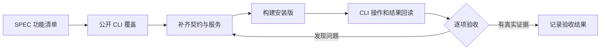

# T-1026 新增 Agent 功能的 CLI 覆盖与安装版验收

## 用户要求与范围

2026-09-21 用户明确要求验收所有新增功能；CLI 未覆盖的新增能力必须补齐，再通过公开 CLI 验证。延续 T-1003 的 AC-AW-01–09、T-1009 产物版本、T-1022–1024 非阻断恢复范围，不把单个任务成功当作全部功能通过。用户授权实现、测试、创建独立验收数据与本机覆盖安装。

## 契约原则

公开 CLI operation 复用 contract、统一鉴权/账号归属、幂等与 backend service，不直接读取数据库或私有连接文件作为验收。执行任务与 AI 业务任务明确区分。新增功能包括计划与账本、文件和命令、浏览器、Skill 目录、产物列表/历史/读回/预览/导出/对账和任务恢复。操作仅暴露产品真实支持的能力；没有实现的能力不能放假接口。任务执行仍通过现有 Agent loop，禁止新建通用接口绕过租约。

## 验收方法

1. 对照 SPEC、代码和安装版动态 operations 建立逐项覆盖矩阵，记录操作、前置条件、请求/任务 ID、结果和限制。
2. 为缺口补正式 operation 及契约/归属/错误回归，页面与 CLI 共用 service。
3. 用安装版公开 CLI 创建验收会话，验证连续计划、数据读取、浏览器、文件/命令、真实产物与同会话修改；回读真实版本、hash 和状态。
4. 验证取消、重启、原任务恢复、冲突、账号隔离、缺模型与暂时失败。故障夹具和安装实测分别记录。
5. 原采集、创作、页面性能和双平台安装范围按 T-1003 的验收项保留；无可用环境标记未验收，禁止以单元测试冒充双端实测。

## 完成条件

所有新增功能均有 CLI 入口或可核验的任务/产物投影，覆盖矩阵没有隐去缺口。所需自动化、类型、边界与教训门卫执行；真实 CLI 结果和仍未验证的平台明确列出。历史回执漂移沿 T-1025 记录，不伪造历史 PASS。

## 实现审查发现

- 独立审查确认 `plan.save` 内根数据库/Blob 读回造成 PGlite 自锁，按锁外核验、锁内身份/CAS复核修复。
- 公开产物读接口去除隐式迁移副作用，对账按原操作幂等且仅唤醒目标任务。
- 全功能回归暴露旧网页恢复测试未带当前冻结运行时版本；核对后更新夹具，保留原恢复与归属断言。扩展测试写域至 `ai-worker/src/execution/*.test.ts`，不借测试更改生产行为。

## 安装实测第二轮修复（2026-09-21）

安装候选235888df的真实任务 `execution-task-2082997a-82` 在第一次计划参数纠错后，下一工具进入unknown_result，计划尚未保存。公开events端点用展示层状态枚举解析真实runtime状态，导致读取400。扩展计划host校验与恢复的实现/集成测试写域；计划可预见校验失败必须明确无写入并交回loop，保存前后崩溃按原键幂等恢复。公开账本增加有界工具名/参数投影，以免未知调用缺少诊断证据；不返回模型凭据或完整请求上下文。

同一轮安装实测还确认长回执分页提示误传 execution callId，而 reader 按 provider toolCallId 查找。修复仅纠正模型分页提示的身份；计划 operationRef 与截图解析仍保留 execution ID。通过真实 Worker/Pi 投影到 backend reader 的回归验证，并拒绝跨任务回读。原报告修复任务末次普通异常仍待新版公开账本提供 finishReason/工具提案后复现，禁止凭总 token 数或耗时猜测。

## 第二轮安装实测追加修复

候选 a9e27bcb 安装后，原卡住任务沿同一 ID 自动进入 attempt=2，72条回执最终结束。浏览器纠错导航/提取/截图/关闭、文件写读及 Node 精确核对已实测，但计划仍为空、3份产物登记失败，因此本任务不视作整体验收通过。模型自拟新 artifactId 的确定性身份错误被误标为 transient/retry；计划错误要求读当前版本却不提供可用读回；文件根目录 `files.list(path=".")` 不兼容常见规范。修正错误类型和具体可执行反馈，并只将 list 的点路径规范为省略路径，不放宽写入或越界权限。

原报告修复末次公开账本已确认 finishReason=length，工具提案为 files_write，仅带 path、缺 content。针对该同形回执建立真实 Worker/持久账本回放红测后修复；保留已结算费用，不重放已发生工具副作用。扩展写域至 chat-pi-loop、durable-stream-model 与对应集成测试，范围仍为原非阻断生成与新增能力验收。

追加边界实测还发现跨回合新 read/stat 返回写入前旧回执，扩展修复至 chat tool 复用边界：同一 callId 的历史重放保留，新读取不能永久复用任务早期观察；命令状态、浏览器观察同样必须检查可变性。另有真实同会话 artifact.copy 与 v2 登记失败，验收范围包含完整版本修改公共链路，不能仅验证初次登记。

浏览器实际双任务均能独立打开、导航、observe，但合法 scroll 与 click 在派发后进入 unknown。新增原生 Rust/真实 Chromium Act 复现与修复写域；保持域/身份/外部提交边界，不能为了通过验收把已派发的不确定外部动作伪报未执行。确定缺参数的 action 在派发前返回具体修复指导。Workbench 错误契约添加可选有界 recovery，未知动作仍固定要求沿原操作核对，不被可选文案覆盖。

独立安全复核确认原生匿名Act故障来自继承crawl用途限制。任务专属anonymous Hub的可信装配仅启用公开声明的七类交互；默认采集与replica保持只读，禁止序列化开启和Act伪装Debug。DEC-T1026-ANONYMOUS-ACT记录范围。旧评论采集回归的矛盾完成文案与诊断缺口单独登记T-1027并行修复，T1026继续保留该失败实测。

第三候选048fd032已安装。实际原任务续跑揭示 execution.run 在脚本改变后仍跨 operation 复用旧进程回执；扩展到 workbench capability host 的可信复用策略及正式host/ledger集成测试，保留同operation回放与未知调用阻断。公开pause已生效但撞上files.edit产生unknown，必须核对原生文件写回执并沿原operation恢复，不能重复写入或抹去未知事实。浏览器各动作已实际成功，但两任务时间窗口不重叠，暂不认作并发通过。

## 第四轮：任务文件写入中断对账

实际pause撞上files.edit后原调用114为unknown。现有原生文件工具只有版本CAS，没有原operationId持久写入回执，无法自动证明是否完成。补任务归属下、原operationId与请求摘要绑定的持久写入记录及只读查询，允许宿主锁外查询、backend锁内核对冻结工具/模型提案/callDigest/claim/租约后结算原调用。派发前、实际写入后、记录落盘前后、回执丢失、重启、相同键不同参数、暂停不唤醒、未知外部动作不恢复均须覆盖。禁止为对账重新调用write。

新记录不能伪造旧版历史回执。旧任务仅在严格只读证据能证明请求目标状态、且原执行已停止时，考虑用明确标注的 `verified_current_state` 观察证据恢复；不得声称历史journal存在。需独立评审确认可行边界，证据不满足保留unknown。禁止仅凭路径、文本相似度或不可信Worker报告解除阻断。保留同任务、原账本及费用，不新建任务掩盖原失败。

实际CLI浏览器串行对应生产dispatcher空队列启动的单槽退出窗口，已由正式service红测复现。使用共享全局空闲退出决定，保持原配置2槽；测试覆盖空队列后长A运行时新B准入、C排队、取消补位和stop收口，不提高并发上限。

文件协议A细案独审有条件通过（详见docs/verification/t1026-file-recovery-protocol.md）：CAS/path/digest校验先于prepared；expectedVersion省略保持null，observedBaseVersion独立；prepared不重放、不凭相同内容提升committed；query只读。扩command.rs/command_windows.rs用于可信scope停写证明。协议B继续待物理quiescence评审，不能以paused、空进程表或computed version证明原提交；通过后观察结果必须保留不可变原unknown快照并显式historicalCommit=unproven。此为落实既有用户修复授权的实现选择，没有新用户确认消息，不得伪造历史确认。

协议A公开入口独审通过：`workbench.files.reconcile` 使用当前账号ctx、taskId及原operationId，按CLI write/apply与gateway幂等执行；服务由冻结模型提案与原账本派生请求身份，锁外读取可信Native journal、锁内复核CAS，仅committed能结算原调用，暂停保持暂停。重复对账回读持久结果，保留旧unknown快照和费用。原99存在旧命令派发历史，现有事实不足以证明所有后代停止，协议B不能用于它；当前候选不引入OS重启状态机，不自动重启用户机器。旧任务维持原记录和暂停，不能用推断伪造恢复成功。

沿现有 recoveryWake 的单在途 lane 自动扫描有界候选；真实 committed 回执结算后仅对该 task 运行既有恢复路径，unknown_result 可自动回原队列，paused 保持暂停。停止期间的Native晚返回不得继续结算或唤醒。没有journal、prepared、外部未知动作不被这条恢复路径视为成功。

第三候选同会话补交付任务190又实测到命令协议纠错缺信息：模型反复使用绝对cwd和重复解释器argv，只收到泛化invalid_input。增加明确协议说明与无副作用参数修复建议，但不改冻结catalog、不自动改写argv或禁止名为node的合法脚本；新成功运行也说明实际operationId和参数含义。任务已由公开CLI暂停，等修复版沿原ID继续。

第四候选860edd61实际发现：两浏览器lane确实重叠并导航成功，但长页browser.observe成为unknown；任务190在暂停模型调用后resume仍因model unknown阻断。继续在本范围修复：仅精确四类纯观察observe/extract/status/screenshot的读取失败可以诚实结算为读取失败并由loop重新观察，保留派发事实；navigate即使目录标read也不得借此放宽，act/open/close同样保持原未知边界。严格冻结身份下的旧纯观察unknown可保留原快照并收口为错误，不伪造成功；过大结果的转换错误也需处理。该细案已由Kuhn独审通过，先红后绿。暂停模型恢复复用已有无外部副作用模型规则，不伪造用量。原99文件对账实际为身份409、Native尚未查询，增加固定reason诊断而不放宽身份条件。

真实CfT复现RFC9110有9450个引用，超过2048上限后整代引用被清空并折叠成权限错误。扩展vendored engine.rs/backend/cdp.rs/injected.rs，以typed容量原因和有界完整行前缀降级，保留实际DOM引用、显式truncated、一次原子新generation，旧引用仍拒绝；不提高cap，不用字符串匹配错误消息，不伪造元素。实现前独审，真实长页及旧generation/有效action验证后才能验收。

正式host回归另外复现相同参数的新browser.act被旧成功回执吞掉；可信复用策略仅对browser.open/act/close关闭跨新operation复用，保留同call幂等和未知阻断。Kuhn独审与实派发计数回归通过，不修改目录或其他业务写入策略。

第五安装G重启后新open仍unknown且无具体阶段证据，增加既有公开events的固定阶段/错误诊断，不改未知结算。真实隔离子进程退出留下profile ownership后，旧lease Cleanup证明OS停止、attempt2 Open仍失败；扩vendor profile.rs精确profile恢复API及测试。只在原lease已有可信停止证明并再次核验owner/browser均Missing、树absent时清已过期的精确ownership marker；PID复用/活owner/损坏记录保持拒绝，不发信号、不扫描或删除profile数据，独审后实施。该隔离红测不直接等同安装G确诊。

原99第五CLI确定缺EXECUTION_CLAIM；对初版Native文件host以来历史核验claim先提交后派发，并严格绑定冻结files.edit定义/模型提案/输入摘要。方案独审允许新增派发前恢复：task锁内保存不可变旧unknown快照，再使原call可重新准入；公开readmitted不代表已写入（版本/hash/size为空），保持paused、不自动唤醒，其他pending/有claim/旧同参数候选均不解锁。与已派发的文件journal协议A分离，不实现B。

综合安装task256真实遭RedFox额度耗尽，错误已如实返回；模型错误将失败查询记成功并在plan.update循环。现有通用拒绝不指具体step，新增确定性诊断只指明本任务错误stepId、operationRef和回执状态及合法状态/重规划规则，保留成功判据、不自动改写计划、不替模型决定跳过。原任务已公开暂停，补回归后沿原ID继续，RedFox额度不足不伪造网络查询成功或擅自充值。

第六安装沿原task256推进至revision4并实际交付文件，但283调用后仍重复修改成功步骤。公开seq282将step6_node_assert的既有operationRef抄错，seq184修改已成功步骤标题、seq186使用未成功依赖；这些分支仍只有泛化冲突，没有具体定位。第七候选仅补确定性validationIssue（具体step、字段、旧引用与当前状态）及置于反馈首部的简短错误，保留成功步骤不可改、依赖与CAS规则。计划快照提供真实状态计数/pendingStepCount/allStepsTerminal，并说明无新增真实工作时可直接交付现有产物、如实解释失败步骤；不自动结算任务，不把计划全部终态等同用户目标完成。未核实产物或删除回执等未在本轮快照命中的分支只记回归覆盖，不冒称实机根因。实施须真实红绿回归与独立评审。

## 第七安装新增阻断与确定性产物复制缺口

原综合task256恢复到attempt3后，没有新模型调用，最终公开错误为`CHAT_MODEL_REQUEST_REPLAY_MISMATCH`；checkpoint282、原model283已superseded。必须沿原任务查明冻结请求与恢复重建的具体差异，取得回放复现后独审修复。不得以任意忽略digest、改写旧账本、复用不同请求键或解除未知工具阻断来洗绿。原计划纠错新反馈尚未实际送达下一模型，不能声称安装验收已通过。

同会话精确恢复已核验报告的子任务242两次模型superseded未写文件，主线公开取消；小块子任务261实际只写两个临时块、未合并/登记新产物，42calls以解释性回复结束。模型转写既有二进制编码既慢又易抄错，不能把它当确定性复制机制。现有`artifact.copy`仅PNG导致已登记HTML/Markdown/CSV/PDF没有同等受控路径。补齐既有copy能力：同会话、真实明确版本、宿主校验原Blob字节/hash，生成独立新artifact@1，保留全部原lineage与费用，不声称生成原artifact的v7或写入本地任务文件。PNG既有2MiB上限保留，其他已支持登记MIME沿20MiB；预览原4MiB界限不变。

HTML复制必须保留原字节和明确依赖闭包：宿主生成可选`htmlResourceBasePath`用于原相对引用解析，冻结`source.htmlResourceBasePath ?? source.relativePath`与原htmlResources精确tuple（artifactId/version/taskId/path/hash/size）。锁外验证所有源Blob，锁内复核归属与冻结身份后沿原调用/租约/幂等/原子结算保存；嵌套copy延续原基准。渲染仅按该冻结清单逐项读验，不按路径猜最新图片，不放宽为同账号任意图片，不增网络或脚本执行；旧无manifest产物保留原安全语义与诊断。新任务使用扩展工具定义，历史冻结目录及请求不改写。

这是用户“新增功能CLI缺口补齐并实测、生成失败继续修复”授权内对现有产物复制的补全，数据归属和执行租约边界不变；服务/工具契约新增字段记录DEC-T1026-EXACT-ARTIFACT-COPY，经Socrates独立方案审查有条件通过（须实现上述闭包约束）。真实红绿覆盖全部已支持MIME、HTML带图/换目录/嵌套复制、旧无manifest、跨会话/账号拒绝、源hash损坏、pending/崩溃对账、重放与不同参数冲突；最后通过公开CLI在新任务复制既有v5并导出四格式核验。

冻结请求漂移已取得真实Pi/durable/SDK脱敏内存复现：历史stop模型之后的宿主续行，当时计划为rev3；重启回放却读取当前rev4，新增步骤标题污染后续已结算模型请求。唯一差异定位在prompt中的宿主user续行；历史rev3回放可保持原指纹。公开接口未提供实际最早失败modelId，不能冒称已确定安装任务的具体首个失败call。修复选用内部`readWorkbenchPlan(modelCallId)`按同task真实已结算root model序列，从正式成功plan回执重建当时snapshot；历史缺失/错task/错kind必须明确拒绝，不回退当前状态。原摘要严格校验、历史文字、费用及283快照保留。扩大精确实现域至execution-worker内部契约、worker-runtime、chat-worker-run、execution域plan历史读取与model-worker-dispatcher及其回归；不得触碰其他子代理的copy契约和resolver。Socrates独审后才改实现。

第七实测恢复子任务242两次模型只有少量正文、无完整工具提案，公开证据无法区分网络与模型慢。代码审查另发现Pi provider桥只转换toolcall_end，start/delta被丢弃，而上层按SDK事件刷新180秒空闲计时。先用隔离真实Pi/SDK/durable/chat链与虚拟时间复现持续参数片段是否被误判空闲；若成立，仅恢复规范tool-input-start/delta/end活性，完整工具提案仍须完成、验证且结算后才派发，未完成参数不得混入正式回执或执行。不得增大超时、盲目重试或公开原始参数。精确域pi-provider.ts、已有HTTP测试与chat-tool-input-liveness.test.ts；Socrates细案独审通过后实施。该风险不能冒充242确诊。

活性方案独审另指出同一模型有多个工具时，durable-stream-model在首个完整tool-call后会缓存后续第二工具的参数片段。须在同一隔离SSE链补顺序双tool的真实红测；若证实，允许仅在既有defer段透传规范tool-input-start/delta/end作为进度，完整tool-call、approval与finish仍须真实模型回执结算后才能前送。不得透传未结算执行指令或放宽计时；断流/取消仍零执行。用“第一工具已完整、第二工具持续参数超过180秒、模型尚未finish”覆盖该输入族，最后两个工具各执行一次，账本和费用保持。Socrates独审后实施，不以首个工具绿冒充全覆盖。

第八候选全局LED054重跑暴露旧chat-worker-entry的unknown夹具仍以根model构造不可重放外部副作用。第五候选已允许暂停模型superseded，当前fixture在工具装配失败时failed；尚未进入worker历史计划读取，不能归因as-of或回退合法恢复。单项稳定复现后，仅扩该集成测试写域，经独审将unknown样例改为真实started tool并保留全部未知阻断断言；增加暂停model恢复对照，核验superseded、原费用/调用不变与装配失败无新模型/凭据请求。不修改生产行为、不skip或放宽unknown断言，旧失败日志保留。
