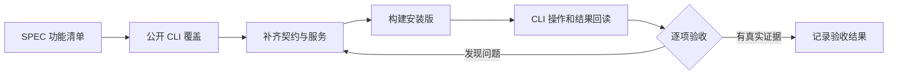

# T-1026 新增 Agent 功能的 CLI 覆盖与安装版验收

## 用户要求与范围

2026-09-21 用户明确要求验收所有新增功能；CLI 未覆盖的新增能力必须补齐，再通过公开 CLI 验证。延续 T-1003 的 AC-AW-01–09、T-1009 产物版本、T-1022–1024 非阻断恢复范围，不把单个任务成功当作全部功能通过。用户授权实现、测试、创建独立验收数据与本机覆盖安装。

## 契约原则

公开 CLI operation 复用 contract、统一鉴权/账号归属、幂等与 backend service，不直接读取数据库或私有连接文件作为验收。执行任务与 AI 业务任务明确区分。新增功能包括计划与账本、文件和命令、浏览器、Skill 目录、产物列表/历史/读回/预览/导出/对账和任务恢复。操作仅暴露产品真实支持的能力；没有实现的能力不能放假接口。任务执行仍通过现有 Agent loop，禁止新建通用接口绕过租约。

## 验收方法

1. 对照 SPEC、代码和安装版动态 operations 建立逐项覆盖矩阵，记录操作、前置条件、请求/任务 ID、结果和限制。
2. 为缺口补正式 operation 及契约/归属/错误回归，页面与 CLI 共用 service。
3. 用安装版公开 CLI 创建验收会话，验证连续计划、数据读取、浏览器、文件/命令、真实产物与同会话修改；回读真实版本、hash 和状态。
4. 验证取消、重启、原任务恢复、冲突、账号隔离、缺模型与暂时失败。故障夹具和安装实测分别记录。
5. 原采集、创作、页面性能和双平台安装范围按 T-1003 的验收项保留；无可用环境标记未验收，禁止以单元测试冒充双端实测。

## 完成条件

所有新增功能均有 CLI 入口或可核验的任务/产物投影，覆盖矩阵没有隐去缺口。所需自动化、类型、边界与教训门卫执行；真实 CLI 结果和仍未验证的平台明确列出。历史回执漂移沿 T-1025 记录，不伪造历史 PASS。

## 实现审查发现

- 独立审查确认 `plan.save` 内根数据库/Blob 读回造成 PGlite 自锁，按锁外核验、锁内身份/CAS复核修复。
- 公开产物读接口去除隐式迁移副作用，对账按原操作幂等且仅唤醒目标任务。
- 全功能回归暴露旧网页恢复测试未带当前冻结运行时版本；核对后更新夹具，保留原恢复与归属断言。扩展测试写域至 `ai-worker/src/execution/*.test.ts`，不借测试更改生产行为。

## 安装实测第二轮修复（2026-09-21）

安装候选235888df的真实任务 `execution-task-2082997a-82` 在第一次计划参数纠错后，下一工具进入unknown_result，计划尚未保存。公开events端点用展示层状态枚举解析真实runtime状态，导致读取400。扩展计划host校验与恢复的实现/集成测试写域；计划可预见校验失败必须明确无写入并交回loop，保存前后崩溃按原键幂等恢复。公开账本增加有界工具名/参数投影，以免未知调用缺少诊断证据；不返回模型凭据或完整请求上下文。

同一轮安装实测还确认长回执分页提示误传 execution callId，而 reader 按 provider toolCallId 查找。修复仅纠正模型分页提示的身份；计划 operationRef 与截图解析仍保留 execution ID。通过真实 Worker/Pi 投影到 backend reader 的回归验证，并拒绝跨任务回读。原报告修复任务末次普通异常仍待新版公开账本提供 finishReason/工具提案后复现，禁止凭总 token 数或耗时猜测。

## 第二轮安装实测追加修复

候选 a9e27bcb 安装后，原卡住任务沿同一 ID 自动进入 attempt=2，72条回执最终结束。浏览器纠错导航/提取/截图/关闭、文件写读及 Node 精确核对已实测，但计划仍为空、3份产物登记失败，因此本任务不视作整体验收通过。模型自拟新 artifactId 的确定性身份错误被误标为 transient/retry；计划错误要求读当前版本却不提供可用读回；文件根目录 `files.list(path=".")` 不兼容常见规范。修正错误类型和具体可执行反馈，并只将 list 的点路径规范为省略路径，不放宽写入或越界权限。

原报告修复末次公开账本已确认 finishReason=length，工具提案为 files_write，仅带 path、缺 content。针对该同形回执建立真实 Worker/持久账本回放红测后修复；保留已结算费用，不重放已发生工具副作用。扩展写域至 chat-pi-loop、durable-stream-model 与对应集成测试，范围仍为原非阻断生成与新增能力验收。

追加边界实测还发现跨回合新 read/stat 返回写入前旧回执，扩展修复至 chat tool 复用边界：同一 callId 的历史重放保留，新读取不能永久复用任务早期观察；命令状态、浏览器观察同样必须检查可变性。另有真实同会话 artifact.copy 与 v2 登记失败，验收范围包含完整版本修改公共链路，不能仅验证初次登记。

浏览器实际双任务均能独立打开、导航、observe，但合法 scroll 与 click 在派发后进入 unknown。新增原生 Rust/真实 Chromium Act 复现与修复写域；保持域/身份/外部提交边界，不能为了通过验收把已派发的不确定外部动作伪报未执行。确定缺参数的 action 在派发前返回具体修复指导。Workbench 错误契约添加可选有界 recovery，未知动作仍固定要求沿原操作核对，不被可选文案覆盖。

独立安全复核确认原生匿名Act故障来自继承crawl用途限制。任务专属anonymous Hub的可信装配仅启用公开声明的七类交互；默认采集与replica保持只读，禁止序列化开启和Act伪装Debug。DEC-T1026-ANONYMOUS-ACT记录范围。旧评论采集回归的矛盾完成文案与诊断缺口单独登记T-1027并行修复，T1026继续保留该失败实测。
