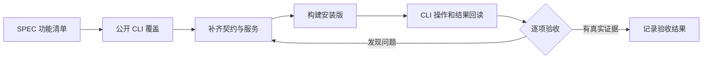

# T-1026 新增 Agent 功能的 CLI 覆盖与安装版验收

## 用户要求与范围

2026-09-21 用户明确要求验收所有新增功能；CLI 未覆盖的新增能力必须补齐，再通过公开 CLI 验证。延续 T-1003 的 AC-AW-01–09、T-1009 产物版本、T-1022–1024 非阻断恢复范围，不把单个任务成功当作全部功能通过。用户授权实现、测试、创建独立验收数据与本机覆盖安装。

## 契约原则

公开 CLI operation 复用 contract、统一鉴权/账号归属、幂等与 backend service，不直接读取数据库或私有连接文件作为验收。执行任务与 AI 业务任务明确区分。新增功能包括计划与账本、文件和命令、浏览器、Skill 目录、产物列表/历史/读回/预览/导出/对账和任务恢复。操作仅暴露产品真实支持的能力；没有实现的能力不能放假接口。任务执行仍通过现有 Agent loop，禁止新建通用接口绕过租约。

## 验收方法

1. 对照 SPEC、代码和安装版动态 operations 建立逐项覆盖矩阵，记录操作、前置条件、请求/任务 ID、结果和限制。
2. 为缺口补正式 operation 及契约/归属/错误回归，页面与 CLI 共用 service。
3. 用安装版公开 CLI 创建验收会话，验证连续计划、数据读取、浏览器、文件/命令、真实产物与同会话修改；回读真实版本、hash 和状态。
4. 验证取消、重启、原任务恢复、冲突、账号隔离、缺模型与暂时失败。故障夹具和安装实测分别记录。
5. 原采集、创作、页面性能和双平台安装范围按 T-1003 的验收项保留；无可用环境标记未验收，禁止以单元测试冒充双端实测。

## 完成条件

所有新增功能均有 CLI 入口或可核验的任务/产物投影，覆盖矩阵没有隐去缺口。所需自动化、类型、边界与教训门卫执行；真实 CLI 结果和仍未验证的平台明确列出。历史回执漂移沿 T-1025 记录，不伪造历史 PASS。

## 实现审查发现

- 独立审查确认 `plan.save` 内根数据库/Blob 读回造成 PGlite 自锁，按锁外核验、锁内身份/CAS复核修复。
- 公开产物读接口去除隐式迁移副作用，对账按原操作幂等且仅唤醒目标任务。
- 全功能回归暴露旧网页恢复测试未带当前冻结运行时版本；核对后更新夹具，保留原恢复与归属断言。扩展测试写域至 `ai-worker/src/execution/*.test.ts`，不借测试更改生产行为。
