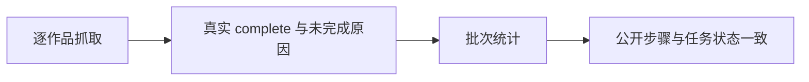
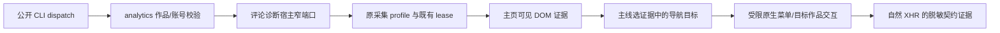

# T-1027 修复评论采集完成统计与失败诊断

## 需求与证据

T-1026 安装版公开 CLI 回归中，评论 run-d1d19487-3e48-453f-9eb0-f0bb602b1cf8 最终 failed，却提示“全量完成:已采9/9个作品”。公开 steps 显示四轮分别处理20/20、20/20、20/20、9/9，均新增0；缺逐作品未完成原因，不能声称真实采集成功。

## 范围与边界

保留原作品及评论，不把零新增推断为空评论或成功。统计必须区分已处理、确认完成和未完成；批次未完整时不得显示“全量完成”。沿现有采集结果与公开 AI steps 暴露有界、不含 Cookie/原始响应的抓取诊断（有效响应、解析、未完成原因）。保留既有身份与浏览器资源管理，不更换采集架构，不用重跑新任务掩盖原失败。



## 验收

先复现 incomplete 被显示全量完成的红测；覆盖完整空结果、部分未完成、截断、重试批次与 runner 失败包装。若诊断明确底层故障，在原采集链修复并复测；不能凭修正提示宣称采集通过。安装后用公开 CLI 回读原证据，再运行授权的采集回归核验新结果。

## 公开失败重试入口

第三候选真实runNow因62项历史失败处于backoff而没有due作品，works=[]。用户已明确要求“CLI里面没有的话增加进去”。新增 `analytics.comments.failures.list` 当前账号分页失败清单，及 `analytics.comments.retry` 基于有界真实publicationId和读取基线提前重试时间。严格校验当前账号/作品归属/状态基线；保留失败次数、失败记录、成功水位、评论和原任务，不删除历史。再复用scheduledJobs.runNow，不创建通用数据库改写入口。

仍遵守平台通道冷却与并发限制；提前作品重试时间不得解除平台限流。服务幂等与正式CLI写入确认政策保持。已到期失败重试应优先于更早成功水位，避免重试永远不due。无需数据库schema变更。验收跨账号拒绝、过期基线、重复请求幂等、失败历史保留及实际进入抓取；先独立契约评审后实现。

第四安装实际选中2项，54.124秒后两项均no_matching_response；公开证据只能证明监听窗口内无匹配评论响应，不能证明无评论、登录有效或限流。补最小被动页面证据：最终固定路由类别、导航HTTP状态、readyState/pageClosed/观察是否成功、滚动尝试与错误计数、观察到的响应总数和固定类别。无可靠组件依据的登录/验证码标记为unknown/null，Cookie存在明确只表示cookie_present_only。禁止公开URL query、Cookie、正文、用户资料或原始异常；不因诊断改变成功判据/平台冷却，不加盲重试或重导航。主线已独立审核该可观察事实方案，先红后绿，再经同一公开CLI对更少选中项复验。

### CLI 精确设计（Kuhn 独立评审通过，按评审约束实现）

#### 失败清单

`analytics.comments.failures.list`，`GET /analytics/comments/failures`；只读、无确认、非异步。

请求 query 为既有 `page/pageSize`（默认 1/20，pageSize 最大 100）。身份只来自可信 ctx 的 userId/accountId，缺账号拒绝，不接受请求体覆盖账号。仅列当前账号、当前仍可采集的抖音已发布作品、comments capability、仍有失败的同步状态；状态 externalId 必须与真实 publication.externalId 相同。按 publicationId 稳定排序，沿既有 list envelope 返回分页 total。

单项严格字段：

```typescript
{
  publicationId: string;
  externalId: string;
  attemptedAt: string;            // ISO UTC
  retryAt: string | null;
  lastSucceededAt: string | null;
  failures: number;               // 正整数
  failureVersion: string;         // sha256:<64位hex>
}
```

failureVersion 是服务端对 user/account/publication/externalId/capability/attemptedAt/retryAt/failures/lastSucceededAt/error 的固定顺序快照哈希，不暴露 error 文本。**包含 retryAt**，以及 error 的哈希摘要。任何相关状态变化都会使原失败基线过期；CLI 相同 key/输入的重放在业务基线检查之前从正式 gateway 返回原 receipt，不重新执行。

#### 请求作品重试

`analytics.comments.retry`，`POST /analytics/comments/retry`；effect=write，confirmation=apply，asyncTask=false，idempotency=gateway。

```typescript
// body：严格对象，1–100 项，publicationId 不重复
{ items: Array<{ publicationId: string; failureVersion: string }> }
// response：严格对象，只表示作品重试时间调整
{ items: Array<{ publicationId: string; failureVersion: string; retryAt: string }>; updated: number }
```

每项须通过当前账号真实作品可采集校验、现存 comments 失败状态、失败基线一致校验。整批先验证，再在事务中按快照条件更新；任何一项越权/基线冲突整批不修改。越权沿现有 OwnershipError（404），失败已恢复/基线变化沿 ConflictError（409）。不提供 force、任意 capability、客户端 retryAt、清错误/失败次数/成功水位或 resetGateway 参数。

唯一修改字段是作品 sync.retryAt：设为原时间与服务端 now 的较早者（缺失则 now）；重复请求不往后推。保留 error、failures、attemptedAt、lastSucceededAt、评论、原 jobRun/aiTask/steps。gateway 相同幂等键与相同输入回放；换幂等键带旧基线会冲突，不能绕过已变更状态。更新不能调用平台 gateway reset，也不直接启动浏览器或抓取。

`isSyncDue` 对合法 retryAt 的判定先于成功水位：未来 retryAt 仍阻止；到期 retryAt 允许失败重试。成功 settle 本来就清空 retryAt，因此原成功采集间隔仍按 lastSucceededAt 生效。

#### 少量作品真实验证的显式运行范围（已授权并经 Kuhn 独立评审）

仅调整 1–2 项 retryAt 后调用现有无筛选 runNow，其他作品可能自然到期，**不能保证少量抓取**。`scheduledJobs.runNow.body` 增加可选 `publicationIds`（1–20，不重复），仅 comments 作业接受。调用前校验真实归属，将选择写入本次 AI task 的 target.publicationIds；不修改持久 scheduledJob.target 或 cron 配置。

collector 对显式选择只处理选中作品，所有后续重试沿原 task target 保留选择。选中作品的完成状态仅由选中范围判断；账户其余失败数仍可作旁证，但不能把成功的少量验证判为失败。公开诊断须分别标明 selected_publications 与 account.comments 的失败计数，不能将账户失败数称为选中任务 pending 数。

已有运行幂等必须保留：若同 job 已有不同选择/全量的进行中任务，不新开并行抓取、不把它当本次少量验证；返回明确冲突并指向已有任务，等待完成后再发起。相同选择可沿既有 dedupe 回读原任务。校验分两层：result.deduped 后核对持久任务；createTask 即使返回旧任务但外层未标 deduped，也在 ensureRun/dispatch 之前核对其持久 target，不用请求 target 覆盖旧任务。平台 gateway 冷却、同账号串行、登录身份与浏览器资源约束全程沿用。

主线已登记该运行范围的新增写域：`contract/src/operations/scheduling.ts`、`contract/tests/modules/scheduling.test.ts`、`backend/src/application/scheduling/controls.ts`、`backend/src/application/scheduling/controls.test.ts`。已实施；comments collector 与诊断类型沿既有写域修改。

#### 先红后绿与独立评审

先新增 contract 测试，取得真实红测后按独立评审开始实现。`/tmp/t1027-verification/cli-retry-contract-red.log`：4 failed / 9 passed，缺失两个正式 operation 与 CLI policy 为实际红因。覆盖清单字段/分页、1–100唯一ID+基线、拒绝跨账号覆盖/时间/平台重置参数、重试回执不冒充抓取成功、正式 CLI policy。

Kuhn 独立方案评审已通过。服务/公共链路测试覆盖：跨账号拒绝、externalId 改变、过期失败基线、整批原子拒绝、gateway与服务重复幂等、并发 settle 与 retry 冲突、历史与成功水位保留、平台冷却不解除、最近成功但失败重试到期、少量选择不扩大到其他 due 作品、选择范围在后续批次保留。安装后由主线经公开 CLI 选择最少少量真实失败 ID，读取原 run 与新抓取证据，不操作私有数据库。

### 最终实现交接：代码冻结

comments failures.list/retry 与 selected runNow 已完成，Kuhn 最终实现独审通过，无阻断发现。后端定向 47/47、全 contract 254/254、前端定向 152/152；红绿原始日志、命令和限制见 `docs/verification/t1027-comment-collection-evidence.md`。本项代码已冻结。主线统一类型检查并负责第四候选安装后公开 CLI 少量选集实测；未将隔离测试当成真实网站采集通过，也未将任务状态标成验收完成。

第五安装真实单项出现页面200/readycomplete、244响应但评论匹配0，同时外层错误把诊断navigationStatus误当加载超时。扩展scheduled-collection-runner.ts及其测试：使用明确本地未完成错误类型保留诊断，不以序列化诊断里的词匹配网络故障；真实网络错误规则保持。沿原response监听增加有界脱敏路由分布以诊断接口族，不增加平台请求，不输出query、动态身份或正文，独审后红测实现。

第六安装仍no_matching_response，路由分布不足以确定页面状态。新增最小同源被动UI证据，Wegener前置独审有条件通过，主线接受其全部边界：仅该reason且原监听已off、完成事实冻结后，扩既有同一次readyState evaluate；精确origin=https://creator.douyin.com，否则not_applicable不出文本。只采可见heading/tab/button/alert/status/dialog短文本与aria-selected，dialog仅可见标题，不取整段正文，不加main/div/p全文fallback、不读表单value/cookie/storage/URL属性。排除input/textarea/select/option/editable、脚本/iframe/shadow、ul/ol/li/table/article及list/feed/grid等正文子树与祖先。全局DOM访问≤2000次/50ms软预算，祖先≤32，复用1s超时，24节点/每类4/每项120Unicode字符，总JSON≤12KiB；覆盖与截断明确，backend再白名单校验。角色缺失或零节点不证明无评论/登录/验证码。
这是用户已授权排障范围内的页面标题和角色UI短文本例外，可能含页面标题或账号显示名，不能声称绝无个人信息；不包含完整评论正文、凭据或表单value，统一遮蔽URL/query文字片段。登录/验证码仍null，由Agent结合实际UI证据理解，不用写死词表做语义判断。真实隔离Chromium跑生产evaluator验证有用状态/横幅/对话框与隐私边界、超时/巨文本/外域；真实fetchComments夹具验证没有新增evaluate或平台动作，完成判据不变。独审后红测实现，安装最多单项再次核真。


## 第七安装后的同身份受控CLI诊断（2026-09-22）

用户已授权CLI缺口补齐及问题修复。Socrates实际独审已通过以下方案，主线采用；这是本任务的SPEC补充，不另建替代计划。只在当前已授权账号的单个真实作品范围内操作，诊断不等于采集完成。实现须先真实红绿，具体限制作为验收条件；没有新的用户确认消息。

### 1. 要回答的问题

用一次、一个真实 publication 的受控流程，区分：

1. 直接进入旧深链接只加载创作者外壳，真实菜单才能进入评论子页面；
2. 已进入评论页面，但自然响应 endpoint 或载荷契约改变；
3. 页面没有选中目标作品，得到全局评论或别的作品。

现有证据不能在三者中选结论：matchedResponses=0 在 JSON/归属判断之前；expected_comment 只核 pathname；4 buttons 是采样上限，mainSeen=false 不证明没有评论页面。959dd9fe/7ac2135e 有历史菜单→interactive/comment 记录与截图，但 T065 后证实 item_id 过滤曾失效。现有 fake goto 注入旧 XHR 的测试不能证明今天真实页面契约。

### 2. 装配选择

| 方案 | 实际新增影响 | 结论 |
| --- | --- | --- |
| scheduledJobs.runNow 增 diagnostic | 不只是加 body 字段：必须冻结 task target/mode，处理进行中选择冲突、run 去重、恢复与任务完成语义，并阻止原 collector 的 ingestion/sync.settle/watermark/失败历史写入。现有 controls/runner/flywheel 都受影响。 | 不选。诊断不是一次正常评论采集。 |
| 新增 analytics.comments.diagnose | 一个正式 dispatch operation、analytics 薄 service/transport、一个宿主窄端口和固定诊断流程；复用账号/作品归属、采集 profile/lease、既有限流。原 runNow 不变。 | 推荐。多一个公开契约，但生产装配影响更小。 |

不建通用 browser/script/CDP API，不让客户端提供 URL、CSS/XPath、JavaScript、凭据、authDir、profileKey 或任意输入文本。不接 primary，不复制登录态，不调用登录入口，不触发 acceptance 网络探针。



### 3. 一个 operation，固定领域阶段；不接受通用动作

固定 POST /analytics/comments/diagnose，输入 `body` 为 strict discriminated union：

- start：`{action:'start',publicationId}`。
- advance：`{action:'advance',diagnosisId,expectedRevision,observationId,intent,targetRef}`；intent 仅 `expand_navigation | enter_comments | open_work_picker | select_target`。
- observe：`{action:'observe',diagnosisId,expectedRevision}`，纯重读现有 Page，不导航、不滚动、不延长网络观察窗口。
- close：`{action:'close',diagnosisId}`，只关闭此诊断持有的页面/context 并沿现有机制释放。

accountId 只来自已认证 ctx/CLI --account；publicationId 只能一个，由服务查询真实作品后冻结 externalId、所属账号。start/advance 重新验证账号、publication 及 externalId 未变化。observe 只返回原session范围内脱敏证据，作品已变化时禁止再发动作token。close 只核对原session的 userId/accountId ownership，不要求作品仍存在/published/externalId相同；作品删改后仍能清理，TTL/dispose同理。

CLI 继续使用已核对的通用 call，不新增手写 operation 列表或专用子命令。新 operation 明确进 policy：external、confirm_impact、同步有界结果、gateway idempotency。遵守当前 cli-policy/requireExecutionFlags，执行需 --apply、--idempotency-key 和 --confirm-impact；这是既有契约执行旗标，不要求用户再次授权方案。需要请求幂等键与诊断 revision 双重防重复。

```sh
# 仅拟议示例，未执行；operation尚未注册。后续advance同样使用正式dispatch和显式账号。
creatoros call analytics.comments.diagnose --account <accountId> \
  --input '{"body":{"action":"start","publicationId":"<publicationId>"}}' \
  --apply --idempotency-key <uniqueKey> --confirm-impact <publicationId>
```

公开网关若对 confirm-impact 资源引用有额外绑定，contract/service须把 diagnosisId解析回原 publication；不能靠字符串非空假验证。因policy按operation分类，observe/close也沿同一旗标；不为便利新增通用浏览器操作或绕过policy。

返回 envelope.data：`schemaVersion,diagnosisId,publicationId,revision,phase,status,dispatched,expiresAt,ui,networkEvidence,allowedNext,stopReason`；不用 succeeded 表示采集完成。status 为 `awaiting_selection | observed | unavailable | expired | closed | unknown` 等固定枚举，最终枚举由 contract 红测锁定。公开错误不透传浏览器原始异常。

### 4. 先看实际 DOM，后选择；不猜 selector

start 只在该账号原采集 profile 的独立受控 Page 上打开固定创作者主页，有限等待后停止本阶段网络窗口，返回实际可见 UI。绝不自动点击“评论管理”的猜测 selector。

UI 证据除已有 title/role 短文规则外，增加受限导航/作品选择候选：

- 真实 tag、显式 role、可见短文本、bounding box、disabled、是否在 form、button type、aria-expanded/controls 是否解析到同一导航区域、有限祖先 tag/role。
- 返回 opaque targetRef，服务端保留对应 ElementHandle；不公开 CSS 路径/ID/完整 HTML。
- 每个 observation 绑定 session/revision/generation；每次observe生成新的observationId/generation，并在session锁内原子替换全部token，即使revision没变也使旧ref失效。advance 前重新验证同 origin、同节点、可见/启用、祖先与候选属性摘要未变化。过期、detached、重渲染或结构变化 -> `observation_stale`，不寻找近似替代、不 nth 兜底。迟到XHR绑定原owned Page/request/stage generation，只进原阶段；冻结阶段后不回写新证据。
- 语义归主线/Agent：由可见证据确认哪个真实菜单是评论入口。宿主只落实固定 intent 和结构/权限边界，不用“评论”等关键词评分自动选择。
- 合法动作族只能是经前置审查确认的站内导航 link/导航展开控件，或已进入评论视图后的作品选择控件。表单提交、发布/回复/删除、外域链接、新窗口、下载、任意文本输入均不属于动作族。仅有 role=button 不足以发放可执行 ref；需带已验证导航结构来源。无法证实为导航时返回候选的观察证据，但不发 action token。
- 同源/非form本身也不能证明安全：nav里的logout/delete handler同样不可凭role放行。导航anchor须命中已审查route族，展开控件需可验证的aria-controls导航关系或已审查站点结构。自然导航可能触发平台已读标记等附带效果，不承诺绝对零平台副作用；明确不调用评论提交、设置或发布接口。
- work picker 的选择只能指向与冻结 externalId 精确关联的真实元素；不能按标题相似度或序号选作品，也不能直接假定 item_id query 生效。若没有可验证 ID 关联，返回 `target_identity_unverified`；先审实际 DOM 再补站点适配，不向不明按钮点击。

本轮不开放搜索框、任意输入、分页或无限展开。最多 2 次菜单展开、1 次进入评论页、1 次打开作品选择器、1 次精确选择目标；固定主页导航仅一次。如果直接由真实菜单链接进入目标作品，可省掉 picker。每次 advance 只执行一个已选动作。

可见页面证据以真实 DOM 节点结构/布局/短文为必需项，不把重绘示意图冒充截图。若 DOM 结构仍不足以验证控件语义，停在 awaiting_selection/unsupported_control，主线裁决是否加限定区域脱敏截图；本方案不默许全页截图泄露评论正文。能够确认控件的结构化可见 DOM 是本轮最小证据。

UI 数据上限：总 24 候选、导航/评论视图/目标 picker 分配预算，避免首页前4个按钮耗尽全部证据；每字段120 Unicode、祖先最多8层、总12KiB。DOM访问2000/50ms软预算/祖先32仍遵守；同源核验在 evaluate 内；表单值/editable/列表正文/dialog正文/iframe/shadow 等现有隐私排除保持。对列表型导航仅可以取被明确验证的导航控件自身标签，不能以“在nav里”为由放开整列表正文；这条需要独立红测和审查，不直接复用正文 textContent。显示名例外沿已授权 SPEC，不声称完全匿名。

### 5. 同 profile/lease 与生命周期

服务start/advance复用 trafficService.assertPublication（真实 owned、published、douyin、非hidden、有externalId）；close不受作品状态变化阻断。composition 使用既有 douyinAuthDirFor(ctx.accountId,signal,ctx.userId)，不得接受客户端目录，也不走 _default 兜底。

宿主复用 douyin-cdp 的 openContext 与 resolve/acquireHostBrowserProfile 链。诊断优先使用 **exclusive** checkout，避免与该账号正在采集的 Page 并改。借用超时只返回 busy，不抢占、不清 cookie、不释放活 lease。其他账号不被该诊断逻辑锁住。

诊断有短暂的进程内 session（必要性：主线必须先看当前真实节点，再在同 Page 上选目标），不新增 DB schema。绑定 userId/accountId/publicationId/externalId/host incarnation；每账号最多1个，固定总寿命5分钟、空闲90秒。超期走真实关闭；仅由已确认停止的既有回调释放 lease，不能以TTL本身解锁。

所有动作串行 CAS revision。平台动作前先记 `dispatching`，成功/失败/未知都占用此次 revision；同 idem/同 revision 重放已有结果，不重点击，different input冲突。动作发出后抛错保留 dispatched=true/unknown，只允许观察或关闭；不能按错误文案重试点击。app 重启旧 diagnosisId 变 expired，不重建/重演；profile orphan 恢复沿已有停止证明机制。

**跨重启start幂等已读代码确认，无需新增持久claim：** backend/src/modules/cli-invocations/cli-invocations.service.ts 的 begin 对非read先 insert onConflictDoNothing，再按 user/accountScope/operation/idempotencyKey查行；仅新insert行返回execute。同key不同inputHash→conflict；running→receipt（5min后outcome_unknown）；failed/unknown→receipt；succeeded→加密缓存或过期receipt，从不重新execute。frontend/src/app/api/v1/dispatch/route.ts在cached/receipt/conflict分支均于调用compositeTransport之前return。故正式CLI在start导航后进程崩溃、response未settle时，重用原key只能得到202运行收据或409未知，不能重新打开主页。新key是用户显式新动作；同进程仍受每账号1session闸约束。重启旧advance/observe的diagnosisId返回expired，不能重建会话。

以上承诺限定正式CLI网关路径；不把裸publicApi.request/直接host调用当成跨进程幂等证明。本轮不新增UI/其他绕过CLI幂等入口。隔离集成必须使用真正runCliCommand与正式dispatch+持久cliInvocations，覆盖claim已落但handler/settlement中断后，重建服务重放同key时host调用仍为0。现有幂等行和加密缓存就是允许复用的持久写通道，不改schema/网关生产语义。

deadline/断连在途取消必须传到底层并确认清理；dispose/close 失败保留占用及固定错误，不能报 closed。正常采集的 cron/target/failure/retryAt/水位/评论数据/费用都不由诊断修改；只允许既有公开请求审计/幂等与资源租约状态。

动作之前复用 creator-center gateway.acquire，不降低平台cooldown或账号准入；每动作仅一次入场，不对浏览器自然子请求加额外 fetch/探针，不持许可跨Agent思考。**不使用withDouyinChannel**：其成功分支会report('ok')清退避，诊断不能走该分支。这里只acquire+截止取消检查，观察/导航成功不report ok，也不把页面出现当成采集成功。仅有可靠协议事实（例如自然响应HTTP429）时按既有固定分类report throttled，不能从页面词语猜；其他诊断未知/DOM错误不改cooldown。既有acquire窄端口不支持signal时采用取消race且许可晚到后再次check abort，绝不执行平台动作；profile checkout排队本身必须传signal取消，不能遗留exclusive队列。遇现有cooldown返回等待事实并关闭或按明确截止收口，不自动延长会话。

### 6. 自然网络契约证据

仅监听本 Page 本阶段自然产生的 xhr/fetch，窗口在返回 observation 前冻结。不得 fetch/route重发、request API、page.request、acceptance探针或伪造查询。不拦截篡改请求，不读取 cookie/storage。

输出按 endpoint 聚合（最多16组）：host固定类别、method、静态pathTemplate、query键名（不含值）、status类别、contentType固定类别、response数量、是否命中旧matcher、请求作品标识 present/targetMatches(true/false/null)、结构证据。

静态路径不以“像英文字母”为静态证明：已有协议白名单/已有公开固定路由可原样；未知或可能动态段仍 :opaque，附 endpointRef 和 pathHash 仅用于本诊断关联，不能据此放宽生产matcher。若确认新评论载荷但路径仍opaque，下一步仅核验这个候选的公开固定route声明/经审查静态段，不能继续泛扫更多诊断。query键只输出固定协议白名单 item_id/aweme_id/cursor/offset/page/page_index/count/limit/sort，最多16个；未知键只计数，不能靠合法identifier正则放行。任何query值/URLfragment/userinfo不公开。

JSON 只检查明确同源 creator XHR/fetch 的有限候选（每阶段最多8个、总24个）；不读取/返回任意站点正文。只投影固定结构键 `data/comments/comment_list/list/items/cid/comment_id/aweme_id/item_id/status_code/has_more/cursor/next_cursor/total` 的类型，数组数量、目标身份匹配计数；未知键只记数，不透传动态键名。status_code/has_more仅输出固定协议判断或类型，不返回自由字符串。评论text/user/昵称/值一律不公开。预算、truncated、omittedResponses、bodyUnavailable原因必须明确；本方案不保证一次必区分全部三个根因，允许确定输出证据不足，不以未读到JSON推断没有评论。

候选body大小限128KiB、总1MiB、深度4、数组只检查前3条且明确sampled。Playwright body读取不能承诺流式硬内存上限：先用已收到的type/length元数据筛选；长度缺失/超限返回结构 unavailable，不能为了满足诊断再请求一次。若底层不能保证128KiB读限，必须在实现审查时明确采用保守不读，而不是先无限读取再截输出。结构不可用不表示没有评论。headers只可内部读取type/length筛选，绝不原样公开/持久化。

body字段以backend二次白名单投影；UI与network总输出≤48KiB。任何诊断成功都不是评论采集成功，绝不 settle success。

### 7. 实现边界（主线已登记）

- contract/src/operations/analytics.ts；contract/src/cli-policy.ts；contract/tests/modules/analytics.test.ts、cli-policy.test.ts、registry.test.ts。
- backend/src/modules/analytics/comment-diagnosis.service.ts（新）、对应.test.ts；analytics.transport.ts/对应测试；必要index导出。
- 不新增 application/collection 转发文件；analytics service持身份与窄端口，宿主单模块持session/DOM/纯投影。仅发现实质复用组合职责时再报告必要文件。
- frontend/src/server/ingestion/douyin-cdp-comment-diagnosis.ts（新）及对应测试；douyin-cdp.ts仅暴露同profile受控session factory，不改正常抓取算法/旧diag完成门。
- frontend/src/server/persistence-client.ts，仅analytics诊断端口装配、生命周期dispose。
- mcp-server/** 仅增加真实runCliCommand→隔离HTTP正式dispatch测试；动态describe与现policy复用，若无生产CLI缺口不改cli.ts。
- 不预计改ai-worker profile/lease生产代码；若真实端口缺取消/独占能力，先报告具体文件，不能另起私有浏览器通道绕过。

### 8. 红绿与验收门

1. 契约/CLI红：未知action/额外selector/js/url/header/authDir/第二publication拒绝；动态describe发现；effect/幂等/严格envelope。
2. service红：跨用户/账号/作品拒绝且host零调用，externalId变化拒绝；session归属/revision/过期；无collector/settle/runNow写；已有cooldown不绕过。
3. 真实隔离Chromium SPA（本机拦截，无平台）：主页真实菜单显出后才可选；deep-link仅外壳、原生menu触发XHR；界面重渲染后旧ref拒绝；未知控件/表单submit/外域/新窗口不得点击；只选当前publication；混合/全局响应不证明目标完成。
4. 真实host session/lease夹具：与正常采集同profile互斥、同账号busy、跨账号隔离、close/超时/崩溃不凭TTL释放；在途同revision与丢回执不重复动作，unknown保留dispatched。
5. 自然XHR夹具：旧endpoint/新endpoint结构/无尾斜线/非JSON/超大/无length/敏感动态键与query；证明零额外probe，输出二次白名单有界。
6. 真正runCliCommand经隔离HTTP正式dispatch连service+真实Chromium fixture（不是只mock transport），完成start→看DOM→advance→observe→close；证明诊断有用且未伪造评论采集成功。
7. 上述红绿与独审后，主线安装、同账号单publication执行一次受控流程；取得真实入口/候选接口事实才修改采集route/trigger/matcher。不得拿隔离SPA证明真实平台成功。

候选预算进一步固定：home优先导航16+当前展开区4+视图标题/状态4；展开后优先真实aria-controls目标区域20+必要导航上下文4；picker阶段精确目标选择区域20+视图上下文4。普通全页非导航button不能消耗导航额度；各组去重后总24、12KiB，返回group来源/scanned/returned/omitted/unsupported与truncated。Socrates已确认该细化不改变原独审通过的边界。
