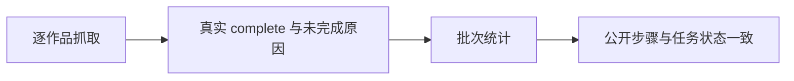

# T-1027 修复评论采集完成统计与失败诊断

## 需求与证据

T-1026 安装版公开 CLI 回归中，评论 run-d1d19487-3e48-453f-9eb0-f0bb602b1cf8 最终 failed，却提示“全量完成:已采9/9个作品”。公开 steps 显示四轮分别处理20/20、20/20、20/20、9/9，均新增0；缺逐作品未完成原因，不能声称真实采集成功。

## 范围与边界

保留原作品及评论，不把零新增推断为空评论或成功。统计必须区分已处理、确认完成和未完成；批次未完整时不得显示“全量完成”。沿现有采集结果与公开 AI steps 暴露有界、不含 Cookie/原始响应的抓取诊断（有效响应、解析、未完成原因）。保留既有身份与浏览器资源管理，不更换采集架构，不用重跑新任务掩盖原失败。



## 验收

先复现 incomplete 被显示全量完成的红测；覆盖完整空结果、部分未完成、截断、重试批次与 runner 失败包装。若诊断明确底层故障，在原采集链修复并复测；不能凭修正提示宣称采集通过。安装后用公开 CLI 回读原证据，再运行授权的采集回归核验新结果。

## 公开失败重试入口

第三候选真实runNow因62项历史失败处于backoff而没有due作品，works=[]。用户已明确要求“CLI里面没有的话增加进去”。新增 `analytics.comments.failures.list` 当前账号分页失败清单，及 `analytics.comments.retry` 基于有界真实publicationId和读取基线提前重试时间。严格校验当前账号/作品归属/状态基线；保留失败次数、失败记录、成功水位、评论和原任务，不删除历史。再复用scheduledJobs.runNow，不创建通用数据库改写入口。

仍遵守平台通道冷却与并发限制；提前作品重试时间不得解除平台限流。服务幂等与正式CLI写入确认政策保持。已到期失败重试应优先于更早成功水位，避免重试永远不due。无需数据库schema变更。验收跨账号拒绝、过期基线、重复请求幂等、失败历史保留及实际进入抓取；先独立契约评审后实现。

第四安装实际选中2项，54.124秒后两项均no_matching_response；公开证据只能证明监听窗口内无匹配评论响应，不能证明无评论、登录有效或限流。补最小被动页面证据：最终固定路由类别、导航HTTP状态、readyState/pageClosed/观察是否成功、滚动尝试与错误计数、观察到的响应总数和固定类别。无可靠组件依据的登录/验证码标记为unknown/null，Cookie存在明确只表示cookie_present_only。禁止公开URL query、Cookie、正文、用户资料或原始异常；不因诊断改变成功判据/平台冷却，不加盲重试或重导航。主线已独立审核该可观察事实方案，先红后绿，再经同一公开CLI对更少选中项复验。

### CLI 精确设计（Kuhn 独立评审通过，按评审约束实现）

#### 失败清单

`analytics.comments.failures.list`，`GET /analytics/comments/failures`；只读、无确认、非异步。

请求 query 为既有 `page/pageSize`（默认 1/20，pageSize 最大 100）。身份只来自可信 ctx 的 userId/accountId，缺账号拒绝，不接受请求体覆盖账号。仅列当前账号、当前仍可采集的抖音已发布作品、comments capability、仍有失败的同步状态；状态 externalId 必须与真实 publication.externalId 相同。按 publicationId 稳定排序，沿既有 list envelope 返回分页 total。

单项严格字段：

```typescript
{
  publicationId: string;
  externalId: string;
  attemptedAt: string;            // ISO UTC
  retryAt: string | null;
  lastSucceededAt: string | null;
  failures: number;               // 正整数
  failureVersion: string;         // sha256:<64位hex>
}
```

failureVersion 是服务端对 user/account/publication/externalId/capability/attemptedAt/retryAt/failures/lastSucceededAt/error 的固定顺序快照哈希，不暴露 error 文本。**包含 retryAt**，以及 error 的哈希摘要。任何相关状态变化都会使原失败基线过期；CLI 相同 key/输入的重放在业务基线检查之前从正式 gateway 返回原 receipt，不重新执行。

#### 请求作品重试

`analytics.comments.retry`，`POST /analytics/comments/retry`；effect=write，confirmation=apply，asyncTask=false，idempotency=gateway。

```typescript
// body：严格对象，1–100 项，publicationId 不重复
{ items: Array<{ publicationId: string; failureVersion: string }> }
// response：严格对象，只表示作品重试时间调整
{ items: Array<{ publicationId: string; failureVersion: string; retryAt: string }>; updated: number }
```

每项须通过当前账号真实作品可采集校验、现存 comments 失败状态、失败基线一致校验。整批先验证，再在事务中按快照条件更新；任何一项越权/基线冲突整批不修改。越权沿现有 OwnershipError（404），失败已恢复/基线变化沿 ConflictError（409）。不提供 force、任意 capability、客户端 retryAt、清错误/失败次数/成功水位或 resetGateway 参数。

唯一修改字段是作品 sync.retryAt：设为原时间与服务端 now 的较早者（缺失则 now）；重复请求不往后推。保留 error、failures、attemptedAt、lastSucceededAt、评论、原 jobRun/aiTask/steps。gateway 相同幂等键与相同输入回放；换幂等键带旧基线会冲突，不能绕过已变更状态。更新不能调用平台 gateway reset，也不直接启动浏览器或抓取。

`isSyncDue` 对合法 retryAt 的判定先于成功水位：未来 retryAt 仍阻止；到期 retryAt 允许失败重试。成功 settle 本来就清空 retryAt，因此原成功采集间隔仍按 lastSucceededAt 生效。

#### 少量作品真实验证的显式运行范围（已授权并经 Kuhn 独立评审）

仅调整 1–2 项 retryAt 后调用现有无筛选 runNow，其他作品可能自然到期，**不能保证少量抓取**。`scheduledJobs.runNow.body` 增加可选 `publicationIds`（1–20，不重复），仅 comments 作业接受。调用前校验真实归属，将选择写入本次 AI task 的 target.publicationIds；不修改持久 scheduledJob.target 或 cron 配置。

collector 对显式选择只处理选中作品，所有后续重试沿原 task target 保留选择。选中作品的完成状态仅由选中范围判断；账户其余失败数仍可作旁证，但不能把成功的少量验证判为失败。公开诊断须分别标明 selected_publications 与 account.comments 的失败计数，不能将账户失败数称为选中任务 pending 数。

已有运行幂等必须保留：若同 job 已有不同选择/全量的进行中任务，不新开并行抓取、不把它当本次少量验证；返回明确冲突并指向已有任务，等待完成后再发起。相同选择可沿既有 dedupe 回读原任务。校验分两层：result.deduped 后核对持久任务；createTask 即使返回旧任务但外层未标 deduped，也在 ensureRun/dispatch 之前核对其持久 target，不用请求 target 覆盖旧任务。平台 gateway 冷却、同账号串行、登录身份与浏览器资源约束全程沿用。

主线已登记该运行范围的新增写域：`contract/src/operations/scheduling.ts`、`contract/tests/modules/scheduling.test.ts`、`backend/src/application/scheduling/controls.ts`、`backend/src/application/scheduling/controls.test.ts`。已实施；comments collector 与诊断类型沿既有写域修改。

#### 先红后绿与独立评审

先新增 contract 测试，取得真实红测后按独立评审开始实现。`/tmp/t1027-verification/cli-retry-contract-red.log`：4 failed / 9 passed，缺失两个正式 operation 与 CLI policy 为实际红因。覆盖清单字段/分页、1–100唯一ID+基线、拒绝跨账号覆盖/时间/平台重置参数、重试回执不冒充抓取成功、正式 CLI policy。

Kuhn 独立方案评审已通过。服务/公共链路测试覆盖：跨账号拒绝、externalId 改变、过期失败基线、整批原子拒绝、gateway与服务重复幂等、并发 settle 与 retry 冲突、历史与成功水位保留、平台冷却不解除、最近成功但失败重试到期、少量选择不扩大到其他 due 作品、选择范围在后续批次保留。安装后由主线经公开 CLI 选择最少少量真实失败 ID，读取原 run 与新抓取证据，不操作私有数据库。

### 最终实现交接：代码冻结

comments failures.list/retry 与 selected runNow 已完成，Kuhn 最终实现独审通过，无阻断发现。后端定向 47/47、全 contract 254/254、前端定向 152/152；红绿原始日志、命令和限制见 `docs/verification/t1027-comment-collection-evidence.md`。本项代码已冻结。主线统一类型检查并负责第四候选安装后公开 CLI 少量选集实测；未将隔离测试当成真实网站采集通过，也未将任务状态标成验收完成。

第五安装真实单项出现页面200/readycomplete、244响应但评论匹配0，同时外层错误把诊断navigationStatus误当加载超时。扩展scheduled-collection-runner.ts及其测试：使用明确本地未完成错误类型保留诊断，不以序列化诊断里的词匹配网络故障；真实网络错误规则保持。沿原response监听增加有界脱敏路由分布以诊断接口族，不增加平台请求，不输出query、动态身份或正文，独审后红测实现。
