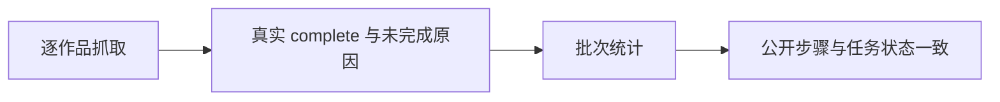

# T-1027 修复评论采集完成统计与失败诊断

## 需求与证据

T-1026 安装版公开 CLI 回归中，评论 run-d1d19487-3e48-453f-9eb0-f0bb602b1cf8 最终 failed，却提示“全量完成:已采9/9个作品”。公开 steps 显示四轮分别处理20/20、20/20、20/20、9/9，均新增0；缺逐作品未完成原因，不能声称真实采集成功。

## 范围与边界

保留原作品及评论，不把零新增推断为空评论或成功。统计必须区分已处理、确认完成和未完成；批次未完整时不得显示“全量完成”。沿现有采集结果与公开 AI steps 暴露有界、不含 Cookie/原始响应的抓取诊断（有效响应、解析、未完成原因）。保留既有身份与浏览器资源管理，不更换采集架构，不用重跑新任务掩盖原失败。

## 验收

先复现 incomplete 被显示全量完成的红测；覆盖完整空结果、部分未完成、截断、重试批次与 runner 失败包装。若诊断明确底层故障，在原采集链修复并复测；不能凭修正提示宣称采集通过。安装后用公开 CLI 回读原证据，再运行授权的采集回归核验新结果。
