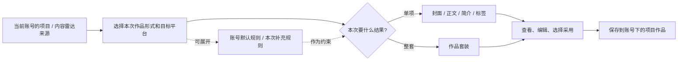

# T-1029 按平台作品形态重构结果优先创作工作台

状态：现有能力/架构补充修订稿，待复审与用户确认；未实施。2026-09-30。

## 用户要得到什么

用户在当前账号下的项目里选择要做的作品形式，直接说“给我封面”“生成简介”“写正文”“生成标签”或“一次备齐”。系统使用当前项目、账号定位、已确认稿件和有权限的素材，交付可查看、可编辑、可再次生成的成品。规则可以预设或临时调整，但不是每次开工的表单门槛。项目继续承载同一创意的素材、版本、发布和复盘；作品形式与目标平台在创建具体产物时选择，不强迫一个项目只能属于一个平台。

## 现状证据与问题

- T-1017 的内容雷达改写优先工作在另一条进行中分支；本任务承接其“先给可编辑首稿”原则，不重写该任务。当前雷达仍显示同步、逐字稿、选题卡与升级项目等多种操作；当用户只想要一个结果时，要理解过多内部步骤。
- 当前项目 Brief 页面仍呈现平台、形式、画幅等配置字段；视频稿面以脚本为核心。小红书图文不应被送入“口播稿 → 分镜 → 视频成片”链。小红书同时可能有视频作品，不能仅根据平台名强制图文。
- 公众号文章已有独立 `article` output、版本和候选采纳，但页面生成前要求选目标平台与补 Brief，并显露大量资料和写作身份控件。它需要保留事实与版本安全，同时把可写正文放到首屏。
- 平台能力合同已区分作品 `kind=video|image|article|mixed` 和平台运行能力；作品目录与创作产物不是同一实体。不能把采集到的外部作品伪装成本地创作项目。
- 真机页面核对：`/positioning` 的账号定位规则已经可编辑；`/intelligence` 在当前账号下是零来源空态，无法从该账号观察有来源时的完整操作；`/projects` 可见 75 个已发布历史项目。源码核对用于补足这次空态无法展示的稿面和雷达行为。不能把本次页面走查看作有源雷达或新图文功能的 E2E 证据。

## 已有能力怎么留在新界面

新稿面是**同一项目与服务上的新导航和新作品呈现**，不另起一套孤立创作系统。下表逐项列明现有能力的去处；“收起”表示入口仍可直接找到，数据与服务继续使用原 owner。

| 现有能力与真实入口 | 新界面中的位置/行为 | 必须保留的真值与约束 |
| --- | --- | --- |
| 定位中心：账号定位母版、五类下游规则、版本 | 创作页“本次依据”摘要，点击可编辑/查看版本；默认自动带入当前正式定位 | 规则按当前账号和实际版本冻结；切号不沿用旧账号规则 |
| 内容雷达：来源分类/筛选/排序、同步、来源快照、公开指标、逐字稿、改写/选题、升级项目 | 雷达保留信源管理和证据页；选中来源后增加直接生成结果入口，逐字稿和拆解进入“来源详情” | 同步/登录、真实来源和指标状态仍可查；未取得正文不造来源；T-1017 首稿回读兼容 |
| 项目与选题：项目列表、选题卡、Brief、平台目标、项目状态、历史导入 | 项目首页先列“作品产物”和主操作；Brief 与选题放“项目设定”抽屉；历史项目仍有原稿面/复盘深链 | 既有项目 ID、账号归属、导入来源、选题证据不迁假项目 |
| 素材与研究：上传、项目弹药库、联网找资料、论点树、缺素材清单 | “资料与素材”抽屉；封面/图文卡片/视频生成就近复用；缺项在对应结果旁提示 | 原 Asset/MaterialLink 和来源引用不变；论点是可选能力，不变成首稿门槛 |
| 视频稿：富文本/结构双视图、局部改稿、版本回滚、审核、右侧编导对话 | 视频工作台主稿面；编辑器与编导保持，审核/历史在稿旁可达 | `output_script` 正式版本优先，旧雷达 seed 只作首次初值；刷新不覆盖用户正式稿 |
| 视频制作：上传粗剪/SRT 或成品、B-roll、AI 分场、分镜确认、渲染、成片预览、素材包导出 | 视频作品的“制作”工作区；图文与文章不显示视频制作步骤 | `contentOutput`/production/Asset 原归属与采纳状态不变；候选视频不冒充已确认成片 |
| 封面与媒体生成：`cover.generate`、`material.generate`、账号画布、素材库 | “做封面/图卡/配图”结果动作优先复用现有生成任务；“在画布深化”是媒体支路 | 画布在独立 `creator-canvas` 工作树、尚未与本工作树合并；集成时复用其账号画布、任务、Asset 候选和显式加入项目，不复制第二套生成/保存逻辑 |
| 发布物料：现有 `publish.package`、标题/简介/标签、封面 Asset、审核、手工登记已发布 | 视频/图文作品的“发布内容”卡片；单项操作落在对应字段，已存发布包原位可看；排期仍在发布中心 | 当前稿面入口固定抖音，不能把它宣称为小红书/快手已可用；复用 publication revision 与人工采纳，平台适配另经能力合同确认 |
| 盲预测、发布后指标、复盘、校准与经验 | 作品状态区的“预测/表现/复盘”入口；已发布项目仍直接进入原复盘页 | 预测须在发布前锁定；指标来自真实采集，不填演示数字；复盘和经验链不断 |
| 公众号文章：独立文章 output、逐段候选采纳、事实待确认、配图清单、版本 | 文章工作台主稿面；资料和写作身份可展开，逐段采纳与版本历史一直可达 | 现有 `wechat_article` Artifact、CAS 与素材文件版本继续使用；未绑定公众号仍可本地写稿，不伪装已发布 |

当前项目创建弹层只要求名称、Brief、画幅与创作模式，且 UI 强制选横/竖屏；它没有平台/图文类型选择。项目 `create` 合同允许 `contentType`，原始枚举已有 `image/audio`，但 `projects.outputs.create` 当前只接受 `video|article`。因此新图文**不是给原视频稿面换文案**：要补真实图文 output 的合同、存储和读回。项目创建弹层可以保留作为旧入口；新增“直接创作作品”入口应允许一句主题建项目，画幅随具体作品而定。涉及原 T-052/T-293 的创建交互裁决，需要在产品确认后写 DEC，不能以本 SPEC 默默覆盖。

## 作品形式与默认成品

| 用户选择 | 首屏主稿 | 可单独请求的结果 | 规则默认来源 |
| --- | --- | --- | --- |
| 小红书图文 | 标题、正文、多张图片顺序及封面 | 封面、图卡、标题、正文、简介/摘要、标签 | 当前账号定位与平台图文规则 |
| 小红书视频 | 视频脚本及所选素材 | 封面、发布简介、标签、字幕文案 | 当前账号定位与平台视频规则 |
| 快手/抖音等短视频 | 视频脚本或已有成片 | 封面、发布简介、标签、口播稿 | 当前账号定位与视频规则 |
| 公众号长文 | 标题、摘要、分段正文与配图 | 标题、摘要、正文、配图、封面图 | 当前账号定位、可选品牌及文章规则 |

平台只给推荐的作品形式与成品清单，不替用户决定具体形式。没有实际生成或接通的能力只能显示清楚的“暂不可用”及原因，不能放无效按钮。跨平台复用同一创意时，各平台结果是独立候选与版本；用户可选择从已确认主稿生成适配稿，原稿不被静默改写。

## 主要交互

需求编号：FR-1029-1 平台与作品形式分别选择；FR-1029-2 单项结果直接生成；FR-1029-3 可选整套生成且部分结果独立可用；FR-1029-4 规则默认继承、可展开；FR-1029-5 雷达来源直接交付候选；FR-1029-6 候选经用户确认才进入正式作品；FR-1029-7 账号、素材和版本归属可核验。下列各条是这些需求的可观察交互。

1. **入口**：项目页有“创作作品”与已有作品列表；在创建具体 output 时选择平台与作品形式，当前账号默认沿用。若从已绑定账号或内容雷达进入，预填可核验的账号/来源，允许用户修改形式。首次没有项目时可直接输入一句主题建归属明确的草稿项目，再创建对应 output；不先要求完整 Brief 或为图文强选视频横竖屏。旧“新建项目”入口和历史项目读法仍保留。
2. **首屏**：左侧/主区是成品预览与编辑器，顶部用一排直白动作“写正文”“做封面”“生成简介”“生成标签”“备齐发布内容”；每个动作显示预计会新增或更新哪些候选。手机窄屏使用单列。历史版本、来源详情和高级规则收在次级入口。
3. **单项生成**：点击“生成标签”只产标签候选，不重新生成正文或封面；点击“做封面”默认读取当前已确认稿与已选图片，先展示候选图，用户确认后才关联当前作品。未有确认稿时可用用户输入的主题生成，并明确标识上下文较少。各项失败互不连坐，已成功项目和候选仍可编辑。
4. **整套生成**：用户明确选“一次备齐”时并行/按依赖生成该形式可用的文本和视觉产物；每项有独立状态、重试、查看和采纳。正文成功而封面失败时正文立即可用，整套显示“部分完成”，不称整单失败。
5. **规则**：账号级规则默认继承定位、品牌、禁用词/事实边界等已有正式版本；项目级和本次补充规则可展开设置。界面说明实际应用了哪个版本。规则缺失时走通用候选并如实标注，除权限、来源、事实安全等硬门外不阻断用户拿首稿。编辑规则不追改旧候选。
6. **内容雷达**：来源卡以“用这条做什么”打开同一结果选择器。若源文案或图文正文真实可用，直接生成对应文案候选；视频逐字稿可由后台按需准备。来源不可读取时说明缺什么，保留手工输入路径。拆解、策略、选题卡是可展开的研究结果，不是生成首稿的必经页面。T-1017 的改写稿与真实来源证据可作为本工作台输入。
7. **审阅与保存**：所有 AI 结果先是候选，单项可“采用到作品”或复制/下载；不会在生成时覆盖已确认稿。采纳时后端重新核对账号、项目、版本、素材与来源归属，冲突时展示差异让用户决定。显示“已生成”“已采用”“需补充”“不可用”四种不同事实，不把建议图当已完成图片。

## 数据、能力与边界

- 项目仍归属 `userId + accountId`；一个项目可有多个 `contentOutput`。`contentType` 原始合同枚举已有 `image`，但 `projects.outputs.create` 当前只接受 `video|article`，图文作品所需的多图稿面与 output 读写仍不存在；CONTRACT 阶段必须先定图文语义，扩展 output 创建和对应 Artifact/版本，旧视频/文章输出按原读法保持。平台目标、作品形式、交付项分开存，不用平台枚举推断内容类型。
- 发布简介与标签属于作品的可编辑发布物料，封面是实际图片 Asset 的版本引用，图文卡片保留顺序及文件版本引用；不能将模型的一段描述当成已生成图片。每项生成记录所读的主稿版本、规则版本、来源与模型回执；数据缺失显示真实空值。
- 账号绑定和作品采集的能力状态沿用 T-1020；写作可以在未绑定目标平台时本地完成，发布动作必须按实际平台授权与发布能力单独开放。本任务不自动发平台、不自动采纳或跨账号复制素材。
- 前端只负责编辑与状态展示；后端持有业务归属、候选与采纳；AI 在 worker/ai-runtime 产候选，不直写正式稿。平台格式约束用版本化配置表达；内容语义与创作选择由 Skill/模型处理，代码只执行可验证边界。
- 装配顺序沿现有 `contract → backend service → worker/ai-runtime` 边界：先扩展可兼容的 output/候选/采纳合同；后端组合项目、当前稿、平台能力与账号规则；worker 继续调用现有执行任务和模型配置；前端以当前服务读回渲染。封面、素材、画布、发布修订和复盘保留各自的既有 owner；新“结果”按钮只是这些能力的清晰入口，不得在前端写第二份真值或绕过服务端归属门。

## 用户旅程与验收

以下条目依次编号 AC-1029-1 至 AC-1029-7，并与上列需求对应。

1. 从小红书账号新建图文，输入一句主题，直接生成一份可编辑标题+正文，并可单独生成多张图卡、封面、简介和标签；不要求先做视频脚本、转写或完整 Brief。刷新后已采用内容和图片顺序仍在。
2. 同一小红书账号新建视频作品时进入视频稿面；快手视频进入视频稿面。平台不会把两种形态混在一套强制流程里。
3. 在已有作品只点击“生成标签”时，正文、已确认封面和历史版本完全不变；标签失败仍保留其他结果。只点击“生成封面”同理。
4. 公众号文章可在首屏写正文、生成候选和保存；未绑定公众号或未填完整 Brief 仍能写通用草稿，来源不足与待确认事实如实显示。逐段采纳和版本历史继续可用。
5. 内容雷达选择图文来源，能在真实可读正文基础上得到对应图文候选；选择视频来源时按需准备逐字稿。来源不可用时不捏造引用，也不要求用户走无关分析步骤。
6. 切账号、跨账号项目/素材 ID、旧版本并发采纳均被阻止或显式处理；旧视频、文章项目仍可读写。旧项目的素材抽屉、脚本版本、审核、发布物料、盲预测、制作/成片、复盘和账号画布入口各有可达位置，来源和正式稿不丢。整套生成部分失败时成功项可立即查看、编辑、采用。
7. 用用户任务计数验收：从进入项目到看到首份可编辑成品，默认路径不超过“选形式、点生成”两次显式操作；高级规则不成为必经点击。用真实桌面页面核对文案、可点击性、空态和刷新恢复。

## 依赖与待确认的产品选择

- T-1017 继续完成雷达一键改写，不因本任务等待而停；本任务负责跨平台的结果选择器和图文工作台，接入其已保存改写稿。
- T-1020/1021/1022/1023 的账号、作品目录和文章能力为输入；工作台只使用已通过归属核验、实际可用的能力。
- T-993/T-994 的无限画布在另一工作树，集成要先核对其任务、素材与项目用料契约；不能根据本工作树缺少页面就认定产品没有画布能力，也不能把画布设为生成封面的强制步骤。
- 当前 `publish.package` 稿面入口和模型链聚焦抖音；小红书/快手的文案与标签要通过真实平台适配能力评审后开放。图文 output 合同、快捷建项目入口及 T-052/T-293 的旧创建裁决均需在用户确认后形成 DEC。
- 产品建议：默认把“小红书图文”列为小红书首项，同时保留“小红书视频”；短视频账号默认视频。需在独立产品评审后再冻结为实现合同。
