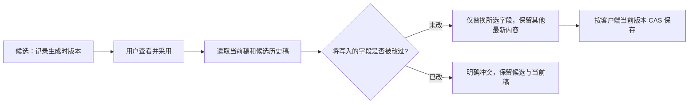

# T-1031 单项结果依次采纳与字段冲突

T-1029 真实模型验收发现：图文标签先采用后，封面因整个版本号变化被拒绝；整套结果不能依次采纳。用户已要求完整可用、结果独立交付及保留已有能力。本任务恢复单项结果的实际可用性，不改变领域 owner、作品归属、正式采纳授权或外部接口。

## 约束与实现范围

1. 文本候选采纳仍要求客户端 expectedCurrentVersionId 等于当前版本。若生成后版本改变，仅比较要写的字段：图文 title/body/summary/tags；文章 title/summary/sections。目标字段相同可仅写该字段；目标字段不同仍返回 VERSION_CONFLICT。比较为 exact JSON structural equality，忽略对象键顺序，保留数组顺序；不判断创作语义。来源引用合并按真实 ID/版本，规则凭据与版本原守卫保留。
2. 真实图片必须用户先预览、明确采用，仅添加/替换被选图片；按当前稿构造新版本，不能回写历史正文。图文图片允许 tags、sourceRefs、图片列表等与图像冻结正文无关的变更；title/body/summary 任一变化则冲突。文章封面要求 title/summary/sections 冻结内容未变；段落配图要求 title 与目标段落的 heading/body 相同且段落仍存在。已有图片变更可独立保留；替换所选封面/目标段图片为用户明确动作。
3. 图片候选保留生成时版本与任务来源。素材账号/文件归属和任务绑定持续校验。未按当前版本审阅、源文改变、错账号、伪造图片均不确认任务、不覆盖正式稿。任务确认后的保存冲突保留素材和候选；既有同请求重放保持幂等，需按 expected 历史版本构造一致写入而不是读取已改变新稿重构不同请求。
4. 改动仅图文候选采纳、文章单项文本采纳、图文/文章媒体采纳适配器及其测试；若需前端文案只显示明确字段冲突及可重新生成提示，保留输入。不调整通用文章逐段候选或视频生产状态机。

## 验收

先红测再修复：同基准标题/简介/标签候选依次采用；标签采用后封面/多图卡依次添加保留最新正文和已选图片；文章标题后简介采纳、文章配图后封面保留图片；目标文字改变/段落删除、旧 expected、跨账号、伪造媒体拒绝；同请求重放无新版本。图文与文章都经已有 backend service 保存，AI 不直接落正式稿。用本机配置真实生成标签与图片、依次采纳和刷新检查正式版本，不自动发布。
