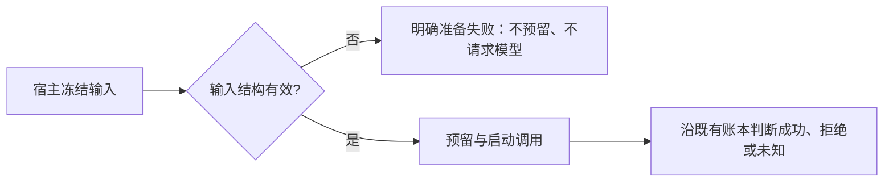

# T-1033 修复模型调用前输入错误被标为提交未知

用户要求持续测试并修复工具问题、保证客户端完整可用。T-1032 公共 Worker 回归当场发现：planning.thesis 的冻结依据缺失或结构无效，在任何模型预留前被异常路径转换为 MODEL_RESULT_UNKNOWN，导致可修复的准备错误变成不可重发的未知任务。

## 约束

- 只在 resolveStructuredBusinessSchema 的调用前置验证边界，将 ZodError 或 JSON SyntaxError 转为 failed / STRUCTURED_INPUT_INVALID；其他异常不得随意按未提交判断。
- 不修改供应商已启动后未知提交的状态、计费、重试或恢复规则，不把所有错误统统转为失败。
- 语义规则仍归 Skill；这里只验证合同类型和合法 JSON，不做事实关键词检测。
- 现有合法 planning/thesis、review、图文与文章调用不增加模型请求。前端只使用已有错误映射；若现有映射无对应码，加入普通可恢复准备错误文案，不暴露堆栈。
- 范围：ai-worker/src/execution/structured-worker-generation.ts 及其公共测试；必要时已有诊断错误码映射及对应测试。无数据迁移、无自动采用、无新增模型审稿阶段。

## 验收

已发生红测：缺失、[]、[42] 三项期待 failed 却收到 unknown_result。先保留该证据，再验证 STRUCTURED_INPUT_INVALID、零预留/启动/HTTP/保存；新增损坏 JSON 与其他使用冻结 JSON 的输入族；普通代码错误保持保守未知；已启动模型断连仍未知。完整公共 Worker 回归及 Worker 类型检查须执行并保留实际结果。独立评审后动生产代码。
