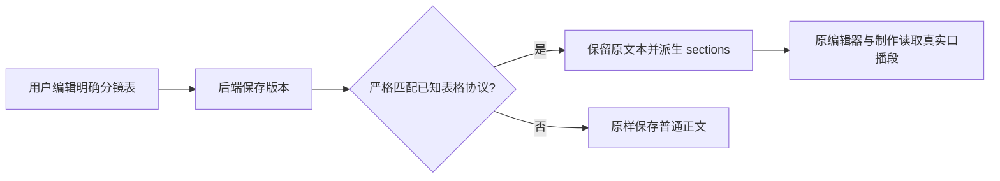

# T-1034 保留编辑分镜的结构与制作正文

用户要求客户端完整可用并保留已有功能。T-1029 浏览器真实验收：视频候选编辑后采用到 v5，旧项目工作区把 Markdown 分镜表显示为一整段“脚本正文”。缺少 sections 使编辑稿失去口播/画面/字幕/时长结构，后续制作可能消费表格语法。

## 范围与约束

- 在 backend/artifacts 模块新增纯协议转换 helper；只支持系统生成的六列表格（#、结构角色、口播、画面、字幕、时长）和用户验收稿的四列表格（#、口播、画面、字幕），表头允许空格，列顺序固定。不依据行业词、内容语义或相似度做选择。
- 只在 output_script 的 createVersion 且调用方没有给 contentData 时使用；已生成真实 sections、画面素材引用和明确结构化编辑不覆盖。
- contentText 原样保存。同时派生 transcript，严格按表格行顺序连接各行口播，保留内容字符（只解码明确协议转义），作为既有制作/审核读端优先读取的口播正文。不会从画面/字幕生成口播。表格格式不完整、额外非表格正文、列数不匹配、无有效行时返回无转换，普通稿原来可保存的路径继续可用。不能部分解析并默默删除剩余文字。
- 协议转换支持已生成的转义竖线与 HTML br 换行；逐行保留口播与制作字段，不从内容猜 role，四列无 role 时只使用正文的基础角色。只分配技术段 ID；不得复用旧候选画面资产、虚构镜头或指标。
- 从表格派生的版本记录明确的协议来源标记。结构段局部改稿继续通过原 applyScriptPatch，在该来源标记范围内按明确的口播/画面/字幕标签协议同步 transcript；多行口播保留，用户把整段替换为无标签正文时按其明确输入保存为口播，只有画面/字幕的段落不补口播。其他版本的 transcript 和显式 contentData 保留。必须验证同一正式稿后续修改与回滚不会消费陈旧口播。
- 所有保存仍走原归属、版本 CAS、AI 候选来源回执和账号隔离守卫。不改数据库、HTTP合同或生产状态机，不变更旧项目级制作归属。
- 文件范围：backend/src/modules/artifacts/script-table-protocol.ts 与测试，artifacts.service.ts；现有 output-scripts 集成测试、artifacts 测试；验收文档。前端不写业务解析。

## 验收

红测→修复：真实 PGlite 候选编辑后采用的 contentData.sections 与口播/画面对应，手工 createVersion 保存同协议表也保留结构；现有两格式、转义管道/换行、未知正文与损坏表格、明确 contentData 保留；相同请求回执、版本 CAS 和跨账号拒绝回归。经实际 makeReviewSubjectReader().getScript 与 extractVoiceoverText 验证制作/审核读取只有口播、无表头/分隔线/画面字幕；无转换稿继续沿原读法。真实 UI 在独立库保存编辑表后从旧稿面查看，确认逐段正文不含表格表头；另核对分镜视图有各行制作字段。原始 contentText 保留，不能把结构检测当内容准确性检测。真实服务补充连续链：表格采用→结构段 applyScriptPatch→实际 getScript→extractVoiceoverText，覆盖带标签/无标签、多行、仅制作字段、回滚与跨账号拒绝，不能导出旧 transcript。独立评审后动生产代码。
