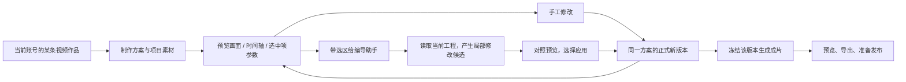

# T-1035 视频制作工作台与编导剪辑

状态：参考核对完成，方案与探索稿待独立评审；尚未改生产代码或安装包。2026-10-01。

## 用户要得到什么

用户打开具体视频的“制作”，能看到当前画面、素材与字幕的排列。可以自己改，也可以选中一段说“换成这张图”“把这张卡提前两秒”“改这句字幕”。编导助手读取当前工程，给出可查看的局部修改；用户应用后，时间轴与画面同步更新，保存后离开/刷新仍能继续。最后用同一方案生成成片、预览并导出。自动剪辑负责准备第一份可编辑方案。

来源：本轮用户要求视频制作工作台、参考三个 ZIP，并追加参考 ChatCut 的编导助手操控剪辑。现有功能完整性与客户端可用性要求持续有效。

## 参考事实与当前问题

完整核对在 [参考报告](../research/t1035-video-production-reference.md)。

- 当前 ProductionWorkbench 有上传粗剪/SRT、素材管理、分场、确认、渲染、成品上传和素材包导出，不应重建这些领域。分场卡存在删卡、换素材能力，但缺合成预览和时间轴。
- 制作页和 video-edit-candidate 均默认项目第一条 output，新多作品入口不能继续这样读取。
- 当前保存分镜与创建渲染串在一起；助手候选主操作同样直接重渲染。手工和助手没有清楚地共享可编辑状态。
- 助手当前修改 renderProps，但返回旧 decisions；再次从 decisions 组装会回到旧稿。必须消除第二份可编辑真值。
- 现有 generateVideoRenderHtml 与 videoRenderProps 可作共同合成基础；字体与音效尚无完整资源、轨道、预览与渲染合同。
- 附件交互只作参考，不复制其个人授权源码、Skill 或动效库。15 个音效作为用户私有导入样本；思源黑体保留所附 OFL 与版权。

## 范围与用户可见功能

| ID | 用户结果 | 来源 | 删除后失去什么 | 验收 |
| --- | --- | --- | --- | --- |
| FR-1035-1 | 从具体视频进入制作，定位当前账号、项目和 output | 多作品完整性及本轮工作台要求 | 同项目多视频可能串稿或串成片 | AC-1035-1 |
| FR-1035-2 | 预览、播放头、时间轴、当前片段参数同步 | 工作台与参考交互 | 仍需猜配置对应的画面 | AC-1035-2 |
| FR-1035-3 | 编辑字幕文本、信息卡内容与动效、素材替换/移除/插入时间和时长；支持撤销/重做 | 用户希望制作可理解、可操作 | 只能整片重新自动生成 | AC-1035-3 |
| FR-1035-4 | 编导读取当前方案与选区，形成局部修改候选，应用后和手工编辑保持同一结果 | 用户追加 ChatCut 编导能力 | 助手只能口头建议或重跑整片 | AC-1035-4 |
| FR-1035-5 | 方案保存与成片生成分开，版本冲突不覆盖输入，刷新可恢复 | 原功能与可用性要求 | 改一句话即渲染、离开丢稿 | AC-1035-5 |
| FR-1035-6 | 音效可导入、试听、定位和调整音量；中文字体及字重在预览与成片一致 | 附件及参考工作台 | 图层无音效、字形/粗细与输出不一致 | AC-1035-6 |
| FR-1035-7 | 用已保存方案生成、查看和导出成片，保留旧成片及既有备料/成品上传/素材包功能 | 客户端完整可用及本轮制作 | 新面板成为孤立演示编辑器 | AC-1035-7 |
| NFR-1035-1 | 无内部 ID 作为名称，无假进度；错误就近说明保留了什么及下一步 | 用户历次交互要求 | 操作状态仍看不懂 | AC-1035-8 |
| NFR-1035-2 | 长片只按需显示片段，控制在途读取，切号/切作品不回写旧状态 | LED-047 | 工作台卡顿或写错作品 | AC-1035-8 |

保留当前“上传粗剪口播与字幕制作”及“直接上传成品”两条路径。已有画布生成的图片/视频可经账号 Asset 和明确加入项目作为制作素材。这里不额外承诺照搬 ChatCut 的全部剪辑功能、自动发布、透明 MOV/剪映工程导出、任意原始录像的完整 NLE 剪切或多机位同步。现有“素材包”仍是素材与说明，不能改称可编辑剪映工程。

## 工作台长什么样

入口：具体视频作品 → **脚本｜制作｜发布内容**，在制作页面保留清晰的作品名称和平台。旧项目制作深链保留兼容路径；明确 output 才能写操作。只有一条旧视频时可准确定位；多条视频/混合图文文章时必须选择具体视频，禁止静默拿第一条。

布局为可逆默认选择，沿现有 CreatorOS token 和中文词汇，不引入新的品牌风格：

规格优先级已在 `frontend/specs/decision-log.md` 的 D-012 记录：用户本轮明确要求重新设计视频制作工作台，允许替代旧 `ui/Production Workspace.png` 的页面内部排列和仅示意章节的时间线；现有 AppShell、Sidebar、TopHeader、WorkspacePage 容器、紫色品牌、通用组件与领域边界继续使用。本 SPEC 是制作内部功能与关系的当前权威，旧截图作保留功能清单参考；探索稿并非生产视觉 PASS。其他页面的截图约束不变，最低制作窗口采用本任务的 900×600 验收，正常制作视口增加 1440×900；全局壳仍按自身规则验收。

- **左侧：编导 / 素材 / 效果 / 字幕**。默认编导，素材页展示当前项目真实素材；效果只列真实支持的自有类型。
- **中间：实际画面预览**，播放、暂停、定位、画幅、当前时间。区分正式方案、待应用修改、上一版成片。
- **右侧：当前选中项**，就近编辑文字、位置时间、素材、动效或音量，未选中时显示明确空态；不堆所有配置。
- **底部：分场、画面、信息卡、字幕、音效**等实际存在的轨道；无素材不制造缩略图或波形。每项可选中，轨道可缩放与横向滚动；普通空格播放，编辑文字时不抢键盘。
- **顶部：保存方案、撤销/重做、版本、生成成片**。生成中显示实际 execution task 阶段，改方案不会改变正在运行的冻结版本。
- 默认常用操作就近；备料、完整分场说明与诊断可展开查看。未接通能力不作为可用按钮出现。

桌面正常尺寸 1440×900，最低验收窗口 900×600。最低窗口优先留预览/时间轴，编导与参数以侧面板切换；不能互相遮住保存、应用或生成。更窄窗口堆叠，不作未经验证的移动端剪辑承诺。

## 工程、模型和代码各自负责什么

### 同一方案与版本

- 正式 owner 是现有 `production`，归当前 `RequestContext → account → project → contentOutput(video)`，Asset 继续归素材领域。项目素材共享不是 output 间共享制作状态。
- 新制作方案以验证后的 `VideoRenderProps` 兼容扩展形状作为唯一可编辑合成数据。AI 的 scenes/cards/素材理由等 `decisions` 是候选来源与只读说明，不再有另一条从旧 decisions 覆盖正式方案的保存/重渲染路径。
- 手工与助手修改使用同一服务：读取当前 revision、校验用户明确编辑、写新 revision、读回更新同一投影。正式草稿 revision 历史、当前方案指针、渲染冻结 revision 和旧成片的映射在 CONTRACT 中定稿；不能仅把一个无 CAS 的大对象塞回 recordingConfig，也不能把制作前进状态当作版本历史。
- 旧 videoEditingPlan 可读取，保留已有兼容调用，首次明确保存再转为新形状。未含音效/字体的旧合法计划仍可制作。未知扩展字段保留为未支持项并告知，不能导入时静默丢后再覆盖原件。
- 存在渲染任务时允许独立编辑新草稿；任务继续用原冻结 revision。旧已发布成片引用不被新版生成静默替换。

### 编导助手怎么操作

1. 选中片段/字幕/素材/时间范围时，用户可“交给编导”，加入可见引用 chip。发送附带 `outputId + revision + itemId/timeRange` 等精确锚点；ID 不作为产品文案。仅选中不触发模型、保存或生成。
   - 没有本地未保存修改时，使用当前已保存 revision。存在用户明确的手工修改时，发送按钮显示“保存并交给编导”，说明会先保存当前修改；点击后先按 CAS 保存并读回该 revision，再将引用重新定位到该版并发送。保存/引用重绑失败时不提交模型任务，保留本地输入与指令，说明冲突。未应用的 AI 候选不能随发送自动采纳。请求等待或模型执行期间产生的新修改另作本地草稿，不回写该任务冻结依据；返回后对照当前版本再应用。任何一次请求的模型依据、候选预览、precondition 和应用目标均有同一已保存 revision 锚点，禁止静默忽略用户屏幕修改或把未经服务校验的客户端大对象当真值。
2. 执行工具前通过 backend service 读取**当前工程、当前项和可用素材**；模型历史只表达意图。切作品、目标删除、项不唯一或 revision 变化时返回可理解冲突，保留指令；可唯一安全重绑时明确回读再执行，不能猜内部 ID。
3. 模型在现有 Worker/可配置 Skill 中理解指令，选择素材或创作取舍，产结构化编辑候选。代码校验真实 ID、归属、类型、时间、版本和用户选择；禁止关键词路由冒充理解。
4. 默认展示局部改动清单和候选画面：“哪项、原来是什么、将改成什么”，可逐项选择，应用一组则后端原子落实这组。部分应用后必须重新绑定最新 revision 与剩余项的 precondition，不能因为 revision 变化导致其余合法项无端不可用。新指令也可以请求重新提出一组修改。
5. **应用到方案**只保存正式新 revision，不自动花费渲染成本；独立“生成成片”才提交 execution。生成素材通过现有 material/cover/视频模型任务形成 Asset 候选，明确采用并关联项目后才加入时间轴。
6. 应用后的撤销是可回读的新版本，不删除源素材或历史。若保存成功但网络回执丢失，通过 request receipt 恢复，不重复提交。助手回报实际改变了哪些项，未应用不说“已完成”。

拟补工具是当前工程读取、选区/帧预览、准备编辑候选、查询候选和解释失败；正式应用沿 UI 的同一服务口。现有 `video.edit.render` 迁为兼容入口，不能保留“旧 decisions + 新 renderProps”两个正式结果。工具 registry、宿主冻结上下文、持久工具循环与结果卡一并验收，不只往 system prompt 加能力描述。

### 预览与生成同源

- 使用现有 `generateVideoRenderHtml` 合成能力与正式 props；backend 组合账号资产签名读侧，Worker/execution 继续做最终物化和本地渲染。前端只播放、定位与显示，不持有模型 SDK 或数据库写权。
- 预览在隔离 iframe 中使用相同帧时钟，按主视频与素材原点处理 currentTime；字幕、动效、音效不得各跑一只漂移的时钟。候选预览不写正式稿。
- HTML/iframe 的短时媒体 URL 不写入长期方案。只服务已校验账号资产与固定合成代码，不把模型给出的任意 HTML/JS当项目可信预览。
- 字体资源与 400/700/900 字重需等待加载后再标预览就绪；最终渲染使用同一字体文件。音效配置使用真实资源、出现时间、裁切范围与音量，试听与最终混音一致。缺失可选音效的旧计划维持无音效输出；明确不可读的用户新素材按项告知，提供移除/替换，而不是整片因审美门失败。

## 当前已有端口与需要定稿的合同

这里是产品方案的可行性映射，不把计划中的端口当作已实现。CONTRACT 必须先有独立复核才接生产界面。

| 需求 | 当前真实能力 | 要补的合同及 owner | 判断 |
| --- | --- | --- | --- |
| FR-1035-1 | projects output 读取、production 按 output、账号归属门 | output 明确路由；制作素材/任务恢复的 output 范围，拒绝非视频 | 可实现，需跨多作品验收 |
| FR-1035-2 | 固定 HTML 合成器、videoRenderProps、资产预览读侧 | 按作品/方案 revision 或已验证候选取得隔离预览；帧/时间同步协议 | 可实现，需预览/成片一致性探针 |
| FR-1035-3/5 | plan expectedRevision 保存与读回 | 类型化草稿、item 身份、历史/撤销、CAS 与请求 receipt；时间与字体/音效扩展 | 可实现，不能只做前端 state |
| FR-1035-4 | Worker video.edit 候选与 selection.outputId | 工程/选区读取、编辑候选、逐项应用、当前 revision 重绑；共享正式保存服务 | 可实现，已有工具需纠正而非加提示词掩盖 |
| FR-1035-6 | Asset 上传与读侧；主视频音轨、audio 枚举 | 私有音效导入与试音、音效轨混音、字体资源/字重传递及打包回归 | 缺口明确，需真实听看验证 |
| FR-1035-7 | execution.tasks 的 render、产物采纳、export、成品上传 | 按 output+冻结 revision 关联任务与成片；重试/未知回执读取 | 可实现，保留既有生命周期 |

保持 `contract → backend service → Worker/execution`，不引入第二数据库、远程剪辑 SaaS 或第二个模型工具循环。输入、取消、进度、日志使用已有 execution/AI 账本。新增数据结构、服务端口与存储策略须在本任务 CONTRACT/DEC 和评审回执中冻结，不能自由编码。

## 状态和异常体验

| 状态 | 用户看见什么 | 可做什么 |
| --- | --- | --- |
| 无方案、已有原视频 | 原视频预览、缺字幕/方案的明确提示 | 上传、读取真实字幕，或生成首份可编辑方案 |
| 无原视频/成片 | 备料与成品上传入口，不伪造演示轨道 | 上传和回脚本；不禁用其他已有作品功能 |
| 读取中/失败 | 局部加载/重试，尚未读到不显示为零数据成功 | 保留编辑输入，原素材仍可查看 |
| 已存方案 | revision 对应实际图层、片段和素材名 | 手工编辑、给编导、保存/预览/生成 |
| 本地未保存 | 明确“有未保存修改”；编导按钮为“保存并交给编导” | 可保存或放弃；明确发送先 CAS 保存/回读，再读该版产候选，失败不提交模型；离开提示 |
| 候选待审 | 原方案与待应用改动区分 | 预览、逐项选、应用、放弃 |
| 版本冲突/目标失效 | 哪部分未应用、输入保留、当前版本可读取 | 重新对照/定位，不自动覆盖或调用付费任务 |
| 模型/工具读取失败 | 真实失败阶段和可执行重试，不输出内部 system prompt | 重试读取或用手工编辑；不能假称项目已修改 |
| 渲染进行中 | 冻结版本、实际阶段、停止/恢复 | 编辑新草稿，旧成片可查看；不重复开同任务 |
| 生成部分失败/回执未知 | 原方案和旧成片保留，未知与确定失败分开 | 查看原任务回执、修正单项、合法安全输出 |
| 成片已就绪 | 对应作品与方案版本的真实成片 | 播放、下载、进入发布内容；旧版本可回顾 |

## 验收：用户真实业务流程

| AC | 必须观察的结果 | 证据 |
| --- | --- | --- |
| AC-1035-1 | 同账号同项目两条视频及图文/文章，分别进入制作，读写、刷新、任务恢复与成片不互串；跨账号 ID 同貌拒绝 | 真实 UI + 公共端口回归 |
| AC-1035-2 | 点击时间轴素材/字幕跳到实际画面；播放头同步字幕与动效；正常/最低窗口选中项、保存和生成可达 | 真页面、关键帧和时间回读 |
| AC-1035-3 | 改一句字幕、移动/替换素材、修改卡内容/动效；撤销/重做准确，未修改项不变；越界提示保留输入 | RED→GREEN、公共保存读回与 UI |
| AC-1035-4 | 真实模型读当前方案与选区，输出可执行局部候选；应用后同一时间轴显示修改，随后手工再改、助手重读最新值；逐项采纳和过期选区有清楚结果 | Worker 最终工具请求/回执、真实 UI；不能 fixture 冒充 |
| AC-1035-5 | 只保存方案不创建渲染任务；刷新恢复；并发冲突不覆盖；保存回执丢失不重复修改；版本恢复保留历史 | 公共服务 CAS、receipt、故障注入 + UI |
| AC-1035-6 | 私有音效试听/定位/音量与成片听感和时间相符；三个字重在实际预览和渲染画面一致，缺可选资源的旧合法方案可导出 | 真实 MP3/OTF、实际帧与音轨检查 |
| AC-1035-7 | 从脚本→备料→AI 方案→手工/助手局部修改→保存→生成→采纳/预览→下载；旧视频、直接成品、素材包与发布物料入口仍可用 | 完整公共链、真实浏览器，安装包另验 |
| AC-1035-8 | 空/失败/未知/取消/切号/切作品均可恢复；长片无重复在途读取/卸载回写；产品文字无内部 ID/原始 system prompt | LED-047、边界门、真实 UI 状态检查 |

测试必须在独立库/媒体目录进行，不读取或清理用户生产媒体作测试。真实资料/模型/成片证据与合成 fixture 分开标记。局部单测、探索稿截图或模型工具目录存在均不等于完整验收。禁止将任务标全可用，直到上述路径与声明平台的实际安装验证满足。

## 本次具体交付物与未完成状态

参考报告、附件哈希盘点、可交互探索稿和本 SPEC 属于本次调研设计交付。探索稿使用醒目标记的示例内容，只演示布局与选择/修改反馈，不连接模型、不保存用户工程、不作为 Gate 10/14 或客户端交付。完整产品仍在 T-1035 排队；下一步在上述范围内闭合 CONTRACT、独立评审、实现和真实验收，不用探索稿替代系统功能。

## 用户追加：优先开源与统一任务队列

2026-10-01 用户明确要求“优先找有没有可以参考的开源项目”“这几个需求都一起来做，排队来做，先把任务拆分好”。先调查并验证可复用开源模块，再决定集成或自有实现边界；不得先写完时间轴，再用调研补理由。附件和 ChatCut 的体验作为参考，正式代码优先使用通过兼容验证的开源组件与现有领域服务。若候选需要整体换渲染内核，先拿出兼容证据并复核架构，不能暗中扩大任务。

T-1035 统筹完整结果，子任务按下表排队，状态仍只由 BACKLOG/taskctl 管理。拆分不减少已确认功能，也不把未完成子任务当已交付。

| 顺序 | 子任务 | 依赖 | 对应用户结果 |
| --- | --- | --- | --- |
| 1 | [T-1036 开源选型与兼容探针](t1036-open-source-video-editor-selection.md) | 本 SPEC 产品范围已通过评审即可研究，不等待父任务整体完成 | 确定真实可复用边界、维护与兼容依据 |
| 2 | [T-1037 作品级工程与版本服务](t1037-output-production-project.md) | T-1036 选型结论；本任务合同评审 | FR-1035-1/3/5/7 的数据和服务基础 |
| 3 | [T-1038 可视工作台与同源预览](t1038-visible-video-workbench.md) | T-1036/T-1037 | FR-1035-2/3/5/7 |
| 4 | [T-1039 编导操控同一剪辑工程](t1039-director-video-editing.md) | T-1037/T-1038 | FR-1035-4，含实际工具读写与局部采纳 |
| 5 | [T-1040 音效与字体预览/渲染](t1040-production-sound-fonts.md) | T-1037/T-1038；队列排在编导后 | FR-1035-6，实际资源与混音/字形验证 |
| 6 | [T-1041 完整创作与客户端验收](t1041-video-workbench-acceptance.md) | T-1037—T-1040、相关现有脚本/采纳回归 | 全部 AC-1035，最后完整成片和实包验证 |

之前 T-1029 平台作品工作台、T-1031 单项采纳、T-1034 编辑脚本制作读端，以及账号/采集/上报任务保留各自状态与证据。本队列优先接入用户本轮视频制作需求；相交功能纳入最终回归，不能删除旧任务或把已有全局验收欠债写成完成。
