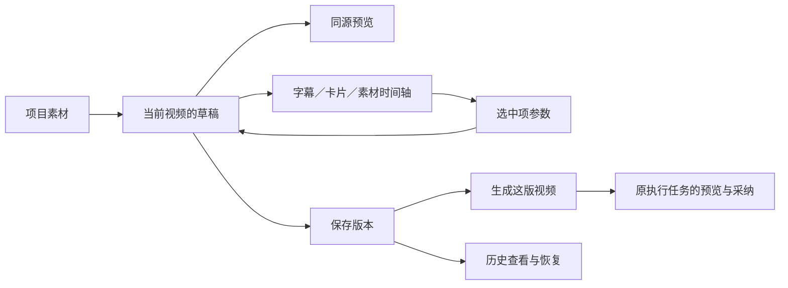

# T-1038 集成可视视频制作工作台与同源预览

状态：已按用户要求加入队列；实施前补齐本任务合同/范围并独立评审。2026-10-01。

## 任务来源和依赖

依赖 T-1036/T-1037；复用选定开源组件，实现预览/时间轴/参数联动、素材字幕和卡片编辑、撤销重做，并保留原备料与成品入口。

整体需求：[T-1035](t1035-video-production-workbench.md)，本子任务不得替代或缩减父任务的完整用户结果。

## 范围

承接 FR-1035-2/3/5/7，按照选型的复用边界集成；制作区沿父 SPEC/D-012 的布局，保留现有应用壳与组件。使用真实作品方案，不将探索稿的数据接入正式界面。时间轴、预览和选中项共用 item ID/播放头，长片按需显示。

合成预览与生成使用同一 VideoRenderProps 和既有合成器；支持实际字幕文本、卡片、素材时间/替换，保存/生成分开。发布、旧成品上传、素材包仍有可达入口；空态和局部失败可继续。

## 验收

真实正常及最低窗口，选中/定位/编辑/保存/刷新/撤销重做闭环；预览与成片关键帧一致；不存在静默演示数据/假按钮。对应 AC-1035-2/3/5/7/8 与 LED-047。页面规范和 CONTRACT 在实现前闭合。

## 具体界面与交互合同

保留 AppShell/Sidebar/TopHeader；入口为 `/projects/:projectId/production?outputId=:outputId`，具体视频稿面直接进入此入口。多视频必须选择，空项目保留旧懒建视频备料路径；图文/文章不能进入视频工程。已保存 editorVersion:1 工程默认可视制作；旧方案明确点“打开可视剪辑”首次转换保存，原件由 T-1037 留存。原备料、AI 分场、成品上传和素材包作为真实可达面板，不能删掉来冒充简化完成。

主区上半部为可播放/定位预览与选中项编辑，下半部为四条基础轨：口播只读、字幕、卡片、素材。复用 `@xzdarcy/react-timeline-editor@1.0.0` 的选中、拖移、边缘伸缩和时间标尺，不引入其播放引擎作为第二套渲染器。正常1440×900与最低900×600都必须能看到预览、时间轴与保存；最低尺寸参数面板可折叠。长片按视口虚拟化，不全展开片段详情。

片段均使用后端稳定 ID；UI 不用文件名或数组序号写入。选择显示中文类型、时间与内容；支持字幕中文/英文/起止，六类现有卡片的对应字段/时间/已支持动效，B-roll 起点/时长/标签/动效/真实项目素材替换与移除，场景标题。口播源、分场边界与画幅继续原明确备料/配置流程；不能表示任意粗剪主录像。插入素材明确选择真实账号 Asset，先加入项目，再成为本视频独立片段。项目素材分页读全，有缺失或失败可重试，不能用空列表假装成功。

编辑先留在本地草稿，拖移/伸缩结束后形成一次撤销操作，输入框按完整字段编辑提交，撤销/重做只改本地草稿。保存经 T-1037 editor.save，保存成功读回新 revision，不创建渲染；生成要求已保存且无未保存修改，以 server revision/requestId 调 editor.render。CAS 冲突保留输入，明确重新读取；请求超时先查 receipt，重试沿用同一 ID。加载、切作品和慢响应都有在途/过期保护，刷新必须回读真实版本。

历史分页只显示真实版本，查看不改当前工程，恢复明确保存为新 revision；不丢弃尚未保存草稿，覆盖前展示本地草稿与所选版本的区别并要求明确选择。生成历史读取 T-1037 render request，原任务预览、采纳和成片查看沿现有 execution/Asset 接口；不自动改已发布作品引用。

## 同源预览公共接口

新增 `outputs.production.editor.preview`：outputId、expectedRevision、requestId、完整草稿；返回 html、durationSec、warnings，不保存、不创建任务、不调用模型。后端先重读当前作品/版本并校验账号、video类型及真实项目素材，再使用 T-1037 相同结构规范与既有 `generateVideoRenderHtml`。保存前预览不得给另一个作品的 draft 授权。未接通媒体或生成 HTML 失败保留草稿、显示重试，旧备料和生成仍可用。

预览素材由当前账号 Asset 服务返回短时 URL 与权威 MIME，只在此次 HTML 中替换媒体 src，不写入 plan、版本或渲染 spec。HTML 只来自固定模板；未知字段不执行代码。iframe sandbox 仅允许模板脚本，不赋予应用同源权限；下载 URL 不进入日志。模板用同一安全 URL 绑定辅助函数生成预览和相对物化路径成片，不能全局替换用户文本。字体/音效由 T-1040 统一后再验收一致性。

播放头由同一时钟驱动 timeline、GSAP 与媒体定位，同时执行 HyperFrames clip lifetime（data-start/data-duration）；仅 GSAP seek 不能算合成预览。输入编辑防抖且取消/忽略旧预览返回，卸载停止时钟；点击和拖移不能互相改播放头。以真实素材关键帧对照实际渲染 MP4，单测 HTML 或探针截图不能代替此项。

### 预览隔离与播放控制协议

父页不访问 iframe DOM，也不增加 `allow-same-origin`。每次建立预览生成独立 channelId，固定模板桥接脚本通过 `postMessage` 交换 `ready/seek/play/pause/time/state`，消息带 channelId、单调递增 commandId 与有限秒数。父页只接收当前 iframe 的 `contentWindow` 所发且匹配当前 channelId 的消息；沙盒 origin 为 opaque，不能把 origin 字符串当作实例身份。channelId 仅用于隔离预览会话，不是账号或媒体访问凭据。桥接脚本只接受 parent 发来的当前 channel 消息，校验消息类型、序号及时间范围，不执行传入代码或任意 HTML。

父页唯一保存期望播放状态和秒数；iframe ready 后先应用父页最新 seek，再按期望状态播放。iframe 内使用一个时钟同步 GSAP、媒体和 clip lifetime，并回传实际 time/state；父页时间轴只显示回传时间，不另起会推进第二个播放头的计时器。seek/pause 中断旧播放，旧 commandId 回执不能覆盖最新定位；媒体尚未就绪时显示真实准备状态，不能只移动时间轴冒充播放。

切作品、替换预览 HTML 或卸载时废弃旧 channel，取消旧请求，暂停并移除旧 iframe，清除监听与动画时钟。新 iframe 未 ready 时保留最新期望秒数、草稿和保存入口；ready 超时显示可重试错误。验收覆盖 seek 后连续播放、暂停后定位、快速换稿、晚到旧 iframe ready/time、卸载后消息，以及最低窗口；旧实例消息不得改当前播放头或草稿。

## 验收范围

公共接口测试覆盖未保存草稿零持久副作用、素材权限、过期 revision、unknown字段保留、same props 预览/渲染一致。真实浏览器覆盖同项目两视频独立选择、各轨定位/移动/伸缩/文字与素材替换/删除、撤销重做、保存刷新、历史恢复、生成回执、局部失败重试、无旧响应覆盖输入。运行 LED-047 及旧 ProductionWorkbench 回归；长片1000片段视口操作可用，窗口两尺寸可见关键控件。实际输出关键帧与媒体语音同步必须有 MP4 对照证据；完整实包归 T-1041，未验证明确记待验。
