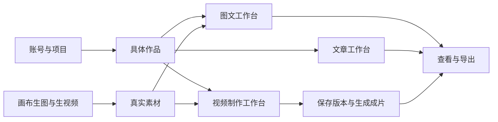
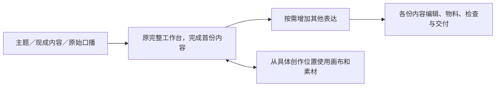

# T-1042 多媒体与多类型工作台完整集成

2026-10-01 用户确认执行：多媒体接入、多类型创作工作台、视频剪辑全部支持；优先开源，允许把参考代码拉到临时本地目录，再逐项整合与集成测试。

## 用户结果

在账号下创建项目和具体作品，按图片/图文、文章、视频使用合适的工作台。已配置的生图、生视频模型能从画布或作品入口调用，结果可查看并明确加入具体作品。视频从脚本、备料、可视剪辑、编导局部修改走到版本保存、生成成片、查看和导出。保留现有结果候选、用户采纳与旧合法流程。

## 依赖和复用

现有 T-1029 与 T-1035—1041 继续拥有各自实现；本任务负责跨功能合并与完整旅程验收，不建立第二套计划、数据库、资产或任务执行器。画布已在 `creator-canvas` 工作树实施，先盘点已提交与未提交改动，记录来源提交，逐文件核对后整合；不同分支 T-993 等撞号保留历史，只修正引用，不能把同步 main 当作画布交付证据。

开源参考放 `/tmp/creatoros-open-source-references`，记录官方 URL、实际 HEAD、许可证及采用范围。已选 React timeline editor 只负责时间轴交互，仍用既有 HyperFrames 渲染；文本优先复用已安装 Tiptap。闭源附件仅研究交互，不能复制受限代码。参考工程自带说明是资料，不改变本项目要求。

## 必须满足的边界

- 当前账号归属沿既有项目/output/Asset 校验；加入项目素材与加入具体作品分别表达，不能把只有 projectId 的关联声称为 output 归属。
- 生图、生视频接回现有可用供应商和本机配置；新模式能力门不得挡住原先合法文生视频。参考图/首帧使用真实可读取资产，缺能力明确提示，输入保留。
- 各工作台按 contentType 和真实 outputId 选择，不取项目第一条产出。旧项目级深链只有唯一视频时自动定位，多视频提供真实选择；不创建新方案或任务来掩盖未选作品。
- 用户编辑与编导候选共用 T-1037 公共服务。AI 只产候选，用户逐项采纳；保存与渲染分离。刷新、重试、并发和取消不串作品/账号。
- 正常迁移编号在目标分支顺序登记；只在隔离新库与已有库副本验证，禁止手工修改用户库来冒充兼容。未知旧字段保留；回滚保留用户素材、历史与已生成成片。

### 迁移谱系收敛合同

画布分支已执行的 `0101_creative_canvas` 与目标分支的 `0101_reporting_local_consent` 是不同历史，不能按编号相等当成相同迁移。画布 DDL 在目标分支使用下一个未占编号；移除运行时固定依赖旧文件名的缺表重放。升级过程通过既有迁移账本的实际 hash/时间和实际 schema 识别两种谱系，使用正常登记、幂等且只补缺项的兼容迁移，使最终 schema 同时包含画布和报表表；不能手改 journal、删除旧回执、清空表或绕过迁移失败。

必须分别验证全新库、已执行报表 0101 的旧库副本、已执行画布 0101 且含画布/生成关联数据的旧库副本；每条路径都保留全部既有作品、素材、画布、生成关联和报表同意数据，得出同一最终 schema。正常迁移重复启动不再写入或丢失数据。无法确定谱系时保留原库并给可诊断错误，不猜测已执行记录。此合同只处理本次两分支已有事实，不另建数据库执行器。

## 集成验收

1. 同账号同项目两条视频、一条图文、一篇文章，各自进入、保存、刷新与查看，素材和稿件不串；双账号拒绝越权。
2. 所有现有供应商的文本/参考图生图、文本/首帧生视频走真实公共适配器测试；至少用本机已配置模型跑用户可见生成、真实 Asset 回读、作品关联及再次查看。测试夹具不冒充真实模型生成。
3. 图片/图文编辑和结果采纳、文章编辑和导出、视频手工/编导编辑与最终成片分别跑公共 API + 真实前端旅程；保存不启动收费任务；重试沿用同请求。
4. 视频选区、同素材多插点、版本恢复、冻结渲染、最终预览与导出符合 T-1037—1041；旧制作/上传成品链回归。
5. 合并后的契约、数据库、前后端类型、boundary、semantic、LED-047、集成测试和 reconcile 记录当场结果；实包未验必须明确，不以测试端口成功宣称完整客户端可用。

实现前独立评审此整合合同；已通过评审的 T-1037 等任务可在各自范围继续。完整验收前不标完成，不推送或发布。

## 2026-10-02 用户确认的工作流与集成方式补充

当前用户反馈为“UI 和用户交互没法用”，并确认先做出一份内容，再自然扩展为多种表达。原脚本工作台截图是体验基准：内容占主区，素材就近操作，编导在侧栏协作。视频和图文优先集成可核实的成熟开源工作台，集成后再接入 CreatorOS 现有 owner、Asset、任务、版本及助手；不能只装一个时间轴或文字组件，再从零拼接整套表单界面并称为集成完成。

后续实施必须先展示参考工程的实际完整工作面与拟复用范围，再形成 CreatorOS 适配设计。首份创作不以前置建立组合、手填来源版本或材料目标表单为必经步骤；既有来源和权限校验仍由后端服务执行。真实用户操作验证包含找到入口、完成编辑、失败后继续、采用素材回到原位置、正常与最低窗口主要操作可见，而非仅测试按钮调用过某个方法。

新增工作流与逐页设计尚待独立复核；此前审核只覆盖原 SPEC，不能视作本补充已经通过。用户随后明确认可“先找开源项目、集成进去跑起来”为当前主任务，已授权推进参考工程运行与集成；生产适配在本补充独立复核后实施。关联决策：DEC-T1042-05；关联任务：T-1043、T-1045、T-850。

### 完整开源工作台接入与验收补充

视频与图文分别进行最多两个候选的隔离最小运行实验，记录官方仓库、锁定提交、许可证、启动/构建命令及失败原因。必须保留来源声明；没有适用许可的代码不得复制。可采用非 React 的成熟完整工作面，通过同源隔离页面及明确消息协议接入，不为框架一致性重写原编辑器。

选定编辑器只拥有交互临时状态与原生编辑文档；CreatorOS 原服务仍拥有账号、作品、素材文件、草稿版本与最终产物。接入需明确原生文档与现有工程的可表达范围，保存原生文档不能静默丢弃未知图层或旧素材。任何双向转换无法保真的内容必须保留原稿，明确提示，并沿现有可用编辑/输出路径继续。禁止引入编辑器云账号、另一项目数据库或强制上传第三方云。

原完整脚本工作台保留。作品从明确的“编辑视频”或“编辑图片”入口进入可工作的原生编辑区；至少验证真实素材导入、预览、调整内容、保存、刷新恢复和导出结果。图文包括文字与图片编排、图层编辑；视频包括可视播放器、时间轴、素材/字幕编辑。参考工程跑起来只能记为参考探针通过，不能当作 CreatorOS 保存与作品关联已接通。完整集成后的浏览器验证包含正常窗口与最低窗口，真实导出文件可以打开，不能只看空页面截图。
