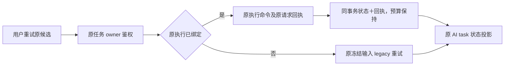

# T-1043 原执行重试回执补充合同

独立复核发现结构文章已绑定持久执行时，复制 AI task 会被现有预算保护拒绝。继续沿原 execution 的 retry 公共操作，不复制任务、不重置预算。

新增 execution_control_receipts 到原 execution 模块和唯一数据库。回执以 userId/accountId/idempotencyKey 唯一，包含完整 command+排序 taskIds 的 SHA-256 摘要和原命令返回资源快照。任务归属必须在读取回执前重新检查；同请求同输入返回原不可变回执，同请求异内容冲突。命令的全部状态修改、调度父子投影和回执写入同事务；并发唯一冲突回滚本次修改后，只能恢复完全相同的赢家回执。回执查重在状态和预算转换前，避免回执丢失或原任务再次失败后重复消耗预算。现有状态、预算与旧素材恢复 guard 保持有效。

文章原 owner 的 readGeneration 返回真实 executionTaskId；已绑定时通过 resumeGeneration 端口调用原 command，候选/task 身份保留，之后读取原 AI task 的执行状态投影。端口必须先查原请求回执，恢复可发生在任务已运行或又失败之后；没有旧回执时只有 failed/blocked 可 retry，cancelled 沿现有保护明确拒绝。未绑定执行的 legacy 原冻结输入重试保留，不能以 legacy 路径绕过已绑定任务保护。

自测要求：原真实 persistent service 的 failed→queued、丢回复重入、再次失败后同 key 不再重排、同 key 异 command/目标拒绝、跨账号零写入、批量混合归属零写入；文章已绑定执行重试不调用 submitGeneration、保留原候选 ID及冻结输入，回复恢复先于当前状态判断。不得以 fixture queued 状态猜测命令已执行。

结果重试在原 creative_results 写入 pending retry 预约（原 owner、retryOf、冻结来源、原 clientRequestId），之后才执行 owner 恢复。预约与套装成员替换同事务；丢回复后按原请求查 pending 预约并恢复同命令，不因原任务已经运行而新建请求。成功绑定真实 task/candidate 后 CAS 更新预约，失败保留预约及原因，刷新可明确恢复该重试；读取不得隐式执行命令。新的请求仍只允许失败/取消结果，原 owner 对取消执行的预算保护不放宽。

`CreativeResult.retryRequestId` 是可空的原重试请求号，只有已鉴权的未绑定重试预约才返回。刷新恢复按钮使用 retryOf + retryRequestId，不能重新造 key；已绑定后该字段为 null。

同一原执行恢复规则同时用于 graphic.post-text、wechat.article-text、script.draft 原 owner 的结果重试；已绑定任务不得沿旧 submit 路径重新领取预算。共用 backend execution 恢复端口验证 AI taskType 及 execution.ownerType/ownerId，使用原 taskId+原请求号的稳定命令键，按原公共 command 查重/执行并唤醒原 Worker。每个 owner 在调用前后继续验证自己冻结的 target/base/sourceRefs；视频原执行恢复不复制 checkpoint，旧未绑定路径才需要完整 legacy checkpoint。此项修复已有同一重试缺陷，不扩展执行种类或权限。
