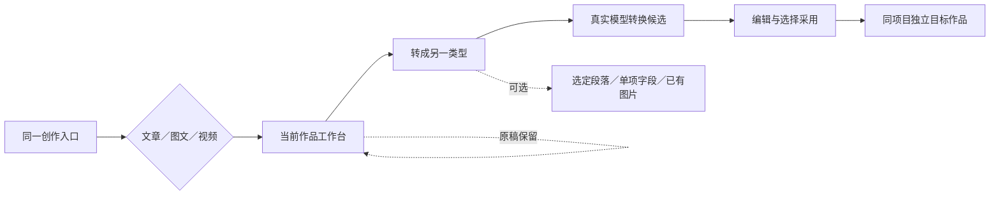

# T-1043 统一创作入口与文章、图文、视频互转

2026-10-01 用户明确要求：入口保持一致，项目创作只分文章、图文、视频；需要一键互转，允许部分内容互转。本需求补充 T-1029/T-1042，不取消多媒体与可视剪辑工作。

## 用户怎样使用

项目列表、首页和内容雷达的“创作”都打开同一创建页面；已有项目中的创作表单使用同一个组件。有项目就加入项目，没有项目就由一句主题建立项目。首屏只选择文章、图文、视频三类，平台是可选设置；账号定位、资料、原项目高级设置仍可展开。旧路由和项目数据兼容，不能留下两个功能重复的主入口。

当前作品旁提供“转成…”：选择另外一种类型，点击即生成可编辑转换稿。高级选项可以只转选定段落、标题、简介、标签或脚本，明确勾选复用的已有图片。原稿始终保留；生成候选不覆盖任何正式稿，不自动渲染、收费生成配图或向平台发布。用户采用后按目标类型保存；不足的图片、真人录像、配音显示待补充，不能把视频脚本声称为已制作的视频。

## 入口合同

2026-10-01 用户补充截图确认：旧完整稿面不能被简易作品列表替代；在原顶部“脚本／制作视频／复盘”导航加入“图文”和“公众号”两个工作面，所有类型共享现有项目资料、素材与编导上下文。本地 Codex 选择由 T-1044 承接真实运行时，不把现有 CLI 授权卡当作完成。

- FR-1043-1：复用同一个三类型选择器，article/image/video 标识保持现有协议。类型标签为文章、图文、视频；平台与类型分别保存，不能继续把平台拼成五种以上类型。
- FR-1043-2：项目列表和首页只保留一个主要“创作”动作。已有 `/projects/new` 深链转到统一入口的高级设置模式，旧项目创建配置、素材、审核、发布、复盘和原稿面能力在同一上下文可达；不删除旧合法操作。项目内表单调用同一组件，不新增独立导航栏目或平行创作系统。
- 顶栏统一工作面为脚本、制作视频、图文、公众号、复盘，全部可直接进入；图文、公众号是并列作品类型，不因旧视频阶段尚未到达而禁用，也不宣称它们按顺序完成。原项目根路径恢复完整视频稿面；作品列表与新建作为稿面内可展开区域。图文／公众号无稿时显示同一三类型创建表单，单稿进入具体稿面，多稿先选择真实 output，不暗选第一份稿；所有具体作品路由保持同一顶栏并准确高亮，旧 `?view=video`、锚点及深链仍可用。
- 合法类型/平台组合沿现有真实能力合同；没选平台可本地创作，明确尚未指定发布目标。用户改变类型时保存本次主题，不强迫清空内容或改账号。平台名不用于内容语义推断。

## 现有实现需要补齐的事实

当前 `WORK_CHOICES` 将平台和作品类型拼成五项，QuickCreateWork 和项目首页各渲染一次；顶栏/首页仍走 `/projects/new` 弹层，项目列表另走 `/projects/create`，用户实际遇到了重复主入口。统一组件必须覆盖这些调用方，旧同页弹层遵守 LED-047 的本地打开要求。

创建幂等并未三类一致：图文已有请求摘要、事务与唯一竞争回执；视频 transport 未透传 clientRequestId，service 每次分配新output；文章旧回执仅比 projectId。转换会创建目标，因此本任务须补齐视频、文章的同键同输入返回原目标、异输入拒绝、并发只产生一个真实目标。不能只在前端复用请求号就声称后端幂等。

现有 sourceItemId 只表示内容雷达来源；文章正文接口当前拒绝该字段，视频只读雷达逐字稿。作品互转必须新增明确的 output/version 来源引用并通过各 owner 读取，不能把作品ID伪装成雷达ID，或把用户正文塞进规则覆盖绕过事实来源。

## 互转公共合同和复用边界

复用现有项目/output、graphic-post、wechat-article、output-script、creative-results 和持久 AI 执行。转换语义交给可配置 Skill/模型；代码只验证当前真值、版本、归属、用户选区、幂等和类型结构，不用关键词改写文章或拼接假视频。

- FR-1043-3：公共 `outputs.conversions.create` 输入 sourceOutputId、sourceVersionId、目标类型、可选目标平台、模式 whole/selected、选定 sourceSectionIds/字段、明确复用的 assetId+assetFileId、固定 clientRequestId。正文/脚本未保存时先明确保存；保存失败保留输入且不提交转换。
- 服务端通过三个既有 owner 的公开读取端口核对源当前版本，冻结真实正文结构、标题、来源/事实待确认项、定位/规则版本和所选素材版本。提交时源版本变更返回冲突，不替用户猜新来源。选区必须是真实段落ID或字段；不接受客户端自报全文作可信来源，不取项目第一份稿。
- 默认建立同账号、同项目的独立目标 output。目标创建必须补齐三类共同后置条件：转换派生的稳定创建键由 transport 端到端传入并持久化，同账号、同键、同完整创建摘要返回原 targetOutputId，异摘要冲突，并发只有一个 winner。视频补齐 transport/service/持久化，文章比较完整摘要并恢复并发 winner，图文保留已有事务语义；在原 result 请求账本和目标候选 owner 中保存转换来源引用，随后按目标类型调既有 body/script 候选链，不建立第二套生成执行器。提交回执包括 targetOutputId、真实 resultId/taskId、sourceAnchor、status。目标暂时为空或单项失败仍可进入、编辑和重试，不能宣称转换已完成。
- 同一请求号绑定账号、源版本、选区、目标类型/平台与复用素材；相同输入重试恢复原目标/result/task，异输入拒绝。目标建立而模型提交回执丢失时继续同一 owner 请求，不复制目标或重发模型。重试使用冻结来源，不自动取今天的原稿或规则。
- FR-1043-4：候选按目标已有结构展示和编辑。文章转图文返回标题、正文与可编辑图卡文字；图文/文章转视频返回可编辑脚本与明确待补录像；视频转文章/图文优先已保存脚本，只有成片而没有稿时明确取得逐字稿后才能转换，转写失败可补文字。字幕文件或视频路径不能当正文。
- 结构化文章/视频段落按 sourceSectionIds 选择；图文 body:string 与旧纯文本脚本采用版本绑定的 textRange {field,start,end,textDigest}，复用既有精确文本范围/摘要校验，UTF-16偏移与字段全文摘要冻结并重新读源版本验证，不用模糊匹配或选区文本当可信全文。范围越界或摘要变化保留输入并拒绝，不自动扩为整稿。
- 图文转换的图卡文字持久化为 graphic-post owner 的可选 cardBriefs [{cardId,title,body,sourceRefs}]，稳定ID与顺序可编辑；旧稿缺字段仍可保存读回。候选、采纳、刷新、版本恢复都保留该结构；实际图片仍只在 imageUses 记录，图卡文字不得冒充 Asset 或塞进摘要。后续做图卡可明确从该cardId文字发真实生图任务，不在转换时自动收费生图。
- selected 模式只读用户选定段落/字段，不扩张到全文；输出只形成对应目标候选字段。未选字段保持目标默认空或已有正式内容，不用全稿替换冒充局部互转。现有图片仅由用户明确选择复用，保留真实文件ID与顺序；缺少目标图卡不伪造图片，也不默认额外调用生图/视频模型。
- FR-1043-5：采用由对应既有 owner 后端服务执行，重新验证当前账号、目标版本、实际写入字段前值、素材文件及来源归属。生成后原稿再编辑不改变已冻结候选；界面明确源版本，允许用户继续采用该历史依据或另起转换。目标并发修改按真实触点拒绝冲突，其他未涉及字段不得被覆盖。
- 来源合同新增严格 `output_version` 引用，保存真实 sourceOutputId、artifactId、versionId、selectionDigest；由来源 owner 读取并核验不可变历史文档，继承的事实与素材引用按该真实文档核对。引用写入目标正式版本及分项，不伪装成当前 project.updatedAt，也不能只存在结果列表的 unknown 来源数组。
- 单项可独立采用；候选已采用、未采用、失败、缺素材分别显示。采用后的 request/result/provenance 可回读，刷新不重新提交。部分采用后的剩余项按照实际写入字段的前值安全重绑，沿 T-1031 已有机制，不凭旧整稿版本误杀合法采纳，也不盲替换摘要。
- FR-1043-6：关闭、切作品或切账号不串请求/候选，轮询限制在途并忽略旧响应。没有可用模型显示真实原因，仍保留手工编辑与原稿；不能放尚未接通的假互转按钮。

## 验收

- AC-1043-1：首页、项目列表、雷达及已有项目使用同一三类型选择器；首屏只有三类，平台可选；旧创建深链仍能进入高级配置，正常/最低窗口真实浏览器验证。
- 顶栏五个工作面在原项目根、制作、图文、公众号、具体视频作品和复盘均可达且当前面高亮；原完整稿面素材、观点、脚本、发布物料和编导功能仍可使用。无稿、单稿、多稿及跨账号深链分别验证，不以导航跳转产生新作品。
- AC-1043-2：六个有向互转组合均从真实公共服务读取具体作品/版本，在隔离库验证目标候选、来源、手工编辑、采用、刷新和原稿保持。至少用本机实际配置模型跑文章→图文→视频脚本→文章真实旅程；不以 fixture 宣称真实模型或成片通过。
- AC-1043-3：whole/selected、结构段落ID、纯文本精确范围、单项字段、图卡文字保存刷新、已有图片明确复用分别测试；当前稿未保存、源并发修改、源无正文、视频只有成片、转写失败、缺生图能力各有清楚且可继续的路径。
- AC-1043-4：目标同字段并发拒绝、无关字段保留、部分采用后连续采纳、跨账号源/目标/素材拒绝、多个视频不串、素材第101条、同请求丢回执和重复刷新无新增目标/任务。
- AC-1043-5：既有文章/图文/视频创作、结果单项生成与发布物料、项目高级设置、可视剪辑、旧备料/成品上传、LED-047 回归，contract/backend/frontend/集成/Gate 当场证据记录。视频转换为脚本与完成 MP4 分别验收，不混称。

实施前独立评审；用户本轮已授权统一入口和互转方向。此任务不改变账号归属、不自动发布、不推送或部署。
