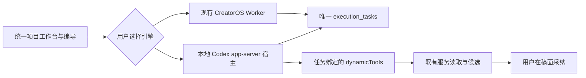

# T-1044 在统一创作工作台选择并使用本地 Codex

2026-10-01 用户明确要求保留完整工作台，并允许用户选择本地 Codex。此前已批准外部 Agent 接入，本任务复用 `codex/external-agent-bridge@7d2087a8` 的 execution_tasks、外部回执与任务工具 owner；Codex 宿主改用官方原生 app-server。参考 ACP 适配器的只读模式实际映射可写且复制认证文件，不纳入产品执行路径。当前设置页的 CLI 授权仅支持反向操作，不代表助手内可选本地 Codex。

## 用户怎样使用

在现有编导输入框选择 CreatorOS 或本地 Codex。保留主题、当前账号、项目和明确选中的作品；应用自动启动随包锁定的本地 Codex 兼容运行时，沿用 Codex 自己管理的本机登录与模型配置；不要求用户手动启动 CLI。运行时缺失、登录不可用或附件不支持时说明真实原因并保留输入，用户可明确换回 CreatorOS。不得静默换引擎。图文、公众号、脚本和制作仍在同一项目工作台查看候选、编辑并采纳。

## 已有接缝和集成合同

- FR-1044-1：沿已有 external-agent-bridge 的 `chat-turn-submission`、外部回执和任务工具服务集成，执行冻结 engine、accountId、projectId、taskId、有效租约、能力版本。只有 Codex 的进程传输替换为官方 app-server JSON-RPC；工具调用沿同一后端账本结算，模型仅产候选，由既有 owner 采纳。不暴露完整 CLI 凭据或直连数据库；不合并另一分支的 BACKLOG、审计事件或同号迁移。原任务旧回执保持兼容，native 回执明确 protocolKind=codex-app-server，不能冒称 ACP 协议。
- FR-1044-2：唯一执行 artifact 为随包锁定的官方 `@openai/codex@0.159.3` 对应平台本地二进制，使用 shell-free argv 启动 `app-server`；本机 PATH 中的旧 CLI 仅作版本诊断，不作为隐式备用执行器，不更新全局安装。发现与启动共用路径、版本和能力校验。installed 只表示随包 artifact 完整可执行；loginStatus 独立来自公开 `account/read(refreshToken:false)`，返回是否可认证，未核实时诚实显示未核实。CreatorOS 不读、复制、链接或落盘 auth.json，不请求原始 token；供应商运行时自己使用现有登录。诊断有超时与进程树关闭，保留输入。
- FR-1044-3：选择按当前用户安装持久化；后续新任务采用该选择，已冻结任务和恢复继续原引擎。切引擎不清空输入，不静默回退。只提供当前实现的 CreatorOS／本地 Codex；WorkBuddy 等尚未实连不放可点击成功入口。本机模型配置由 Codex 自己读取，CreatorOS 不替用户改全局配置。
- FR-1044-4：公共提交上下文绑定正在查看的 outputId、类型和实际保存版本，由 service port 核对项目与账号归属并冻结，任务工具再核对冻结归属、租约和能力。图文／公众号／视频多稿先明确选择，不默取第一份。未选择作品允许项目资料研究，需要作品目标的生成/修改要求选择。旧项目脚本沿兼容 owner 读取，不误建新视频。
- FR-1044-5：复用持久事件、结果卡和取消链。关闭面板仅停订阅；停止先发原 threadId/turnId 的 `turn/interrupt`，超时关闭本任务进程树。迟到结果不能跨账号、作品、租约回写。实际 provider threadId/turnId 与 operation/inputDigest 写入原 executionCall，并使用下述唯一恢复状态机；不能把供应商启动失败误记为已提交未知。
- FR-1044-6：`thread/start` 必须显式 `environments:[]`（禁用执行环境），本任务数据操作仅通过权限过滤的 dynamicTools；允许锁版运行时自带的无数据 I/O 辅助工具（如 clock），但不会把它们声称为业务能力。需要用户输入的原生请求返回“不支持此交互，请在 CreatorOS 对话中询问”，不伪造用户回复；未知工具请求拒绝。CreatorOS 不给 Codex 原生命令、补丁或任意文件能力。read-only/cwd/提示词不能代替这个边界。公开 `config/read` 只在内存提取有效 MCP 名称和特性布尔值，原始响应、env/header/token 不进入日志、提示词或持久数据；按真实服务名用本进程 overrides 全部 disabled，设置 `web_search="disabled"` 并关闭 plugins/apps/hooks/multi_agent/image_generation 等非任务数据工具，重启并复核。全局配置保持原样；未知特性、仍启用的 MCP 或原生工具不能证明已关闭时返回能力不可用，用户可选择现有引擎继续创作。工具清单及 thread 启动的实际能力需确定性协议测试和当前官方源码佐证。图片附件只在协议能力验证后传递，其他附件保留并提示采用素材 owner 读取，不能冒充纯文本。
- 宿主独占构造后续 `turn/start`：不接受客户端或模型提供的 environment override、additional directories 或 permissionProfile 升级，保持受控 thread 的无执行环境策略；不调用 fork/resume 去另起回合。App-server RPC 白名单仅 initialize、account/read、config/read、thread/start、thread/read、turn/start、turn/interrupt、mcpServerStatus/list 及受控 dynamicTool 响应；任意模型文本不能映射成 fs/readFile、命令或其他 RPC。协议消息、环境覆盖、MCP 启用状态及 tool call 归属均有确定性回归。
- FR-1044-7：Mac/Windows 包含各自锁定官方 runtime 和许可证，不在点击时 npx 下载，不带用户认证文件。native JSON-RPC 和宿主能力发现放在 worker/允许的 execution 宿主边界，frontend 只显示状态和提交用户选择；不把 Agent SDK 或后端业务挪到 frontend。原 Pi、CLI 与外部配对权限及旧任务保持可读。

## 未知回执的唯一恢复状态机

| 原 executionCall 状态 | 新 attempt 的允许动作 | 后置条件 |
| --- | --- | --- |
| reserved，尚无 provider turn 入场证据 | 当前租约下启动一次；先持久 threadId，实际 turn 入场时持久 turnId | 同一 operation/inputDigest；启动前失败可明确拒绝，已发送 turn 但丢回执必须 unknown |
| started / unknown 且存在 provider threadId/turnId | 只用 `thread/read(includeTurns:true)` 对账同一 turn，不再发送 prompt、turn/start 或工具动作 | 只有真实终态 completed、对应原 turn、冻结摘要不变且子工具全 settled/rejected、无 unknown，才能结算原 call 并提交原消息 |
| started / unknown 缺 provider ID、无法读取或仍运行 | 保留未知状态、已返回内容和工具记录，提示仍待核验 | 不自动新建 session 或重放；用户明确另起任务用新的 sourceMessageId，原任务保持未知 |
| settled | 读并提交原真实回执；相同提交幂等 | 不启动供应商、不重新执行工具；不同回执冲突 |
| rejected / cancelled | 展示原诊断／取消结果；用户可明确另起任务 | 不恢复已取消回合，不让迟到结果采纳或写回 |

恢复不会继续执行未知副作用；只对账供应商已有终态。若供应商返回 failed/interrupted，保留真实部分内容与诊断，不称成功。没有终态证据不得将 unknown→settled；供应商不支持历史读取时清楚说明结果尚无法确认。运行中订阅恢复使用原事件序列；执行恢复与 UI 重订阅分开。

## 验收

- AC-1044-1：真实检测随包运行时可用／缺失／版本不匹配／超时／本机登录不可用，UI 状态与提交失败一致，输入、附件与旧任务保持；双引擎选择、刷新和切账号回归。
- AC-1044-2：当前 Mac 的本地 Codex 通过助手产生真实任务、读取所选项目与明确作品、返回可核验结果，至少一次生成候选并在对应稿面人工采纳、刷新读回。fixture 协议测试和历史另一分支证据分别注明，不能替代本次实连。
- AC-1044-3：双账号、多作品、同请求、取消、重复订阅、迟到结果、发送后丢 turn 回执、持久 thread/turn 后断线、已入场未知回执和历史读取不支持分别验证；按恢复表逐项验证原 call 对账与拒绝重放，不覆盖原稿。
- AC-1044-4：沿既有 contract、Worker、持久提交和 frontend 集成测试；运行边界/孤儿/对账，真实记录既有失败；Mac 打包依赖包含检测和许可。0.144.5/0.156.1/0.159.3 的真实 schema 探针与隔离无模型 thread/start 证据单独记录，environments=[]、全部 MCP 禁用和 feature/tool 清单核验不能只靠 mock。Windows/其他 Agent 只能在真实环境验证后标通过。

复用参考分支属于本地集成；本任务不推送、部署、自动发布或改全局 Agent 配置。用户已明确授权实施与测试，无需再次确认同一范围。
