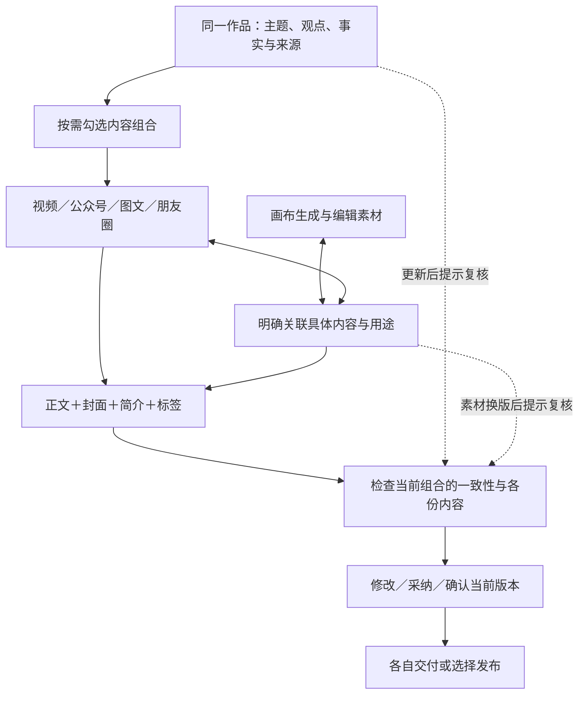

# T-1045 一鱼多吃：作品组合、画布物料与版本审核

2026-10-02 用户明确要求：“一鱼多吃要保证内容的一致性和连贯性，例如作品发视频 公众号 图文 朋友圈 都是可选的，但是可随意组合 作品与画布相结合，封面 简介 标签 审核 机制要连贯”。承接 T-1043 互转和 T-1042 多媒体整合，不取消可视剪辑或既有创作能力。当前是新增范围 SPEC，详细服务合同及实现尚未通过 Gate。

## 用户看见的一条完整流程

一条作品围绕同一主题组织内容。用户勾选视频、公众号、图文、朋友圈中的任意组合，也可先只做一份，再添加其他表达。每份内容可独立编辑、保存、审核和交付；未选择的内容不会自动生成或阻挡已选内容。各渠道共享经确认的主题、事实、核心观点与来源，表达、长度、标题、图片及发布物料可按渠道分别调整，不能把“一致”理解为复制相同文案。

例：只选视频+朋友圈，先完成视频脚本与剪辑，再从已保存稿件生成朋友圈候选；从画布选一张具体图片作为视频封面和朋友圈配图。公众号/图文没有被勾选，不要求补稿。视频改了关键结论，朋友圈显示“依据已更新，需要复核”，保留原朋友圈文案，用户对照后选择更新。改标签不会清空封面或让其他渠道的正文采纳失败。

## 组合与具体稿件

- FR-1045-1：四个用户选项可自由组合，不是顺序阶段；支持单选和全部 15 种非空组合，暂时不选也可保存作品资料。增选只加入对应草稿/候选；取消选择不删除已有稿件、历史、素材或发布记录，重新选中可恢复原内容。
- 产品层的一条作品包含相关表达；数据层继续由现有具体 output 与对应 owner 保存正式稿件，不把不同正文塞到一个字段或让不同渠道共用可变正文。明确记录组合关联、具体目标 output/发布草稿身份和来源版本；同项目有两条不同主题作品时不可仅靠 projectId 或 contentType 自动归为同一组合，不暗选第一份稿。
- 保留文章/图文/视频三个底层 contentType，公众号沿文章 owner。朋友圈是该作品可独立保存的短文/配图交付项，不默认扩成第四个通用创作类型、不冒充公众号平台或自动发布能力；其真实 owner、持久化版本与操作由合同定稿。朋友圈只选时仍可编辑短文并选图，不强制先做视频或公众号。
- “添加一种表达”可从组合中用户明确指定的已保存稿件或已确认内容依据生成；未存稿先明确保存，失败不调用模型。默认转换仍保留原稿、经过候选采用。正文可独立完成，不把尚未有封面/简介/标签当作保存硬门。

组合拥有稳定身份，每个表达关联明确目标。已有同类型多稿时由用户选择；取消/恢复沿原关联身份及其实际当前保存版本，不凭类型新建或暗换稿件。查看/恢复历史是另一项明确操作。朋友圈单选的保存、选图、复制及下载必须经真实独立 owner/版本/CAS 路径，不依赖虚构的视频或文章 output。

## 内容一致性与连贯性

- FR-1045-2：共享依据使用真实不可变版本锚点：主题/观点/事实来源、定位和适用规则版本，以及用户明确选用的稿件段落/字段。可以从文章、图文、脚本或朋友圈已保存内容起步，不把视频设为强制母稿。重复生成/重试沿原冻结来源及请求回执，不换今天的依据。
- 每份衍生内容保存自己的正式版本、生成来源、已采用字段和使用素材版本。模型在用户选择的上下文内调整渠道表达，不能编造新事实或将关键结论改为相反；缺证据显示待确认。内容一致、信息是否遗漏、论证是否连贯由可配置 Skill/模型判断，代码校验来源/版本/权限/范围，不用关键词或字符串相似度冒充一致性审核。
- FR-1045-3：更新任一作为来源的已保存稿件/共享依据后，按显式依赖标识哪些衍生内容与物料使用旧版本。机械依赖变化先显示“依据已更新，待复核”，模型复核后才能说明是否实质冲突；不得按文件名、标题或更新时间猜测血缘。
- 不自动同步覆盖：用户可查看变更、对所选目标发起局部更新候选、按项采用；未涉及字段和手工修改保留。允许继续保留历史依据，明确显示与当前依据的关系；已发布内容始终保留当时快照，不自动替换或重发。同字段冲突保留输入，其他字段可以继续采用，沿 T-1031/T-1043 的触点机制。

保留历史依据须记录用户所选源版本及确认范围；只能说明已确认该历史依据，不能自动升级为“与最新依据一致”。重试绑定原完整请求、规则与素材版本，不只比较正文摘要。单份审核按实际触点绑定，组合复核另绑定所选表达身份及版本；生成完成、模型未发现问题和用户确认是不同状态。

## 画布与作品双向关联

- FR-1045-4：从具体作品/表达打开画布，携带明确的作品、稿件版本、选区/图卡及用途；画布结果产生真实 Asset，经用户选择再关联为封面、正文配图、图卡、视频素材或朋友圈配图。画布不直接写正式正文、不默认替换已有物料。
- 从已有画布选择真实成果“用于作品”，明确选择组合里的目标表达和用途；可让同一真实素材用于多个表达，每个关联分别记录，来源文件保持共享，不复制成虚假素材。账号素材、加入项目、用于具体表达是不同事实，均经现有 service 重新验证。
- 绑定真实 assetId+assetFileId/不可变文件版本及生成来源；画布节点移动不会断开已选素材，重新生成或替换文件产生新版本，不静默更新已确认封面。显示所用版本与“有新版可选”，用户明确采用后才更新对应物料并使相关审核待复核；历史文件缺失明确提示，不能拿新文件冒充原文件。
- 作品文字改稿后，依赖该版本生成的画布物料显示“内容依据已更新”；模型提出是否需更新的建议，用户可重生成、保留或替换。缺生图/生视频能力仍可上传/选用已有素材并继续文字工作，不能阻断整个组合。

## 封面、简介、标签与审核

- FR-1045-5：每份表达的正文、封面、简介、标签以同一面板展示当前保存/候选/采用状态及依据；按渠道真实能力可选，单项生成/编辑/采用，不默认一键覆盖全部。每项绑定具体 output/交付项、稿件版本、物料版本、实际字段前值与来源；从候选到保存、刷新、历史恢复可读回。
- 封面可以来自画布或现有生成/上传链，经真实预览和用户选择采用。简介/标签依据指定已保存内容生成；只改标签不抹正文、封面或简介，生成/采用失败只标该项并可重试。无简介/标签需求的渠道可显示“不使用”，不能编造平台能力或假按钮。
- FR-1045-6：审核同时呈现“各份内容/物料审核”和“当前所选组合的一致性复核”。问题定位到具体表达、字段、段落或图片，给出可理解理由和修改候选；用户可编辑并逐项采用，不把建议直接写库。
- 审核回执绑定所审正文、封面/图片文件、简介、标签、共享依据及所选组合的确切版本；任何相关项改变，其对应旧回执保留为历史并显示待复核，不能继续冒充当前审核通过。无关项不清空已有通过记录；仅组合发生增减时更新组合复核，不凭此判其他未变内容审核失败。
- 显式区分未审核、进行中、待用户确认、需修改、已确认当前版本、依据已更新；“模型检查未发现问题”不等于用户已确认。模型不可用时显示未验证，保留人工检查/编辑和既有导出路径，不能显示虚假通过或新增全局质量门阻断合法保存/生成。既有必要权限/来源/发布规则继续生效。
- 发布前沿既有真实平台能力展示该渠道必需项、最新版本和适用审核状态，已确认新版本不更改旧发布快照。发布是独立用户动作，此需求不授权自动发布，也不承诺当前无接口的朋友圈直发；朋友圈可先真实复制文本、下载配图交付，只有接通真实操作才显示对应按钮。

## 交互与服务边界

FR-1045-7：组合选择、稿面、画布关联、物料、审核和交付在同一作品上下文连贯可达，保留完整稿面与原顶栏。摘要区展示真实数量/状态，例如“已选2份，1份依据待复核”；选项不是完成步骤，未选内容不显示待办债。首屏突出当前稿件；画布、物料和审核按需展开，保留在途任务挂载；正常与最低窗口无按钮裁切，键盘可用。切作品/账号、慢请求及刷新遵守 LED-047，在途限制及旧响应隔离，不出现他人或另主题稿件。

复用 T-1043 转换来源和候选、现有具体稿件/creative-results/publication/review owner、T-1042 画布与 Asset。不建第二套 Agent、执行队列、素材数据库或可变 current plan。新增组合关系、朋友圈 owner、审核版本指纹及状态传播需要先定稿 contract→transport→service→repository 独立评审，再改生产代码。AI只产候选，用户采纳后后端验权/CAS落库；重试幂等、历史不可变、旧数据不自动迁移覆盖。旧 standalone output 不强制归入组合，不以升级需求破坏旧可用入口。

## 完整验收

## 2026-10-02 服务合同定稿候选

用户已要求全面落地并完成自测。以下选择在既有授权范围内具体化，不代表实现通过。新增 work-compositions/moments 领域模块，review 模块扩展真实组合报告；仍使用唯一 backend 数据库及现有 execution/ai_tasks。三个 output owner 不变。画布端口由 T-1042 真正整合，未接通不展示虚假生成结果。

### 存储与事务

`work_compositions`：稳定 id、userId/accountId/projectId、basisArtifactId、currentRevision。`work_composition_versions`：compositionId/revision 唯一、basisVersionId、selection 和明确成员槽位、createdAt；完整快照不可变。selection 为 video/article/image/moments 任意子集，不能有重复；成员 union 为前三者的 outputId 或 moments 的 momentsId，每个 kind 一个明确槽位。取消只改 selection，成员保留；重新选择沿原成员当前正式版本，历史恢复另作明确动作。同项目可以多个组合，列表不自动分组。

共享依据使用 `work_basis` artifact，topic/claims/factItems/严格来源及规则引用作为正式文档，由组合 owner 通过 artifacts service 保存，组合只有 basisVersionId 引用，不另存可写正文。空依据可以手工保存；发起生成时必须有用户明确提供的文字/选区，不能编内容。

`work_composition_requests` 与 `moments` 创建回执绑定 user/account/clientRequestId，保存完整 payload 摘要及结果，唯一请求键。所有写操作带 expectedRevision/clientRequestId。来源/关联 owner 在同事务连接上通过公开 service 重读鉴权；CAS 当前、版本、请求回执在同事务提交。新建成员通过可持久恢复预约绑定稳定 owner 创建键；先保留预约，再创建 owner 草稿，最后绑定；断线后查预约/owner 原回执恢复同一目标，不复制 output。同键异内容409，同键同输入鉴权后恢复原回执，缺失/越权404，非法结构400。外账号、其他项目、错误类型不允许绑定。

朋友圈 `moments_anchors`：id、user/account/projectId/artifactId、创建请求摘要；`wechat_moments` artifact 用既有版本表。document 为 schemaVersion:1/text/imageUses[{assetId,assetFileId,order}]/sourceRefs，无必填图片/标题。新增严格 `moments_version` 引用包含 momentsId/artifactId/versionId/selectionDigest/选区，按 owner 历史核验，不伪装 output。采用以 text 或 imageUses 实际字段前值校验，其他字段不覆盖，采用回执与正式版原子保存。

### 公共操作

| 操作 | 明确输入及返回 |
| --- | --- |
| workCompositions.create/get/list/versions.get | create: projectId/title/clientRequestId；读明确 compositionId/revision，list分页；返回真实完整组合与版本 |
| workCompositions.selection.save | compositionId/expectedRevision/clientRequestId/selection；只更新选择，不删成员 |
| workCompositions.members.bind/create | 明确 kind及目标身份，或完整 owner 创建输入；expectedRevision/clientRequestId；返回稳定绑定和新 revision |
| workCompositions.basis.save | 完整依据 document、expectedRevision/clientRequestId；返回真实 basisVersionId及组合revision |
| moments.create/get/versions.get/versions.create | 明确 projectId或momentsId/versionId；写完整document、expectedCurrentVersionId/clientRequestId；真实版本回执 |
| moments.candidates.generate/get/adopt/retry | 明确 source/选区、规则引用、目标触点、requestId；原 Worker文本候选task/candidate引用，采用带字段前值和用户editedValue |
| workCompositions.dependencies.get | compositionId，按真实 owner 当前值返回字段级 current/historical/needs_review；不写稿 |
| work.sources.select | 只读POST，projectId与三类明确历史owner/version/范围；服务器产生锚点摘要，客户端不报摘要或正文 |
| workCompositions.canvasContext.get | compositionId/member/version/选区/用途，返回已鉴权上下文；无画布端口明确不可用 |
| workCompositions.materials.attach/replace/detach/list | 明确 member、用途 cover/body_image/card/video_material/moments_image、target section/card/item ID及真实assetFileId；预期owner版本和requestId；由原owner写正式物料 |
| workReviews.create/get/list/status/confirm | scope:member/field/composition、明确身份/字段；冻结snapshot/fingerprint；create返回真实task/report，confirm重读真值并绑定当前fingerprint，requestId恢复原确认 |

正式接口形状落 contract resource/operation，禁止自由 JSON path；各 endpoint完整 errors/permissions/examples 必须测试并过独立评审。复制朋友圈文本读取指定保存版本；下载通过精确Asset文件公共接口，不产生publication或“已发布”事实。

### 依赖与审核

依赖由正式采用回执记录具体 member/owner/版本/字段及来源 basis/output/moments/素材文件/规则版本；正式保存失败不标采用。通过owner当前读取做只读失效投影，不靠名称或project.updatedAt猜血缘。用户保留历史依据的确认范围独立保存，不能升级当前一致性。

新增 `work_review_reports` 与 `work_review_confirmations`：user/account、scope、不可变snapshot/fingerprint、task/report、问题定位及model结论或用户明确确认；指纹规范JSON仅机械版本校验。单项绑定所审字段前值、素材文件、实际来源及发布修订，组合绑定selection/member身份/版本/依据。标签改变只影响相关审核/组合复核，不误杀无关字段采纳。模型无问题与用户确认分离；没有真实视觉审图能力时图片标未验证。报告提交沿现有execution/Worker受控端口，验证租约/账号和实际冻结ID，不创建新执行器。旧报告保留，当前status从指纹匹配投影；人工确认可独立记录并标明未做模型验证。

素材关联要求当前账号、同项目且明确目标，Asset文件精确版本验证；画布仅提供已提交成果与生成来源端口，节点变动不替换文件。正式owner版本与关联回执在同事务提交或沿原owner幂等回执恢复，不留下“已关联”假状态。未映射目标拒绝且保留输入。

新增表、artifactType及索引沿正常backend/drizzle迁移和fresh DDL；先核对当前编号，测试全新库和两条画布/报表旧谱系副本，保留全部历史。不自动归组、创建朋友圈、覆盖旧稿或更换旧发布快照。公众号物料沿article真实能力；朋友圈先文本/文件交付，不能用现有仅image/video的publication adapter冒充支持。页面同一作品摘要+组合选择+具体稿面+物料/画布/审核辅助区，900×600及1440×900实际验收。

### 独立复核后的合同澄清

field审核的owner/publication版本ID只保存在不可变snapshot中追溯，不参与无关字段的当前有效性判断。field指纹仅比较实际所审字段前值、所依赖来源和素材文件；member整稿审核比较完整正式版本，composition比较selection/成员身份/完整版本/依据。因此标签修订不会使未变封面的field确认失效，但整稿/组合复核可待复核。

members.create统一采用持久预约路径，不同时承诺跨owner全部同事务。请求预约状态reserved→owner_created→bound，另有conflict/cancelled；持久保存稳定owner创建键和实际targetId。首次reserve在expectedRevision CAS内占用该kind的待建槽位、revision加1，但不加入selection、不显示正式已绑定。另一个同kind创建读回该预约或明确冲突；用户bind/cancel可明确替换/取消待建槽位并记录状态，不能暗中覆盖。

owner_created保存实际targetId，即使此时用户改变selection也不丢回执。finalize在当前组合事务中校验原预约仍有效、kind槽位未被改绑；无关selection变化可重读当前revision并CAS完成绑定，不改用户selection。预约被取消或槽位已换时标cancelled/conflict，返回实际已创建targetId并保留独立owner草稿，不称已关联、不删除、不重建。用户可明确bind这个实际目标。`workCompositions.members.requests.get`读真实状态与target，重试沿原预约/创建键；新动作须新请求。

依赖权威记录存于`work_composition_dependencies`，严格目标身份/正式采用receipt/来源union/字段/素材文件/规则；同事务关联owner写入，或以原正式采用回执幂等补齐，读侧在未确认receipt前标pending，不能显示已采用。审核报告提交须读取并核验原任务真实settled结果与冻结snapshot，不接受模型自报成功。全新库与旧库均沿同一正常版本迁移构建schema，fresh初始化不能绕开该迁移谱系。

本轮合同核对：现有 `creativeBundle` 绑定单个 outputId，不能直接当跨表达组合；`creativeOwner` 当前仅有 graphic_post/output_script/wechat_article/publication，没有已验证的朋友圈正式 owner；`scriptReviewReportResource` 目前绑定脚本 artifactVersion，没有涵盖封面文件、发布物料和整个组合。上述能力可复用局部服务，但不能改名称就称一鱼多吃与统一审核已完成；需补齐实际关联和审核范围。

1. 15种非空组合及空选择、先单份后增选、取消/恢复、朋友圈单选；未选项零模型/生图调用，不要求其他稿件才能保存/交付。
2. 同项目不同主题各含同类型多个 output、双账号、不同来源类型起步；组合归属、源版本、部分转换/采用与字段回执准确，重试不复制交付项或收费任务。
3. 改依据→受影响内容提示→模型/人工对照→局部更新→保留手改→重新确认，事实/观点一致性由真实模型样本核验；缺凭据记未验，不用fixture冒充。
4. 作品→画布→真实图片/视频→具体封面/配图/素材；画布→明确目标表达；同素材多用途、素材换版、节点改动、缺历史文件、跨账号拒绝，原发布快照保留。
5. 正文、封面、简介、标签分别生成/采用/失败重试/保存刷新，审核对照确切版本；改标签不误杀封面采纳，换图仅重核相关记录，组合增减及已发布旧快照均明确。
6. 真实旅程至少覆盖视频+朋友圈、公众号+图文以及四项组合，从当前保存稿、画布物料、审核修改到实际文件/文本交付；视频沿 T-850/T-1037—1041 验真实 MP4，不能用脚本称视频完成。实包与真实发布能力分别记证据。
7. 公共接口/contract/前后端/LED-047/boundary/orphan/reconcile 当场记录，历史缺失不补拍。具体服务合同和页面规范定稿后独立评审；T-1043/T-1042原实现继续拥有各自范围，本任务不把它们的局部测试冒充完整一鱼多吃完成。
