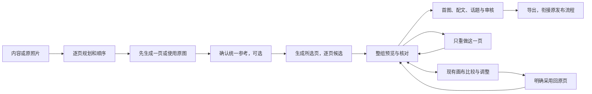

# T-1048 在现有画布落地连续组图创作

## 用户目标与授权

2026-10-02/03 用户明确：先完成一份内容，再自然扩展表达；图文核心是出图和组图生成，一致性与作品/画布衔接；快图可以保留和改造，但不作为主工作流。优先集成成熟开源实现再改造，要求交互可用、布局合理、全面自测。T-1047 已完成调研，本任务落实其结论，不重复开发编辑器。沿用客户端已配置模型；真实模型未可用时如实记录待验，不能用桩结果冒充完成。

用户进入作品，看到这组图有哪些页、每页说什么、已经出了哪张图。可以先改内容再出图，也可以使用原照片。统一参考和风格是可选帮助，不是创作前置表单。只重做某页保留其他页；画布调整能明确回到原页。最后核对整组、首图与配文再交付。

## 开源复用与物理边界

复用 MIT 的 JimLiu/baoyu-skills 中 baoyu-xhs-images 的逐页大纲、共享视觉方向、首图参考、逐页提示和局部重做方法。固定提交 `1567581c26ec29f4216c6e6835415bf30343b0e3`，保存选用源、MIT 许可、来源、哈希及改造说明。它提供生成方法，不是编辑器；不执行上游脚本、不照搬关键词选风格、固定页数、默认平台硬规则或禁止改字限制。方法接入现有可配置 Skill；画面取舍由模型与用户负责。可编辑文字仍是稿面真实文字，不把 AI 位图里的错字当作正确正文。

单一领域属主仍是 GraphicPostsService/现有 Artifact 版本。CreativeResults 管候选及已有 bundle，Assets 管不可变图片文件，Canvas 管节点/候选/比较，WorkMaterials 管来自画布的精确槽位采用。Worker 通过现有受控端口调用模型与写候选，不直连数据库。不新增组图数据库、生成执行器、编辑器或自动写正文链。

## 合同与版本

1. GraphicPostDocument 保持 schemaVersion=1，新增可选 `seriesProfile`：`visualDirection:string`，`aspectRatio:string`（由已支持模型能力校验，不冒充平台限制），可选 `referenceImage:{assetId,assetFileId}`。CardBrief 新增可选 `visualBrief:string`。旧稿缺字段仍可读写，已有照片和未绑定 cardId 的图片保留，不自动猜页或覆盖。具体参考必须是本账号可读的 active image 精确文件，不能保存一个会漂移的 currentFile 指针。为空的风格/画幅允许沿用现有能力默认值。
2. 复用 CreativeResults 已有 `targetSectionId` 携带图文真实 cardId，只允许 image/image_card；文章仍使用自己的 sectionId，其他类型拒绝。单页请求必须从本账号当前作品和不可变 baseVersion 读取指定页，不接受前端自报正文、风格或文件事实。不存在/重复/跨作品页拒绝。
3. 冻结输入含目标 cardId、目标页标题/正文/visualBrief/sourceRefs、全部有序页规划、正文来源、seriesProfile 与精确参考文件证明。模型据此判断页间关系与共享风格，代码只校验真实 ID、归属、类型与精确版本。冻结内容与原不可变版本不一致时拒绝。重试原任务复用完整冻结输入；参考 Asset 后来换 currentFile 也不换原文件。真正的请求未知沿原 requestId 查询，不能自动重复付费。
4. 生成选中页复用已有 bundle，每项保留 cardId、taskId、状态、错误与候选；一页失败保留成功页并可只重试失败项。既有 bundle 容量是系统容量，不解释为平台限制；超过单次容量分组提交并显示真实分组状态，不静默漏页、不新建第二轮询/执行引擎。首图可先单页生成；用户采用并明确设为统一参考后，后续请求冻结该精确文件。没有参考可用仍允许文生图，不能因审美要求阻断合法生成。
5. 图片候选读取必须携带目标 cardId 和本次真实 assetId/assetFileId。采用仅替换该 cardId 的 card 图片，未绑定旧图片、其他页、旧素材历史和用户文本保持不变。同批其他页的图片采用不会使余下页作废：用当前版本 CAS，按冻结的有序规划、来源、正文及风格/参考逐字段比较；这些依据改变需重新审读/生成，不能拿旧规划覆盖新稿。已采用回执同请求重放，不重复落库；新的过期 CAS 明确冲突并保留候选与草稿。
6. 用户换图/排序/删除页是明确操作，不由代码推断语义。cardBriefs 顺序是有绑定页的阅读顺序，图片 order 为派生展示顺序；未绑定旧照片保留用户顺序。删除页先明确是否移除该页图片，保留 Asset 历史；候选目标已删除不可采用。移动页不会改 cardId，会提示整组需要重新核对。文字、参考或图片改动均通过已有版本 owner 并影响现有审核依赖。
7. 封面是既有 role=cover 的独立精确文件用途；把某页设为封面时复制其文件用途，不破坏该页 role=card/cardId。整组交付按页顺序，若封面同文件，交付列表只出现一次；单独封面置首，其他页保持顺序。选择封面不擅自改文字或隐式删除旧页。未绑定旧照片和原单图合法保存、导出仍可用。

## 图像调用与画布衔接

图卡 Skill 分支读取冻结逐页规划和共享方向，对指定页产出画面提示候选；旧整稿说明配图与公众号段落配图保留。生图沿已有 cover/card 的持久两次调用/结算与精确参考读取端口；接通 seriesProfile 的精确参考和画幅，禁止丢 referenceFileId 后取 currentFile。供应商不支持参考图时显示实际不可用原因，用户可明确选择取消参考转为文生图；不能静默声称使用了参考。不要声称共享 Prompt 能保证视觉或事实一致。

从选定页进入现有画布：独立稿使用账号隔离的 scoped canvas handle，绑定 account/project/output/cardId/baseVersion 和原槽精确文件；入画布先通过既有 getGraphicPost/getGraphicPostVersion 读取并核验原项目、真实页及版本，再创建/复用有真实页说明与参考的生成节点。普通图文不要求 compositionId，不隐式创建或挑选组合。Canvas 生成节点新增可选 referenceFileId，指定组图精确参考时持久保存该文件并沿现有 getReference/readImageReference 端口读取；旧只指定 Asset 的自由画布继续冻结提交时的当前文件。生成只产候选；用户确认图片后重读 getGraphicPost，以当前真实页和原槽精确文件核对，经既有 GraphicPostsService createVersion 当前版本 CAS 明确采用回该 cardId，仍是原唯一领域 owner。返回 `/projects/:projectId/outputs/:outputId/image` 并读回真实新图；旧画布自由创作继续可用。

已有页图来自媒体采用、用户选图或快图但无有效物料关联时，同样从 owner 读当前槽精确 expectedFile，显示“替换这一页”确认，再用原 createVersion CAS 仅换该 cardId；不伪造 association、不先删图再 attach、不覆盖其余页。原槽若已被另一操作替换，保留新候选并报冲突，用户重新读回和确认后才能用新的 CAS 保存。已有 composition 且有效 association 的原 WorkMaterials replace 流程继续可用；不能挑选其他组合/槽位的 association。增加独立稿进入/返回、媒体或用户先采用→画布替换、并发换图、目标删除、跨账号及旧保存回执重放的公共链回归。

## 主界面与真实操作

工作台主面是组图页列表/网格和选中页的内容、图片与候选；只有一个清楚的主动作，随状态显示“规划组图”或“生成所选页”。页可新增、编辑、选中、排序、删除。页选区、图片预览、当前候选与历史区分；空页显示真实空，不拿文字方块冒充已出图。统一方向/比例/参考放可展开区域，不堆全屏前置配置。

每页提供真实的生成/重做、候选预览/采用、使用已有图片、进入画布、可选快图细调。正在生成不阻断其他页编辑；依赖变化时保留候选并解释差异。整组网格便于核对连续阅读，标题/配文/摘要/标签放交付区，原正文仍可直接编辑和保存；扩展其他表达在首份内容后的既有入口。不再在顶部列出所有页的“编辑图卡”按钮。

复用现有 ImagePreview 精确文件 URL、候选查询/采用、bundle 状态及错误。合法保存/导出不能因没有模型、无参考、没有整组审核结果被额外封死。AI 检查读取实际图片和文字，若当前模型没有图像能力如实提示，用户仍可手工整组核对；版本哈希不是语义审核。没有后端操作的控制不展示为可用。

900×600 与 1440×900 下可操作；页列表和选中页避免重复大表单，按钮文案直说结果，可键盘操作、焦点可见。状态/错误紧邻动作。页面与账号/output 切换阻断旧响应回写、限制在途轮询并取消卸载更新，运行 LED-047 回归。同页面板走本地打开，不等待整页路由。

## 验收与证据

先写行为红测再实现，不回填历史 RED。Contract 验证新旧稿、页字段、引用与 targetSectionId 允许范围。Backend 公共服务/适配器测试实际多页依次采用、同页替换不动其余页、冻结参考换版本不漂移、未知提交幂等、跨账号归属、目标删除、并发 CAS、失败项恢复、封面去重和旧未绑定照片继续保存。Worker 测试整组语境/目标页/真实参考及画幅沿原持久调用传递，不新增模型通道；Skill 可配置和上游许可来源可核验。

Frontend 组件集成测试真实操作绑定、选区和 dirty 保存、多个目标页提交/采用、失败局部恢复、草稿保留、画布准确返回、候选与作品读回一致、切换账号不串写、可选快图。真实 UI 验收从已有内容到三页规划、至少三张实际模型图片、单页重做/采用、画布返回、首图/配文/标签、整组检查和真实导出。两种视口检查布局；模型/浏览器安全策略阻断时记录具体未验，不能以测试图片或源码断言充数。

运行受影响 contract/backend/worker/frontend 测试与类型检查、LED-047、boundary、semantic boundary、orphan、reconcile。既有全仓失败单独列根因与范围，不能增高基线或伪报全绿。证据写 `docs/verification/t1048-image-series.md`。实现、许可及验证可审阅后提交；完整真实链路和所需 Gate 未过不标任务完成。
