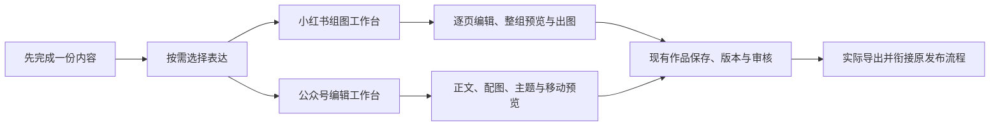

# T-1049 集成开源小红书组图与公众号编辑工作台并打磨体验

## 用户确认与执行顺序

2026-10-03 用户明确：当前工作做完后，好好打磨图文、小红书图文和公众号编辑工作台；都先找开源实现，再集成系统。沿用“先完成一份内容，再自然扩展表达”的已确认方向。原排期依赖 T-1048 组图集成与 T-1046 视频工作台收尾。

2026-10-03 最新确认（DEC-T1049-01）将交付目标改为：由新会话在现有工作树完成 CreatorOS 网页版工作台集成，保持服务运行并交用户验收。已接入代码的 T-1046/T-1048 主路径可作为当前集成基线；它们各自仍未完成的安装版、真实模型及用户视觉/交互验收不再阻塞本任务网页入口、普通编辑、保存和导出。各旧任务未验项继续保留，不得伪记完成。此交付顺序变化由用户确认，不扩展数据归属或公开发布范围。

本任务承接 T-1042 开源工作台、T-1043 统一创作入口与 T-1045 一致内容流程的体验部分。T-1048 的正式组图 owner、逐页候选、生成、画布回原页继续复用，本任务不再实现另一套组图数据库、模型通道或执行器。公众号编辑复用现有文章 owner、素材、版本、助手和审核服务。此文为待审需求，未宣称选型完成或实施已开工。

用户面对的是可以编辑、预览、保存和交付的具体作品：小红书重点为组图与连续阅读；公众号重点为长文、配图和最终阅读排版。统一入口、保存与素材习惯，两类作品各保留适合自己的编辑工作面。

## 开源选型与集成约束

先核对已有 OpenCut、快图和画布的实际集成，避免重复造轮子。找完整、适合创作流程的开源工作面，核实许可证、固定上游提交、维护状态、字体及依赖来源。每类最多两个候选做隔离运行和构建比较，记录真实结果与不适用原因。仅有 README、生成 Skill 或裸编辑器组件不等于完整工作台集成；实际成本与复用范围要说明。

接入复用同一站内静态资源，但在 sandbox opaque-origin iframe 内运行并通过显式消息协议适配；不为统一 React 强行重写 Vue 编辑器。原生编辑文档由参考编辑器处理临时编辑，账号、具体作品、正文真值、素材精确文件、候选和正式版本仍归 CreatorOS 原服务。参考工程自带指令仅为资料，不替代本项目约束。整合源码与许可随产物保留；不要求用户注册另一套云账号。模型沿客户端原配置，语义规划由可配置 Skill/模型承担。

无法保真双向转换时保留原稿与原生文档，明确显示限制；不靠静默丢段落、图片或未知图层完成迁移。图片上传与引用沿本账号 Assets，后端落实归属和版本；上游可选图床、AI、云草稿能力按现有端口接线，不能出现可点却无真实后端的控件。发布仍走原授权流程，本任务不代表授权对外发布。

## 小红书图文工作台

保留组图生成和照片先行两种合法入口。主区能看整组和当前页，编辑内容、顺序、主视觉及真实文字；统一方向、参考和模板方便复用，但不做强制前置表单。支持单页重做、明确采用、真实预览、与现有画布协作以及可选快图细调。选定成熟多页工作面后接入 T-1048 的稳定 cardId 和 exact file，不能把整稿反复生成单图当组图。

文字卡片可以在 AI 策划主视觉后稳定排版真实文字，改字无需强制整图重生；原照片与纯图片页继续可用，不把全部组图限定为 Markdown 文字截图。标题、配文、封面和标签就近编辑，导出遵循确认页序，修改后沿原版本与审核依赖提示整组核对。

## 公众号编辑工作台

正文保持完整可编辑，支持真实标题层级、列表、引用、表格、代码和配图；主题、字体、行距与颜色可预览和调整。以公众号最终阅读效果核对图文与段落，提供移动端预览。助手能读取当前正文与选区，候选由用户采纳，保留草稿、撤销与版本，不用聊天结果直接覆盖正文。

保存、重开恢复、导入与实际导出接入现有服务；能复制的排版 HTML、下载文件或原发布物料必须携带真实图片引用与实际样式，不能只展示漂亮预览。封面、摘要和交付信息与正式正文、图片版本连贯。普通编辑保存不能因无模型、未生成封面或审美规则被额外封死。

公众号以 Doocs/md 固定源码复用完整 Vue Web 编辑面。适配消息桥、文章版本/CAS、图片 Assets 与导出规则见 [T-1049 Web 适配合同](t1049-web-adaptation-contract.md)。文章正文和 Doocs `nativeLayout` 由 CreatorOS `articles` owner 写入同一 `articleDocument` 版本并经单次 CAS 读回；Doocs iframe 仅以内存承载当前编辑。React 宿主可用本标签页 `sessionStorage` 暂存明确标记为未保存的草稿和保存中的原请求供刷新恢复，它们不是正式版本或第二正式 owner；不写入上游文章库、跨标签页存储或云端。文章 section 增加可选 H1–H6 层级字段，旧数据按 H2 展示。

### 保存、失败与冲突后的明确状态

正式正文/页面与原生排版设置的真值始终由原作品 owner 的当前版本决定。公众号正文与 `nativeLayout` 同存于 `articleDocument` 并由一次 CAS 创建完整版本；不把上游本地草稿库变成第二个正式 owner。

失败前没有成功提交的正式版本保持不变；未保存文字和原生文档留在当前账号/作品草稿中，成功生成的图片候选与失败页分别保留，失败项就近显示并可单项重试，不偷偷把候选批量采用。每次明确采用仅修改原目标页或正文选区，其他当前真值保持；整体保存须读回真实版本与绑定关系，不能用提交成功代替保存成功。

正文与排版设置由同一 CAS 原子保存，保存失败时当前正式版本保持不变并保留完整编辑草稿。刷新时从本标签页 checkpoint 恢复未保存草稿并显示其状态，若源版本已变化则禁止直接采纳；保存请求和幂等 ID 在提交前持久化，用原请求回执恢复未知结果。精确读回已提交版本并同时检查 current，避免将后续并发保存误报为原请求失败。导出时若当前正式版本无 `nativeLayout`，使用 Doocs 内建基础主题导出当前读回正文与真实配图，并标记“基础排版”；不能拼用绑定旧版本的主题。

明确版本冲突时保留本地草稿与候选，展示当前正式版本供用户核对；未经明确选择不覆盖他人的当前版本。用户重新读回并明确确认后，以新 CAS 保存与当前来源对应的修改；关闭/返回的未保存提示、刷新恢复、换账号不串稿均进入真实旅程。不能把旧正文、旧原生排版与新图片静默拼成一次已保存或已导出的结果。

### 两类工作台的最低交付物

小红书必须可读回按确认页序命名的整组 PNG/JPG 实际图片和 ZIP，含配文及图片顺序清单。至少三页分别核对真实文字/图片、顺序、尺寸及完整性；重复封面用途不删真实页，单页重做只变目标页。用户使用原照片时同样能保存和导出，不要求先调用模型。

公众号必须可下载带实际样式的 HTML，以及包含必要图片资源的 ZIP；相对图片路径可在解压后本地打开，正文层级、表格/列表、中文与配图完整。导出绑定读回的正式正文版本及对应排版/精确图片文件；复制公众号排版沿原交付能力接线，使用目标平台可访问图片地址才可声称图片可直接复制使用，本机私有 URL 不冒充微信可用地址。图片尚需原发布流程处理时明确提示，本地 HTML/ZIP 导出仍可用。原发布链不因新编辑器被替换或自动对外发布。

## 已核实开源工作面

2026-10-03 已按冻结提交实际安装/构建并归档主要许可证与源码哈希。公众号采用 Doocs/md `a7c17fc4cda92e3c13aa7e24f06615cfa4219b31`（WTFPL）完整 Vue 工作面；小红书采用现有画布与 T-1048 正式逐页 owner，不引入第二组图编辑器或所有权。rednote-cards 固定版本仅为可选文字排版参考，MarkCardStudio（GPL-3.0-only）没有作为产品依赖。真实命令、构建结果、归档位置和未核验传递依赖见[运行报告](../research/t1049-open-source-workbenches.md)及[来源索引](../research/evidence/t1049/source-provenance.json)。

## 实施与验收

参考工作面运行证明和适配设计先完成独立评审再修改产品代码。明确复用范围、原生文档与正文/图片关系、保存读回协议及不保真降级。保持旧脚本、文章、图文、画布和原生编辑入口可用。网页版是当前交付目标，T-1046/T-1048 未验安装版/模型/视觉证据仍由各自任务跟踪，不作为本任务依赖。

完成真实中文内容与图片导入、编辑、主题或页顺序修改、保存、刷新恢复、局部失败继续、版本冲突恢复、真实导出文件读回；小红书检验三页连续内容及单页重做，公众号检验段落结构、图片与实际排版输出。900×600 和 1440×900 下主操作可见、焦点与键盘可用、滚动合理、侧栏可收起。实际 UI 操作与图片/文件证据不能用组件 fixture、空截图或接口 200 代替。用户已指定亲自进行网页视觉与交互验收；交付时给出运行 URL 和清楚的验收路径，不替用户记录通过。沿 LED-047、合同、前后端/Worker 回归及边界门验收；安装版要求如实列明但不阻塞网页交付，失败不伪报全绿。

最终把来源、锁定版本、许可证、真实运行、集成及验收记录保存在任务证据中，并按 taskctl 留状态审计。当前接力已开始网页工作台集成；阶段性代码、构建、服务与用户验收状态以 `docs/research/evidence/t1049/` 中当次证据为准。
