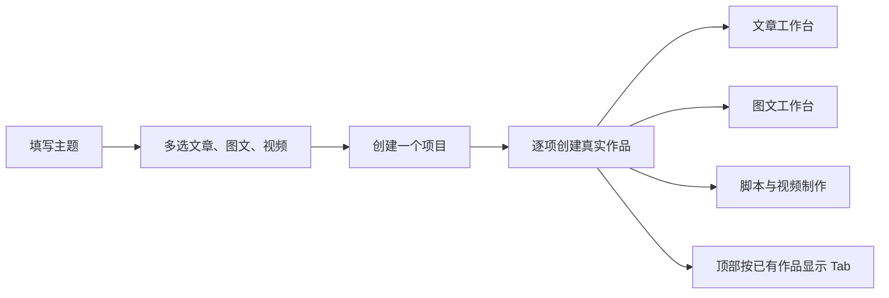

# T-1050 — 简化新建项目并支持多种作品工作台

## 用户确认与范围

2026-10-03 用户实测 `/projects/new`：画幅和创作模式没有新建时选择的必要；创建报错；文章、图文、视频应支持多选，选中的形式显示对应工作台 Tab。本任务承接此明确确认，修正 T-1043/T-1045 的首份内容单选入口约定，保留既有作品 owner、编辑能力和用户已保存内容。T-1049 的开源编辑器集成范围不改。

大白话：先写主题，勾选这次需要的作品形式。同一项目里建立对应的真实稿件，再从顶部切换工作台。视频画幅在具体剪辑工程内设置；AI 与手写在同一工作台随时使用，不让一个模式按钮冒充实际功能。

## 真实现状与失败原因

预览服务使用隔离 PGlite 数据库，浏览器此前选择的账号不在该库中。当前属主守卫拒绝旧账号，`projects.create` 返回 `428 / AccountRequiredError`；表单只显示一般错误，用户无法得知恢复方法。不得跳过账号隔离，不自动伪造绑定身份，不修改真实工作库或迁移安全检查。

现有新建表单只选一种形式，项目头部固定展示所有形式。已有 `projects.create`、`outputs.create`、`outputs.list` 和作品路由可复用，无需新数据库 owner 或新的批量接口。

## 行为与边界

1. 新建弹层和直接创作页面都采用文章、图文、视频复选卡，明确“可多选”。至少选一种，空选时创建按钮不可用。主题必填，描述与平台可选。新建表单删除画幅和创作模式，不提交这两项；旧数据与后端兼容默认值保留。具体编辑工作台仍可改变尺寸。
2. 平台选项列出至少一种已选形式支持的平台；创建时只给兼容的作品传该平台，其他形式不指定平台。说明该设置只作用于支持此平台的已选形式，不伪造平台支持。
3. 一个项目内每种已选形式建立一个真实 output。按卡片固定顺序“文章 → 图文 → 视频”排序创建及回执列表，不按勾选先后改变顺序。全部成功后进入该顺序中首个已选形式的真实工作台；未选进入时提供打开入口。新建不因多选自动启动额外模型任务；直接创作原有首个作品起稿能力保留，追加形式先建空稿，用户在对应工作台操作。
4. 在该入口本次提交期间，项目确认成功后固定该项目，不因改名/重试再建项目。每个作品保存独立的请求键与参数快照；请求已提交但响应丢失时重试同一键同一参数；明确成功的形式不重复创建。部分失败保留项目、成功作品及输入，指出未完成形式，可重试继续。未决请求的参数不被新输入静默覆盖；同一账号确认后可继续。关闭后仍可从项目作品组合读到已建作品；不承诺项目创建自身的未知网络回执幂等，因为现有合同无项目请求键，此时明确提示先核对项目列表。
5. 顶部工作面来自属主校验后的真实 `outputs.list`，不是复选框内存或另存一份配置。文章对应“文章”，图文对应“图文”，视频对应“脚本”和“制作视频”；“作品组合”和“复盘”保留共同入口。旧项目没有 output 时保留原脚本/制作入口，避免合法旧项目不可用；已读到真实非视频作品时不显示额外视频 Tab。读取失败时只保留共同入口和当前实际路由，不能冒充已存在作品。后续添加形式刷新后新增对应 Tab。
6. `AccountRequiredError` 明确提示“请先添加或选择一个创作账号，再继续创建”，提供真实 `/accounts` 入口并保留主题与选择。未选号不得自动归属其他账号；既有账号切换器负责验证当前号并同步 cookie。预览环境可通过公共账号创建服务添加明确标注的本地测试账号，不伪装平台授权。
7. 保留 LED-047 同页弹层本地打开路径、焦点管理、未提交输入及禁重复提交。刷新/换账号不得把已有提交续写到其他账号的项目；创建会话绑定实际账号 ID，发现切换时停止续写并提示回原账号或开启新的创建。

## 实施范围与验收

前端：新建表单、复选卡、弹层与直接创作共同创建协调器、工作面导航、项目 identity provider 的真实 output 读取、结构化账号错误提示。复用既有 backend service/contract，不增加模型语义判断、所有权或迁移。单份作品的添加形式控件保留单选。

实施前独立评审本 SPEC，记录用户授权 DEC。验证复选/空选/删除控件、三形式创建、平台兼容过滤、部分失败/响应丢失请求键复用、改参数/切账号保护、刷新后动态导航与旧项目兼容、428 账号恢复提示；执行 LED-047 相关前端回归、类型检查、boundary/orphan 门。用户亲自验收网页版，不使用浏览器自动化，不伪造视觉或实际模型证据。已有全仓 reconcile/TSC 失败单列范围外根因。
